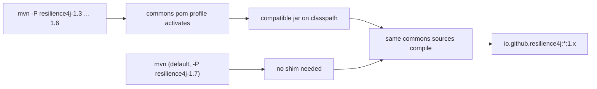

# Developer Guide — 1.x (release-1.x branch, v0.1.x)

> Source branch: `release-1.x` · Version line: `0.1.x` · Target: **Resilience4j 1.3.0 – 1.7.0**
> 中文版本见 [zh/README.md](zh/README.md)

This guide documents the internals of the 1.x maintenance line. The overall architecture is the same as the [current line](../../current/developer-guide/README.md); this page focuses on what is specific to 0.1.x: the **compatible** shim module, the multi-version build strategy, and the 1.x APIs the modules are woven against.

## System Architecture

```mermaid
flowchart TD
    subgraph plugins["Plugins (1.x)"]
        DRUID["…-alibaba-druid"]
        MYBATIS["…-mybatis"]
        WEB["…-spring-web"]
        HIB["…-hibernate-core"]
        FEIGN["…-openfeign"]
    end
    SPRING["microsphere-resilience4j-spring"]
    COMMONS["microsphere-resilience4j-commons"]
    COMPAT["microsphere-resilience4j-compatible"]
    R4J["Resilience4j 1.3 – 1.7"]

    DRUID & MYBATIS & WEB & HIB --> SPRING
    FEIGN --> COMMONS
    SPRING --> COMMONS
    COMMONS --> R4J
    COMPAT -.-"added by profiles\nresilience4j-1.3 … 1.6"--> COMMONS
```

## The Multi-Version Build Problem and the `compatible` Module

Resilience4j 1.3 – 1.7 do not share one event API: several event classes used by the library's Spring event bridge (e.g. `CircuitBreakerOnFailureRateExceededEvent`, `CircuitBreakerOnSlowCallRateExceededEvent`, `RateLimiterEvent`, `RateLimiterOnDrainedEvent` under package `io.github.resilience4j.*.event`) were introduced only in later 1.x releases.

The solution in this branch:

- Profiles `resilience4j-1.3` … `resilience4j-1.6` (defined in `microsphere-resilience4j-commons/pom.xml`) add a dependency on `microsphere-resilience4j-compatible`, which **declares the missing event classes under the original `io.github.resilience4j` package names**.
- Profile `resilience4j-1.7` (`activeByDefault`) does not need the shim, because 1.7.0 already contains those types.



See [microsphere-resilience4j-compatible.md](microsphere-resilience4j-compatible.md) for the class-by-class analysis.

## Design Patterns

Identical to the current line — Template Method (`Resilience4jTemplate` subclasses), Facade (`Resilience4jFacade`, `LazyResilience4jFacade`), Chain of Responsibility (`ChainableResilience4jFacade`, `CallbackChain`), Registry wrapping, Observer event bridge (`*ApplicationEventPublisher`), SPI (`Resilience4jPlugin`), and Decorator/Proxy in every plugin. The [current developer guide](../../current/developer-guide/README.md#design-patterns-used) has the pattern table; module-specific analyses are linked below.

## Developer Guide Pages

| Page | Module |
|------|--------|
| [microsphere-resilience4j-commons.md](microsphere-resilience4j-commons.md) | commons — templates, facade, chain, context (1.x APIs) |
| [microsphere-resilience4j-spring.md](microsphere-resilience4j-spring.md) | spring — annotations, registrars, event bridge, plugin SPI |
| [microsphere-resilience4j-compatible.md](microsphere-resilience4j-compatible.md) | compatible — back-ported event classes |
| [microsphere-resilience4j-alibaba-druid.md](microsphere-resilience4j-alibaba-druid.md) | plugin |
| [microsphere-resilience4j-mybatis.md](microsphere-resilience4j-mybatis.md) | plugin |
| [microsphere-resilience4j-openfeign.md](microsphere-resilience4j-openfeign.md) | plugin |
| [microsphere-resilience4j-spring-web.md](microsphere-resilience4j-spring-web.md) | plugin |
| [microsphere-resilience4j-hibernate-core.md](microsphere-resilience4j-hibernate-core.md) | plugin |
| [microsphere-resilience4j-dependencies.md](microsphere-resilience4j-dependencies.md) | BOM |
| [microsphere-resilience4j-parent.md](microsphere-resilience4j-parent.md) | build parent |

Chinese translations of every page live in `zh/` with identical file names.

## Building

```bash
# default: Resilience4j 1.7.0 (profile 'resilience4j-1.7' is activeByDefault)
./mvnw clean install

# against an older 1.x — the compatible shim is attached automatically
./mvnw clean install -P resilience4j-1.3   # or -1.4 / -1.5 / -1.6
```

`${revision}` is `0.1.5-SNAPSHOT`; released artifacts on this line are `0.1.0` – `0.1.4`. The parent for this line is `microsphere-spring-cloud-parent` **0.1.26**, which pins the Spring Cloud Hoxton – 2021.0.x compatible stack.

## Differences from the 0.2.x Line (for maintainers porting code)

| Aspect | 0.1.x (`release-1.x`) | 0.2.x (`release`) |
|--------|----------------------|-------------------|
| Resilience4j | 1.3.0 – 1.7.0 (default 1.7.0) | 2.0.0 – 2.4.0 (default 2.4.0) |
| `compatible` module | present, profile-attached | absent (not needed) |
| Parent | microsphere-spring-cloud-parent 0.1.26 | microsphere-spring-cloud-parent 0.2.26 |
| Spring stack | Hoxton – 2021.0.x | 2022.0.x – 2025.0.x |
| Event APIs | 1.x `EventPublisher`/event type names, shimmed where missing | 2.x event model |
