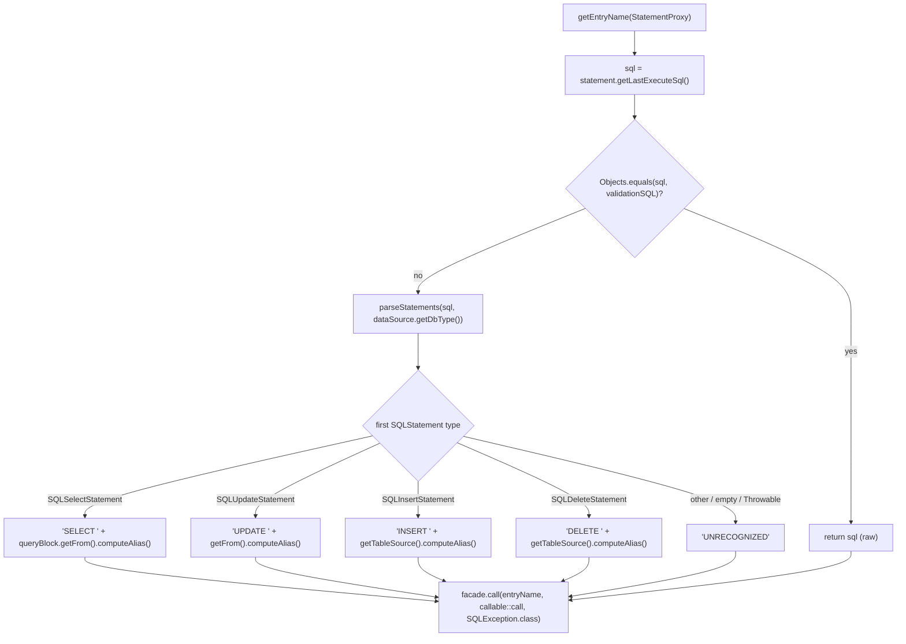
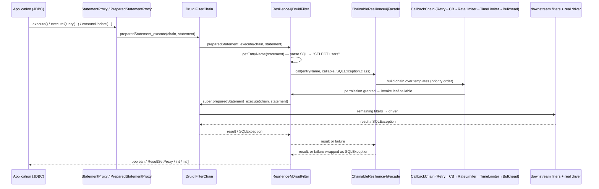
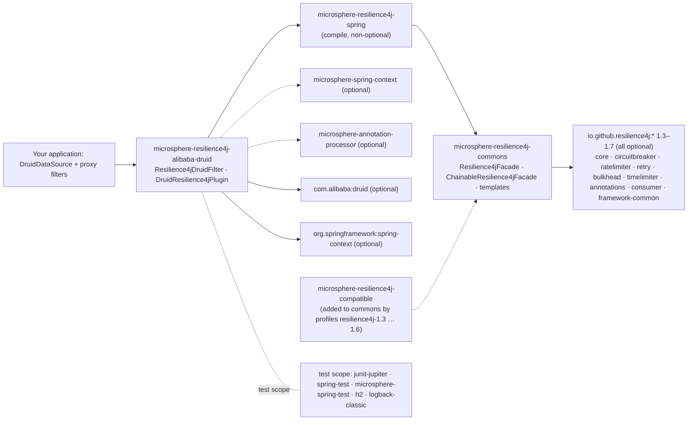

# microsphere-resilience4j-alibaba-druid — Developer Guide (1.x)

> Version line `0.1.x` (`release-1.x` branch) · latest release `0.1.4` · current `${revision}` = `0.1.5-SNAPSHOT` · Resilience4j **1.3.0 – 1.7.0** (default `1.7.0`) · Spring Cloud Hoxton – 2021.0.x · [← developer guide index](README.md)

Module path: `microsphere-resilience4j-plugins/microsphere-resilience4j-alibaba-druid`.

## Class inventory

| Type | File | Role |
|------|------|------|
| `Resilience4jDruidFilter` | `src/main/java/io/microsphere/resilience4j/alibaba/druid/filter/Resilience4jDruidFilter.java` | The only executing hook: a Druid `FilterAdapter` subclass that funnels 13 overridden execution methods into `Resilience4jFacade.call(...)` |
| `DruidResilience4jPlugin` | `src/main/java/io/microsphere/resilience4j/alibaba/druid/DruidResilience4jPlugin.java` | `Resilience4jPlugin` descriptor; `getName()` returns `"alibaba-druid"`, `plugin(...)` body is **empty** |
| resource | `src/main/resources/META-INF/spring.factories` | `io.microsphere.resilience4j.spring.common.Resilience4jPlugin=io.microsphere.resilience4j.alibaba.druid.DruidResilience4jPlugin` |
| `Resilience4jDruidFilterTest` | `src/test/java/…/filter/Resilience4jDruidFilterTest.java` | 4 tests: `testConstants`, `testExecuteStatement`, `testExecutePreparedStatement`, `testGetter` |

There is **no test** for `DruidResilience4jPlugin` on this branch, and no `spring.factories` entry for anything but the plugin SPI (no event publisher/consumer is contributed by this module).

## Weaving mechanism: the Druid filter chain — `FilterAdapter`, not `FilterEventAdapter`

`Resilience4jDruidFilter extends com.alibaba.druid.filter.FilterAdapter`. The task-level expectation of "FilterEventAdapter" does **not** hold on `release-1.x`: the imports are `Filter`, `FilterAdapter`, `FilterChain`, `DruidDataSource`, `DataSourceProxy`, `StatementProxy`, `PreparedStatementProxy`, `ResultSetProxy` and the `com.alibaba.druid.sql.ast.*` types. `FilterEventAdapter` is never referenced.

Mechanically this means:

1. **One override per JDBC execution shape.** Druid's `Filter` SPI exposes a method per execution flavour; the plugin overrides 13 of them and every override is the same one-liner that passes the chain continuation as a `Callable`:

```java
@Override
public boolean preparedStatement_execute(FilterChain chain, PreparedStatementProxy statement) throws SQLException {
    return doInResilience4j(statement, () -> super.preparedStatement_execute(chain, statement));
}
```

   Overridden set (verbatim names from the source): `preparedStatement_execute`, `preparedStatement_executeQuery`, `preparedStatement_executeUpdate`, `statement_executeQuery`, `statement_execute` (×4 arities), `statement_executeBatch`, `statement_executeUpdate` (×4 arities).

   The decorated unit is therefore *the rest of the Druid chain*, not the driver call alone: filters registered after this one (stat, SLF4J, …) are also inside the resilience boundary. Ordering inside the pool is decided by the order of `DruidDataSource.setProxyFilters(...)`, which the test demonstrates with a single-element list.

2. **A single decoration funnel:**

```java
protected final <T> T doInResilience4j(StatementProxy statement, Callable<T> callable) throws SQLException {
    String entryName = getEntryName(statement);
    return this.facade.call(entryName, callable::call, SQLException.class);
}
```

   `call(String, ThrowableSupplier<T>, Class<TR>)` is a **default method** of `io.microsphere.resilience4j.common.Resilience4jOperations` (commons). On a `ChainableResilience4jFacade` it resolves to `call(name, supplier)` → a `CallbackChain` over the priority-sorted `Resilience4jTemplate` list, with any `Throwable` re-thrown as `SQLException` by `io.microsphere.util.ExceptionUtils.wrap`.

3. **Lifecycle coupling to Druid.** `init(DataSourceProxy)` is Druid's `Filter.init`, invoked while the pool builds its proxy-filter list. The implementation caches the `DataSourceProxy` and, when it is a `DruidDataSource`, its `getValidationQuery()`:

```java
@Override
public void init(DataSourceProxy dataSource) {
    this.dataSource = dataSource;
    if (dataSource instanceof DruidDataSource) {
        DruidDataSource druidDataSource = (DruidDataSource) dataSource;
        this.validationSQL = druidDataSource.getValidationQuery();
    }
}
```

4. **Resource naming = SQL AST parsing.** `getEntryName(StatementProxy)` short-circuits on `validationSQL`, otherwise calls `SQLUtils.parseStatements(sql, dataSource.getDbType())` and dispatches on the first AST node (`SQLSelectStatement`, `SQLUpdateStatement`, `SQLInsertStatement`, `SQLDeleteStatement`) reading `SQLTableSource.computeAlias()`. The private `getEntryName(SQLStatement)` catches `Throwable` and logs at `debug`; unrecognised input degrades to `"UNRECOGNIZED"`, so naming can never break the call path.

### Entry-name flow



Note: `entryNamePrefix` (`DEFAULT_ENTRY_NAME_PREFIX = "alibaba-druid@"`) is **not** part of any of these return values — `getEntryName(...)` returns the resource name only. Verified by reading the method bodies; the prefix is reachable only through `getEntryNamePrefix()`.

### Intercepted call path



## Which Resilience4j 1.x APIs this module uses

| Layer | 1.x types touched | Where |
|-------|-------------------|-------|
| This module's **main** sources | **none** | `Resilience4jDruidFilter` and `DruidResilience4jPlugin` import no `io.github.resilience4j.*` class at all; everything goes through `io.microsphere.resilience4j.common.Resilience4jFacade` |
| This module's **test** | `io.github.resilience4j.bulkhead.BulkheadRegistry`, `circuitbreaker.CircuitBreakerRegistry`, `ratelimiter.RateLimiterRegistry`, `retry.RetryRegistry`, `timelimiter.TimeLimiterRegistry` — all via `ofDefaults()` | `Resilience4jDruidFilterTest.createResilience4jFacade()` |
| Transitively (commons) | `io.github.resilience4j.core.Registry`, `core.EventConsumer`, `core.EventProcessor`, `core.registry.*` events, and the 1.x `io.github.resilience4j.common.*.configuration.*ConfigurationProperties` classes from `resilience4j-framework-common` | `Resilience4jTemplate`, `Resilience4jUtils`, `Resilience4jModule` |

**About the `compatible` shim.** On `release-1.x`, the Maven profiles `resilience4j-1.3` … `resilience4j-1.6` add `microsphere-resilience4j-compatible` as a dependency of `microsphere-resilience4j-commons` only (see `microsphere-resilience4j-commons/pom.xml`, `<profiles>`). It back-fills `io.github.resilience4j.circuitbreaker.event.CircuitBreakerOnFailureRateExceededEvent`, `…OnSlowCallRateExceededEvent` and `io.github.resilience4j.ratelimiter.event.RateLimiterEvent`, `RateLimiterOnDrainedEvent`, which are imported by `CircuitBreakerTemplate` and `RateLimiterTemplate` in commons. **This plugin imports none of those event classes**, so its own compilation is profile-independent — the shim reaches it only transitively through the facade implementations it uses at runtime.

## Design patterns (with evidence)

| Pattern | Evidence in this module |
|---------|-------------------------|
| **Decorator** | Each override adds behaviour around `super.<method>(chain, …)` rather than replacing it; the decorated unit travels as a `Callable<T>` lambda. |
| **Adapter** | 13 heterogeneous Druid `Filter` execution callbacks are adapted to one `Resilience4jFacade.call(name, supplier, throwableClass)` contract. The class name says it: `extends FilterAdapter`. |
| **Facade** | The only collaborator is `io.microsphere.resilience4j.common.Resilience4jFacade`. |
| **Chain of Responsibility (downstream)** | The `FilterChain` continuation plus, deeper in commons, `CallbackChain` over the template list. |
| **Template Method** | `Resilience4jTemplate.begin/end/doCall` hooks, reached through the facade call. |
| **Observer** | Not used here: the filter registers no event consumers. Observability is available on the templates (`CircuitBreakerTemplate.onCallNotPermittedEvent(...)` etc.). |
| **SPI (Spring `spring.factories`)** | `DruidResilience4jPlugin implements io.microsphere.resilience4j.spring.common.Resilience4jPlugin` — yes, the `*Resilience4jPlugin` classes implement the **spring module's** SPI (`plugin(ConfigurableListableBeanFactory, BeanDefinitionRegistry, ConfigurableEnvironment)` + `getName()`). `EnableResilience4jRegistrar.registerPlugins(...)` loads factories with `loadFactories(beanFactory, Resilience4jPlugin.class)` and invokes `plugin(...)` only when `ArrayUtils.contains(plugins, plugin.getName())`. For this module that call is a **no-op** by construction. |

## Dependency map (from `pom.xml`)



| Fact | Detail |
|------|--------|
| Mandatory dependency | only `microsphere-resilience4j-spring` |
| Druid version management | `microsphere-resilience4j-parent/pom.xml` imports `microsphere-alibaba-druid-dependencies` **0.1.20** (`<microsphere-alibaba-druid.version>`); the plugin POM itself declares `com.alibaba:druid` with no version |
| Test DB | H2 in-memory: `jdbc:h2:mem:test_mem`, driver `org.h2.Driver`, user `sa` |
| Framework-neutral? | The filter itself needs only Druid + commons interfaces; `DruidResilience4jPlugin` is the only Spring-facing class |

## Extension points and caveats for contributors

- `doInResilience4j(StatementProxy, Callable<T>)` is `protected final`; `getEntryName(StatementProxy)` is `public final`. Sub-classes can override the individual `statement_*`/`preparedStatement_*` methods but cannot widen the naming algorithm — add a new `Filter` if you need table-plus-SQL granularity.
- `getFacade()` and `getEntryNamePrefix()` are `public final` — intentionally non-overridable.
- The unused `entryNamePrefix` is a latent inconsistency with the MyBatis/Hibernate plugins. Changing it to prefix entry names would break every user's Resilience4j instance names — flag as a breaking change.
- Missing coverage worth adding in a PR: `CallableStatement` support (explicitly excluded by the class Javadoc), the `validationSQL` short-circuit branch, and `UNRECOGNIZED` naming. The current tests execute those SQL statements but assert only JDBC results, never entry names.
- `createResilience4jFacade()` in the test builds **two** `ChainableResilience4jFacade` instances (assigns one to the field, returns the other); the field is then overwritten by `setUp`. It works but is a copy-paste smell — do not copy this pattern into new tests.

## Related pages

- [User guide — this module](../user-guide/microsphere-resilience4j-alibaba-druid.md)
- [Developer guide — commons](microsphere-resilience4j-commons.md)
- [Developer guide — spring](microsphere-resilience4j-spring.md)
- [Developer guide — mybatis](microsphere-resilience4j-mybatis.md) (the decorator-style counterpart)
