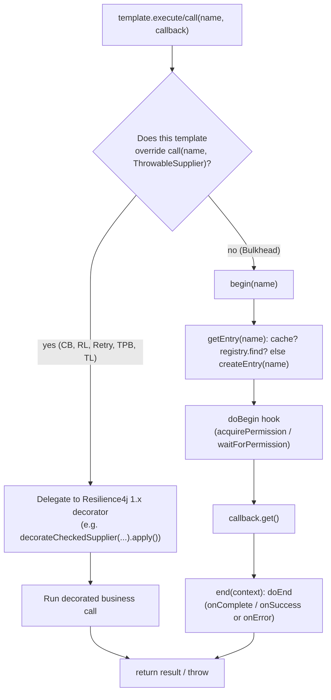
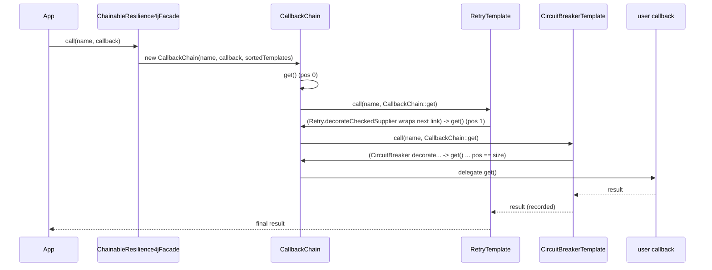
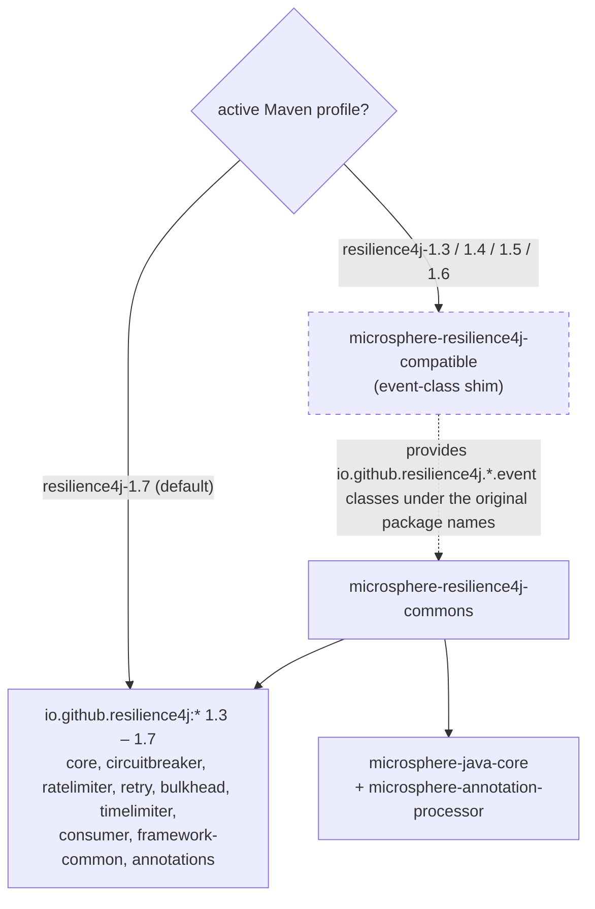

# microsphere-resilience4j-commons — Developer Guide (1.x)

> Version line: `0.1.x` (source branch `release-1.x`) · latest release `0.1.4` · branch revision `0.1.5-SNAPSHOT`
> Resilience4j `1.3.0` – `1.7.0` (Maven profiles, default `1.7.0`) · baseline JDK 8
> This module has **no Spring dependency**; it depends on Resilience4j 1.x and `microsphere-java-core` only (all declared `<optional>`).
> ← [guide index](README.md) · [User Guide page](../user-guide/microsphere-resilience4j-commons.md)

All paths below are relative to `microsphere-resilience4j-commons/`. Line references are to the `release-1.x`
sources under the read-only snapshot `.doc-tmp/release-1x/`.

---

## 1. Responsibility

The bottom layer of the project. It turns the six independent Resilience4j 1.x modules into one uniform, extensible
programming model:

- one contract (`Resilience4jOperations` → `AdvancedResilience4jOperations`) for *execute a callback under one module's decoration*;
- one abstract template (`Resilience4jTemplate`) that owns a `Registry`, resolves named entries, caches them,
  exposes the two-phase `begin`/`end` lifecycle and adapts Resilience4j events;
- six concrete templates, one per module;
- one composable façade (`ChainableResilience4jFacade` + package-private `CallbackChain`) that wraps N modules
  around a single callback in priority order;
- one per-execution context object (`Resilience4jContext`) with a `ThreadLocal` binding;
- one metadata + reflection layer (`Resilience4jModule`, `Resilience4jConstants`,
  `META-INF/default/templates.properties`, `Resilience4jUtils`).

Everything above it (`microsphere-resilience4j-spring`, the plugins) consumes only these types. Nothing here
imports `org.springframework`.

---

## 2. Package layout and class inventory

```
src/main/java/io/microsphere/resilience4j/
├── common/
│   ├── Resilience4jOperations.java              interface (public)
│   ├── AdvancedResilience4jOperations.java      interface (public)
│   ├── Resilience4jTemplate.java                abstract class (public)
│   ├── Resilience4jContext.java                 class (public ctor is protected)
│   ├── Resilience4jFacade.java                  interface (public)
│   ├── ChainableResilience4jFacade.java         class (public)
│   ├── CallbackChain.java                       class (package-private)
│   ├── Resilience4jModule.java                  enum (public)
│   └── Resilience4jConstants.java               interface (public)
├── circuitbreaker/CircuitBreakerTemplate.java
├── ratelimiter/RateLimiterTemplate.java
├── retry/RetryTemplate.java
├── bulkhead/BulkheadTemplate.java
├── bulkhead/ThreadPoolBulkheadTemplate.java
├── timelimiter/TimeLimiterTemplate.java
└── util/Resilience4jUtils.java                  abstract class (public)
src/main/resources/META-INF/default/templates.properties
```

### 2.1 `io.microsphere.resilience4j.common`

| Type | Kind | Visibility | Role |
|------|------|------------|------|
| `Resilience4jOperations<E>` | interface | public | Minimal contract: one-time `execute`/`call` overloads + two-phase `begin`/`end` + `isBeginSupported`/`isEndSupported`. |
| `AdvancedResilience4jOperations<E, C, R>` | interface | public | Extends `Resilience4jOperations<E>` + `Prioritized`; registry/config/entry management, raw-entry `Consumer`/`Function` ops, `getLogger()`. |
| `Resilience4jTemplate<E, C, R>` | abstract class | public | Registry-owning base: entry resolution + local cache, `final begin/end` with `doBegin/doEnd` hooks, event registration, priority. |
| `Resilience4jContext<E>` | class | ctor `protected` | Mutable per-execution state + `ThreadLocal` binding (`withinContext`, static `getContext/setContext/removeContext/doInContext`). |
| `Resilience4jFacade` | interface | public | Marker: `Resilience4jOperations<Resilience4jContext[]>`. |
| `ChainableResilience4jFacade` | class | public | Facade over an ordered, de-duplicated `List<Resilience4jTemplate>`. |
| `CallbackChain<T>` | class | **package-private** | `ThrowableSupplier` that nests each template's `call` around the rest of the chain. |
| `Resilience4jModule` | enum | public | Metadata for the six modules + `valueOf(Class)` lookup. |
| `Resilience4jConstants` | interface | public | `String` config-namespace prefixes. |

### 2.2 Template packages

| Type | Entry / Config / Registry | Decoration in `call` | Two-phase | Entry-event methods |
|------|---------------------------|----------------------|-----------|---------------------|
| `circuitbreaker.CircuitBreakerTemplate` | `CircuitBreaker` / `CircuitBreakerConfig` / `CircuitBreakerRegistry` | `decorateCheckedSupplier(cb).apply()` | `doBegin`=`acquirePermission`+`nanoTime`; `doEnd`=`onSuccess`/`onError` | 8 |
| `ratelimiter.RateLimiterTemplate` | `RateLimiter` / `RateLimiterConfig` / `RateLimiterRegistry` | `RateLimiter.decorateCheckedSupplier(rl, cb).apply()` | both phases `waitForPermission` | 3 |
| `retry.RetryTemplate` | `Retry` / `RetryConfig` / `RetryRegistry` | `Retry.decorateCheckedSupplier(r, cb).apply()` | disabled | 4 |
| `bulkhead.BulkheadTemplate` | `Bulkhead` / `BulkheadConfig` / `BulkheadRegistry` | *not overridden* → base `call` runs `begin`+`end` | `doBegin`=`acquirePermission`; `doEnd`=`onComplete` | 3 |
| `bulkhead.ThreadPoolBulkheadTemplate` | `ThreadPoolBulkhead` / `ThreadPoolBulkheadConfig` / `ThreadPoolBulkheadRegistry` | `executeCallable(...).toCompletableFuture().get()` | disabled | 3 |
| `timelimiter.TimeLimiterTemplate` | `TimeLimiter` / `TimeLimiterConfig` / `TimeLimiterRegistry` | `decorateFutureSupplier(...).call()` on an `ExecutorService` | disabled | 3 |

### 2.3 `io.microsphere.resilience4j.util`

`Resilience4jUtils` (abstract, implements `Utils`) is the reflection bridge. It holds a lazily-built
`Map<Resilience4jModule, Method>` of the registry `entryName(String, Config)` methods and the
`Map<Resilience4jModule, Class<? extends Resilience4jTemplate>>` default-template table loaded from
`META-INF/default/templates.properties`. Key statics: `getEntry`, `getEventProcessor` (six per-type overloads + a
`Registry` overload), `createTemplate`, `createTemplates`.

---

## 3. `Resilience4jTemplate` execution flow

### 3.1 Construction

```java
public Resilience4jTemplate(R registry, boolean localEntriesCached) {
    assertNotNull(registry, "The registry must not be null");
    this.registry                = registry;
    this.module                  = valueOf(registry.getClass());   // Resilience4jModule.valueOf
    this.registryEventProcessor  = getEventProcessor(registry);    // Resilience4jUtils
    this.localEntriesCache       = localEntriesCached ? createLocalEntriesCache() : null; // default new HashMap
    this.priority                = this.module.getDefaultAspectOrder();
}
```

The module is inferred from the runtime class of the `Registry`, which is what lets one constructor signature
serve every template. The default aspect order becomes the template's `priority`, and priority is what
`ChainableResilience4jFacade` sorts on.

### 3.2 Entry resolution

`getEntry(String)` is `final`: it first consults the local `HashMap` cache (`getEntryFromCache`) and otherwise
delegates to the `AdvancedResilience4jOperations` default, which does `registry.find(name)` else `createEntry(name)`.
`createEntry` is the subclass hook that calls the module-specific registry factory, e.g.
`registry.circuitBreaker(name, getConfiguration(name))`. The cache is only made thread-safe when the caller
pre-populates it via `initLocalEntriesCache(...)`.

### 3.3 One-time path (`execute` / `call`)

- `execute(name, Supplier)` and `execute(name, Runnable)` are `default` on `Resilience4jOperations` and ultimately
  funnel into `call(name, ThrowableSupplier)` (throwing `Throwable`), re-wrapped into a `RuntimeException`.
- **`call(name, ThrowableSupplier)` is the seam.** The interface `default` is:

  ```java
  default <T> T call(String name, ThrowableSupplier<T> callback) throws Throwable {
      Resilience4jContext context = begin(name);
      try {
          return callback.get();
      } finally {
          end(context);
      }
  }
  ```

  Five of the six templates **override** `call` to instead delegate to a Resilience4j decorator factory
  (`CircuitBreaker`, `RateLimiter`, `Retry`, `ThreadPoolBulkhead`, `TimeLimiter`). `BulkheadTemplate` does **not**
  override it, so for Bulkhead the one-time path runs `begin` (→ `acquirePermission`) + `end` (→ `onComplete`)
  around the callback. This is the single most important behavioural fact to know when reading the code: whether
  `execute`/`call` uses the decorator or the two-phase lifecycle depends on the template.

### 3.4 Two-phase path (`begin` / `end`)

`begin` and `end` are `final` on `Resilience4jTemplate`; they are non-overridable wrappers around the protected
hooks `doBegin`/`doEnd`:

```java
public final Resilience4jContext<E> begin(String name) {
    E entry = getEntry(name);
    Resilience4jContext<E> context = new Resilience4jContext(name, entry);
    doBegin(context);
    return context;
}

public final void end(Resilience4jContext<E> context) {
    doEnd(context);
}
```

The base `doBegin`/`doEnd` throw `UnsupportedOperationException`, so a template that does not implement them is a
template whose `isBeginSupported()`/`isEndSupported()` must be `false` (and they are: `RetryTemplate`,
`TimeLimiterTemplate`, `ThreadPoolBulkheadTemplate` override those two flags to `false`). `Resilience4jUtilsTest`
and `AbstractResilience4jTemplateTest` assert exactly that: `isEndSupported() == isBeginSupported()`, and the three
disabled modules reject `begin`/`end`.

`CircuitBreakerTemplate.doEnd` reads `context.getFailure()` and `context.getStartTime()` to decide between
`onSuccess(duration, NANOSECONDS)` and `onError(duration, NANOSECONDS, failure)` — this is why `Resilience4jContext`
carries a start time and failure slot.

### 3.5 Event registration

Three layers of registration exist:

- `onEntryAddedEvent` / `onEntryRemovedEvent` / `onEntryReplacedEvent` (final) target the **registry**'s
  `EventProcessor` via `registerRegistryEventConsumer`.
- `registerEntryEventConsumer(entryName, eventType, consumer)` (protected final) resolves the **entry**, obtains
  its `EventProcessor` through `Resilience4jUtils.getEventProcessor(entry)` and registers there. Every concrete
  template's `on…Event(...)` methods are thin, fluent wrappers around this call, each pinned to a specific event
  class (`CircuitBreakerOnSuccessEvent`, `RateLimiterOnDrainedEvent`, …).

Under the hood `registerEventConsumer` keys the consumer by `eventType.getName()` on the `EventProcessor` — a
1.x `EventProcessor.registerConsumer(String, EventConsumer)` call.

### 3.6 Single-template execution — flowchart



### 3.7 Single-template two-phase — sequence diagram

```mermaid
sequenceDiagram
    participant App
    participant T as CircuitBreakerTemplate
    participant Op as Resilience4jOperations(default call)
    participant CB as CircuitBreaker (entry)
    App->>T: call(name, ThrowableSupplier)  (overridden)
    T->>CB: decorateCheckedSupplier(cb).apply()
    CB-->>App: result or CallNotPermitted/recorded error
    Note over App,T: Or drive the two phases manually:
    App->>T: begin(name)
    T->>T: getEntry(name) -> doBegin
    T->>CB: acquirePermission(); record nanoTime()
    T-->>App: Resilience4jContext
    App->>T: end(context)
    T->>CB: onSuccess(duration, NANOSECONDS) or onError(duration, NANOSECONDS, failure)
```

---

## 4. `ChainableResilience4jFacade` + `CallbackChain`

### 4.1 Composition

`ChainableResilience4jFacade` turns registries into templates:

```java
public ChainableResilience4jFacade(Collection<Registry> registries) {
    this(createTemplates(registries));   // Resilience4jUtils: one template per registry, de-duplicated, sorted
}

public ChainableResilience4jFacade(List<Resilience4jTemplate> templates) {
    // de-duplicate by equality, then sort by Prioritized.COMPARATOR (i.e. getPriority())
    effectiveTemplates.sort(COMPARATOR);
    this.templates = effectiveTemplates;
    this.size = effectiveTemplates.size();
}
```

Because priority defaults to the module's aspect order, the sorted chain runs outer-to-inner in the canonical
Resilience4j order `Retry(0) → CircuitBreaker(1) → RateLimiter(2) → TimeLimiter(3) → Bulkhead(4)`. The `Test2`
facade test feeds nine registries with duplicates and asserts `getSize() == 5` — the de-duplication collapses
repeated registries of the same module.

### 4.2 `call` via `CallbackChain`

The façade's `call` does not itself decorate; it builds a `CallbackChain` and invokes `get()`:

```java
public <T> T call(String name, ThrowableSupplier<T> callback) throws Throwable {
    CallbackChain<T> supplier = new CallbackChain<>(name, callback, this.templates);
    return supplier.get();
}
```

`CallbackChain.get()` is the recursive nesting: at position `pos` it takes `templates.get(pos)` and calls
`template.call(entryName, CallbackChain.this::get)` — i.e. the "callback" for template *i* is "run the rest of the
chain". Each template wraps one layer of decoration around the remaining chain; when `pos == size` the real user
callback (`delegate.get()`) finally runs. That is a textbook **chain of responsibility** built on the 1.x decorator
`call` methods.

### 4.3 `begin` / `end` across the chain

```java
public Resilience4jContext<Resilience4jContext[]> begin(String name) {
    Resilience4jContext[] subContexts = new Resilience4jContext[size];
    Resilience4jContext<Resilience4jContext[]> context = new Resilience4jContext<>(name, subContexts);
    for (int i = 0; i < size; i++) {
        Resilience4jTemplate template = templates.get(i);
        if (template.isBeginSupported()) {
            subContexts[i] = template.begin(name);
        }
    }
    return context;
}
```

`end` mirrors it and skips templates where `isEndSupported()` is `false`, so a chain containing Retry/TimeLimiter/
ThreadPoolBulkhead leaves those `subContexts[i]` slots `null` and never calls their (unsupported) hooks.

### 4.4 Chainable-façade execution — sequence diagram



---

## 5. Design patterns (with evidence)

| Pattern | Where | Evidence |
|---------|-------|----------|
| **Template Method** | `Resilience4jTemplate` | `final begin/end` fix the algorithm skeleton and delegate to the overridable `doBegin/doEnd` hooks; `final getEntry` fixes the lookup and delegates to abstract `createEntry`; subclasses override `call` / `isBeginSupported` selectively. `BulkheadTemplate` deliberately leaves `call` un-overridden so it inherits the base `begin`-`end` template method. |
| **Facade** | `Resilience4jFacade` / `ChainableResilience4jFacade` | One `call`/`begin`/`end` surface hides N templates. `Resilience4jFacade extends Resilience4jOperations<Resilience4jContext[]>` reuses the same contract with an array of sub-contexts as the "entry". |
| **Chain of Responsibility** | `CallbackChain` | Each `Resilience4jTemplate` handles one module and passes the remainder of the list to the next link (`template.call(entryName, CallbackChain.this::get)`); the terminal link runs the real callback. |
| **Registry / Adapter** | `AdvancedResilience4jOperations` + `Resilience4jUtils` | The library adapts Resilience4j's `Registry<E, C>` (find/create/remove/replace, `getEventPublisher`) behind uniform `getEntry`/`createEntry`/`removeEntry`/`getEventProcessor` methods, bridging the six 1.x registries onto one interface. |
| **Strategy (light)** | per-template `call` overrides | The decoration strategy differs per module (checked supplier vs future supplier vs `executeCallable`), selected by subclass. |
| **Singleton / Flyweight (state)** | `Resilience4jContext` `ThreadLocal` | A `static ThreadLocal<Resilience4jContext>` carries the current context; `withinContext` / static `getContext`/`setContext`/`removeContext`/`doInContext`. |

---

## 6. Module dependency (including the profile-conditional compatible shim)



The `compatible` jar is declared as a dependency of `commons` **only** inside the `resilience4j-1.3`, `resilience4j-1.4`,
`resilience4j-1.5` and `resilience4j-1.6` profiles of `microsphere-resilience4j-commons/pom.xml`. The default
`resilience4j-1.7` build omits it because 1.7.0 already ships the event types the commons code references. All of
`commons`'s own compile dependencies are `<optional>`, so downstream applications choose the exact Resilience4j
artifacts and version. See [compatible developer guide](microsphere-resilience4j-compatible.md).

---

## 7. Build notes

`commons` inherits its `<parent>` from `microsphere-resilience4j-parent` (version `${revision}`), which in turn
inherits `microsphere-spring-cloud-parent` `0.1.26`. `microsphere-resilience4j-commons/pom.xml` defines **four**
profiles, all of which do the same thing — attach the `compatible` module:

| Profile in commons `pom.xml` | Effect |
|------------------------------|--------|
| `resilience4j-1.3` | add dependency `io.github.microsphere-projects:microsphere-resilience4j-compatible:${revision}` |
| `resilience4j-1.4` | same |
| `resilience4j-1.5` | same |
| `resilience4j-1.6` | same |

There is **no** `resilience4j-1.7` profile in `commons/pom.xml`; the `1.3.0 … 1.7.0` version numbers themselves
come from the parent's profiles (`resilience4j-1.7` there is `activeByDefault`). So `commons` never activates the
shim by default and pulls it in exactly when the build targets a pre-1.7 Resilience4j.

Declared dependencies of `commons` (all `<optional>true</optional>`, versions managed by the parent):
`microsphere-annotation-processor`, `microsphere-java-core`, and the Resilience4j artifacts `resilience4j-annotations`,
`resilience4j-consumer`, `resilience4j-framework-common`, `resilience4j-core`, `resilience4j-circuitbreaker`,
`resilience4j-ratelimiter`, `resilience4j-retry`, `resilience4j-bulkhead`, `resilience4j-timelimiter`. Test-scoped:
`junit-jupiter`, `microsphere-java-test`, `logback-classic`.

```bash
# default build -> Resilience4j 1.7.0, no shim
./mvnw -pl microsphere-resilience4j-commons -am clean test

# pre-1.7 build -> compatible shim attached automatically
./mvnw -pl microsphere-resilience4j-commons -am clean test -P resilience4j-1.4
```

### 7.1 Test inventory (source of the User Guide examples)

| Test | Covers |
|------|--------|
| `AbstractResilience4jTemplateTest` | Shared contract test (execute/call/begin/end, local cache, registry events, priority); resolved via reflection over `<E, C, R, RT>` type args. |
| `CircuitBreakerTemplateTest` | Success/error/failure-rate/slow-call/state-transition/reset event flows. |
| `RateLimiterTemplateTest` | Success/failure/drained events under concurrency. |
| `RetryTemplateTest` | Retry/success/ignored-error events, `getNumberOfRetryAttempts()`. |
| `BulkheadTemplateTest` | Permitted/finished/rejected events. |
| `ThreadPoolBulkheadTemplateTest` | Permitted/finished/rejected events and `getRootCause` unwrapping. |
| `TimeLimiterTemplateTest` | Success/error/timeout events with a custom `ExecutorService`. |
| `CallbackChainTest` | Chain over `{Bulkhead, Retry}` registries returns the delegate result. |
| `ChainableResilience4jFacadeTest2` | Dedup/sort of nine registries down to `size == 5`; `begin`/`end`, `execute`, `call` (this branch names the façade test `...Test2`). |
| `Resilience4jContextTest` | Properties, attributes, `withinContext`/`getContext`/`doInContext`. |
| `Resilience4jModuleTest` | Metadata + `valueOf(Class)` for all six modules. |
| `Resilience4jUtilsTest` | `createTemplate(s)`, `getEntry`, `getEventProcessor`, template map loading. |
| `Resilience4jConstantsTest` | Prefix/module-name constants. |

---

Chinese translations of every page live in `zh/` with identical file names.
