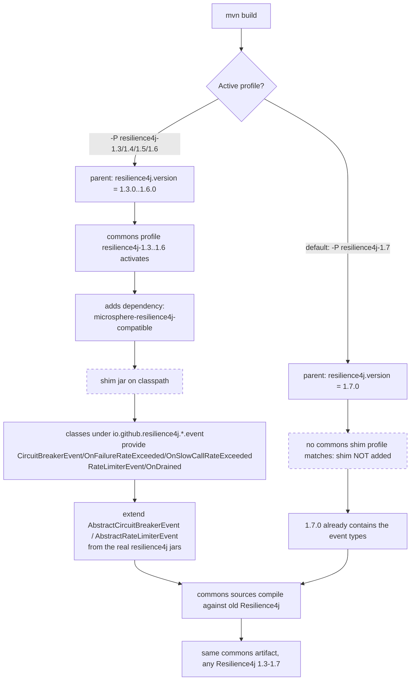

# microsphere-resilience4j-compatible — Developer Guide (1.x)

> Version line: `0.1.x` (source branch `release-1.x`) · latest release `0.1.4` · branch revision `0.1.5-SNAPSHOT`
> A build-time event-class **shim** for Resilience4j `1.3.0 – 1.6.0`; not attached when building against `1.7.0`.
> ← [guide index](README.md) · [User Guide page](../user-guide/microsphere-resilience4j-compatible.md)

Paths are relative to `microsphere-resilience4j-compatible/`. All facts are read from the `release-1.x` sources in
the read-only snapshot `.doc-tmp/release-1x/`.

---

## 1. Responsibility

Provide the handful of Resilience4j **event** types that `microsphere-resilience4j-commons` compiles against but
that may be absent from older Resilience4j 1.x releases, without editing commons. The module contains **only**
forked classes (no library logic) plus a `package-info.java`:

```
src/main/java/io/github/resilience4j/
├── package-info.java
├── circuitbreaker/event/
│   ├── CircuitBreakerEvent.java                        interface
│   ├── CircuitBreakerOnFailureRateExceededEvent.java   class
│   └── CircuitBreakerOnSlowCallRateExceededEvent.java  class
└── ratelimiter/event/
    ├── RateLimiterEvent.java                           interface
    └── RateLimiterOnDrainedEvent.java                  class
```

---

## 2. Rationale — and what can actually be proven from the source

The authoritative statement of intent is the module's `package-info.java`:

```java
/**
 * The classes in this package or sub-packages are forked from the Resilience4j 1.7.x(latest),
 * which will be used to be compatible with the lower versions of Resilience4j.
 */
```

So the shim's classes are **forks of the Resilience4j 1.7.x event types**, kept so the commons sources still
compile when the build is pinned to a lower 1.x release. What we can infer from the forked bodies, staying within
the evidence:

- `CircuitBreakerEvent.Type` in this fork enumerates `ERROR, IGNORED_ERROR, SUCCESS, NOT_PERMITTED,
  STATE_TRANSITION, RESET, FORCED_OPEN, DISABLED, FAILURE_RATE_EXCEEDED, SLOW_CALL_RATE_EXCEEDED` and marks
  `STATE_TRANSITION`/`RESET` with `forcePublish = true`. The `FAILURE_RATE_EXCEEDED` and `SLOW_CALL_RATE_EXCEEDED`
  constants (and their `On…ExceededEvent` classes) are the newer additions commons relies on via
  `onFailureRateExceededEvent(...)` and `onSlowCallRateExceededEvent(...)`.
- `RateLimiterEvent.Type` enumerates `FAILED_ACQUIRE, SUCCESSFUL_ACQUIRE, DRAINED`. The `DRAINED` constant and the
  `RateLimiterOnDrainedEvent` back the `RateLimiterTemplate.onDrainedEvent(...)` API.
- The concrete `On…ExceededEvent` / `OnDrainedEvent` classes are `public` classes extending the Resilience4j
  package-private bases `AbstractCircuitBreakerEvent` / `AbstractRateLimiterEvent` (not re-forked here), matching
  the 1.7.x event-class shape.

We deliberately **do not** claim an exact minor-version number for each individual type ("introduced in 1.6.0",
etc.) — the repository does not state per-class introduction versions. The only version the code asserts is that
these types exist in **1.7.x**, and the build wiring treats the shim as needed for **1.3–1.6** and not needed for
**1.7** (section 5). That profile boundary is the concrete, verifiable expression of "which releases need help".

Why commons references these types at all: `CircuitBreakerTemplate` imports and uses
`CircuitBreakerOnFailureRateExceededEvent` / `CircuitBreakerOnSlowCallRateExceededEvent`; `RateLimiterTemplate`
imports and uses `RateLimiterOnDrainedEvent`; and `Resilience4jModule` names `CircuitBreakerEvent` / `RateLimiterEvent`
as the modules' event classes. If those symbols are missing from the target Resilience4j jar, commons would not
compile — the shim closes that gap.

---

## 3. The package-name collision ("shadow-compat") technique

The classes are declared **under Resilience4j's own package names** — `io.github.resilience4j.circuitbreaker.event`
and `io.github.resilience4j.ratelimiter.event` — instead of a private `io.microsphere.…` namespace. This is the core
of the design:

- **Type identity.** Because the fully-qualified names match upstream, the shimmed types *are* the types commons
  imports. No aliases, no adapter layer, no `import` gymnastics in commons — a single source tree compiles whether
  the symbols come from Resilience4j 1.7.x or from this jar.
- **Access to same-package bases.** The fork `CircuitBreakerOnFailureRateExceededEvent extends AbstractCircuitBreakerEvent`
  and `RateLimiterOnDrainedEvent extends AbstractRateLimiterEvent`, and the fork sources reference those `Abstract…Event`
  bases **by simple name with no `import`** — proof they resolve inside the same package (`…circuitbreaker.event` /
  `…ratelimiter.event`). Those bases live in the real `resilience4j-circuitbreaker` / `resilience4j-ratelimiter` jars and
  are not re-forked here. Java restricts non-`public` members per *runtime package* = (class loader, package name), so
  placing the fork in the identical package lets it extend the upstream base even though it ships in a different jar.
  That is precisely why the fork must reuse the original package and cannot live under `io.microsphere.*`.
- **Forked interfaces shadow upstream.** The forked `CircuitBreakerEvent` / `RateLimiterEvent` interfaces duplicate
  the upstream interface names, so whichever appears first on the classpath wins. Under the pre-1.7 profiles the shim
  supplies the richer `Type` enum; under 1.7 the shim is absent and the upstream jar (which already has those values)
  is used. There is no need for the forked interface to coexist with a *different* upstream interface of the same name —
  the profile boundary guarantees exactly one provider.

This technique makes the module a **build-time compatibility layer**, not a runtime library. It is intentionally not
deployed (`maven-deploy-plugin` `<skip>true</skip>`), so published applications never resolve it from a remote
repository; it exists only inside the reactor that compiles commons.

---

## 4. Class inventory (developer view)

| Class | Extends / implements | Members the shim adds | Consumed by commons via |
|-------|----------------------|-----------------------|--------------------------|
| `CircuitBreakerEvent` (interface) | — | `getCircuitBreakerName()`, `getEventType()`, `getCreationTime()`, `enum Type {…, FAILURE_RATE_EXCEEDED, SLOW_CALL_RATE_EXCEEDED, FORCED_OPEN, DISABLED}` with `forcePublish` | `Resilience4jModule.CIRCUIT_BREAKER` event class; test imports of `CircuitBreakerEvent.Type.*` |
| `CircuitBreakerOnFailureRateExceededEvent` | `AbstractCircuitBreakerEvent` | `float getFailureRate()`, ctor `(String, float)`, `getEventType() → FAILURE_RATE_EXCEEDED`, `toString()` | `CircuitBreakerTemplate.onFailureRateExceededEvent(String, EventConsumer<…>)` |
| `CircuitBreakerOnSlowCallRateExceededEvent` | `AbstractCircuitBreakerEvent` | `float getSlowCallRate()`, ctor `(String, float)`, `getEventType() → SLOW_CALL_RATE_EXCEEDED`, `toString()` | `CircuitBreakerTemplate.onSlowCallRateExceededEvent(...)` |
| `RateLimiterEvent` (interface) | — | `getRateLimiterName()`, `getEventType()`, `getNumberOfPermits()`, `getCreationTime()`, `enum Type { FAILED_ACQUIRE, SUCCESSFUL_ACQUIRE, DRAINED }` | `Resilience4jModule.RATE_LIMITER` event class |
| `RateLimiterOnDrainedEvent` | `AbstractRateLimiterEvent` | ctor `(String)`, `getEventType() → DRAINED`, `getNumberOfPermits() → 1` | `RateLimiterTemplate.onDrainedEvent(...)` |

The two `Abstract…Event` bases are **not** forked; they come from the real `resilience4j-circuitbreaker` /
`resilience4j-ratelimiter` jars declared as optional dependencies (section 5).

---

## 5. POM dependency list (verified, full)

`microsphere-resilience4j-compatible/pom.xml` declares the parent `microsphere-resilience4j-parent:${revision}`, packaging
`jar`, and the following compile dependencies — **all marked `<optional>true</optional>`** — which are the artifacts
the forked sources need in order to compile:

1. `io.github.resilience4j:resilience4j-annotations`
2. `io.github.resilience4j:resilience4j-consumer`
3. `io.github.resilience4j:resilience4j-framework-common` — pinned with an explicit `<version>${resilience4j.version}</version>`
4. `io.github.resilience4j:resilience4j-core`
5. `io.github.resilience4j:resilience4j-circuitbreaker` (supplies `AbstractCircuitBreakerEvent`)
6. `io.github.resilience4j:resilience4j-ratelimiter` (supplies `AbstractRateLimiterEvent`)
7. `io.github.resilience4j:resilience4j-retry`
8. `io.github.resilience4j:resilience4j-bulkhead`
9. `io.github.resilience4j:resilience4j-timelimiter`

The complete list is **nine** artifacts. Beyond the annotations/consumer/framework-common/core/circuitbreaker/
ratelimiter/retry group, it also includes `resilience4j-bulkhead` and `resilience4j-timelimiter`. Their versions come
from the parent's dependency management / `${resilience4j.version}` (framework-common also restates it explicitly),
matching whichever profile is active.

Build configuration of note:

```xml
<build>
    <plugins>
        <plugin>
            <groupId>org.apache.maven.plugins</groupId>
            <artifactId>maven-deploy-plugin</artifactId>
            <configuration>
                <skip>true</skip>   <!-- never published -->
            </configuration>
        </plugin>
    </plugins>
</build>
```

This module defines **no** profiles of its own; the version selection and the "attach shim or not" logic both live in
the parent (`resilience4j-1.3 … 1.7`) and in commons (`resilience4j-1.3 … 1.6`).

---

## 6. Profile → shim → compile flow



---

## 7. Difference from the 0.2.x line

There is no `compatible` module on the `0.2.x` line. Resilience4j 2.x has a single, stable event model across the
supported 2.0–2.4 range, so no back-port shim is required and commons never references missing event types. The
entire existence of this module — the package-name fork, the optional-dependency list, the deploy skip — is specific
to the multi-version Resilience4j 1.3–1.7 strategy of `release-1.x`.

---

Chinese translations of every page live in `zh/` with identical file names.
