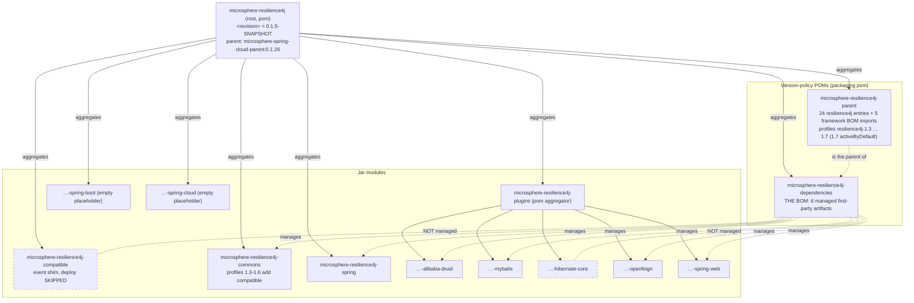
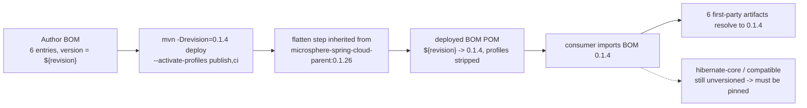

# microsphere-resilience4j-dependencies — Developer Guide (1.x / v0.1.x)

> Version line `0.1.x` (`release-1.x` branch) · `${revision}` = `0.1.5-SNAPSHOT` · latest release `0.1.4` · manages **6** artifacts · [← developer guide index](README.md)

This page documents the BOM `microsphere-resilience4j-dependencies` as an *authoring artifact*: where it sits in the reactor, what its `<dependencyManagement>` really contains, which modules fall out of it, and how `${revision}` becomes a concrete version at publish time.

## Coordinates and position

```
microsphere-resilience4j                 (reactor root, ${revision} = 0.1.5-SNAPSHOT)
  ├── microsphere-resilience4j-parent    (${revision}, pom)      <-- the BOM's <parent>
  └── microsphere-resilience4j-dependencies (${revision}, pom)   <-- the BOM
```

From `microsphere-resilience4j-dependencies/pom.xml`:

| Field | Value |
|-------|-------|
| `<parent>` | `io.github.microsphere-projects:microsphere-resilience4j-parent:${revision}`, `relativePath ../microsphere-resilience4j-parent/pom.xml` |
| `artifactId` / `version` / `packaging` | `microsphere-resilience4j-dependencies` / `${revision}` / `pom` |
| `<name>` / `<description>` | `Microsphere :: Resilience4j :: Dependencies` / `Microsphere Resilience4j Dependencies` |
| Sections present | `<parent>`, coordinates, `name`/`description`, `<dependencyManagement>` — **nothing else** (no `<build>`, no `<profiles>`, no `<dependencies>`) |

Because the parent is also the version-policy POM of the line, the BOM *inherits* the five framework-BOM imports, the 24 explicit `io.github.resilience4j:*` entries and the `resilience4j-1.3` … `resilience4j-1.7` profiles — but its **own** `<dependencyManagement>` block adds only the six first-party artifacts below. See the [parent developer page](microsphere-resilience4j-parent.md) for what the inherited part does and does not guarantee to a consumer.

## Managed artifacts (complete, verified list)

All six entries are `io.github.microsphere-projects` with `<version>${revision}</version>`; the order is exactly the order in the file:

| # | artifactId | version | Module it publishes |
|---|-----------|---------|---------------------|
| 1 | `microsphere-resilience4j-commons` | `${revision}` | `microsphere-resilience4j-commons` (jar) |
| 2 | `microsphere-resilience4j-alibaba-druid` | `${revision}` | `microsphere-resilience4j-plugins/microsphere-resilience4j-alibaba-druid` (jar) |
| 3 | `microsphere-resilience4j-openfeign` | `${revision}` | `…/microsphere-resilience4j-openfeign` (jar) |
| 4 | `microsphere-resilience4j-mybatis` | `${revision}` | `…/microsphere-resilience4j-mybatis` (jar) |
| 5 | `microsphere-resilience4j-spring-web` | `${revision}` | `…/microsphere-resilience4j-spring-web` (jar) |
| 6 | `microsphere-resilience4j-spring` | `${revision}` | `microsphere-resilience4j-spring` (jar) |

> The list is **identical to the `0.2.x` BOM** (verified by comparing `microsphere-resilience4j-dependencies/pom.xml` on both branches). Any impression that the 1.x BOM manages a smaller set than the current line is not supported by the two files: same six coordinates, same `${revision}` binding.

## Artifacts deliberately absent from the BOM

| Artifact | Reactor member? | Why it is missing / what happens |
|----------|-----------------|-----------------------------------|
| `microsphere-resilience4j-hibernate-core` | yes, under `plugins` | ships code and is deployed, yet unmanaged → every consumer must state its version. The Hibernate *stack* is managed indirectly (`microsphere-hibernate-dependencies:0.1.9` imported by the parent), only the plugin coordinate is missing |
| `microsphere-resilience4j-compatible` | yes, top-level `<module>` | build-time shim for profiles `resilience4j-1.3`–`1.6`; its own POM also sets `maven-deploy-plugin <skip>true</skip>`, so it is not published at all |
| `microsphere-resilience4j-spring-boot`, `microsphere-resilience4j-spring-cloud` | yes | placeholders: `packaging` is `jar` but the directories contain only a `pom.xml` |
| `microsphere-resilience4j-plugins` | yes | `pom` aggregator, also `maven-deploy-plugin <skip>true</skip>` |
| `microsphere-resilience4j`, `microsphere-resilience4j-parent` | yes | reactor root / build parent — consumed via `<parent>`, never imported as a BOM |

Maintenance rule: **a new first-party module is invisible to consumers until someone adds its `${revision}` entry here.** The Hibernate plugin is the standing example — it is built, deployed and usable, but never version-managed.

## Reactor and BOM structure



Three distinct relations are easy to confuse in this reactor:

| Relation | Who | Where declared |
|----------|-----|----------------|
| **aggregation** (`<modules>`) | root → all 8 children (parent, dependencies, compatible, commons, plugins, spring, spring-boot, spring-cloud); plugins → its 5 leaves | root `pom.xml`, `microsphere-resilience4j-plugins/pom.xml` |
| **inheritance** (`<parent>`) | every module, including the BOM, declares `microsphere-resilience4j-parent` as its parent; the parent itself declares the root as its parent | each module POM |
| **management** (`<dependencyManagement>`) | the BOM manages 6 artifacts; the parent manages the framework stack | `microsphere-resilience4j-dependencies/pom.xml`, parent POM |

## How `${revision}` becomes a real version

The line uses the Maven “CI-friendly versions” pattern: every module and every BOM entry is written as `${revision}`, and the value is defined exactly once — `<revision>0.1.5-SNAPSHOT</revision>` in the reactor root POM. `-Drevision=…` at build/deploy time overrides it for the whole reactor.

Publishing, from `.github/workflows/maven-publish.yml`:

```bash
./mvnw --batch-mode --update-snapshots --file pom.xml \
    -Drevision=${{ inputs.revision }} -Dgpg.skip=true deploy \
    --activate-profiles publish,ci
```

with `inputs.revision` validated against `^[0-9]+\.[0-9]+\.[0-9]+$`. So the six entries are stamped with the same concrete release version as the BOM itself: a consumer importing `microsphere-resilience4j-dependencies:0.1.4` receives six artifacts pinned to `0.1.4`.

For that to work the deployed POM must not contain a literal `${revision}` — a consumer cannot resolve a property that belongs to the producer's model. That job is done by the flattening step configured in the `microsphere-spring-cloud-parent:0.1.26` grandparent line, which the `publish`/`ci` profiles of the deploy run engage. Two honest caveats for anyone reading only this worktree:

- no `.flattened-pom.xml` is checked in here, so the flattened output shape cannot be quoted from this snapshot; the [current-line developer page](../../current/developer-guide/microsphere-resilience4j-dependencies.md#how-revision-is-resolved-ci-friendly-version--flatten) documents it from a captured run of the `0.2.x` build, and the same grandparent machinery is what this line relies on;
- whether profiles survive into the released BOM is therefore something to *check*, not to assume. Download a deployed BOM POM (or run the flatten locally with `-Drevision=… process-resources`) and confirm which `${resilience4j.version}` text, if any, remains in it before you change anything in this file.



### Why the branch reads `0.1.5-SNAPSHOT` after `0.1.4`

The publish workflow's last steps bump the root `<revision>` to `<major>.<minor>.<patch+1>-SNAPSHOT` with a `sed` rewrite of the `<revision>` element, commit it, tag and release, then merge `release-1.x` into `dev-1.x`. Released versions on this line: `0.1.0`–`0.1.4`.

## Consumer override mechanics (dev reminder)

A consumer can override a managed coordinate either by putting their own `<dependencyManagement>` entry **before** the import or by setting an explicit `<version>` on the dependency. `microsphere-resilience4j-hibernate-core` and `microsphere-resilience4j-compatible` are never overridable “for free”, because they are not managed here at all. Snippets live on the [user guide page](../user-guide/microsphere-resilience4j-dependencies.md).

## Verifying the managed list yourself

The tables above were read from the source file. To re-derive the list or to check a newer release:

```bash
# from the repository root of the release-1.x branch
sed -n '/<dependencyManagement>/,/<\/dependencyManagement>/p' \
    microsphere-resilience4j-dependencies/pom.xml | grep '<artifactId>'
```

Expected: exactly the six `microsphere-resilience4j-*` artifactIds and nothing else — the count is the regression check to run whenever a module is added to the reactor.

## Version facts verified from source

| Fact | Value | Where read |
|------|-------|-----------|
| BOM packaging | `pom` | `microsphere-resilience4j-dependencies/pom.xml` |
| Managed first-party artifacts | 6, all `${revision}` | same file |
| Inherited parent of the BOM | `microsphere-resilience4j-parent:${revision}` | same file |
| Reactor `${revision}` | `0.1.5-SNAPSHOT` | root `pom.xml` |
| Reactor modules | 8, including `microsphere-resilience4j-compatible` | root `pom.xml` `<modules>` |
| Latest release | `0.1.4` | git tag `0.1.4`, `release-notes.md` |
| Publish JDK / command | JDK 11, `deploy --activate-profiles publish,ci` | `.github/workflows/maven-publish.yml` |
| Deploy-skipped modules | `microsphere-resilience4j-compatible`, `microsphere-resilience4j-plugins` | their POMs (`maven-deploy-plugin <skip>true</skip>`) |

## Related pages

- [User guide — microsphere-resilience4j-dependencies (1.x)](../user-guide/microsphere-resilience4j-dependencies.md)
- [Developer guide — microsphere-resilience4j-parent (1.x)](microsphere-resilience4j-parent.md)
- [Developer guide — 1.x index](README.md)
- [Current (0.2.x) BOM developer page](../../current/developer-guide/microsphere-resilience4j-dependencies.md)
