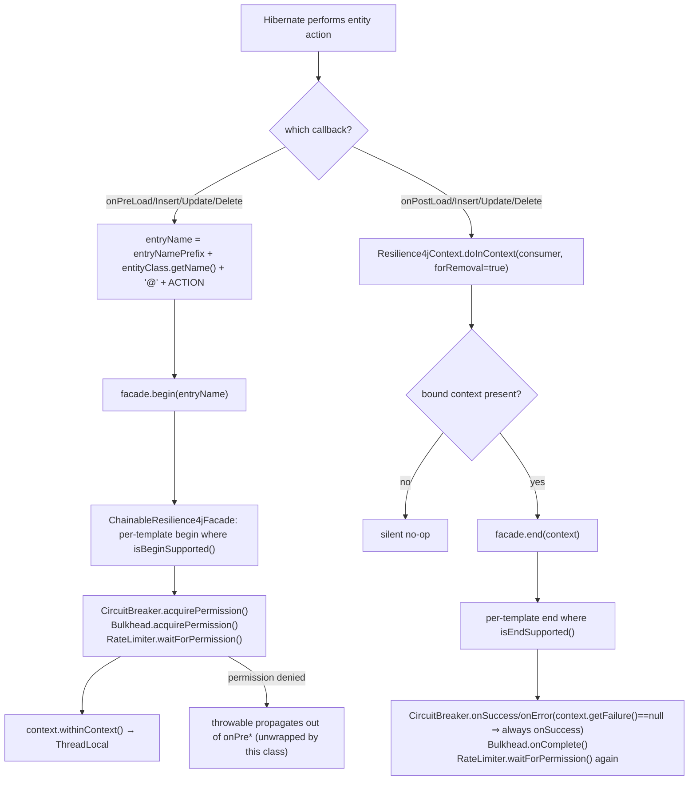
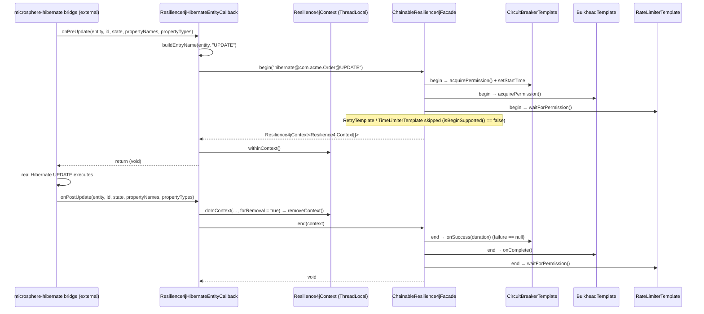
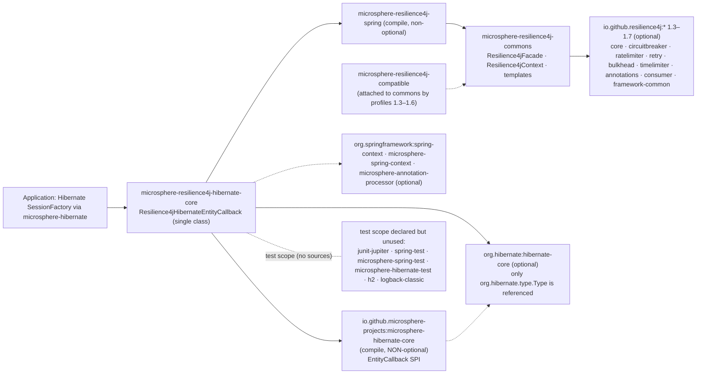

# microsphere-resilience4j-hibernate-core — Developer Guide (1.x)

> Version line `0.1.x` (`release-1.x` branch) · latest release `0.1.4` · current `${revision}` = `0.1.5-SNAPSHOT` · Resilience4j **1.3.0 – 1.7.0** (default `1.7.0`) · Spring Cloud Hoxton – 2021.0.x · [← developer guide index](README.md)

Module path: `microsphere-resilience4j-plugins/microsphere-resilience4j-hibernate-core`.

## Class inventory

| Type | File | Role |
|------|------|------|
| `Resilience4jHibernateEntityCallback` | `src/main/java/io/microsphere/resilience4j/hibernate/Resilience4jHibernateEntityCallback.java` | The **only** file in the module besides `pom.xml`. Implements Microsphere-Hibernate's `EntityCallback`, mapping 8 lifecycle hooks onto the facade's two-phase `begin`/`end` operations |
| build descriptor | `pom.xml` | `io.github.microsphere-projects:microsphere-resilience4j-hibernate-core`, `${revision}`, parent `microsphere-resilience4j-parent` |

Deliberate absences, all verified by listing the module tree on `release-1.x`:

| What is missing | Consequence |
|-----------------|-------------|
| **`src/test` does not exist** | The class has zero automated coverage on this branch. (0.2.x ships `Resilience4jHibernateEntityCallbackTest extends AbstractHibernateH2Test`; that file is not part of `release-1.x`.) Any behavioural claim about it is source-derived, not execution-verified. |
| `META-INF/spring.factories` | Not registered as a `Resilience4jPlugin`; `@Enable*(plugins = …)` cannot discover it. |
| A `*Resilience4jPlugin` class | Unlike Druid and MyBatis, this plugin contributes nothing to the spring module's `Resilience4jPlugin` SPI, so there is no `getName()` value (no `"hibernate"` plugin name exists on this branch). |
| Constructors and getters | JavaBean-only configuration (`setFacade`, `setEntryNamePrefix`); nothing is readable back out of the instance. |

## Weaving mechanism: entity lifecycle callbacks (no proxy, no decorator)

`Resilience4jHibernateEntityCallback implements io.microsphere.hibernate.entity.EntityCallback`. The SPI belongs to **`microsphere-hibernate-core`** (a mandatory dependency), not to Hibernate itself. The only `org.hibernate.*` type imported by this module is `org.hibernate.type.Type`, used purely as a callback parameter type. How Microsphere-Hibernate bridges these callbacks into Hibernate (interceptor, event listener, integrator) is defined in that external artifact and is **not verifiable from this snapshot**.

Each action is split into a matching pre/post pair:

```java
@Override
public void onPreLoad(Object entity, Object id, Object[] state, String[] propertyNames, Type[] types) {
    String entryName = buildEntryName(entity, "LOAD");
    Resilience4jContext<Resilience4jContext[]> begin = this.facade.begin(entryName);
    begin.withinContext();
}

@Override
public void onPostLoad(Object entity, Object id, String[] propertyNames, Type[] types) {
    doInContext(contextt -> this.facade.end(contextt), true);
}
```

Static imports used by the class: `io.microsphere.resilience4j.common.Resilience4jContext.doInContext` and `io.microsphere.util.Assert.assertNotNull`.

Mechanics, per the source:

1. **`begin` opens, `end` closes, `ThreadLocal` is the relay.** `facade.begin(name)` returns `Resilience4jContext<Resilience4jContext[]>`; `withinContext()` calls `Resilience4jContext.setContext(this)` (a `private static final ThreadLocal<Resilience4jContext>`). The `onPost*` side calls `doInContext(consumer, true)` → `removeContext()` then `facade.end(context)`. The post-callbacks receive **no context argument**, so the ThreadLocal is the only transport between the two phases — which is also the module's main fragility (see *Design risks*).
2. **No wrapping of Hibernate objects.** There is no `Executor`/`Filter`-style delegate here; the class is a pure observer around an externally driven action. Consequently nothing about `Session`, `SessionFactory` or entity state is intercepted or altered — the plugin cannot see the outcome of the operation.
3. **Naming is class-based.** `buildEntryName(Object entity, String action)` returns `entryNamePrefix + entity.getClass().getName() + '@' + action`; four actions only (`LOAD`, `DELETE`, `INSERT`, `UPDATE`), with the literals hard-coded at each call site. It is `protected`, so it is the sanctioned extension point.
4. **Failures are not observable from this SPI shape.** No `onPost*` method receives a `Throwable`, and the class never calls `Resilience4jContext.setFailure(...)`. `CircuitBreakerTemplate.doEnd` branches on `context.getFailure() == null`, so it always records `onSuccess`. Compare the spring-web plugin, which does call `context.setResult(returnValue).setFailure(error)` — the Hibernate plugin simply has no place to do the same. This is a design gap, not an oversight in this document.

### Callback lifecycle flowchart



### Intercepted call path (sequence)



## Resilience4j 1.x APIs used

| Layer | Types | Notes |
|-------|-------|-------|
| This module's main source | **none** | No `io.github.resilience4j.*` import exists in `Resilience4jHibernateEntityCallback`; collaborators are `Resilience4jFacade` and `Resilience4jContext` (commons) plus `EntityCallback`/`org.hibernate.type.Type` |
| Microsphere commons API surface used | `Resilience4jFacade.begin(String)`, `Resilience4jFacade.end(Resilience4jContext)`, `Resilience4jContext.withinContext()`, `Resilience4jContext.doInContext(Consumer, boolean)` | the two-phase half of `Resilience4jOperations`; the one-time `call(...)` used by the Druid/MyBatis plugins is not used here |
| Test sources | **do not exist** | hence the test-scope Resilience4j registries (`BulkheadRegistry.ofDefaults()` etc.) that the sibling plugins use are absent |

**Shim note (1.x specific).** On `release-1.x`, `microsphere-resilience4j-compatible` is attached to **commons** by the Maven profiles `resilience4j-1.3` … `resilience4j-1.6` (`microsphere-resilience4j-commons/pom.xml`). It supplies `io.github.resilience4j.circuitbreaker.event.CircuitBreakerOnFailureRateExceededEvent`, `CircuitBreakerOnSlowCallRateExceededEvent`, `io.github.resilience4j.ratelimiter.event.RateLimiterEvent` and `RateLimiterOnDrainedEvent`, which `CircuitBreakerTemplate`/`RateLimiterTemplate` import. This Hibernate module references none of those classes — its own compilation is version-profile independent; the 1.x/2.x divergence is confined to the commons layer it calls into.

**The one 1.x-only build difference among the three plugins** is the framework coordinate itself: this POM declares `org.hibernate:hibernate-core` (Hibernate 5 namespace), whereas the same file on `release` (0.2.x) declares `org.hibernate.orm:hibernate-core` (Hibernate 6). The Java sources of all three plugins (`alibaba-druid`, `mybatis`, `hibernate-core`) are otherwise byte-identical between the two lines — the branch divergence lives in commons/spring and in the version properties, not in the plugin code.

## Design patterns (with evidence)

| Pattern | Present? | Evidence |
|---------|----------|----------|
| **Observer / lifecycle callback** | Yes — the core of this module | 8 `EntityCallback` `on*` implementations; the class registers no state of its own beyond the injected facade and prefix |
| **Facade** | Yes | depends only on `io.microsphere.resilience4j.common.Resilience4jFacade` |
| **Template Method** | Yes, downstream | `ChainableResilience4jFacade.begin/end` dispatch to `Resilience4jTemplate.begin/end` whose `doBegin`/`doEnd` are the per-module hooks; `isBeginSupported()`/`isEndSupported()` are the feature switches |
| **Thread-local scoped context** | Yes | `Resilience4jContext.withinContext()` / `doInContext(…, true)` around an externally driven action — effectively a manual "open/close scope" |
| **Decorator** | **No** | unlike `Resilience4jExecutor` (MyBatis) and `Resilience4jDruidFilter` (chain continuation), nothing is wrapped; the callback cannot substitute the operation |
| **Proxy** | **No** | no `Plugin.wrap`, no `InvocationHandler` |
| **SPI (`Resilience4jPlugin`)** | **No** | the class implements Microsphere-Hibernate's `EntityCallback`, **not** `io.microsphere.resilience4j.spring.common.Resilience4jPlugin`; and the module ships no `*Resilience4jPlugin` class or `spring.factories` entry at all. Contrast: `DruidResilience4jPlugin` and `MyBatisResilience4jPlugin` both implement the spring module's SPI (`plugin(ConfigurableListableBeanFactory, BeanDefinitionRegistry, ConfigurableEnvironment)` + `getName()`) and are listed under the `Resilience4jPlugin` key in their module's `META-INF/spring.factories`. |
| **JavaBean configuration** | Yes | field injection via `setFacade`/`setEntryNamePrefix` with `assertNotNull` guards; the only plugin of the three without constructor injection |

## Dependency map (from `pom.xml`)



| Fact | Detail |
|------|--------|
| Mandatory dependencies | **two**: `microsphere-resilience4j-spring` and `microsphere-hibernate-core` — the only plugin of the three documented here with more than one required dependency |
| Hibernate coordinate | `org.hibernate:hibernate-core`, no `<version>` in this POM; resolved through the imported `microsphere-hibernate-dependencies` BOM, property `microsphere-hibernate.version = 0.1.9` in `microsphere-resilience4j-parent/pom.xml` |
| BOM coverage gap | `microsphere-resilience4j-dependencies` does **not** manage this artifact, so downstream builds must pin the version manually |
| Test deps | present but dead — no test sources exist, so `microsphere-hibernate-test` and `h2` contribute nothing on this branch |

## Design risks and the test suite a contributor should add

Because the module is untested, these source-level risks are currently unguarded:

1. **Unbalanced pre/post → leaked ThreadLocal.** `onPost*` clears the context only if the pair fires on the same thread. A missing post-callback leaves the context bound *and* leaves a bulkhead permit acquired. Suggested test: drive `onPreInsert` without `onPostInsert`, assert `Resilience4jContext.getContext()` is still non-null, then document the operational impact.
2. **Nested/cascading callbacks overwrite the bound context.** One ThreadLocal slot cannot hold an outer and an inner operation. Suggested test: `onPreLoad(A) → onPreLoad(B) → onPostLoad(B) → onPostLoad(A)` and assert which contexts reach `facade.end`.
3. **Circuit breaker never records failures** (`context.getFailure()` is always `null` at `end`). Suggested test: make the entry point open and assert `onError` is *not* invoked, then decide whether `EntityCallback` should gain a failure-carrying hook.
4. **`facade` unset → NPE at the first pre-callback.** The class cannot fail fast at construction because it has no constructor. Suggested test: call `onPreLoad` on an un-configured instance and pin the current behaviour.
5. **`RateLimiterTemplate.doEnd` blocks again** (`waitForPermission` in the close phase), so a rate limiter on entity traffic doubles its cost. Worth a test before exposing this path in a starter.
6. **Proxies break naming**: `entity.getClass().getName()` for a Hibernate proxy/byte-buddy subclass is not the mapped entity name.

## Related pages

- [User guide — this module](../user-guide/microsphere-resilience4j-hibernate-core.md)
- [Developer guide — commons](microsphere-resilience4j-commons.md) (`Resilience4jOperations` two-phase contract, `Resilience4jContext`)
- [Developer guide — mybatis](microsphere-resilience4j-mybatis.md) (the decorator counterpart)
- [Developer guide — spring](microsphere-resilience4j-spring.md) (`Resilience4jPlugin` SPI this module does **not** implement)
