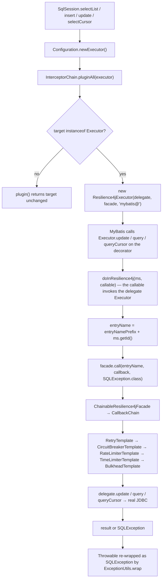
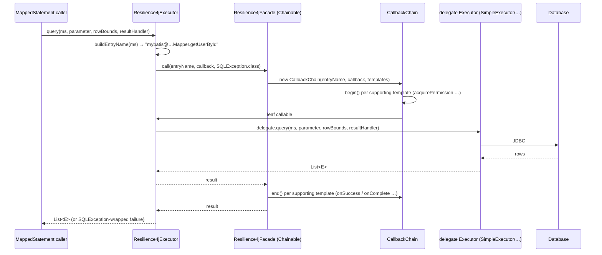
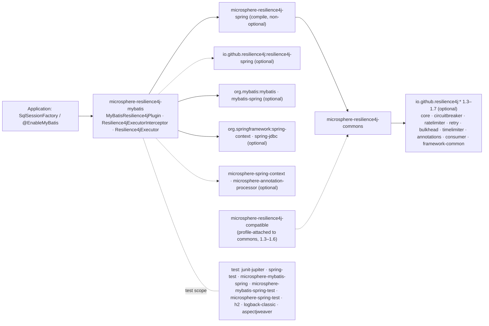

# microsphere-resilience4j-mybatis — Developer Guide (1.x)

> Version line `0.1.x` (`release-1.x` branch) · latest release `0.1.4` · current `${revision}` = `0.1.5-SNAPSHOT` · Resilience4j **1.3.0 – 1.7.0** (default `1.7.0`) · Spring Cloud Hoxton – 2021.0.x · [← developer guide index](README.md)

Module path: `microsphere-resilience4j-plugins/microsphere-resilience4j-mybatis`.

## Class inventory

| Type | File | Role |
|------|------|------|
| `MyBatisResilience4jPlugin` | `src/main/java/io/microsphere/resilience4j/mybatis/MyBatisResilience4jPlugin.java` | `Resilience4jPlugin` SPI implementation; registers the interceptor bean definition |
| `Resilience4jExecutorInterceptor` | `src/main/java/io/microsphere/resilience4j/mybatis/plugin/Resilience4jExecutorInterceptor.java` | MyBatis `Interceptor` whose `plugin()` returns the decorator |
| `Resilience4jExecutor` | `src/main/java/io/microsphere/resilience4j/mybatis/executor/Resilience4jExecutor.java` | `Executor` decorator holding the resilience boundary |
| resource | `src/main/resources/META-INF/spring.factories` | `io.microsphere.resilience4j.spring.common.Resilience4jPlugin=io.microsphere.resilience4j.mybatis.MyBatisResilience4jPlugin` |
| `MyBatisResilience4jPluginTest` | `src/test/java/io/microsphere/resilience4j/mybatis/` | Spring-context path: `@EnableBulkhead(plugins = "mybatis")` + `@EnableCircuitBreaker` + `@EnableMyBatis` |
| `Resilience4jExecutorInterceptorTest` | `src/test/java/io/microsphere/resilience4j/mybatis/plugin/` | Programmatic path: `configuration.addInterceptor(...)`, 5 test methods |

`Resilience4jExecutor` has **no dedicated test class**; it is covered indirectly through the interceptor test (`testMapper`, `testSqlSession`, `testInvoke`).

## Weaving mechanism: `Interceptor.plugin()` as a decorator factory

### The `@Intercepts` question, answered from the source

The brief for this page asks to "quote the actual annotated methods". Verified result: **there are none.** A repository-wide grep on `release-1.x` for `@Intercepts` / `@Signature` matches nothing in this module (the only `Signature` hit in the whole snapshot is `io.microsphere.reflect.MethodUtils.getSignature` inside the *openfeign* plugin). The complete annotation inventory of `Resilience4jExecutorInterceptor` is:

```java
public class Resilience4jExecutorInterceptor implements Interceptor {
    @Override public Object intercept(Invocation invocation) throws Throwable { … }
    @Override public Object plugin(Object target) { … }
}
```

Its imports are `org.apache.ibatis.executor.Executor`, `org.apache.ibatis.plugin.Interceptor`, `org.apache.ibatis.plugin.Invocation` — `org.apache.ibatis.plugin.Plugin` (the wrapper that *reads* `@Intercepts`) and `org.apache.ibatis.plugin.Signature` are not imported.

Why it still works: MyBatis' `InterceptorChain.pluginAll(Object target)` calls `interceptor.plugin(target)` for each registered interceptor. The conventional implementation is `return Plugin.wrap(target, this)`, which requires `@Intercepts` and builds a JDK proxy that later calls `intercept(Invocation)`. This implementation instead returns a **hand-written decorator**:

```java
@Override
public Object plugin(Object target) {
    if (target instanceof Executor) {
        return new Resilience4jExecutor((Executor) target, facade, entryNamePrefix);
    }
    return target;
}
```

Consequences, all readable from the code:

1. `intercept(Invocation)` is dead code in the MyBatis runtime path. Its body is `return invocation.proceed();` preceded by the comment `// Current method will be not executed`. The only caller is the unit test, which constructs an `Invocation` manually.
2. No dynamic proxy is created, so there is no `InvocationHandler` and no reflective dispatch — the interception cost is a plain method call plus the facade decoration.
3. Only `Executor` targets are wrapped. `StatementHandler`, `ParameterHandler` and `ResultSetHandler` targets pass through unchanged, so the plugin must be the *only* thing in the chain for those types if you combine it with other interceptors.
4. Because `@Intercepts` is absent, the interceptor cannot be declared through `mybatis-config.xml`'s `<plugins>` element (that path needs a default constructor and feeds `Properties`); it must be added via `Configuration.addInterceptor(...)` or as a Spring bean that your factory collects. `Resilience4jExecutorInterceptor` exposes only `(Resilience4jFacade)` and `(Resilience4jFacade, String)` constructors — no setters, no no-arg constructor.

### What `Resilience4jExecutor` decorates

Four methods open a boundary, all through one funnel:

```java
protected <T> T doInResilience4j(MappedStatement ms, ThrowableSupplier<T> callback) throws SQLException {
    String entryName = buildEntryName(ms);
    return this.facade.call(entryName, callback, SQLException.class);
}

private String buildEntryName(MappedStatement ms) {
    return this.entryNamePrefix + ms.getId();
}
```

Decorated: `update(MappedStatement, Object)`, `query(MappedStatement, Object, RowBounds, ResultHandler, CacheKey, BoundSql)`, `query(MappedStatement, Object, RowBounds, ResultHandler)`, `queryCursor(MappedStatement, Object, RowBounds)`.

Pass-through (no resilience): `flushStatements`, `commit`, `rollback`, `createCacheKey`, `isCached`, `clearLocalCache`, `deferLoad`, `getTransaction`, `close`, `isClosed`.

One delegation is **not** a straight pass-through:

```java
@Override
public void setExecutorWrapper(Executor executor) {
    delegate.setExecutorWrapper(new Resilience4jExecutor(executor, facade, entryNamePrefix));
}
```

The incoming executor is decorated again before being forwarded. If a caller passes an already-decorated executor, decoration nests — a real re-entry risk worth a regression test; the branch has none.

### Entry-name asymmetry across plugins (verified)

| Plugin | Prefix constant | Is the prefix part of the entry name? |
|--------|-----------------|----------------------------------------|
| alibaba-druid | `"alibaba-druid@"` | **No** — `getEntryName(...)` returns `SELECT <table>` etc. |
| mybatis | `"mybatis@"` | **Yes** — `entryNamePrefix + ms.getId()` |
| hibernate-core | `"hibernate@"` | **Yes** — `entryNamePrefix + entityClass.getName() + '@' + action` |

## Intercepted call path





## Resilience4j 1.x APIs used

| Layer | Types | Where |
|-------|-------|-------|
| This module's **main** sources | **none** — no `io.github.resilience4j.*` import exists in `MyBatisResilience4jPlugin`, `Resilience4jExecutorInterceptor` or `Resilience4jExecutor` | verified by reading all three files |
| This module's **tests** | `io.github.resilience4j.bulkhead.BulkheadRegistry`, `circuitbreaker.CircuitBreakerRegistry`, `ratelimiter.RateLimiterRegistry`, `retry.RetryRegistry`, `timelimiter.TimeLimiterRegistry` (each `ofDefaults()`) | `Resilience4jExecutorInterceptorTest.createResilience4jFacade()` |
| MyBatis API surface | `org.apache.ibatis.executor.Executor`, `plugin.Interceptor`, `plugin.Invocation`, `mapping.MappedStatement`, `mapping.BoundSql`, `cache.CacheKey`, `cursor.Cursor`, `executor.BatchResult`, `reflection.MetaObject`, `session.ResultHandler`, `session.RowBounds`, `transaction.Transaction` | `Resilience4jExecutor`, `Resilience4jExecutorInterceptor` |
| Spring API surface (plugin class only) | `ConfigurableListableBeanFactory`, `BeanDefinitionRegistry`, `ConfigurableEnvironment`, `AbstractBeanDefinition`, `BeanDefinitionBuilder.genericBeanDefinition`, `BeanDefinitionReaderUtils.generateBeanName`, plus `io.microsphere.spring.beans.factory.support.BeanRegistrar.registerBeanDefinition` | `MyBatisResilience4jPlugin.registerResilience4jExecutorInterceptor(...)` |

**Shim note (1.x specific).** The `microsphere-resilience4j-compatible` event classes (`CircuitBreakerOnFailureRateExceededEvent`, `CircuitBreakerOnSlowCallRateExceededEvent`, `RateLimiterEvent`, `RateLimiterOnDrainedEvent`) are attached as a dependency of **commons** by the `resilience4j-1.3` … `resilience4j-1.6` Maven profiles. This MyBatis module does not import any of them; its compile classpath is profile-independent. The 1.x-vs-2.x divergence lives in commons/spring (`io.github.resilience4j.core.Registry`, `core.EventProcessor`, `Registry.EventPublisher`, `io.github.resilience4j.common.*.configuration.*ConfigurationProperties`), which this plugin reaches only through `Resilience4jFacade`.

## Design patterns (with evidence)

| Pattern | Evidence |
|---------|----------|
| **Decorator (concrete, not proxy-based)** | `Resilience4jExecutor implements Executor` and holds `private final Executor delegate`, forwarding every method and adding behaviour to four of them. This is the classic GoF decorator; MyBatis' proxy-based `Plugin.wrap` is explicitly avoided. |
| **Interceptor (framework hook)** | `Resilience4jExecutorInterceptor implements Interceptor`, but only `plugin()` carries behaviour — an unusual "interceptor that never intercepts". |
| **Facade** | Both the interceptor and the executor depend solely on `io.microsphere.resilience4j.common.Resilience4jFacade`. |
| **Chain of Responsibility** | MyBatis' `InterceptorChain` (multiple `plugin()` calls) and commons' `CallbackChain` (nested template calls). |
| **Template Method** | `Resilience4jTemplate.begin/end` with per-module `doBegin`/`doEnd`; `isBeginSupported()`/`isEndSupported()` overrides in `RetryTemplate`/`TimeLimiterTemplate` return `false`. |
| **Factory Method / Bean Definition** | `MyBatisResilience4jPlugin` builds an `AbstractBeanDefinition` with `addConstructorArgReference("lazyResilience4jFacade")` and a generated bean name. |
| **SPI** | `MyBatisResilience4jPlugin implements io.microsphere.resilience4j.spring.common.Resilience4jPlugin` (the spring module's SPI — confirmed), published via `META-INF/spring.factories`, discovered by `EnableResilience4jRegistrar.registerPlugins(...)` and gated on `getName()` matching the annotation's `plugins` attribute. This is the only one of the three documented plugins whose `plugin(...)` does real work. |

## Dependency map (from `pom.xml`)



| Fact | Detail |
|------|--------|
| Mandatory dependency | `microsphere-resilience4j-spring` only |
| MyBatis version | not pinned here; resolved through the imported `microsphere-mybatis-dependencies` BOM, `microsphere-mybatis.version = 0.1.15` (parent POM) |
| Extra vs. the Druid plugin | this POM additionally declares `resilience4j-spring` and `spring-jdbc` (optional), and the test-scope `microsphere-mybatis-spring(-test)` + `aspectjweaver` |
| Facade bean referenced | `LazyResilience4jFacade.BEAN_NAME` = `"lazyResilience4jFacade"` |

## Extension points and caveats for contributors

- `Resilience4jExecutorInterceptor.plugin(...)` and `Resilience4jExecutor.doInResilience4j(...)` are the two natural extension points; both are non-final, so subclassing lets you add `StatementHandler` support (you would need to return a second decorator type from `plugin()`).
- Adding a `Configuration`-level `@Intercepts` implementation would require switching `plugin()` to `Plugin.wrap(target, this)` and moving the boundary into `intercept()`; that changes the ordering semantics with other user interceptors, so it needs a design discussion, not a refactor.
- `setExecutorWrapper` double-decoration deserves a unit test before any change.
- The MyBatis-context test (`MyBatisResilience4jPluginTest`) asserts via external helpers `assertConfiguration(configuration)` and `assertUserMapper(userMapper)`, imported from Microsphere's MyBatis test artifacts (`io.microsphere.mybatis.test.*`) which are **not part of this repository**, so their bodies could not be reviewed. **What the test proves**: the context starts, the plugin-registered bean definition is valid, and mapper calls still succeed. **What it does not prove** (not visible in this repository): that the interceptor is present inside `Configuration.getInterceptors()`, or that a circuit breaker actually opened. Cover that with a dedicated assertion if you extend the suite.
- `createResilience4jFacade()` in both tests assigns one facade to the field and returns a *different* instance; `setUp` overwrites the field. Harmless but copy-paste smell — do not replicate.

## Related pages

- [User guide — this module](../user-guide/microsphere-resilience4j-mybatis.md)
- [Developer guide — commons](microsphere-resilience4j-commons.md)
- [Developer guide — spring](microsphere-resilience4j-spring.md)
- [Developer guide — hibernate core](microsphere-resilience4j-hibernate-core.md)
