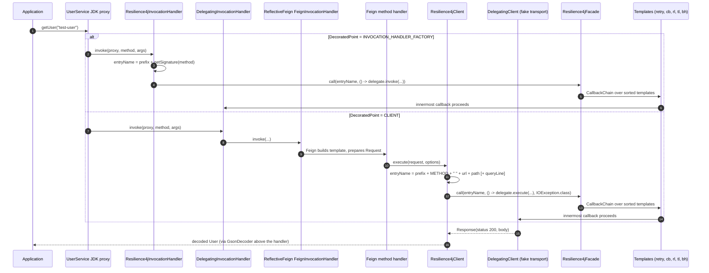
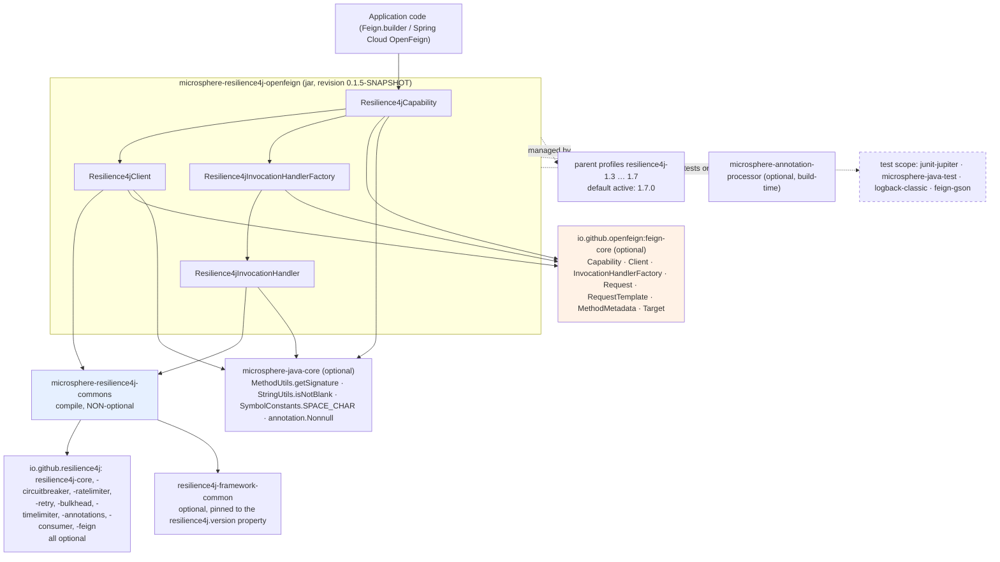

# microsphere-resilience4j-openfeign — Developer Guide (1.x)

> Version line `0.1.x` (`release-1.x` branch) · latest release `0.1.4` · current `${revision}` = `0.1.5-SNAPSHOT` · Resilience4j **1.3.0 – 1.7.0** (default `1.7.0`) · Spring Cloud **Hoxton – 2021.0.x** (parent `microsphere-spring-cloud-parent` `0.1.26`) · JDK **8** baseline · [← guide index](README.md)

Module path: `microsphere-resilience4j-plugins/microsphere-resilience4j-openfeign`. Package: `io.microsphere.resilience4j.feign`.

## Which module this plugin really sits on: commons, not spring

The plugin's POM has exactly one non-optional project dependency: `io.github.microsphere-projects:microsphere-resilience4j-commons` (`${revision}`). `microsphere-resilience4j-spring` is **absent** from the POM, and no class in the module imports anything from `io.microsphere.resilience4j.spring.*`, `org.springframework.*` or `javax.servlet.*`. Corroborating facts from the snapshot:

- there is no `src/main/resources` directory at all — hence no `META-INF/spring.factories`, unlike the `alibaba-druid`, `mybatis` and `spring-web` plugins;
- the plugin implements `feign.Capability`, not the Spring-side `io.microsphere.resilience4j.spring.common.Resilience4jPlugin` SPI;
- the only injection point is `io.microsphere.resilience4j.common.Resilience4jFacade`, an interface from commons that is satisfied by `ChainableResilience4jFacade` (tests) or by any other facade you write.

Consequence: the plugin works in a plain Java process, and nothing in it knows about registries, Spring contexts or configuration properties.

## Class inventory

### Production classes (`src/main/java`)

| Class | Implements | Role |
|-------|-----------|------|
| `Resilience4jCapability` | `feign.Capability` | The only registration object the user creates; selects the weaving point (`DecoratedPoint`) and builds the matching decorator |
| `Resilience4jClient` | `feign.Client` | Decorates the transport step; entry name derived from the `Request`/`RequestTemplate`/`MethodMetadata` |
| `Resilience4jInvocationHandlerFactory` | `feign.InvocationHandlerFactory` | Decorates the factory so every proxy handler Feign creates gets wrapped |
| `Resilience4jInvocationHandler` | `java.lang.reflect.InvocationHandler` | The actual decoration at proxy level; entry name derived from the `Method` signature |

Nested type: `Resilience4jCapability.DecoratedPoint` (`CLIENT`, `INVOCATION_HANDLER_FACTORY`).

### Test classes (`src/test/java`, all in `io.microsphere.resilience4j.feign`)

| Type | Role |
|------|------|
| `AbstractResilience4jFeignTest` | Shared fixture: registries → facade → `Feign` instance → `UserService` proxy; `testProxy()` and `testUserService()`; declares `protected abstract Resilience4jCapability createResilience4jCapability(Resilience4jFacade facade)` |
| `Resilience4jCapabilityTest` | default constructor path; asserts `DEFAULT_ENTRY_NAME_PREFIX == "feign@"` and `DEFAULT_DECORATED_POINT == CLIENT` |
| `Resilience4jClientTest` | `CLIENT` mode with `entryNamePrefix = this.getClass().getSimpleName()` |
| `Resilience4jInvocationHandlerFactoryTest` | `INVOCATION_HANDLER_FACTORY` mode |
| `DelegatingCapability` | a second `Capability` that only overrides `InvocationHandlerFactory enrich(InvocationHandlerFactory)`, used to prove multi-capability ordering |
| `DelegatingInvocationHandlerFactory` | wraps the delegate handler in `DelegatingInvocationHandler` |
| `DelegatingInvocationHandler` | stores the call's `Object[] args` in a `ThreadLocal` and exposes `static Object[] getArguments()`; `getDelegate()` for assertions |
| `DelegatingClient<T>` | a fake transport: resolves the `Method` from `request.requestTemplate().methodMetadata().method()`, invokes it on a local implementation, encodes the result into a `Response` with status `200` |
| `api.User`, `api.UserService`, `server.SimpleUserService` | the fixture service (`@RequestLine("POST /user/{name}")`, `@RequestLine("GET /user")`, in-memory `Map<String, User>` repository) |

## Weaving mechanism

### 1. `Resilience4jCapability` inside Feign's `Capability` architecture

`feign.Capability` is a flat interface of single-argument `enrich(...)` hooks, each returning the same type it receives (identity by default). Inspected with `javap` on the `feign-core` artifacts in the local Maven repository:

| `feign-core` | `Capability` static helpers | `enrich` overloads |
|--------------|-----------------------------|----------------|
| `10.10.1` (Hoxton-era OpenFeign) | `static <E> E enrich(E, List<Capability>)`, `static <E> E invoke(E, Capability)` | 11: `Client`, `Retryer`, `RequestInterceptor`, `Logger`, `Logger.Level`, `Contract`, `Request.Options`, `Encoder`, `Decoder`, `InvocationHandlerFactory`, `QueryMapEncoder` |
| `11.10` (Spring Cloud 2021-era OpenFeign) | `static Object enrich(Object, Class<?>, List<Capability>)`, `static Object invoke(Object, Capability, Class<?>)` | the 11 above plus `AsyncClient<Object>`, `ResponseInterceptor`, `ErrorDecoder`, `AsyncResponseHandler`, `AsyncContextSupplier<C>` (listing truncated; count not asserted) |

`Resilience4jCapability` overrides **two** of them and leaves every other hook at the inherited identity default. The before → after relation is the whole decoration contract:

```java
// before: the plain Client Feign would use  ->  after: the same call path, resilience-wrapped
@Override
public Client enrich(Client client) {
    return isDecoratedClient() ? new Resilience4jClient(client, facade, entryNamePrefix) : client;
}

// before: the plain InvocationHandlerFactory ->  after: a factory whose handlers are wrapped
@Override
public InvocationHandlerFactory enrich(InvocationHandlerFactory invocationHandlerFactory) {
    return isDecoratedInvocationHandlerFactory()
            ? new Resilience4jInvocationHandlerFactory(invocationHandlerFactory, facade, entryNamePrefix)
            : invocationHandlerFactory;
}
```

Because `DecoratedPoint` is a single enum value, the two hooks are mutually exclusive: with the default `CLIENT` point, `enrich(InvocationHandlerFactory)` returns its argument unchanged, and vice versa.

Feign folds the capability list in `Feign.Builder` order, so **the last capability added produces the outermost object**. `AbstractResilience4jFeignTest` proves it from the outside:

```java
this.feign = Feign.builder()
        .client(new DelegatingClient<>(encoder, new SimpleUserService()))
        .decoder(decoder)
        .encoder(encoder)
        .addCapability(new DelegatingCapability())   // added first  -> inner
        .addCapability(this.capability)              // added second -> outer
        .build();
```

In `INVOCATION_HANDLER_FACTORY` mode `testProxy()` then asserts the stack `Resilience4jInvocationHandler → DelegatingInvocationHandler → feign.ReflectiveFeign$FeignInvocationHandler`; in `CLIENT` mode the proxy handler chain stops at `DelegatingInvocationHandler` (the Resilience4j wrapper is nowhere at proxy level) and the decoration lives on the `Client` instead.

### 2. `Resilience4jInvocationHandlerFactory` — a factory-of-factories

```java
@Override
public InvocationHandler create(Target target, Map<Method, MethodHandler> dispatch) {
    InvocationHandler delegate = this.delegate.create(target, dispatch);
    return new Resilience4jInvocationHandler(delegate, facade, entryNamePrefix);
}
```

It is stateless apart from its three `final` fields and performs no caching of handlers: Feign calls `create` once per `newInstance(Target)` (i.e. per client proxy), so the wrapper count is bounded by the number of proxies, not by the number of calls. `target` and `dispatch` are only forwarded, which is why this mode's entry names are method-based rather than URL-based.

### 3. `Resilience4jInvocationHandler` — proxy-level decoration

```java
@Override
public Object invoke(Object proxy, Method method, Object[] args) throws Throwable {
    String entryName = buildEntryName(method);
    return this.facade.call(entryName, () -> delegate.invoke(proxy, method, args));
}

private String buildEntryName(Method method) {
    return entryNamePrefix + getSignature(method);   // io.microsphere.reflect.MethodUtils
}
```

`throws Throwable` matches `InvocationHandler#invoke` exactly, so the plain `call(String, ThrowableSupplier<T>)` overload is usable and nothing is wrapped — Feign's `ReflectiveFeign` handler may throw checked exceptions and they pass through untouched. Constructor arguments are validated with `requireNonNull`, and `getDelegate()` / `getFacade()` exist specifically so tests (and your own diagnostics) can walk the chain.

### 4. `Resilience4jClient` — transport-level decoration

```java
@Override
public Response execute(Request request, Request.Options options) throws IOException {
    String entryName = buildEntryName(request);
    return this.facade.call(entryName, () -> this.delegate.execute(request, options), IOException.class);
}

private String buildEntryName(Request request) {
    StringBuilder entryNameBuilder = new StringBuilder(entryNamePrefix);
    Request.HttpMethod httpMethod = request.httpMethod();
    RequestTemplate requestTemplate = request.requestTemplate();
    MethodMetadata methodMetadata = requestTemplate.methodMetadata();
    String url = requestTemplate.feignTarget().url();
    String path = methodMetadata.template().path();
    String queryLine = requestTemplate.queryLine();
    entryNameBuilder.append(httpMethod.name()).append(SPACE_CHAR).append(url).append(path);
    if (isNotBlank(queryLine)) {
        entryNameBuilder.append(queryLine);
    }
    return entryNameBuilder.toString();
}
```

Design points worth knowing before you change it:

- **Split source of truth.** `path` comes from the *contract-parsed, unresolved* template (`methodMetadata.template()`), so URI variables stay literal (`/user/{name}`); `queryLine` comes from the *per-request* `RequestTemplate`, so query values become part of the key. Cardinality of entry names is therefore driven by query strings, not by path variables.
- The three-argument `call(..., IOException.class)` is the only reason `IOException` survives the facade: `Resilience4jOperations#call(String, ThrowableSupplier<T>, Class<TR>)` runs the two-phase default and routes any `Throwable` through `ExceptionUtils.wrap(t, throwableClass)`.
- No caching, no per-instance state; every call rebuilds the name.

### 5. What happens inside the facade

Both decorators use the one-time `call(...)` path, which `ChainableResilience4jFacade` turns into a recursive chain (commons sources):

```java
public <T> T call(String name, ThrowableSupplier<T> callback) throws Throwable {
    CallbackChain<T> supplier = new CallbackChain<>(name, callback, this.templates);
    T result = supplier.get();
    ...
}
// CallbackChain.get(): templates[pos++].call(entryName, CallbackChain.this::get) until exhausted, then delegate.get()
```

`createTemplates(registries)` maps each registry to its template and `templates.sort(COMPARATOR)` orders them by `Resilience4jModule` default priority — `RETRY 0`, `CIRCUIT_BREAKER 1`, `RATE_LIMITER 2`, `TIME_LIMITER 3`, `BULKHEAD 4`, `THREAD_POOL_BULKHEAD 4` — so **retry is the outer decoration and bulkhead the innermost**. Per-module one-time behaviour in this 1.x commons line: `CircuitBreakerTemplate.call` → `circuitBreaker.decorateCheckedSupplier(...)`, `RetryTemplate.call` → `Retry.decorateCheckedSupplier(...)`, `RateLimiterTemplate.call` → `RateLimiter.decorateCheckedSupplier(...)`, `TimeLimiterTemplate.call` → `timeLimiter.decorateFutureSupplier(...)` on an internal executor, `ThreadPoolBulkheadTemplate.call` → `executeCallable(...)` + `future.get()`, and `BulkheadTemplate` keeps the inherited begin/end composition. Entry resolution is `registry.find(name)` → `registry.<module>(name, getConfiguration(name))`, so a registry **configuration whose name equals the entry name** binds to that endpoint.

### Sequence diagram: an intercepted Feign call (`UserService#getUser`)



## Design-pattern evidence

| Pattern | Where | Evidence (source) |
|---------|-------|-------------------|
| **Decorator** | `Resilience4jClient`, `Resilience4jInvocationHandler`, `Resilience4jInvocationHandlerFactory` | each holds `private final <same-interface> delegate`, implements that same interface, forwards the call inside a lambda |
| **Proxy (JDK dynamic proxy)** | `Resilience4jInvocationHandler` | `implements java.lang.reflect.InvocationHandler`, `invoke(Object proxy, Method method, Object[] args)`; test obtains it with `Proxy.getInvocationHandler(userService)` |
| **Abstract Factory / factory decoration** | `Resilience4jInvocationHandlerFactory` | `create(Target, Map<Method, MethodHandler>)` decorates the product, not the factory method's inputs |
| **Chain of Responsibility** | `Resilience4jCapability` (capability list folded by Feign) and `ChainableResilience4jFacade` + `CallbackChain` | `addCapability(...)` ordering proven by `testProxy()`; `CallbackChain.get()` recursion over sorted templates |
| **Strategy** | `Resilience4jCapability.DecoratedPoint` | `enrich(Client)` / `enrich(InvocationHandlerFactory)` choose the strategy via `isDecoratedClient()` / `isDecoratedInvocationHandlerFactory()` |
| **Facade** | the `Resilience4jFacade` constructor parameter | the plugin never touches a Resilience4j registry, entry or decorator class |
| **Template Method** | `Resilience4jClient#buildEntryName`, `Resilience4jInvocationHandler#buildEntryName` | private name-building step inside the fixed `execute`/`invoke` skeleton |
| **SPI** | *not used here* | no `META-INF/services` and no `META-INF/spring.factories` in this module; registration is `Feign.Builder#addCapability` (Feign's extension point). Compare the sibling `spring-web` plugin, which *is* an SPI implementation of `io.microsphere.resilience4j.spring.common.Resilience4jPlugin` and is published through `META-INF/spring.factories` |
| Test-double / **Adapter** | `DelegatingClient<T>`, `Delegating*` helpers | adapt a local `SimpleUserService` to `feign.Client`, and record the chain for assertions |

## Dependency graph (from the POMs)



Notes on the graph, all taken from the POM files: only `microsphere-resilience4j-commons` is non-optional; `resilience4j-framework-common` is the single dependency with an explicit `${resilience4j.version}` in this module (the rest of the versions come from `microsphere-resilience4j-parent`'s `dependencyManagement`); `feign-gson` is **test-scoped**, so a real application supplies its own `Encoder`/`Decoder`; and `microsphere-resilience4j-compatible` is attached to commons only under profiles `resilience4j-1.3` … `resilience4j-1.6` (see the [compatible page](microsphere-resilience4j-compatible.md)).

## Verification status

| Claim | Status |
|-------|--------|
| All class/method/field names and signatures in the four production classes and the test fixtures | verified from the `release-1x` sources |
| `feign.Capability` overload inventory and the static `enrich` helpers | verified with `javap` against `feign-core` `10.10.1` and `11.10` in the local Maven repository (both are OpenFeign generations reachable from the Hoxton/2020/2021 profiles) |
| Which `feign-core` version your build resolves | **not fixed by this repository** — inherited from the Spring Cloud BOM of the active profile; verify with `mvn dependency:tree` |
| The exact string produced by `io.microsphere.reflect.MethodUtils#getSignature(Method)` | **unverified** — the utility lives in `microsphere-java-core`, outside this snapshot; only the concatenation `entryNamePrefix + getSignature(method)` is verified |
| `Feign.Builder` folds capabilities in insertion order (last = outermost) | consistent with the asserted handler stack in `testProxy()`; Feign's own folding loop was not read in this snapshot |
| Spring Cloud OpenFeign picks up `Capability` beans from a client context | **unverified** — external behaviour; nothing in this module depends on Spring Cloud |

## Notes for maintainers

- Adding a new weaving point means a new `DecoratedPoint` constant **and** a matching `enrich` override; the predicates are exhaustive `equals` checks, so an unhandled point silently decorates nothing.
- `entryNamePrefix` is concatenated verbatim. The default `"feign@"` carries its own separator, and `Resilience4jClientTest` deliberately passes a prefix without one — if you make the prefix configurable, normalise it here rather than in callers.
- Consider whether `CLIENT`-mode query strings should be sanitised before they become registry keys; today every distinct query line creates (and keeps) one entry per module registry.
- The module has no integration test against a real HTTP server; `DelegatingClient` short-circuits transport, which also means response-error paths (`ErrorDecoder`, non-2xx) are untested here.
