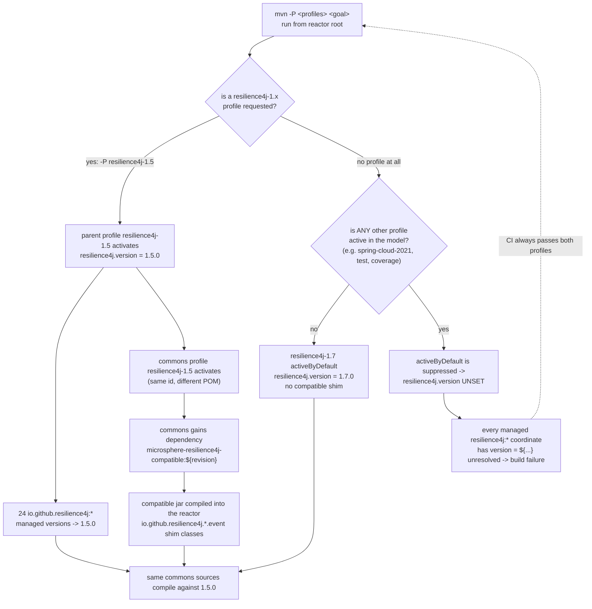

# microsphere-resilience4j-parent — Developer Guide (1.x / v0.1.x)

> Version line `0.1.x` (`release-1.x` branch) · `${revision}` = `0.1.5-SNAPSHOT` · latest release `0.1.4` · Resilience4j **1.3.0 – 1.7.0** (default `1.7.0`) · [← developer guide index](README.md)

This page documents the internals of the 1.x build parent: what its POM actually contains, how the five `resilience4j-1.x` profiles resolve across the reactor, why profiles `1.3`–`1.6` also change the *dependency graph*, and how CI drives the whole matrix.

## POM inventory (`microsphere-resilience4j-parent/pom.xml`)

| Section | Present? | Content |
|---------|----------|---------|
| `<parent>` | yes | `io.github.microsphere-projects:microsphere-resilience4j:${revision}`, `relativePath ../pom.xml` |
| `<properties>` | yes | five `microsphere-*.version` properties only (table below) |
| `<dependencyManagement>` | yes | 24 explicit `io.github.resilience4j:*` entries + 5 imported `microsphere-*-dependencies` BOMs |
| `<profiles>` | yes | `resilience4j-1.3` … `resilience4j-1.7`; only `resilience4j-1.7` has `activeByDefault` |
| `<dependencies>` | **no** | the parent adds no dependency to consumers |
| `<build>`, `<pluginManagement>`, `<distributionManagement>`, `<repositories>` | **no** | all inherited from `microsphere-spring-cloud-parent:0.1.26` through the reactor root |

Rule of thumb for maintainers: this file owns **version policy** only. Any shared *plugin* behaviour (compiler level, flatten, sources/javadoc jars, deploy) lives in the grandparent line and must be changed there.

### Inheritance and aggregation (two different POMs)

| POM | artifactId | packaging | Has `<modules>`? | Role |
|-----|-----------|-----------|------------------|------|
| Reactor root | `microsphere-resilience4j` | `pom` | **yes** (8 modules) | aggregator; `${revision} = 0.1.5-SNAPSHOT`; parent `microsphere-spring-cloud-parent:0.1.26` |
| Build parent | `microsphere-resilience4j-parent` | `pom` | no | inherited parent of every other module; itself listed as a `<module>` of the reactor |

### Managed microsphere integration versions

| Property | Value | Imported BOM |
|----------|-------|--------------|
| `microsphere-spring-cloud.version` | `0.1.26` | `microsphere-spring-cloud-dependencies` |
| `microsphere-alibaba-druid.version` | `0.1.20` | `microsphere-alibaba-druid-dependencies` |
| `microsphere-mybatis.version` | `0.1.15` | `microsphere-mybatis-dependencies` |
| `microsphere-hibernate.version` | `0.1.9` | `microsphere-hibernate-dependencies` |
| `microsphere-redis.version` | `0.1.13` | `microsphere-redis-dependencies` |

All five are `<type>pom</type>` `<scope>import</scope>`. They are the reason the leaf POMs can write `microsphere-hibernate-core`, `microsphere-mybatis-*`, Druid or Redis coordinates version-free.

### Explicit Resilience4j version management

The 1.x parent manages **24** `io.github.resilience4j` coordinates, each with `<version>${resilience4j.version}</version>`:

`resilience4j-all`, `resilience4j-bulkhead`, `resilience4j-cache`, `resilience4j-circuitbreaker`, `resilience4j-circularbuffer`, `resilience4j-consumer`, `resilience4j-feign`, `resilience4j-framework-common`, `resilience4j-kotlin`, `resilience4j-metrics`, `resilience4j-micrometer`, `resilience4j-prometheus`, `resilience4j-ratelimiter`, `resilience4j-ratpack`, `resilience4j-reactor`, `resilience4j-retrofit`, `resilience4j-retry`, `resilience4j-rxjava2`, `resilience4j-rxjava3`, `resilience4j-spring`, `resilience4j-spring-boot2`, `resilience4j-spring-cloud2`, `resilience4j-timelimiter`, `resilience4j-vertx`.

**There is no `resilience4j-bom` import on this line** — that is a deliberate difference from `0.2.x`, which imports `io.github.resilience4j:resilience4j-bom:${resilience4j.version}` plus `resilience4j-framework-common`. Two consequences visible in this repository:

1. `resilience4j-annotations` and `resilience4j-core` are **not** managed here, yet the commons, compatible, druid, hibernate-core and openfeign POMs declare them without `<version>`; those two coordinates resolve through one of the imported framework BOMs (the `microsphere-spring-cloud-dependencies:0.1.26` chain), outside this worktree. Verify with `./mvnw help:effective-pom` rather than assuming they track `${resilience4j.version}`.
2. Adding a new Resilience4j artifact to a module POM requires editing **this** list (or relying on the imported BOM), whereas on `0.2.x` the `resilience4j-bom` import covers every module automatically.

## Profile resolution: two POMs, one profile id

The version profiles are split across two files, and the same id in both is what makes the multi-version build work:

| Profile id | `microsphere-resilience4j-parent/pom.xml` | `microsphere-resilience4j-commons/pom.xml` |
|------------|--------------------------------------------|---------------------------------------------|
| `resilience4j-1.3` | `<properties>` → `resilience4j.version = 1.3.0` | `<dependencies>` → adds `microsphere-resilience4j-compatible:${revision}` (compile, non-optional) |
| `resilience4j-1.4` | → `1.4.0` | → same addition |
| `resilience4j-1.5` | → `1.5.0` | → same addition |
| `resilience4j-1.6` | → `1.6.0` | → same addition |
| `resilience4j-1.7` | → `1.7.0`, **`activeByDefault = true`** | *no such profile* |

`microsphere-resilience4j-commons/pom.xml` therefore declares **no** `resilience4j-1.7` profile: with the default build the commons module gets nothing extra, because Resilience4j 1.7.0 already contains the event types the shim back-ports (`CircuitBreakerEvent`, `CircuitBreakerOnFailureRateExceededEvent`, `CircuitBreakerOnSlowCallRateExceededEvent`, `RateLimiterEvent`, `RateLimiterOnDrainedEvent` — all under the original `io.github.resilience4j.*.event` packages, see `microsphere-resilience4j-compatible/src/main/java`).

The `activeByDefault` flag appears exactly once in the whole line (parent, profile `resilience4j-1.7`).

### Profile-resolution flowchart



The `activeByDefault` suppression branch is not theoretical: `.github/workflows/maven-build.yml` activates `test`, `coverage`, a `spring-cloud-*` and a `resilience4j-1.x` profile on every run, precisely so that no leg of the matrix can land in the “property unset” state.

### Compatible-module mechanics

| Fact | Evidence |
|------|----------|
| `microsphere-resilience4j-compatible` contains 5 shim classes + `package-info.java`, all in `io.github.resilience4j.circuitbreaker.event` / `io.github.resilience4j.ratelimiter.event` | `microsphere-resilience4j-compatible/src/main/java/...` |
| Its own POM declares the same nine optional Resilience4j modules as commons, with `resilience4j-framework-common` pinned to `${resilience4j.version}` | `microsphere-resilience4j-compatible/pom.xml` |
| It is **not deployed**: `maven-deploy-plugin` `<skip>true</skip>` | same file |
| It is **not managed** by `microsphere-resilience4j-dependencies` | see [BOM developer page](microsphere-resilience4j-dependencies.md) |
| It reaches downstream modules transitively, because the commons profile adds it as a plain compile dependency | `microsphere-resilience4j-commons/pom.xml` profiles |

Consequence for `mvn deploy` of a `1.3`–`1.6` build: the reactor still *builds* the shim (it is a `<module>`), and the commons profile still *references* `microsphere-resilience4j-compatible:${revision}`, but the shim artifact is not published — so an external consumer that resolved a `0.1.x` commons built for 1.6 would ask Central for a `microsphere-resilience4j-compatible:0.1.4` that is not there. The release flow avoids that situation: `.github/workflows/maven-publish.yml` passes no `resilience4j-*` profile at all (only `publish,ci`), so the published line is the `activeByDefault` `resilience4j-1.7` build, which needs no shim. If you ever ship a 1.3–1.6 build, drop the `<skip>true</skip>` on the compatible module **and** add it to the BOM, or remove the profile dependency — otherwise verify the resolved classpath from a deployed POM (`mvn dependency:tree`) before announcing the release.

## How CI and the release flow use these profiles

`.github/workflows/maven-build.yml` (triggers: `push` → `dev-1.x`; `pull_request` → `dev-1.x`, `release-1.x`):

| Matrix dimension | Values |
|------------------|--------|
| `java` | `8`, `11`, `17`, `21`, `25` |
| `maven-profile-spring-cloud` | `spring-cloud-hoxton`, `spring-cloud-2020`, `spring-cloud-2021` |
| `maven-profile-resilience4j` | `resilience4j-1.3` … `resilience4j-1.7` |

```bash
mvn --batch-mode --update-snapshots --file pom.xml -Drevision=0.0.1-SNAPSHOT test \
    --activate-profiles test,coverage,<maven-profile-spring-cloud>,<maven-profile-resilience4j>
```

The `spring-cloud-*` ids are **not** defined in this repository — they come from the `microsphere-spring-cloud-parent:0.1.26` line. A new Spring Cloud train is adopted by bumping that grandparent version, not by editing the resilience4j parent.

`.github/workflows/maven-publish.yml` (trigger: `push` → `release-1.x`, or `workflow_dispatch` with a `revision` input matching `^[0-9]+\.[0-9]+\.[0-9]+$`):

1. `setup-java` with `java-version: '11'` — releases are produced on JDK 11 on this line,
2. `./mvnw -Drevision=${{ inputs.revision }} -Dgpg.skip=true deploy --activate-profiles publish,ci`,
3. tag `v$revision` … and then bump: `sed` rewrites the root `<revision>` to `<major>.<minor>.<patch+1}-SNAPSHOT`, commits and pushes,
4. merges `release-1.x` into `dev-1.x`.

That is why this snapshot sits at `0.1.5-SNAPSHOT` immediately after `0.1.4` was published.

## JDK baseline — verified from this branch

| Question | Answer | Evidence |
|----------|--------|----------|
| Is there a `java.version` property on the 1.x line? | **No** — not in the reactor root POM (which sets only `<revision>`), not in the parent, not in any module POM | searched every `pom.xml` in `release-1x`; the only matches for `java.version` in the whole tree are the two `setup-java` workflow keys |
| Which JDKs are actually built and tested? | 8, 11, 17, 21, 25 | `.github/workflows/maven-build.yml` matrix |
| Which JDK produces the release? | 11 | `.github/workflows/maven-publish.yml` `setup-java` |
| Where is the compiler level defined? | Inherited from `microsphere-spring-cloud-parent:0.1.26` (external, not in this worktree) | the parent POM has no `<build>` section at all |
| Corroborating signals of an old baseline | `javax.servlet:javax.servlet-api` dependency in the spring-web plugin POM; `release-notes.md` v0.1.2: “Reverted to `javax.servlet` API and enforced Java 11 compatibility.” | `microsphere-resilience4j-plugins/microsphere-resilience4j-spring-web/pom.xml`, `release-notes.md` |

Do not copy the `0.2.x` claim (`java.version=17`) to this line — it does not hold here; the reactor root of `release-1x` defines only `<revision>0.1.5-SNAPSHOT</revision>`.

## Differences from the 0.2.x parent (for maintainers porting)

| Aspect | `0.1.x` (`release-1x`) | `0.2.x` (`release`) |
|--------|------------------------|---------------------|
| Resilience4j version source | 24 individually listed coordinates | `resilience4j-bom` import + `resilience4j-framework-common` |
| Profiles | `resilience4j-1.3` … `1.7` (default `1.7`) | `resilience4j-2.0` … `2.4` (default `2.4`) |
| Profiles with side effects | yes — `1.3`–`1.6` add the `compatible` dependency in the commons POM | none (no shim module exists) |
| Extra reactor module | `microsphere-resilience4j-compatible` | — |
| Grandparent | `microsphere-spring-cloud-parent:0.1.26` | `microsphere-spring-cloud-parent:0.2.26` |
| Managed microsphere versions | spring-cloud `0.1.26`, druid `0.1.20`, mybatis `0.1.15`, hibernate `0.1.9`, redis `0.1.13` | `0.2.26`, `0.2.20`, `0.2.16`, `0.2.10`, `0.2.14` |
| `java.version` | not declared | `17` in the reactor root |
| Reactor `<modules>` | 8 (adds `compatible`) | 7 |

## Version facts verified from source

| Fact | Value | Where read |
|------|-------|-----------|
| Reactor `${revision}` | `0.1.5-SNAPSHOT` | root `pom.xml` `<properties>` |
| Reactor modules | `parent`, `dependencies`, `compatible`, `commons`, `plugins`, `spring`, `spring-boot`, `spring-cloud` | root `pom.xml` `<modules>` |
| Grandparent | `microsphere-spring-cloud-parent:0.1.26` | root `pom.xml` `<parent>` |
| Managed resilience4j coordinates | 24 | parent `pom.xml` `<dependencyManagement>` |
| Imported framework BOMs | 5 | parent `pom.xml` `<dependencyManagement>` |
| Default profile | `resilience4j-1.7` → `1.7.0` (`activeByDefault`) | parent `pom.xml` `<profiles>` |
| Commons profiles adding the shim | `resilience4j-1.3`, `1.4`, `1.5`, `1.6` | commons `pom.xml` `<profiles>` |
| CI JDK matrix | 8 / 11 / 17 / 21 / 25 | `maven-build.yml` |
| Publish JDK | 11 | `maven-publish.yml` |

## Related pages

- [User guide — microsphere-resilience4j-parent (1.x)](../user-guide/microsphere-resilience4j-parent.md)
- [Developer guide — microsphere-resilience4j-dependencies (1.x)](microsphere-resilience4j-dependencies.md)
- [Developer guide — 1.x index](README.md)
