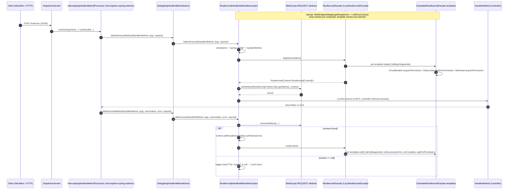

# microsphere-resilience4j-spring-web — Developer Guide (1.x)

> Version line `0.1.x` (`release-1.x` branch) · latest release `0.1.4` · current `${revision}` = `0.1.5-SNAPSHOT` · Resilience4j **1.3.0 – 1.7.0** (default `1.7.0`) · Spring Cloud **Hoxton – 2021.0.x** (parent `microsphere-spring-cloud-parent` `0.1.26`) · JDK **8** baseline · [← guide index](README.md)

Module path: `microsphere-resilience4j-plugins/microsphere-resilience4j-spring-web`. Package: `io.microsphere.resilience4j.spring.web`.

## Module position: this one *is* an SPI plugin

Unlike the sibling [openfeign plugin](microsphere-resilience4j-openfeign.md) (which sits on `microsphere-resilience4j-commons` and only knows Feign), this plugin sits on **`microsphere-resilience4j-spring`** — its single non-optional project dependency — and implements that module's SPI:

```java
public class SpringWebResilience4jPlugin implements Resilience4jPlugin {   // io.microsphere.resilience4j.spring.common.Resilience4jPlugin
```

The SPI interface (from the `release-1x` snapshot of the spring module) is two methods only:

```java
void plugin(ConfigurableListableBeanFactory beanFactory, BeanDefinitionRegistry registry, ConfigurableEnvironment environment);
String getName();
```

## Class inventory

| Type | File | Role |
|------|------|------|
| `SpringWebResilience4jPlugin` | `src/main/java/.../SpringWebResilience4jPlugin.java` | SPI descriptor: `getName() = "spring-web"`; `plugin(...)` registers one bean definition |
| `Resilience4jHandlerMethodInterceptor` | `src/main/java/.../Resilience4jHandlerMethodInterceptor.java` | the decoration: `HandlerMethodInterceptor` + `ApplicationListener<WebEndpointMappingsReadyEvent>` + `Ordered` |
| resource | `src/main/resources/META-INF/spring.factories` | `io.microsphere.resilience4j.spring.common.Resilience4jPlugin=\ io.microsphere.resilience4j.spring.web.SpringWebResilience4jPlugin` |
| `SpringWebResilience4jPluginTest` | `src/test/java/.../SpringWebResilience4jPluginTest.java` | the only test: one `test()` method, `MockMvc` POST `/test/user` |

The interceptor's own Javadoc (“the abstract template class for Resilience4j's `HandlerMethodInterceptor`”) is stale: the class is concrete, instantiated by the plugin, with `initEntryCache(...)` as its only `protected` member.

## Weaving mechanism

### 1. Publication and activation of the SPI

The plugin is *published* through `META-INF/spring.factories` under the SPI interface name, and *activated* by the spring module's registrar. From `io.microsphere.resilience4j.spring.common.annotation.EnableResilience4jRegistrar` (1.x sources):

```java
private void registerPlugins(ResolvablePlaceholderAnnotationAttributes attributes, BeanDefinitionRegistry registry) {
    String[] plugins = attributes.getStringArray("plugins");
    List<Resilience4jPlugin> resilience4jPlugins = loadFactories(this.beanFactory, Resilience4jPlugin.class);
    for (Resilience4jPlugin resilience4jPlugin : resilience4jPlugins) {
        String pluginName = resilience4jPlugin.getName();
        if (contains(plugins, pluginName)) {
            resilience4jPlugin.plugin(this.beanFactory, registry, this.environment);
        }
    }
}
```

So activation requires three coincidences: the `spring.factories` entry (present), an `@Enable*` annotation whose `plugins` attribute lists `spring-web`, and the name matching `getName()`. `plugins` is declared on `@EnableResilience4j` as `String[] plugins() default {}` (alongside `publishEvents() default false` and `consumeEvents() default false`), and every module annotation (`@EnableBulkhead`, …) re-exposes it via `@AliasFor(annotation = EnableResilience4j.class, attribute = "plugins")`. Note also the ordering inside `registerBeanDefinitions`: `registerEntryConfiguration` → `registerCommonConfigurations` → `registerEventComponentBeans` → **`registerPlugins`** → `registerResilience4jFacade`.

Values are placeholder-resolvable (`ResolvablePlaceholderAnnotationAttributes`), so `plugins = "${...}"` is a supported spelling (inferred from that wrapper; not exercised by the module's test).

### 2. What `plugin(...)` actually does — a bean definition, nothing else

```java
@Override
public void plugin(ConfigurableListableBeanFactory beanFactory, BeanDefinitionRegistry registry, ConfigurableEnvironment environment) {
    registerResilience4jHandlerMethodInterceptor(registry);
}

private void registerResilience4jHandlerMethodInterceptor(BeanDefinitionRegistry registry) {
    registerBeanDefinition(registry, BEAN_NAME, Resilience4jHandlerMethodInterceptor.class);
}
```

`registerBeanDefinition(BeanDefinitionRegistry, String, Class)` comes from `io.microsphere.spring.beans.factory.support.BeanRegistrar` (statically imported). The two other SPI arguments are unused, and no property is read.

The interceptor has exactly one constructor, requiring a `Resilience4jFacade`; the definition carries no constructor arguments, so the collaborator is resolved by Spring at instantiation time. It is deterministic because the same registrar registers the facade bean as **primary**: `registerResilience4jFacade` creates `genericBeanDefinition(LazyResilience4jFacade.class)` with `setPrimary(true)` under the name `LazyResilience4jFacade.BEAN_NAME = "lazyResilience4jFacade"`, and accumulates a `modules` property per `@Enable*` invocation. `LazyResilience4jFacade` implements `Resilience4jFacade`, `ApplicationListener<ContextRefreshedEvent>` and `DelegatingWrapper`, resolving its delegate on refresh — which is why an interceptor can be created before any registry exists.

### 3. The handler-method interception path on 1.x-era Spring Web

The plugin never implements Spring's `org.springframework.web.servlet.HandlerInterceptor`. It implements the **Microsphere Web** extension interface, and the types involved are `javax.servlet`-based (Spring 5 / Boot 2.x generation) — consistent with the profiles `Hoxton.SR12` → `2021.0.9`. Verified by `javap` against the `microsphere-spring-web` / `microsphere-spring-webmvc` `0.1.36` artifacts of the same `0.1.x` line in the local Maven repository:

| Type (fully qualified) | Verified shape in that bytecode |
|------------------------|--------------------------------|
| `io.microsphere.spring.web.method.support.HandlerMethodInterceptor` | interface with exactly two `default` methods: `beforeExecute(HandlerMethod, Object[], NativeWebRequest) throws Exception` and `afterExecute(HandlerMethod, Object[], Object, Throwable, NativeWebRequest) throws Exception` — the two methods the plugin overrides |
| `io.microsphere.spring.web.method.support.DelegatingHandlerMethodAdvice` | `extends OnceApplicationContextEventListener<ContextRefreshedEvent> implements HandlerMethodAdvice`, with `beforeExecuteMethod(HandlerMethod, Object[], NativeWebRequest)` / `afterExecuteMethod(HandlerMethod, Object[], Object, Throwable, NativeWebRequest)`; the bridge from the advice callbacks to the `HandlerMethodInterceptor` beans |
| `io.microsphere.spring.webmvc.method.support.InterceptingHandlerMethodProcessor` | `extends OnceApplicationContextEventListener<WebEndpointMappingsReadyEvent>` and implements `HandlerMethodArgumentResolver`, `HandlerMethodReturnValueHandler`, `HandlerInterceptor`, `io.microsphere.spring.webmvc.config.WebMvcConfigurerAdapter`; it owns `resolveArgument(...)`, `handleReturnValue(...)`, `preHandle/postHandle/afterCompletion(...)` and a package-private `afterExecute(HttpServletRequest, Object, Exception)` |
| `io.microsphere.spring.webmvc.annotation.EnableWebMvcExtension` | attributes: `registerWebEndpointMappings`, `interceptHandlerMethods`, `publishEvents`, `requestContextStrategy`, `registerHandlerInterceptors`, `handlerInterceptors`, `sources`, `storeRequestBodyArgument`, `storeResponseBodyReturnValue`, `reversedProxyHandlerMapping` (the first two defaults read as `true` in the constant pool; the remaining defaults were not mapped one by one) |
| `io.microsphere.spring.web.event.WebEndpointMappingsReadyEvent` | `extends ApplicationContextEvent`, carries `Collection<WebEndpointMapping> getMappings()` — the event the interceptor listens for |
| `io.microsphere.spring.web.util.WebScope` | enum `REQUEST`, `SESSION` with `getAttribute/setAttribute/removeAttribute(RequestAttributes, String)` — `NativeWebRequest` is a `RequestAttributes`, which is how the context crosses the two callbacks |

Putting the verified pieces together, the call path is: DispatcherServlet → `InterceptingHandlerMethodProcessor` (argument-resolution / return-value / interceptor roles) → `HandlerMethodAdvice` → `DelegatingHandlerMethodAdvice` → every `HandlerMethodInterceptor` bean, including `Resilience4jHandlerMethodInterceptor`. `@EnableWebMvcExtension` is what installs that machinery, which explains why the module's test carries it.

> Scope of verification: the *exact* `microsphere-spring-*` version resolved by this branch is managed by the external parent chain (`microsphere-spring-cloud-parent` `0.1.26` → `microsphere-spring-boot-dependencies` `0.1.34`), not by anything inside this snapshot; `0.1.36` was inspected as the closest available `0.1.x` build. The internal dispatch order inside `InterceptingHandlerMethodProcessor` was not read from bytecode and is described above only at the level of the types and method signatures that were.

### 4. The decoration itself: two-phase `begin` / `end` across two callbacks

```java
@Override
public void beforeExecute(HandlerMethod handlerMethod, Object[] args, NativeWebRequest request) {
    Resilience4jContext<Resilience4jContext[]> context = resilience4jFacade.begin(getEntryName(handlerMethod));
    REQUEST.setAttribute(request, RESILIENCE4J_CONTEXT_ATTRIBUTE_NAME, context);
}

@Override
public void afterExecute(HandlerMethod handlerMethod, Object[] args, Object returnValue, Throwable error, NativeWebRequest request) {
    Resilience4jContext<Resilience4jContext[]> context = (Resilience4jContext<Resilience4jContext[]>)
            REQUEST.removeAttribute(request, RESILIENCE4J_CONTEXT_ATTRIBUTE_NAME);
    if (context == null) {
        logger.trace("The 'context' is null , please check whether the 'resilience4jFacade' is a 'ChainableResilience4jFacade'", error);
        return;
    }
    context.setResult(returnValue).setFailure(error);
    this.resilience4jFacade.end(context);
}
```

Why a request attribute and not the commons `ThreadLocal`: `Resilience4jContext` does own a thread-bound holder (`contextHolder`, exposed as `getContext()` / `setContext(...)` / `removeContext()` / `doInContext(...)`), but this plugin deliberately does not use it — binding the context to the request keeps the `begin`/`end` pair attached to the request being handled instead of to whichever thread finishes the dispatch. The interceptor's constructor carries the source comment `// always keep self being a delegate` next to its null-check, which is the only stated design intent; the facade it is handed is normally the delegating `LazyResilience4jFacade` bean, not a chain.

On the commons side, `ChainableResilience4jFacade` fills an array of sub-contexts, one per template, guarded by `isBeginSupported()` / `isEndSupported()`. In the 1.x line `RetryTemplate`, `TimeLimiterTemplate` and `ThreadPoolBulkheadTemplate` return `false` for both, so they are skipped entirely here — the structural difference from the openfeign plugin, which uses the one-time `call(...)` path where all six modules participate. What the three participating templates do in this branch:

| Template | `doBegin` | `doEnd` |
|----------|-----------|---------|
| `CircuitBreakerTemplate` | `long startTime = nanoTime(); circuitBreaker.acquirePermission(); context.setStartTime(startTime);` | `durationTime = nanoTime() - context.getStartTime()`, then `onSuccess(durationTime, NANOSECONDS)` or `onError(durationTime, NANOSECONDS, failure)` (fixed `NANOSECONDS`, not the entry's own timestamp unit) |
| `BulkheadTemplate` | `bulkhead.acquirePermission()` | `bulkhead.onComplete()` — the only release path for the permit |
| `RateLimiterTemplate` | `RateLimiter.waitForPermission(rateLimiter)` | `RateLimiter.waitForPermission(rateLimiter)` **again** — a 1.x quirk: two permits are consumed per two-phase call |

Because `context.setResult(returnValue).setFailure(error)` runs before `end(...)`, the outcome recorded for the circuit breaker comes from the MVC callback (`error` is the exception Spring MVC saw, `returnValue` the handler's return value), not from an exception caught around the call — which is why `Retry`-style re-execution cannot be expressed on this path at all.

### 5. Startup pre-computation: `initEntryCache`

```java
protected void initEntryCache(WebEndpointMappingsReadyEvent event) {
    Collection<WebEndpointMapping> webEndpointMappings = event.getMappings();
    Map<Method, String> methodEntryNamesCache = newFixedHashMap(webEndpointMappings.size());
    this.methodEntryNamesCache = methodEntryNamesCache;
    Iterator<WebEndpointMapping> iterator = webEndpointMappings.iterator();
    while (iterator.hasNext()) {
        Object endpoint = iterator.next().getEndpoint();
        if (endpoint instanceof HandlerMethod) {
            HandlerMethod handlerMethod = (HandlerMethod) endpoint;
            String entryName = getEntryName(handlerMethod);   // side effect: fills the cache
            logger.trace("Create the entryName : '{}' for HandlerMethod : {}", entryName, handlerMethod);
        }
    }
    ChainableResilience4jFacade facade = tryUnwrap(this.resilience4jFacade, ChainableResilience4jFacade.class);
    if (facade != null) {
        for (Resilience4jTemplate template : facade.getTemplates()) {
            template.initLocalEntriesCache(methodEntryNamesCache.values());
        }
    }
}
```

Three points a maintainer should keep in mind:

- The `getEntryName(handlerMethod)` call inside the loop looks like dead code but is not: it is what populates the map whose `values()` are then used to pre-warm each template's local entry cache (`newFixedHashMap` from `io.microsphere.collection.MapUtils`, `tryUnwrap` from `io.microsphere.lang.Wrapper`, logger from `io.microsphere.logging`).
- Pre-warming is the thread-safety contract: `Resilience4jTemplate#localEntriesCache` is documented in-source as a `HashMap` that is “not thread-safe and can be thread-safe if and only if it's initialized by `initLocalEntriesCache` at the initialization phase”.
- `getEntryName` performs `methodEntryNamesCache.computeIfAbsent(method, m -> PLUGIN_NAME + "@" + handlerMethod)`. If `WebEndpointMappingsReadyEvent` never reaches this listener the field is still `null` and the first request throws `NullPointerException`; a handler method that was not part of the published mappings mutates the map at request time. Both are consequences of the design, not of the framework.

### Sequence diagram: an intercepted handler-method call



## Design-pattern evidence

| Pattern | Where | Evidence |
|---------|-------|----------|
| **SPI / service loading** | `SpringWebResilience4jPlugin` | `META-INF/spring.factories` keyed by the interface `io.microsphere.resilience4j.spring.common.Resilience4jPlugin`; loaded by `loadFactories(beanFactory, Resilience4jPlugin.class)` and matched by `getName()` |
| **Observer** | `Resilience4jHandlerMethodInterceptor implements ApplicationListener<WebEndpointMappingsReadyEvent>`; the `ChainableResilience4jFacade` templates register `EventConsumer`s through `Resilience4jTemplate`'s registry/entry event methods | the `onApplicationEvent` → `initEntryCache` edge |
| **Template Method** | the fixed `beforeExecute` → `facade.begin/end` skeleton with `getEntryName` and `initEntryCache` as the variable steps (`initEntryCache` is `protected`) | class structure |
| **Chain of Responsibility** | `ChainableResilience4jFacade.begin/end` iterate templates in priority order; `LazyResilience4jFacade` delegates to it, and the interceptor only ever holds a `Resilience4jFacade` reference | commons / spring module sources; the interceptor constructor's own comment `// always keep self being a delegate`, written directly above `assertNotNull(resilience4jFacade, …)` |
| **Decorator (structural, not of Resilience4j)** | `LazyResilience4jFacade` wraps the real facade; `tryUnwrap(...)` peels it back in `initEntryCache` | `DelegatingWrapper` on the facade, `Wrapper.tryUnwrap` in the interceptor |
| **Advice / interceptor chain** | `HandlerMethodInterceptor` beans driven by `HandlerMethodAdvice` inside `InterceptingHandlerMethodProcessor` | verified bytecode signatures (see table above) |
| **Marker/Registry key strategy** | entry name equals the Resilience4j entry **and** the named-configuration lookup key (`getConfiguration(name)`) | `AdvancedResilience4jOperations#getEntry/getConfiguration` |
| Not used | no `Proxy`, no `Builder`, no `DecoratedPoint`-style strategy: this plugin has exactly one weaving point and no configuration switch | the class list above |

## Dependency graph (from the POMs)

```mermaid
graph TD
    APP["Application (Spring MVC / Spring Boot 2.x web app)"]
    subgraph WEB["microsphere-resilience4j-spring-web (jar, revision 0.1.5-SNAPSHOT)"]
        PLUGIN["SpringWebResilience4jPlugin"]
        INTERCEPTOR["Resilience4jHandlerMethodInterceptor"]
        FACTORIES["META-INF/spring.factories"]
    end
    SPRING["microsphere-resilience4j-spring<br/>compile, NON-optional<br/>Resilience4jPlugin SPI · @Enable* · LazyResilience4jFacade"]
    COMMONS["microsphere-resilience4j-commons (compile, non-optional via spring)"]
    R4J["io.github.resilience4j 1.3 – 1.7 (default 1.7.0)<br/>core · circuitbreaker · ratelimiter · bulkhead · retry · timelimiter"]
    R4JSPRING["resilience4j-spring (optional here and in spring)"]
    MSCONTEXT["microsphere-spring-context<br/>OPTIONAL in this module, compile non-optional in the spring module<br/>io.microsphere.spring.beans.factory.support.BeanRegistrar"]
    MSJC["microsphere-java-core<br/>declared OPTIONAL in commons → not transitive<br/>io.microsphere.logging · util · lang · collection · annotation"]
    MSWEB["microsphere-spring-web (optional)<br/>HandlerMethodInterceptor · WebEndpointMapping · WebEndpointMappingsReadyEvent · WebScope"]
    MSWMVC["microsphere-spring-webmvc (TEST scope in this module)<br/>@EnableWebMvcExtension · InterceptingHandlerMethodProcessor"]
    SPRINGWEB["org.springframework:spring-web (optional)<br/>HandlerMethod · NativeWebRequest"]
    SPRINGMVC["org.springframework:spring-webmvc (optional, declared under the Testing comment)"]
    TESTDEPS["test scope: junit-jupiter · spring-test · spring-aop ·<br/>microsphere-spring-test · microsphere-spring-webmvc · javax.servlet-api ·<br/>jackson-databind · aspectjweaver · jsonassert · hamcrest · logback-classic"]

    APP --> PLUGIN
    FACTORIES --> PLUGIN
    PLUGIN --> INTERCEPTOR
    PLUGIN --> SPRING
    PLUGIN -.direct import.-> MSCONTEXT
    INTERCEPTOR --> SPRING
    INTERCEPTOR --> MSWEB
    INTERCEPTOR --> SPRINGWEB
    INTERCEPTOR -.compile-visible via spring-webmvc (optional).-> SPRINGMVC
    SPRING --> COMMONS
    SPRING --> MSCONTEXT
    SPRING --> R4JSPRING
    COMMONS --> R4J
    COMMONS -.declared optional, so NOT transitive.-> MSJC
    INTERCEPTOR -.io.microsphere.* imports; provider not declared in this POM.-> MSJC
    MSWMVC -.the application must declare it: this module only has it in test scope.-> APP
    WEB -.tests only.-> TESTDEPS

    style SPRING fill:#e6f0ff
    style MSWMVC fill:#ffe6e6
    style MSJC stroke-dasharray: 5 5
    style TESTDEPS stroke-dasharray: 5 5
```

Edges are read straight from the module POM plus the imports of the two main classes: solid = declared dependency (with its `optional`/`test` flag in the node label), dotted = either an import that has no matching declaration in this POM, or a scope trap. `microsphere-java-core` is `optional` in `microsphere-resilience4j-commons`, so it does **not** reach this module transitively — the `io.microsphere.*` types the interceptor imports (`annotation.Nonnull`, `collection.MapUtils`, `lang.Wrapper`, `logging.Logger`/`LoggerFactory`, `util.Assert`) must therefore be supplied by another path in the consuming application; which artifact ultimately provides them is **unverified** here because it is declared outside this snapshot.

Three POM-level traps worth repeating: `microsphere-spring-webmvc` (which provides `@EnableWebMvcExtension`, i.e. the whole interception machinery) is **`test` scope** in this module and must therefore be a runtime dependency of the application; `org.springframework:spring-webmvc` sits under the “Testing” comment yet is declared **`optional`**, so it is compile-visible but non-transitive; and `resilience4j-spring`, `spring-web`, `microsphere-spring-context` and `microsphere-spring-web` are all `optional` as well. Nothing here uses `provided`.

## Verification status

| Claim | Status |
|-------|--------|
| All members, signatures and constants of `SpringWebResilience4jPlugin` and `Resilience4jHandlerMethodInterceptor`, the `spring.factories` content, and the test setup | verified from the `release-1x` sources |
| `Resilience4jPlugin` interface shape, `EnableResilience4jRegistrar.registerPlugins`, `registerResilience4jFacade` (`setPrimary(true)`, bean name `lazyResilience4jFacade`) | verified from the 1.x `microsphere-resilience4j-spring` sources |
| Two-phase participation of the templates (`Retry`/`TimeLimiter`/`ThreadPoolBulkhead` disabled; `RateLimiterTemplate` waiting for permission in both phases) | verified from the 1.x `microsphere-resilience4j-commons` sources |
| `HandlerMethodInterceptor` / `DelegatingHandlerMethodAdvice` / `InterceptingHandlerMethodProcessor` / `EnableWebMvcExtension` signatures | verified with `javap` on `microsphere-spring-web` and `microsphere-spring-webmvc` `0.1.36` (same `0.1.x` line, but not proven to be the exact version this branch resolves) |
| The internal order in which `InterceptingHandlerMethodProcessor` invokes argument-resolution advice versus `HandlerInterceptor` callbacks | **unverified** — bytecode-level control flow was not analysed |
| `io.microsphere.collection.MapUtils.newFixedHashMap(int)` backing `Map` implementation | **unverified** — external utility; treated as a plain `Map` in the analysis |
| `BeanRegistrar.registerBeanDefinition(...)` is statically imported by `SpringWebResilience4jPlugin` | verified from the source file; the artifact that supplies it is inferred to be `microsphere-spring-context` (the only Microsphere Spring artifact in this POM besides `microsphere-spring-web`), and the `io.microsphere.*` provider artifact (used by the interceptor for logging, `Assert`, `Wrapper`, `MapUtils`, `@Nonnull`) is **unverified** — nothing in these POMs declares it directly |
| `TestController`'s mapping and response body | inferred from the test's assertions (`POST /test/user`, `status().isOk()`, content equals the request JSON); the controller class itself lives in `microsphere-spring-test` |

## Notes for maintainers

- Porting to the `0.2.x` line: this branch's two-phase path is what is documented above, and it is the *only* behaviour verified here. Whether the commons templates changed their begin/end details afterwards — notably whether the circuit-breaker duration honours the entry's own `TimestampUnit` and whether `RateLimiterTemplate` still waits for permission in **both** phases — was not checked against anything outside this `release-1x` snapshot, so re-read the current sources before carrying the 1.x permit-accounting assumptions over.
- If you add a second weaving point to this plugin (e.g. an argument-level advice), keep the `plugins` name stable: `spring-web` is what every existing `@Enable*(plugins = …)` configuration lists, and a renamed plugin silently disables the feature rather than failing.
- A `null`-context `trace` line in production logs means one of: the facade is not a `ChainableResilience4jFacade`, `beforeExecute` never stored the attribute, or the request attribute was already consumed — the log message itself only hints at the first.
