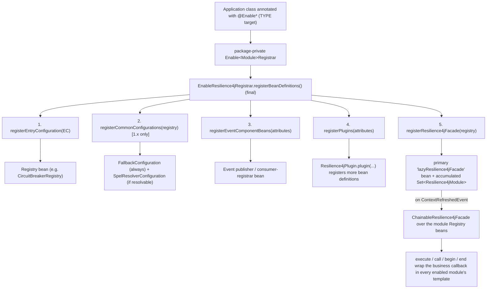
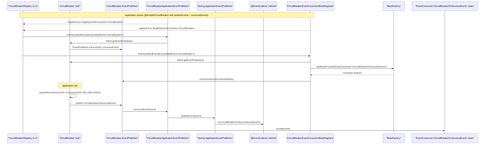
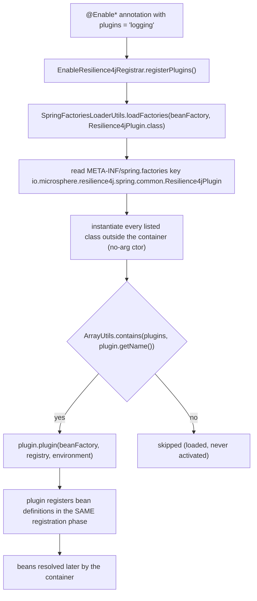
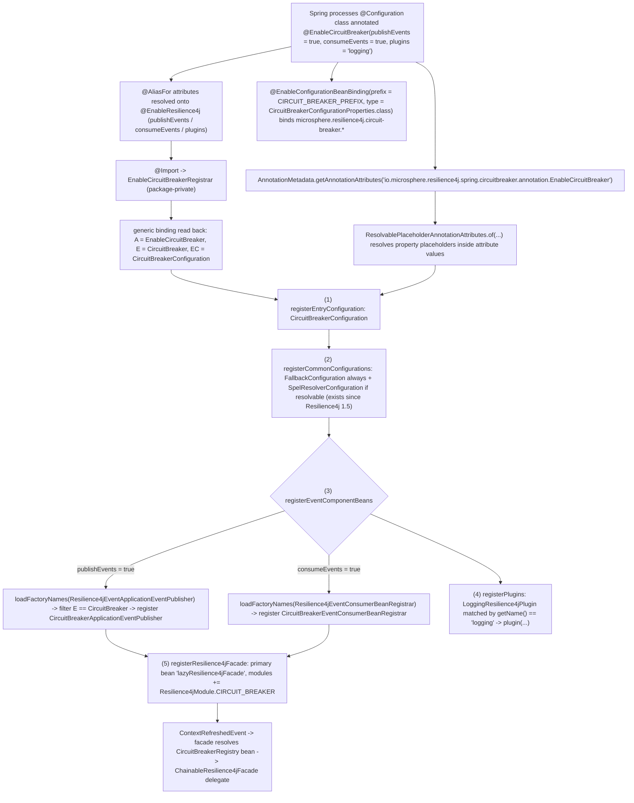
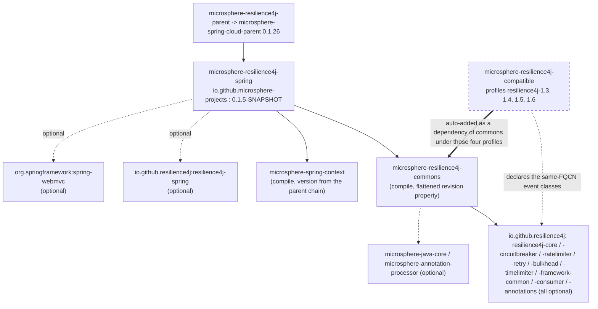

# microsphere-resilience4j-spring — Developer Guide (1.x)

> Source branch: `release-1.x` · Version line: `0.1.x` (latest release `0.1.4`, branch revision `0.1.5-SNAPSHOT`) · Target: **Resilience4j 1.3.0 – 1.7.0** (default `1.7.0`) · Spring Cloud **Hoxton – 2021.0.x**
> Back to [guide index](README.md) · End-user view: [user guide](../user-guide/microsphere-resilience4j-spring.md) · 0.2.x equivalent: [current developer guide](../../current/developer-guide/microsphere-resilience4j-spring.md)

This page analyses the internals of `microsphere-resilience4j-spring` **as it exists on `release-1.x`**:
the registrar pipeline, the event bridge woven against Resilience4j's 1.x `EventPublisher` /
`EventConsumer` / `RegistryEventConsumer` API, the `Resilience4jPlugin` SPI lifecycle, and the
1.x-only `registerCommonConfigurations` step. Every statement below is traceable to a file under
`microsphere-resilience4j-spring/src/{main,test}` in that branch.

---

## 1. Architecture: annotation → registrar → beans → decoration



Four cooperating layers:

| Layer | Classes | Responsibility |
|-------|---------|----------------|
| Annotation | `common.annotation.EnableResilience4j` (`@Target(ANNOTATION_TYPE)`), six per-module annotations | declarative switch board: `publishEvents`, `consumeEvents`, `plugins` + properties binding through `@EnableConfigurationBeanBinding(s)` |
| Registrar | `common.annotation.EnableResilience4jRegistrar<A, E, EC>` + six package-private subclasses | programmatic `ImportBeanDefinitionRegistrar` pipeline (5 steps, §2) |
| Runtime beans | `LazyResilience4jFacade`, five `*ApplicationEventPublisher` + five `*EventConsumerBeanRegistrar` implementations, `EventConsumerMethodFilter` | facade assembly + the event bridge |
| Decoration | commons `Resilience4jTemplate` / `ChainableResilience4jFacade` (outside this module) | the actual wrapping of user callbacks |

### 1.1 Source map (`src/main/java/io/microsphere/resilience4j/spring`)

| Path | Classes |
|------|---------|
| *(root)* | `LazyResilience4jFacade` |
| `common` | `Resilience4jPlugin` (SPI), `Resilience4jUtils` (**1.x only**) |
| `common.annotation` | `EnableResilience4j`, `EnableResilience4jRegistrar` |
| `common.event` | `Resilience4jEventApplicationEventPublisher<E, ET>`, `Resilience4jEventConsumerBeanRegistrar<E>`, `EventConsumerMethodFilter` |
| `circuitbreaker.annotation` / `.event` | `EnableCircuitBreaker` + `EnableCircuitBreakerRegistrar`; `CircuitBreakerApplicationEventPublisher`, `CircuitBreakerEventConsumerBeanRegistrar` |
| `ratelimiter.annotation` / `.event` | `EnableRateLimiter` + `EnableRateLimiterRegistrar`; `RateLimiterApplicationEventPublisher`, `RateLimiterEventConsumerBeanRegistrar` |
| `retry.annotation` / `.event` | `EnableRetry` + `EnableRetryRegistrar`; `RetryApplicationEventPublisher`, `RetryEventConsumerBeanRegistrar` |
| `bulkhead.annotation` / `.event` | `EnableBulkhead`, `EnableThreadPoolBulkhead` + their registrars; `BulkheadApplicationEventPublisher`, `BulkheadEventConsumerBeanRegistrar` |
| `timelimiter.annotation` / `.event` | `EnableTimeLimiter` + `EnableTimeLimiterRegistrar`; `TimeLimiterApplicationEventPublisher`, `TimeLimiterEventConsumerBeanRegistrar` |
| `src/main/resources/META-INF/spring.factories` | the two event-component keys (§4.4) |

There are **no `@Bean` methods, no `@Conditional*` annotations and no `@Order` declarations** anywhere in
this module's main sources (verified by search): every bean definition is registered programmatically, and
ordering/presence decisions are encoded in plain Java (`if (supported)`, `Objects.equals(entryType, …)`,
`resolveClass(...) != null`).

---

## 2. `EnableResilience4jRegistrar` — source analysis

```java
public abstract class EnableResilience4jRegistrar<A extends Annotation, E, EC>
        extends BeanCapableImportCandidate implements ImportBeanDefinitionRegistrar {

    private static final Map<String, Class<?>> attributedEventComponentClassesMap = ofMap(
            "publishEvents", Resilience4jEventApplicationEventPublisher.class,
            "consumeEvents", Resilience4jEventConsumerBeanRegistrar.class);

    protected EnableResilience4jRegistrar() {
        this.superType = resolveSuperType();
        this.annotationType = resolveGeneric(0);
        this.entryType = resolveGeneric(1);
        this.entryConfigurationType = resolveGeneric(2);
    }

    public final void registerBeanDefinitions(AnnotationMetadata metadata, BeanDefinitionRegistry registry) {
        String annotationClassName = annotationType.getName();
        Map<String, Object> annotationAttributes = metadata.getAnnotationAttributes(annotationClassName);
        ResolvablePlaceholderAnnotationAttributes attributes = of(annotationAttributes, annotationType, getEnvironment());

        registerEntryConfiguration(registry);       // (1)
        registerCommonConfigurations(registry);      // (2)  <-- 1.x-only step
        registerEventComponentBeans(attributes, registry); // (3)
        registerPlugins(attributes, registry);       // (4)
        registerResilience4jFacade(registry);        // (5)
    }
}
```

### 2.1 Type-parameter binding happens at construction

The subclass declares no fields and overrides nothing; it only *is* the generic signature, e.g.:

```java
class EnableCircuitBreakerRegistrar extends EnableResilience4jRegistrar<EnableCircuitBreaker, CircuitBreaker,
        CircuitBreakerConfiguration> {
}
```

The base class reads that signature back with `ResolvableType`:

```java
private static ResolvableType resolveSuperType(Class<?> targetClass, Class<?> superClass) {
    ResolvableType type = forType(targetClass);
    return type.as(superClass);
}

private <T> Class<T> resolveGeneric(int index) {
    return (Class<T>) this.superType.resolveGeneric(index);
}
```

so `A` = the enable annotation (used to fetch `AnnotationMetadata` attributes), `E` = the Resilience4j
entry type (`CircuitBreaker`), `EC` = the Resilience4j entry configuration class
(`io.github.resilience4j.circuitbreaker.configure.CircuitBreakerConfiguration`). The same trick is reused
in `resolveEntryType(Class<?> targetClass, Class<?> superClass)` to recover the `E` of an event component
class.

### 2.2 Step (1) + (2): entry configuration and the 1.x common configurations

```java
private void registerEntryConfiguration(BeanDefinitionRegistry registry) {
    registerBeanDefinition(registry, getEntryConfigurationType());
}
```

`registerBeanDefinition` is `io.microsphere.spring.beans.factory.support.BeanRegistrar`
(microsphere-spring-context). Registering `CircuitBreakerConfiguration` is what puts the
`CircuitBreakerRegistry` bean into the context — Resilience4j's own 1.x configuration class provides the
registry, and the module's tests autowire it.

Step (2) is the step that **only exists on this branch**:

```java
public abstract class Resilience4jUtils {           // io.microsphere.resilience4j.spring.common (1.x only)

    public static final String SPEL_RESOLVER_CONFIGURATION_CLASS_NAME =
            "io.github.resilience4j.spelresolver.configure.SpelResolverConfiguration";

    public static void registerCommonConfigurations(BeanDefinitionRegistry registry) {
        registerFallbackConfiguration(registry);
        registerSpelResolverConfiguration(registry);
    }

    public static void registerFallbackConfiguration(BeanDefinitionRegistry registry) {
        registerBeanDefinition(registry, FallbackConfiguration.class);
    }

    public static void registerSpelResolverConfiguration(BeanDefinitionRegistry registry) {
        Class<?> spelResolverConfigurationClass = resolveClass(SPEL_RESOLVER_CONFIGURATION_CLASS_NAME);
        if (spelResolverConfigurationClass != null) {
            registerBeanDefinition(registry, spelResolverConfigurationClass);
        }
    }
}
```

Rationale, quoted from this class' own Javadoc: *"Resilience4j Spring 2.0+ Entry Configuration class
imports FallbackConfiguration and SpelResolverConfiguration default"* — i.e. on Resilience4j **1.x** they
must be registered explicitly, which is why the 1.x registrar contains the extra call and why
`registerSpelResolverConfiguration` guards on `resolveClass(...) != null` (`SpelResolverConfiguration`
exists only *since Resilience4j 1.5*, so a `resilience4j-1.3` / `1.4` build silently skips it).
`FallbackConfiguration` is a plain type import
(`io.github.resilience4j.fallback.configure.FallbackConfiguration`) and is therefore required on the
compile classpath.

> Name collision worth knowing: this class shares its simple name with commons'
> `io.microsphere.resilience4j.util.Resilience4jUtils` (the `createTemplates(…)` helper). They are
> different types in different artifacts; the registrar uses neither by qualified name — it static-imports
> `io.microsphere.resilience4j.spring.common.Resilience4jUtils.registerCommonConfigurations`.

On `release` (0.2.x) the same method list is `registerEntryConfiguration → registerEventComponentBeans →
registerPlugins → registerResilience4jFacade`, and `Resilience4jUtils` (spring flavour) does not exist —
verified by diffing the two trees.

### 2.3 Step (3): `registerEventComponentBeans` — spring.factories plus a generics filter

```java
private void registerEventComponentBeans(ResolvablePlaceholderAnnotationAttributes attributes,
                                         BeanDefinitionRegistry registry) {
    for (Map.Entry<String, Class<?>> entry : attributedEventComponentClassesMap.entrySet()) {
        String attributeName = entry.getKey();
        boolean supported = attributes.getBoolean(attributeName);
        if (supported) {
            Class<?> eventComponentClass = entry.getValue();
            registerComponentBean(eventComponentClass, registry);
        }
    }
}

private void registerComponentBean(Class<?> componentClass, BeanDefinitionRegistry registry) {
    ClassLoader classLoader = this.getClassLoader();
    List<String> actualComponentClassNames = loadFactoryNames(componentClass, classLoader);
    for (String actualComponentClassName : actualComponentClassNames) {
        Class<?> actualComponentClass = resolveClassName(actualComponentClassName, classLoader);
        Class<E> entryTypeFromComponent = resolveEntryType(actualComponentClass, componentClass);
        if (Objects.equals(entryTypeFromComponent, this.entryType)) {
            registerBeanDefinition(registry, actualComponentClass);
        }
    }
}
```

The indirection is deliberate: the abstract super-types are the **spring.factories keys**, and each
concrete implementation declares its entry type as generic parameter `0`:

```properties
# src/main/resources/META-INF/spring.factories
io.microsphere.resilience4j.spring.common.event.Resilience4jEventApplicationEventPublisher=\
io.microsphere.resilience4j.spring.bulkhead.event.BulkheadApplicationEventPublisher,\
io.microsphere.resilience4j.spring.circuitbreaker.event.CircuitBreakerApplicationEventPublisher,\
io.microsphere.resilience4j.spring.ratelimiter.event.RateLimiterApplicationEventPublisher,\
io.microsphere.resilience4j.spring.retry.event.RetryApplicationEventPublisher,\
io.microsphere.resilience4j.spring.timelimiter.event.TimeLimiterApplicationEventPublisher

# Resilience4jEventConsumerBeanRegistrar
io.microsphere.resilience4j.spring.common.event.Resilience4jEventConsumerBeanRegistrar=\
io.microsphere.resilience4j.spring.bulkhead.event.BulkheadEventConsumerBeanRegistrar,\
io.microsphere.resilience4j.spring.circuitbreaker.event.CircuitBreakerEventConsumerBeanRegistrar,\
io.microsphere.resilience4j.spring.ratelimiter.event.RateLimiterEventConsumerBeanRegistrar,\
io.microsphere.resilience4j.spring.retry.event.RetryEventConsumerBeanRegistrar,\
io.microsphere.resilience4j.spring.timelimiter.event.TimeLimiterEventConsumerBeanRegistrar
```

Consequences an implementer must internalise:

- Third-party modules can add a new event component for a new entry type by appending to these keys —
  no change to the registrars (open/closed).
- A component whose `E` does not equal the annotation's `E` is skipped. Because no
  `ThreadPoolBulkhead`-typed component is shipped, `@EnableThreadPoolBulkhead(publishEvents = true,
  consumeEvents = true)` registers nothing (its `E` is `ThreadPoolBulkhead`).
- `loadFactoryNames` is Spring's `SpringFactoriesLoader`, using the registrar's `getClassLoader()`
  inherited from `BeanCapableImportCandidate`.

### 2.4 Step (4): `registerPlugins`

```java
private void registerPlugins(ResolvablePlaceholderAnnotationAttributes attributes,
                             BeanDefinitionRegistry registry) {
    String[] plugins = attributes.getStringArray("plugins");
    List<Resilience4jPlugin> resilience4jPlugins = loadFactories(this.getBeanFactory(), Resilience4jPlugin.class);
    for (Resilience4jPlugin resilience4jPlugin : resilience4jPlugins) {
        String pluginName = resilience4jPlugin.getName();
        if (contains(plugins, pluginName)) {
            resilience4jPlugin.plugin(this.beanFactory, registry, this.environment);
        }
    }
}
```

`loadFactories` is `io.microsphere.spring.core.io.support.SpringFactoriesLoaderUtils.loadFactories`
(microsphere-spring-context), which returns instantiated plugins (hence the no-arg-constructor
requirement); `contains` is `io.microsphere.util.ArrayUtils.contains`. The `registry` and
`this.environment` passed to `plugin(...)` are the registrar's own collaborators, so the plugin acts in
exactly the same registration phase as the registrar.

### 2.5 Step (5): `registerResilience4jFacade` — one facade, accumulating modules

```java
private void registerResilience4jFacade(BeanDefinitionRegistry registry) {
    Resilience4jModule module = valueOf(this.entryType);
    String beanName = BEAN_NAME;
    String propertyName = "modules";

    Set<Resilience4jModule> modules;
    AbstractBeanDefinition beanDefinition;
    PropertyValue modulesPropertyValue;
    if (registry.containsBeanDefinition(beanName)) {
        beanDefinition = (AbstractBeanDefinition) registry.getBeanDefinition(beanName);
        modulesPropertyValue = beanDefinition.getPropertyValues().getPropertyValue(propertyName);
        modules = (Set<Resilience4jModule>) modulesPropertyValue.getValue();
    } else {
        modules = newHashSet(Resilience4jModule.values().length);
        beanDefinition = genericBeanDefinition(LazyResilience4jFacade.class);
        beanDefinition.setPrimary(true);
        MutablePropertyValues propertyValues = beanDefinition.getPropertyValues();
        propertyValues.add(propertyName, modules);
        registerBeanDefinition(registry, beanName, beanDefinition);
    }
    modules.add(module);
}
```

Key points:

- The **same `Set` instance** is mutated across annotations, so `@EnableRetry` +
  `@EnableCircuitBreaker` + `@EnableRateLimiter` accumulate three modules on one bean definition. The
  property value is a live object, not a value string — a technique that only works because registration
  and refresh are separated in time.
- `setPrimary(true)` is what lets applications `@Autowired Resilience4jFacade`.
- `Resilience4jModule.valueOf(Class)` (commons) searches each enum member's entry / config / properties /
  event / registry class and throws `IllegalArgumentException` if the type is unknown — so the entry type
  `E` of a registrar must be a type commons knows about.
- On `release` (0.2.x) this method is identical (diff shows no change); only the surrounding pipeline
  differs.

---

## 3. The per-module registrars

| Registrar (package-private) | `A` | `E` | `EC` (registered class) |
|---|---|---|---|
| `EnableCircuitBreakerRegistrar` | `EnableCircuitBreaker` | `CircuitBreaker` | `…circuitbreaker.configure.CircuitBreakerConfiguration` |
| `EnableRateLimiterRegistrar` | `EnableRateLimiter` | `RateLimiter` | `…ratelimiter.configure.RateLimiterConfiguration` |
| `EnableRetryRegistrar` | `EnableRetry` | `Retry` | `…retry.configure.RetryConfiguration` |
| `EnableTimeLimiterRegistrar` | `EnableTimeLimiter` | `TimeLimiter` | `…timelimiter.configure.TimeLimiterConfiguration` |
| `EnableBulkheadRegistrar` | `EnableBulkhead` | `Bulkhead` | `…bulkhead.configure.BulkheadConfiguration` |
| `EnableThreadPoolBulkheadRegistrar` | `EnableThreadPoolBulkhead` | `ThreadPoolBulkhead` | `…bulkhead.configure.BulkheadConfiguration` — **not** `…bulkhead.configure.threadpool.ThreadPoolBulkheadConfiguration`, which is only named in its Javadoc |

Each file is a single class declaration with no members; all behaviour is inherited. On Resilience4j
`1.7.0`, `BulkheadConfiguration` itself is `@Configuration @Import({ThreadPoolBulkheadConfiguration.class,
FallbackConfiguration.class, SpelResolverConfiguration.class})`, which is why `@EnableThreadPoolBulkhead`
still yields a `ThreadPoolBulkheadRegistry` in `EnableThreadPoolBulkheadTest`.

The per-module annotations add the properties binding, e.g.:

```java
@Target(TYPE)
@Retention(RUNTIME)
@Documented
@Inherited
@Import(EnableCircuitBreakerRegistrar.class)
@EnableResilience4j
@EnableConfigurationBeanBinding(prefix = CIRCUIT_BREAKER_PREFIX, type = CircuitBreakerConfigurationProperties.class)
public @interface EnableCircuitBreaker { … }
```

with `CIRCUIT_BREAKER_PREFIX = "microsphere.resilience4j.circuit-breaker."` from commons'
`Resilience4jConstants`, and (1.x-specific) `type` pointing at
`io.github.resilience4j.circuitbreaker.configure.CircuitBreakerConfigurationProperties`.
`@EnableBulkhead` / `@EnableThreadPoolBulkhead` instead use `@EnableConfigurationBeanBindings({…})` with
both `…bulkhead.configure.BulkheadConfigurationProperties` (`BULKHEAD_PREFIX`) and
`io.github.resilience4j.common.bulkhead.configuration.ThreadPoolBulkheadConfigurationProperties`
(`THREAD_POOL_BULKHEAD_PREFIX`). On the 0.2.x branch that second type is
`…common.bulkhead.configuration.CommonThreadPoolBulkheadConfigurationProperties` — the only difference
between the two branches' bulkhead annotation sources.

---

## 4. The event bridge and the Resilience4j **1.x** event API

### 4.1 What the sources import — and what those imports resolve to

`io.microsphere.resilience4j.spring.common.event.Resilience4jEventApplicationEventPublisher` imports:

```java
import io.github.resilience4j.core.EventConsumer;
import io.github.resilience4j.core.EventPublisher;
import io.github.resilience4j.core.registry.EntryAddedEvent;
import io.github.resilience4j.core.registry.EntryRemovedEvent;
import io.github.resilience4j.core.registry.EntryReplacedEvent;
import io.github.resilience4j.core.registry.RegistryEventConsumer;
```

and the module subclasses bind the 1.x event types, e.g. `CircuitBreakerApplicationEventPublisher`'s
imports are:

```java
import io.github.resilience4j.circuitbreaker.CircuitBreaker;
import io.github.resilience4j.circuitbreaker.event.CircuitBreakerEvent;   // <-- may come from the shim!
import io.github.resilience4j.core.EventConsumer;
import io.microsphere.resilience4j.spring.common.event.Resilience4jEventApplicationEventPublisher;
```

That `io.github.resilience4j.circuitbreaker.event.CircuitBreakerEvent` import is the 1.x-specific detail
to watch: on Resilience4j `1.7.0` the type ships in `resilience4j-circuitbreaker`, but under the
`resilience4j-1.3` … `resilience4j-1.6` build profiles the same FQCN is contributed by this branch's
**`microsphere-resilience4j-compatible`** artifact (attached to `…-commons` by those profiles), which
declares `io.github.resilience4j.circuitbreaker.event.{CircuitBreakerEvent,
CircuitBreakerOnFailureRateExceededEvent, CircuitBreakerOnSlowCallRateExceededEvent}` and
`io.github.resilience4j.ratelimiter.event.{RateLimiterEvent, RateLimiterOnDrainedEvent}`. Concretely:
`RateLimiterOnDrainedEvent` is absent from `resilience4j-ratelimiter` 1.4.0/1.6.1 and present from 1.7.0,
which is the archetypal case the shim covers. `…event.RetryEvent`, `…event.TimeLimiterEvent` and
`…event.BulkheadEvent` (imported by their publishers) have no shim counterpart and must come from the
Resilience4j artifacts themselves.

The same resolution applies to commons' `Resilience4jModule`, whose `CIRCUIT_BREAKER` and `RATE_LIMITER`
constants carry `…event.CircuitBreakerEvent` / `…event.RateLimiterEvent` as their `eventClass`.

### 4.2 Publishing side: `Resilience4jEventApplicationEventPublisher<E, ET>`

```java
public abstract class Resilience4jEventApplicationEventPublisher<E, ET>
        implements EventConsumer<ET>, RegistryEventConsumer<E>, ApplicationEventPublisherAware {

    @Override
    public void consumeEvent(ET event) {
        applicationEventPublisher.publishEvent(event);
        logger.trace("The Resilience4j Event : {} was published on the Spring ApplicationListener(s)", event);
    }

    @Override
    public void onEntryAddedEvent(EntryAddedEvent<E> entryAddedEvent) {
        register(entryAddedEvent::getAddedEntry);
    }

    @Override
    public void onEntryRemovedEvent(EntryRemovedEvent<E> entryRemoveEvent) {
    }                                       // deliberate no-op: subscriptions are not undone

    @Override
    public void onEntryReplacedEvent(EntryReplacedEvent<E> entryReplacedEvent) {
        register(entryReplacedEvent::getNewEntry);
    }

    private void register(Supplier<E> entrySupplier) {
        E entry = entrySupplier.get();
        Class<?> entryClass = entry.getClass();
        Method eventPublisherMethod = findMethod(entryClass, "getEventPublisher");
        EventPublisher<ET> eventPublisher = (EventPublisher) invokeMethod(eventPublisherMethod, entry);
        eventPublisher.onEvent(this::consumeEvent);
    }
}
```

Design notes:

- It is a **`RegistryEventConsumer`**, so it is picked up by Resilience4j's 1.x registry when the registry
  is built; that is the hook that makes the bridge entry-lifecycle aware.
- `getEventPublisher()` is obtained **reflectively** (`ReflectionUtils.findMethod`/`invokeMethod`) rather
  than through a shared interface, because in 1.x each entry type (`CircuitBreaker`, `Retry`, `Bulkhead`,
  …) declares its own nested publisher type and its own `getEventPublisher()` signature; one reflective
  call covers all of them.
- `EventPublisher#onEvent(EventConsumer)` (the 1.x single-argument form) subscribes the publisher to
  **all** events of that entry, so the whole event family reaches Spring.
- `publishEvent(event)` publishes the Resilience4j event object itself; Spring wraps non-`ApplicationEvent`
  payloads in a `PayloadApplicationEvent`, which is why `@EventListener(CircuitBreakerOnSuccessEvent.class)`
  works verbatim (see `EnableCircuitBreakerTest`, `CircuitBreakerApplicationEventPublisherTest`).

### 4.3 Consuming side: `Resilience4jEventConsumerBeanRegistrar<E>`

```java
public abstract class Resilience4jEventConsumerBeanRegistrar<E>
        implements RegistryEventConsumer<E>, BeanFactoryAware {

    private void register(E entry) {
        Class<?> entryClass = entry.getClass();
        Method eventPublisherMethod = findMethod(entryClass, "getEventPublisher");
        Class<?> eventPublisherClass = eventPublisherMethod.getReturnType();
        Object eventPublisher = invokeMethod(eventPublisherMethod, entry);
        doWithMethods(eventPublisherClass, method -> {
            ResolvableType type = forMethodParameter(method, 0);
            ObjectProvider objectProvider = beanFactory.getBeanProvider(type);
            objectProvider.forEach(eventConsumerBean -> invokeMethod(method, eventPublisher, eventConsumerBean));
        }, INSTANCE);
    }
}
```

The generic parameter type (`EventConsumer<CircuitBreakerOnSuccessEvent>`) is the bean lookup key, and
`ObjectProvider#forEach` means *zero-or-many*: several beans of the same event type are all subscribed.
`onEntryAddedEvent` / `onEntryReplacedEvent` log the entry lifecycle at trace level and then register;
`onEntryRemovedEvent` only logs.

### 4.4 The method filter

```java
public class EventConsumerMethodFilter implements MethodFilter {          // org.springframework.util.ReflectionUtils.MethodFilter

    public static EventConsumerMethodFilter INSTANCE = new EventConsumerMethodFilter();

    @Override
    public boolean matches(Method method) {
        return method.getParameterCount() == 1 && EventConsumer.class.equals(method.getParameterTypes()[0]);
    }
}
```

The test `EventConsumerMethodFilterTest` pins the contract against the **1.x** publisher interfaces —
`io.github.resilience4j.core.EventPublisher` plus the nested `Retry.EventPublisher`,
`CircuitBreaker.EventPublisher`, `RateLimiter.EventPublisher`, `TimeLimiter.EventPublisher`,
`Bulkhead.EventPublisher`: every locally declared method must match (`doWithLocalMethods` +
`assertEquals(matched, INSTANCE.matches(method))`), and the test class itself must not. On 1.7.0 the
CircuitBreaker publisher is exactly that shape — `onSuccess`, `onError`, `onStateTransition`, `onReset`,
`onIgnoredError`, `onCallNotPermitted`, `onFailureRateExceeded`, `onSlowCallRateExceeded`, each taking a
single `EventConsumer<…>`. Because the comparison is on the **raw** parameter type, the
`EventConsumer` type itself contributes no generic information; the generic is read separately in
`Resilience4jEventConsumerBeanRegistrar` via `ResolvableType.forMethodParameter(method, 0)`.

> Mutable-static note for maintainers: `INSTANCE` is a non-`final` public static field. The current code
> never reassigns it, but nothing protects it either; if you add state to the filter, make it `final`.

### 4.5 Bridge coverage

| Entry type `E` | Publisher component | Consumer-registrar component |
|----------------|---------------------|------------------------------|
| `CircuitBreaker` | `CircuitBreakerApplicationEventPublisher` | `CircuitBreakerEventConsumerBeanRegistrar` |
| `RateLimiter` | `RateLimiterApplicationEventPublisher` | `RateLimiterEventConsumerBeanRegistrar` |
| `Retry` | `RetryApplicationEventPublisher` | `RetryEventConsumerBeanRegistrar` |
| `TimeLimiter` | `TimeLimiterApplicationEventPublisher` | `TimeLimiterEventConsumerBeanRegistrar` |
| `Bulkhead` | `BulkheadApplicationEventPublisher` | `BulkheadEventConsumerBeanRegistrar` |
| `ThreadPoolBulkhead` | *none shipped* | *none shipped* |

Each concrete class is a one-liner: e.g.
`public class RetryApplicationEventPublisher extends Resilience4jEventApplicationEventPublisher<Retry, RetryEvent> {}`.

### 4.6 Diagram (b): a Resilience4j 1.x event travelling both directions



---

## 5. `LazyResilience4jFacade`: lazy initialization analysis

```java
public class LazyResilience4jFacade implements Resilience4jFacade,
        ApplicationListener<ContextRefreshedEvent>, DelegatingWrapper {

    public static final String BEAN_NAME = "lazyResilience4jFacade";

    @Override
    public void onApplicationEvent(ContextRefreshedEvent event) {
        initDelegate(event.getApplicationContext());
    }

    private void initDelegate(ApplicationContext context) {
        Set<Resilience4jModule> modules = getModules();
        List<Registry> registries = newArrayList(modules.size());
        for (Resilience4jModule module : modules) {
            Class<? extends Registry> registryClass = module.getRegistryClass();
            Registry registry = context.getBean(registryClass);
            registries.add(registry);
        }
        this.delegate = new ChainableResilience4jFacade(registries);
    }
}
```

- `Registry` here is `io.github.resilience4j.core.Registry` — the 1.x (raw) registry type; commons'
  `ChainableResilience4jFacade(Collection<Registry>)` constructor converts each registry into its template
  through `io.microsphere.resilience4j.util.Resilience4jUtils.createTemplates`, deduplicates, then sorts
  with `Prioritized.COMPARATOR`.
- Every facade method is a pure one-line delegation to `delegate` (`execute`, `call` ×4, `begin`, `end`,
  `isBeginSupported`, `isEndSupported`); `getDelegate()` implements `DelegatingWrapper` and the inherited
  `unwrap(Class)` returns the typed delegate (asserted in `LazyResilience4jFacadeTest#testGetDelegate`).
- Failure modes are implicit by design: `delegate == null` before refresh → `NullPointerException`; a
  missing registry bean for an enabled module → `NoSuchBeanDefinitionException` at
  `ContextRefreshedEvent` time (which is why `resilience4j-spring` must be on the classpath even though it
  is optional in the POM).
- `onApplicationEvent` re-runs on every `ContextRefreshedEvent` (refreshable contexts rebuild the delegate),
  which is what makes a late-added `Registry` bean pickable without restarting.

---

## 6. Plugin SPI lifecycle



Test-scope evidence of the whole cycle: `src/test/resources/META-INF/spring.factories` lists
`LoggingResilience4jPlugin` (name `"logging"`) and `NoOpResilience4jPlugin` (name `"no-operation"`), and
`EnableBulkheadTest` activates only the first one (`plugins = NAME`). Production plugins use the same
mechanism: `MyBatisResilience4jPlugin` (`PLUGIN_NAME = "mybatis"`) registers a bean definition whose
constructor argument references `LazyResilience4jFacade.BEAN_NAME`, and
`SpringWebResilience4jPlugin` (`PLUGIN_NAME = "spring-web"`) registers
`Resilience4jHandlerMethodInterceptor` under its own `BEAN_NAME` — proof that a plugin's job is bean-definition
registration, not bean instantiation.

---

## 7. Diagram (a): `@EnableCircuitBreaker` bootstrap



---

## 8. Design patterns — with evidence

| Pattern | Where | Evidence in the 1.x source |
|---------|-------|----------------------------|
| **Template Method** (fixed pipeline, variable generics) | `EnableResilience4jRegistrar` | `public final void registerBeanDefinitions(...)` calls five private steps; subclasses contribute nothing but the `<A, E, EC>` declaration |
| **Self-configuring generic type** | same class | `resolveSuperType(this.getClass(), EnableResilience4jRegistrar.class).resolveGeneric(0/1/2)`; `resolveEntryType(actualComponentClass, componentClass)` |
| **Observer / Event bus** | `Resilience4jEventApplicationEventPublisher` | implements `EventConsumer<ET>` + `RegistryEventConsumer<E>`; subscribes itself with `EventPublisher.onEvent(this::consumeEvent)` and forwards to `ApplicationEventPublisher.publishEvent` |
| **Adapter** | both bridge bases | Resilience4j's `EventConsumer` world is adapted to Spring's `ApplicationEventPublisher`, and Spring's `ObjectProvider<EventConsumer<…>>` beans are adapted back onto `getEventPublisher()` methods |
| **Specification / Filter** | `EventConsumerMethodFilter` | single predicate `matches(Method)` reused by `ReflectionUtils.doWithMethods` |
| **SPI / plugin** | `Resilience4jPlugin` | loaded by `SpringFactoriesLoaderUtils.loadFactories` from `META-INF/spring.factories`; activated by name match |
| **Facade + Lazy Proxy (virtual proxy flavour)** | `LazyResilience4jFacade` | implements `Resilience4jFacade`, holds a `delegate` built only on `ContextRefreshedEvent`, exposes it via `DelegatingWrapper#getDelegate()` / `unwrap` |
| **Chain of Responsibility** (delegated to commons) | `initDelegate` | builds `ChainableResilience4jFacade(registries)`, which wraps the callback through each module template |
| **Registry** | the whole module | one `Registry` bean per `Resilience4jModule`, keyed by entry name at call time |
| **Accumulating bean definition (shared mutable property value)** | `registerResilience4jFacade` | the same `Set<Resilience4jModule>` instance is read back out of an existing `PropertyValue` and mutated |
| **Marker/utility encapsulation** | `Resilience4jUtils` (spring, 1.x) | `private Resilience4jUtils() {}`, abstract class, only static methods |

---

## 9. Bean inventory for `@EnableBulkhead(publishEvents = true, consumeEvents = true, plugins = "logging")`

| Bean definition | Source of registration | Notes |
|-----------------|------------------------|-------|
| `BulkheadConfiguration` | step (1) | contributes `BulkheadRegistry` (and, on 1.7.0, transitively `ThreadPoolBulkheadConfiguration`) |
| `FallbackConfiguration` | step (2) | unconditional |
| `SpelResolverConfiguration` | step (2) | only if the class is resolvable (Resilience4j ≥ 1.5) |
| `BulkheadApplicationEventPublisher` | step (3), `publishEvents` | entry type `Bulkhead` |
| `BulkheadEventConsumerBeanRegistrar` | step (3), `consumeEvents` | entry type `Bulkhead` |
| (no bean) for `LoggingResilience4jPlugin` | step (4) | instantiated by the SPI loader, never a container bean; its `plugin(...)` would register definitions |
| `lazyResilience4jFacade` | step (5) | primary, `modules = {BULKHEAD}` |
| `…bulkhead.configure.BulkheadConfigurationProperties` and `io.github.resilience4j.common.bulkhead.configuration.ThreadPoolBulkheadConfigurationProperties` | `@EnableConfigurationBeanBinding(s)` meta-annotation, **not** the registrar | bound from `microsphere.resilience4j.bulkhead.*` and `microsphere.resilience4j.thread-pool-bulkhead.*` |

---

## 10. Module dependencies (from `microsphere-resilience4j-spring/pom.xml`)



Facts behind the diagram:

- `microsphere-resilience4j-commons` and `microsphere-spring-context` are the only **non-optional**
  compile dependencies of this module (besides test-scope `junit-jupiter`, `spring-test`,
  `microsphere-spring-test`, `aspectjweaver`, `logback-classic`).
- `resilience4j-spring` and `spring-webmvc` are `<optional>true</optional>` — applications must add the
  Resilience4j artifacts they use.
- The profile-conditional shim is declared in `microsphere-resilience4j-commons/pom.xml`, not here:
  profiles `resilience4j-1.3`, `resilience4j-1.4`, `resilience4j-1.5`, `resilience4j-1.6` each add a
  dependency on `microsphere-resilience4j-compatible` at `${revision}`; profile `resilience4j-1.7`
  (`activeByDefault`, `1.7.0`) does not. So `spring → commons → (compatible)?` is how the missing event
  types reach this module's classpath.
- The version profiles themselves live in `microsphere-resilience4j-parent/pom.xml`, and this module's POM
  adds **no** profile of its own (unlike the 0.2.x `microsphere-resilience4j-spring/pom.xml`, which
  re-declares `resilience4j-2.4` with `2.3.0`).

---

## 11. Testing conventions (and why the initializer exists on this branch)

| Test | Wiring style | Asserts |
|------|--------------|---------|
| `EnableCircuitBreakerTest`, `EnableRateLimiterTest`, `EnableRetryTest`, `EnableTimeLimiterTest`, `EnableBulkheadTest`, `EnableThreadPoolBulkheadTest` | `@SpringJUnitConfig(classes = <the test class itself>)` + the `@Enable*` annotation + `@TestPropertySource` + `@EnableSpringConverterAdapter` | registry bean present, properties bound into `…<module>.configure.<Module>ConfigurationProperties.InstanceProperties`, entry behaviour |
| `CircuitBreakerApplicationEventPublisherTest` | `@ExtendWith(SpringExtension.class)` + `@ContextConfiguration(classes = {CircuitBreakerConfiguration, CircuitBreakerConfigurationProperties, CircuitBreakerApplicationEventPublisher, the test}), initializers = {CommonConfigurationsApplicationContextInitializer}` + an `@EventListener` | the Resilience4j event reaches the Spring listener |
| `CircuitBreakerEventConsumerBeanRegistrarTest` | same shape, but registers a `@Bean EventConsumer<CircuitBreakerOnSuccessEvent>` | the typed consumer is invoked |
| `EventConsumerMethodFilterTest` | plain JUnit 5, `ReflectionUtils.doWithLocalMethods` | the filter's predicate over the 1.x publisher interfaces |
| `LazyResilience4jFacadeTest` | `@SpringJUnitConfig` + `@EnableBulkhead` | the delegating facade API, `unwrap`/`getDelegate` |

`io.microsphere.resilience4j.spring.context.CommonConfigurationsApplicationContextInitializer` is the
1.x-only test helper:

```java
public class CommonConfigurationsApplicationContextInitializer implements ApplicationContextInitializer<ConfigurableApplicationContext> {

    @Override
    public void initialize(ConfigurableApplicationContext context) {
        ConfigurableListableBeanFactory beanFactory = context.getBeanFactory();
        BeanDefinitionRegistry registry = asBeanDefinitionRegistry(beanFactory);
        registerCommonConfigurations(registry);
    }
}
```

It exists precisely because the two `*event*` tests bypass the `@Enable*` annotations and declare the
`CircuitBreakerConfiguration` / publisher / registrar classes directly, so step (2) of §2.2 would otherwise
never run and Resilience4j 1.x's configuration classes would miss `FallbackConfiguration` /
`SpelResolverConfiguration`. On the 0.2.x branch this initializer class does not exist and the tests carry
no `initializers` attribute (diff-verified).

To add a new module to this branch you therefore need: an `@Enable*` annotation with the three aliased
attributes, a package-private `Enable<Module>Registrar extends EnableResilience4jRegistrar<A, E, EC>`, the
two event component classes, two `spring.factories` lines, and — if the entry type or event classes are not
present in every supported Resilience4j 1.x release — the corresponding types in
`microsphere-resilience4j-compatible`.

---

## 12. Known sharp edges (1.x)

1. **Javadoc vs. code**: `publishEvents` / `consumeEvents` are documented as "`true` as default" in
   `EnableResilience4j` and in all six annotations, but declared `default false`. Per-module `plugins()`
   Javadoc says "Spring Bean names" while the registrar matches `Resilience4jPlugin#getName()`.
2. **`EnableThreadPoolBulkheadRegistrar` registers `BulkheadConfiguration`** (third generic), although its
   Javadoc `@see` names `ThreadPoolBulkheadConfiguration`. Behaviour on 1.7.0 depends on Resilience4j's own
   `@Import` chain — check it when you change the Resilience4j profile.
3. **No `ThreadPoolBulkhead` event components** ship in `spring.factories`, so `@EnableThreadPoolBulkhead`
   silently registers nothing for both event flags.
4. **Reflective coupling to `getEventPublisher()`**: both bridge bases `findMethod(entryClass,
   "getEventPublisher")` and then `invokeMethod(...)` without a null check. If a future 1.x entry type lacks
   that method, `invokeMethod(null, entry)` throws `NullPointerException`/`IllegalArgumentException` — this
   is an intentional 1.x assumption (every 1.x entry exposes its own publisher).
5. **Removed entries are never unsubscribed** (`onEntryRemovedEvent` is empty on both sides); long-running
   registries that churn entries keep their listeners.
6. **Unchecked casts by design**: `(EventPublisher) invokeMethod(...)`,
   `(Set<Resilience4jModule>) modulesPropertyValue.getValue()`, raw `Registry` / `ObjectProvider` usage.
   They are what keeps one source tree compiling against `1.3` – `1.7`.
7. **The facade is refresh-driven and null before refresh**; `ContextRefreshedEvent` also fires on context
   refresh, rebuilding the delegate each time.
8. **Classpath-sensitive common configurations**: `registerSpelResolverConfiguration` succeeds only when
   `io.github.resilience4j.spelresolver.configure.SpelResolverConfiguration` resolves (Resilience4j ≥ 1.5);
   `registerFallbackConfiguration` requires `resilience4j-framework-common` with
   `io.github.resilience4j.fallback.configure.FallbackConfiguration` present, and it runs for *every*
   `@Enable*`, including bulkhead, whose own `BulkheadConfiguration` already imports both classes on 1.7.0.

---

## 13. See also

- [1.x developer guide index](README.md) · [spring module user guide (1.x)](../user-guide/microsphere-resilience4j-spring.md)
- [commons module — developer guide](microsphere-resilience4j-commons.md) · [compatible shim — developer guide](microsphere-resilience4j-compatible.md) · [parent / BOM](microsphere-resilience4j-parent.md)
- 0.2.x equivalent analysis: [../../current/developer-guide/microsphere-resilience4j-spring.md](../../current/developer-guide/microsphere-resilience4j-spring.md)
