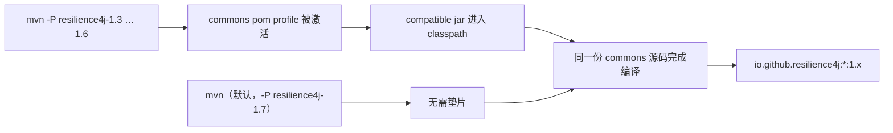

# 开发者指南 — 1.x（release-1.x 分支，v0.1.x）

> 源分支：`release-1.x` · 版本线：`0.1.x` · 目标：**Resilience4j 1.3.0 – 1.7.0**
> 英文版本见 [README.md](../README.md)

本指南记录 1.x 维护版本的内部实现。整体架构与[当前版本线](../../../current/developer-guide/zh/README.md)一致；本页聚焦于 0.1.x 特有的部分：**compatible** 兼容性垫片模块、多版本构建策略，以及各模块所围绕编织（weave）的 1.x API。

## 系统架构

```mermaid
flowchart TD
    subgraph plugins["插件（1.x）"]
        DRUID["…-alibaba-druid"]
        MYBATIS["…-mybatis"]
        WEB["…-spring-web"]
        HIB["…-hibernate-core"]
        FEIGN["…-openfeign"]
    end
    SPRING["microsphere-resilience4j-spring"]
    COMMONS["microsphere-resilience4j-commons"]
    COMPAT["microsphere-resilience4j-compatible"]
    R4J["Resilience4j 1.3 – 1.7"]

    DRUID & MYBATIS & WEB & HIB --> SPRING
    FEIGN --> COMMONS
    SPRING --> COMMONS
    COMMONS --> R4J
    COMPAT -.-"由以下 profile 添加\nresilience4j-1.3 … 1.6"--> COMMONS
```

## 多版本构建问题与 `compatible` 模块

Resilience4j 1.3 – 1.7 并不共用同一套事件 API：本库的 Spring 事件桥所依赖的若干事件类（例如位于 `io.github.resilience4j.*.event` 包下的 `CircuitBreakerOnFailureRateExceededEvent`、`CircuitBreakerOnSlowCallRateExceededEvent`、`RateLimiterEvent`、`RateLimiterOnDrainedEvent`）直到较晚的 1.x 版本才被引入。

本分支的解决方案是：

- profile `resilience4j-1.3` … `resilience4j-1.6`（定义于 `microsphere-resilience4j-commons/pom.xml`）会添加对 `microsphere-resilience4j-compatible` 的依赖，该模块**在原有的 `io.github.resilience4j` 包名下声明了那些缺失的事件类**。
- profile `resilience4j-1.7`（`activeByDefault`）不需要该垫片，因为 1.7.0 本身已经包含这些类型。



逐类分析请参见 [microsphere-resilience4j-compatible.md](microsphere-resilience4j-compatible.md)。

## 设计模式

与当前版本线完全一致——模板方法（`Resilience4jTemplate` 各子类）、门面（`Resilience4jFacade`、`LazyResilience4jFacade`）、责任链（`ChainableResilience4jFacade`、`CallbackChain`）、注册表包装、观察者式事件桥（`*ApplicationEventPublisher`）、SPI（`Resilience4jPlugin`），以及每个插件中的装饰器/代理模式。模式表格见[当前开发者指南](../../../current/developer-guide/zh/README.md#design-patterns-used)；各模块的专项分析见下方链接。

## 开发者指南页面

| 页面 | 模块 |
|------|--------|
| [microsphere-resilience4j-commons.md](microsphere-resilience4j-commons.md) | commons — 模板、门面、链、上下文（1.x API） |
| [microsphere-resilience4j-spring.md](microsphere-resilience4j-spring.md) | spring — 注解、注册器、事件桥、插件 SPI |
| [microsphere-resilience4j-compatible.md](microsphere-resilience4j-compatible.md) | compatible — 回移的事件类 |
| [microsphere-resilience4j-alibaba-druid.md](microsphere-resilience4j-alibaba-druid.md) | 插件 |
| [microsphere-resilience4j-mybatis.md](microsphere-resilience4j-mybatis.md) | 插件 |
| [microsphere-resilience4j-openfeign.md](microsphere-resilience4j-openfeign.md) | 插件 |
| [microsphere-resilience4j-spring-web.md](microsphere-resilience4j-spring-web.md) | 插件 |
| [microsphere-resilience4j-hibernate-core.md](microsphere-resilience4j-hibernate-core.md) | 插件 |
| [microsphere-resilience4j-dependencies.md](microsphere-resilience4j-dependencies.md) | BOM |
| [microsphere-resilience4j-parent.md](microsphere-resilience4j-parent.md) | 构建父工程 |

所有页面的中文译文位于 `zh/` 目录下，文件名与英文版本完全一致。

## 构建

```bash
# 默认：Resilience4j 1.7.0（profile 'resilience4j-1.7' 为 activeByDefault）
./mvnw clean install

# 针对较旧的 1.x 版本构建 —— compatible 垫片会被自动挂载
./mvnw clean install -P resilience4j-1.3   # 或 -1.4 / -1.5 / -1.6
```

`${revision}` 为 `0.1.5-SNAPSHOT`；本版本线上已发布的构件为 `0.1.0` – `0.1.4`。本版本线的父工程是 `microsphere-spring-cloud-parent` **0.1.26**，它锁定了与 Spring Cloud Hoxton – 2021.0.x 兼容的技术栈。

## 与 0.2.x 版本线的差异（供移植代码的维护者参考）

| 方面 | 0.1.x（`release-1.x`） | 0.2.x（`release`） |
|--------|----------------------|-------------------|
| Resilience4j | 1.3.0 – 1.7.0（默认 1.7.0） | 2.0.0 – 2.4.0（默认 2.4.0） |
| `compatible` 模块 | 存在，按 profile 挂载 | 不存在（无需） |
| 父工程 | microsphere-spring-cloud-parent 0.1.26 | microsphere-spring-cloud-parent 0.2.26 |
| Spring 技术栈 | Hoxton – 2021.0.x | 2022.0.x – 2025.0.x |
| 事件 API | 1.x 的 `EventPublisher`/事件类型名称，缺失处由垫片补齐 | 2.x 事件模型 |
