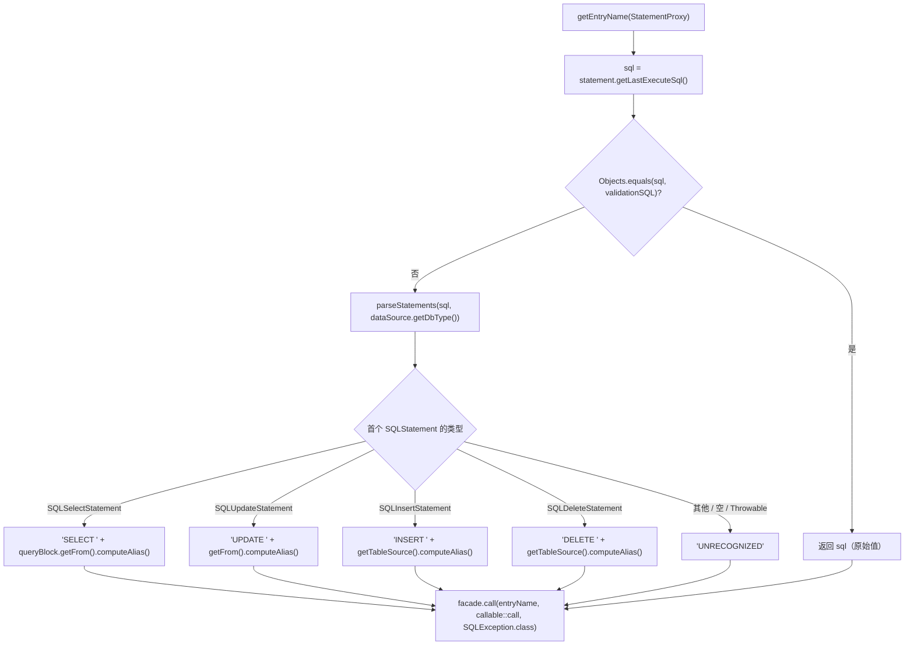
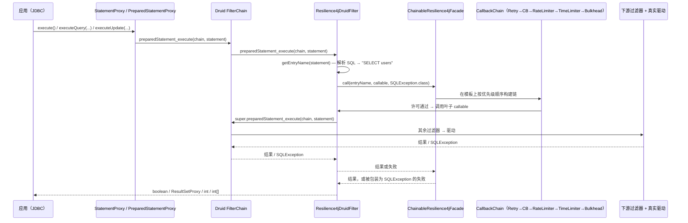
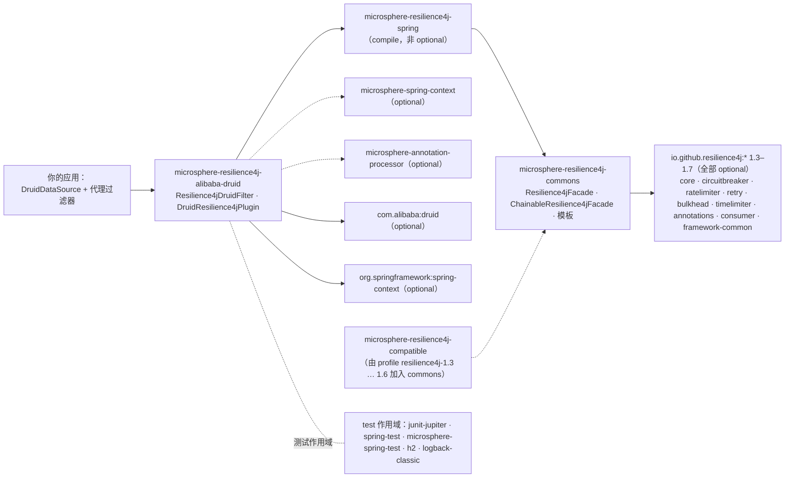

# microsphere-resilience4j-alibaba-druid — 开发者指南（1.x）

> 简体中文 | [English](../microsphere-resilience4j-alibaba-druid.md)

> 版本线 `0.1.x`（`release-1.x` 分支）· 最新发布版本 `0.1.4` · 当前 `${revision}` = `0.1.5-SNAPSHOT` · Resilience4j **1.3.0 – 1.7.0**（默认 `1.7.0`）· Spring Cloud Hoxton – 2021.0.x · [← 开发者指南索引](README.md)

模块路径：`microsphere-resilience4j-plugins/microsphere-resilience4j-alibaba-druid`。

## 类清单

| 类型 | 文件 | 角色 |
|------|------|------|
| `Resilience4jDruidFilter` | `src/main/java/io/microsphere/resilience4j/alibaba/druid/filter/Resilience4jDruidFilter.java` | 唯一真正执行的钩子：一个 Druid `FilterAdapter` 子类，把 13 个被覆盖的执行方法全部汇聚到 `Resilience4jFacade.call(...)` |
| `DruidResilience4jPlugin` | `src/main/java/io/microsphere/resilience4j/alibaba/druid/DruidResilience4jPlugin.java` | `Resilience4jPlugin` 描述符；`getName()` 返回 `"alibaba-druid"`，`plugin(...)` 方法体为**空** |
| 资源 | `src/main/resources/META-INF/spring.factories` | `io.microsphere.resilience4j.spring.common.Resilience4jPlugin=io.microsphere.resilience4j.alibaba.druid.DruidResilience4jPlugin` |
| `Resilience4jDruidFilterTest` | `src/test/java/…/filter/Resilience4jDruidFilterTest.java` | 4 个测试：`testConstants`、`testExecuteStatement`、`testExecutePreparedStatement`、`testGetter` |

本分支上 `DruidResilience4jPlugin` **没有任何测试**，并且除插件 SPI 之外 `spring.factories` 中没有任何其他条目（本模块不提供事件发布器/消费者）。

## 织入机制：Druid 过滤器链——是 `FilterAdapter`，不是 `FilterEventAdapter`

`Resilience4jDruidFilter extends com.alibaba.druid.filter.FilterAdapter`。任务层面所预期的“FilterEventAdapter”在 `release-1.x` 上**并不成立**：其 import 是 `Filter`、`FilterAdapter`、`FilterChain`、`DruidDataSource`、`DataSourceProxy`、`StatementProxy`、`PreparedStatementProxy`、`ResultSetProxy` 以及 `com.alibaba.druid.sql.ast.*` 各类型。`FilterEventAdapter` 从未被引用。

从机制上讲，这意味着：

1. **每一种 JDBC 执行形态各一个覆盖方法。** Druid 的 `Filter` SPI 为每种执行风格暴露一个方法；本插件覆盖了其中 13 个，而每个覆盖都是同样的单行写法——把链的延续作为一个 `Callable` 传进去：

```java
@Override
public boolean preparedStatement_execute(FilterChain chain, PreparedStatementProxy statement) throws SQLException {
    return doInResilience4j(statement, () -> super.preparedStatement_execute(chain, statement));
}
```

   被覆盖的集合（名称逐字取自源码）：`preparedStatement_execute`、`preparedStatement_executeQuery`、`preparedStatement_executeUpdate`、`statement_executeQuery`、`statement_execute`（×4 种参数个数）、`statement_executeBatch`、`statement_executeUpdate`（×4 种参数个数）。

   因此被装饰的单位是*Druid 链的剩余部分*，而不仅仅是驱动调用：注册在本过滤器之后的其他过滤器（stat、SLF4J，……）同样位于弹性边界之内。池内的顺序由 `DruidDataSource.setProxyFilters(...)` 的元素顺序决定，测试用只含单个元素的列表演示了这一点。

2. **单一的装饰汇聚点：**

```java
protected final <T> T doInResilience4j(StatementProxy statement, Callable<T> callable) throws SQLException {
    String entryName = getEntryName(statement);
    return this.facade.call(entryName, callable::call, SQLException.class);
}
```

   `call(String, ThrowableSupplier<T>, Class<TR>)` 是 `io.microsphere.resilience4j.common.Resilience4jOperations`（commons）的一个**默认方法**。在 `ChainableResilience4jFacade` 上，它解析为 `call(name, supplier)` → 在按优先级排序的 `Resilience4jTemplate` 列表之上构建的 `CallbackChain`，其中任意 `Throwable` 都由 `io.microsphere.util.ExceptionUtils.wrap` 重新抛出为 `SQLException`。

3. **与 Druid 的生命周期耦合。** `init(DataSourceProxy)` 就是 Druid 的 `Filter.init`，在连接池构建其代理过滤器列表时被调用。该实现缓存了 `DataSourceProxy`，并且当它是 `DruidDataSource` 时缓存其 `getValidationQuery()`：

```java
@Override
public void init(DataSourceProxy dataSource) {
    this.dataSource = dataSource;
    if (dataSource instanceof DruidDataSource) {
        DruidDataSource druidDataSource = (DruidDataSource) dataSource;
        this.validationSQL = druidDataSource.getValidationQuery();
    }
}
```

4. **资源命名 = SQL AST 解析。** `getEntryName(StatementProxy)` 先在 `validationSQL` 上做短路判断，否则调用 `SQLUtils.parseStatements(sql, dataSource.getDbType())`，并根据第一个 AST 节点（`SQLSelectStatement`、`SQLUpdateStatement`、`SQLInsertStatement`、`SQLDeleteStatement`）进行分派，读取 `SQLTableSource.computeAlias()`。私有的 `getEntryName(SQLStatement)` 会捕获 `Throwable` 并以 `debug` 级别记日志；无法识别的输入退化为 `"UNRECOGNIZED"`，因此命名永远不可能破坏调用路径。

### 条目名称流程



注意：`entryNamePrefix`（`DEFAULT_ENTRY_NAME_PREFIX = "alibaba-druid@"`）**不是**上述任何返回值的组成部分——`getEntryName(...)` 只返回资源名。这一点已通过阅读方法体核实；该前缀只能通过 `getEntryNamePrefix()` 取得。

### 被拦截的调用路径



## 本模块用到了哪些 Resilience4j 1.x API

| 层次 | 触及的 1.x 类型 | 位置 |
|-------|-------------------|-------|
| 本模块的 **main** 源码 | **无** | `Resilience4jDruidFilter` 与 `DruidResilience4jPlugin` 完全没有 import 任何 `io.github.resilience4j.*` 类；一切都经由 `io.microsphere.resilience4j.common.Resilience4jFacade` |
| 本模块的 **test** | `io.github.resilience4j.bulkhead.BulkheadRegistry`、`circuitbreaker.CircuitBreakerRegistry`、`ratelimiter.RateLimiterRegistry`、`retry.RetryRegistry`、`timelimiter.TimeLimiterRegistry`——全部通过 `ofDefaults()` | `Resilience4jDruidFilterTest.createResilience4jFacade()` |
| 传递性（commons） | `io.github.resilience4j.core.Registry`、`core.EventConsumer`、`core.EventProcessor`、`core.registry.*` 事件，以及来自 `resilience4j-framework-common` 的 1.x `io.github.resilience4j.common.*.configuration.*ConfigurationProperties` 类 | `Resilience4jTemplate`、`Resilience4jUtils`、`Resilience4jModule` |

**关于 `compatible` 垫片。** 在 `release-1.x` 上，Maven profile `resilience4j-1.3` … `resilience4j-1.6` 只把 `microsphere-resilience4j-compatible` 作为 `microsphere-resilience4j-commons` 的依赖加入（见 `microsphere-resilience4j-commons/pom.xml` 的 `<profiles>`）。它补齐了 `io.github.resilience4j.circuitbreaker.event.CircuitBreakerOnFailureRateExceededEvent`、`…OnSlowCallRateExceededEvent` 以及 `io.github.resilience4j.ratelimiter.event.RateLimiterEvent`、`RateLimiterOnDrainedEvent`，这些类型被 commons 中的 `CircuitBreakerTemplate` 与 `RateLimiterTemplate` import。**本插件不 import 上述任何事件类**，因此它自身的编译与 profile 无关——该垫片只通过它在运行时所使用的门面实现而传递性地到达它。

## 设计模式（附证据）

| 模式 | 在本模块中的证据 |
|---------|-------------------------|
| **装饰器** | 每个覆盖方法都是在 `super.<method>(chain, …)` 之外增加行为，而不是替换它；被装饰的单位以一个 `Callable<T>` lambda 的形式传递。 |
| **适配器** | 13 个互不相同的 Druid `Filter` 执行回调被适配到同一个 `Resilience4jFacade.call(name, supplier, throwableClass)` 契约上。类名已经说明了一切：`extends FilterAdapter`。 |
| **门面** | 唯一的协作者就是 `io.microsphere.resilience4j.common.Resilience4jFacade`。 |
| **责任链（下游）** | `FilterChain` 的延续，以及更深处 commons 里在模板列表之上构建的 `CallbackChain`。 |
| **模板方法** | 通过门面调用抵达的 `Resilience4jTemplate.begin/end/doCall` 钩子。 |
| **观察者** | 此处未使用：过滤器没有注册任何事件消费者。可观测性在模板层提供（`CircuitBreakerTemplate.onCallNotPermittedEvent(...)` 等）。 |
| **SPI（Spring `spring.factories`）** | `DruidResilience4jPlugin implements io.microsphere.resilience4j.spring.common.Resilience4jPlugin`——是的，这些 `*Resilience4jPlugin` 类实现的是 **spring 模块**的 SPI（`plugin(ConfigurableListableBeanFactory, BeanDefinitionRegistry, ConfigurableEnvironment)` + `getName()`）。`EnableResilience4jRegistrar.registerPlugins(...)` 用 `loadFactories(beanFactory, Resilience4jPlugin.class)` 加载工厂，并且仅当 `ArrayUtils.contains(plugins, plugin.getName())` 成立时才调用 `plugin(...)`。就本模块而言，这个调用按构造即是一个**空操作**。 |

## 依赖关系图（来自 `pom.xml`）



| 事实 | 细节 |
|------|--------|
| 强制依赖 | 仅 `microsphere-resilience4j-spring` |
| Druid 版本管理 | `microsphere-resilience4j-parent/pom.xml` 导入 `microsphere-alibaba-druid-dependencies` **0.1.20**（`<microsphere-alibaba-druid.version>`）；插件 POM 自身声明 `com.alibaba:druid` 时不带版本号 |
| 测试数据库 | H2 内存库：`jdbc:h2:mem:test_mem`，驱动 `org.h2.Driver`，用户 `sa` |
| 是否与框架无关？ | 过滤器本身只需要 Druid + commons 接口；`DruidResilience4jPlugin` 是唯一面向 Spring 的类 |

## 面向贡献者的扩展点与注意事项

- `doInResilience4j(StatementProxy, Callable<T>)` 是 `protected final`；`getEntryName(StatementProxy)` 是 `public final`。子类可以覆盖各个 `statement_*`/`preparedStatement_*` 方法，但无法扩展命名算法——如果你需要“表 + SQL”粒度的保护，请新增一个 `Filter`。
- `getFacade()` 与 `getEntryNamePrefix()` 是 `public final`——有意设计为不可覆盖。
- 未被使用的 `entryNamePrefix` 是与 MyBatis/Hibernate 插件之间存在的一处潜在不一致。把它改为真正给条目名称加前缀，会破坏所有现有用户的 Resilience4j 实例名称——应标记为破坏性变更。
- 值得在 PR 中补齐的覆盖缺口：`CallableStatement` 支持（被类 Javadoc 明确排除）、`validationSQL` 短路分支，以及 `UNRECOGNIZED` 命名。当前测试确实执行了这些 SQL 语句，但只断言 JDBC 结果，从未断言条目名称。
- 测试里的 `createResilience4jFacade()` 构建了**两个** `ChainableResilience4jFacade` 实例（一个赋给字段，返回另一个）；该字段随后又被 `setUp` 覆盖。它能工作，但属于复制粘贴的坏味道——不要在新测试中沿用这一写法。

## 相关页面

- [用户指南 — 本模块](../../user-guide/zh/microsphere-resilience4j-alibaba-druid.md)
- [开发者指南 — commons](microsphere-resilience4j-commons.md)
- [开发者指南 — spring](microsphere-resilience4j-spring.md)
- [开发者指南 — mybatis](microsphere-resilience4j-mybatis.md)（装饰器风格的对应模块）
