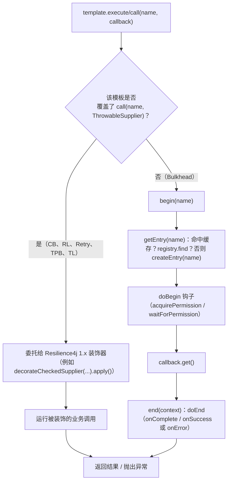
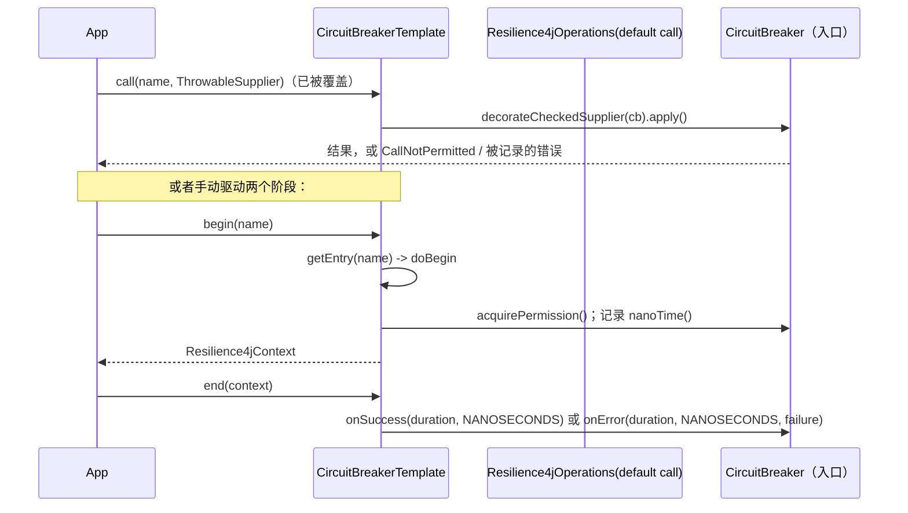
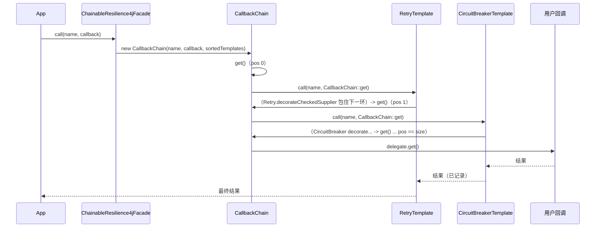
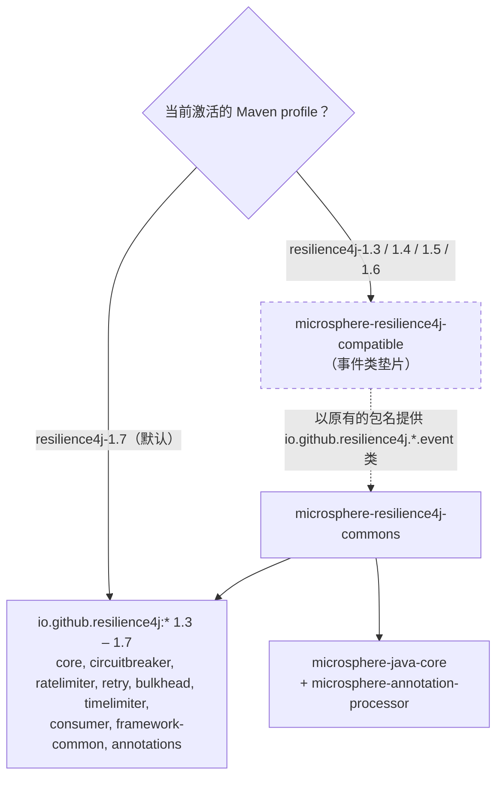

# microsphere-resilience4j-commons — 开发者指南（1.x）

> 版本线：`0.1.x`（源分支 `release-1.x`） · 最新发布版本 `0.1.4` · 分支 revision `0.1.5-SNAPSHOT`
> Resilience4j `1.3.0` – `1.7.0`（Maven profile，默认 `1.7.0`）· 基线 JDK 8
> 本模块**不依赖 Spring**；它只依赖 Resilience4j 1.x 和 `microsphere-java-core`（全部声明为 `<optional>`）。
> 英文原文：[microsphere-resilience4j-commons.md](../microsphere-resilience4j-commons.md)
> ← [指南索引](README.md) · [用户指南页面](../../user-guide/zh/microsphere-resilience4j-commons.md)

下文所有路径都相对于 `microsphere-resilience4j-commons/`。行号引用的是只读快照
`.doc-tmp/release-1x/` 下的 `release-1.x` 源码。

---

## 1. 职责

它是整个项目的最底层。它把六个彼此独立的 Resilience4j 1.x 模块变成一个统一的、可扩展的编程模型：

- 一个契约（`Resilience4jOperations` → `AdvancedResilience4jOperations`），用于表达*在单个模块的装饰下执行一个回调*；
- 一个抽象模板（`Resilience4jTemplate`），持有 `Registry`、解析具名入口、缓存入口、暴露两阶段的
  `begin`/`end` 生命周期，并适配 Resilience4j 的事件；
- 六个具体模板，每个模块一个；
- 一个可组合的门面（`ChainableResilience4jFacade` + package-private 的 `CallbackChain`），按优先级顺序
  把 N 个模块包在同一个回调外层；
- 一个"每次执行"的上下文对象（`Resilience4jContext`），带有 `ThreadLocal` 绑定；
- 一个元数据 + 反射层（`Resilience4jModule`、`Resilience4jConstants`、
  `META-INF/default/templates.properties`、`Resilience4jUtils`）。

位于它之上的一切（`microsphere-resilience4j-spring`、各个插件）只消费这些类型。这里没有任何代码
导入 `org.springframework`。

---

## 2. 包结构与类清单

```
src/main/java/io/microsphere/resilience4j/
├── common/
│   ├── Resilience4jOperations.java              接口（public）
│   ├── AdvancedResilience4jOperations.java      接口（public）
│   ├── Resilience4jTemplate.java                抽象类（public）
│   ├── Resilience4jContext.java                 类（构造器为 protected）
│   ├── Resilience4jFacade.java                  接口（public）
│   ├── ChainableResilience4jFacade.java         类（public）
│   ├── CallbackChain.java                       类（package-private）
│   ├── Resilience4jModule.java                  枚举（public）
│   └── Resilience4jConstants.java               接口（public）
├── circuitbreaker/CircuitBreakerTemplate.java
├── ratelimiter/RateLimiterTemplate.java
├── retry/RetryTemplate.java
├── bulkhead/BulkheadTemplate.java
├── bulkhead/ThreadPoolBulkheadTemplate.java
├── timelimiter/TimeLimiterTemplate.java
└── util/Resilience4jUtils.java                  抽象类（public）
src/main/resources/META-INF/default/templates.properties
```

### 2.1 `io.microsphere.resilience4j.common`

| 类型 | 种类 | 可见性 | 角色 |
|------|------|------------|------|
| `Resilience4jOperations<E>` | 接口 | public | 最小契约：一次性的 `execute`/`call` 重载 + 两阶段的 `begin`/`end` + `isBeginSupported`/`isEndSupported`。 |
| `AdvancedResilience4jOperations<E, C, R>` | 接口 | public | 继承 `Resilience4jOperations<E>` + `Prioritized`；注册表/配置/入口管理、原始入口的 `Consumer`/`Function` 操作、`getLogger()`。 |
| `Resilience4jTemplate<E, C, R>` | 抽象类 | public | 持有注册表的基类：入口解析 + 本地缓存、`final` 的 `begin/end` 配合 `doBegin/doEnd` 钩子、事件注册、优先级。 |
| `Resilience4jContext<E>` | 类 | 构造器 `protected` | 可变的"每次执行"状态 + `ThreadLocal` 绑定（`withinContext`，静态 `getContext/setContext/removeContext/doInContext`）。 |
| `Resilience4jFacade` | 接口 | public | 标记接口：`Resilience4jOperations<Resilience4jContext[]>`。 |
| `ChainableResilience4jFacade` | 类 | public | 建立在一个有序、去重的 `List<Resilience4jTemplate>` 之上的门面。 |
| `CallbackChain<T>` | 类 | **package-private** | 把每个模板的 `call` 嵌套在链条其余部分外层的 `ThrowableSupplier`。 |
| `Resilience4jModule` | 枚举 | public | 六个模块的元数据 + `valueOf(Class)` 查找。 |
| `Resilience4jConstants` | 接口 | public | `String` 类型的配置命名空间前缀。 |

### 2.2 模板所在的包

| 类型 | 入口 / 配置 / 注册表 | `call` 中的装饰 | 两阶段 | 入口事件方法数 |
|------|---------------------------|----------------------|-----------|---------------------|
| `circuitbreaker.CircuitBreakerTemplate` | `CircuitBreaker` / `CircuitBreakerConfig` / `CircuitBreakerRegistry` | `decorateCheckedSupplier(cb).apply()` | `doBegin`=`acquirePermission`+`nanoTime`；`doEnd`=`onSuccess`/`onError` | 8 |
| `ratelimiter.RateLimiterTemplate` | `RateLimiter` / `RateLimiterConfig` / `RateLimiterRegistry` | `RateLimiter.decorateCheckedSupplier(rl, cb).apply()` | 两个阶段都是 `waitForPermission` | 3 |
| `retry.RetryTemplate` | `Retry` / `RetryConfig` / `RetryRegistry` | `Retry.decorateCheckedSupplier(r, cb).apply()` | 已禁用 | 4 |
| `bulkhead.BulkheadTemplate` | `Bulkhead` / `BulkheadConfig` / `BulkheadRegistry` | *未覆盖* → 基类 `call` 运行 `begin`+`end` | `doBegin`=`acquirePermission`；`doEnd`=`onComplete` | 3 |
| `bulkhead.ThreadPoolBulkheadTemplate` | `ThreadPoolBulkhead` / `ThreadPoolBulkheadConfig` / `ThreadPoolBulkheadRegistry` | `executeCallable(...).toCompletableFuture().get()` | 已禁用 | 3 |
| `timelimiter.TimeLimiterTemplate` | `TimeLimiter` / `TimeLimiterConfig` / `TimeLimiterRegistry` | 在一个 `ExecutorService` 上调用 `decorateFutureSupplier(...).call()` | 已禁用 | 3 |

### 2.3 `io.microsphere.resilience4j.util`

`Resilience4jUtils`（抽象类，实现 `Utils`）是这座反射桥梁。它持有一个惰性构建的
`Map<Resilience4jModule, Method>`（指向各注册表的 `entryName(String, Config)` 方法），以及从
`META-INF/default/templates.properties` 加载的
`Map<Resilience4jModule, Class<? extends Resilience4jTemplate>>` 默认模板表。关键的静态方法：
`getEntry`、`getEventProcessor`（六个按类型分别提供的重载 + 一个 `Registry` 重载）、`createTemplate`、`createTemplates`。

---

## 3. `Resilience4jTemplate` 执行流程

### 3.1 构造

```java
public Resilience4jTemplate(R registry, boolean localEntriesCached) {
    assertNotNull(registry, "The registry must not be null");
    this.registry                = registry;
    this.module                  = valueOf(registry.getClass());   // Resilience4jModule.valueOf
    this.registryEventProcessor  = getEventProcessor(registry);    // Resilience4jUtils
    this.localEntriesCache       = localEntriesCached ? createLocalEntriesCache() : null; // 默认是 new HashMap
    this.priority                = this.module.getDefaultAspectOrder();
}
```

模块是从 `Registry` 的运行时类推断出来的，正是这一点让同一个构造器签名可以服务于所有模板。
默认切面顺序成为模板的 `priority`，而 `ChainableResilience4jFacade` 排序依据的正是这个优先级。

### 3.2 入口解析

`getEntry(String)` 是 `final` 的：它先查本地的 `HashMap` 缓存（`getEntryFromCache`），未命中时
委托给 `AdvancedResilience4jOperations` 的 `default` 实现，后者执行 `registry.find(name)`，找不到就
`createEntry(name)`。`createEntry` 是留给子类的钩子，它调用模块特定的注册表工厂，例如
`registry.circuitBreaker(name, getConfiguration(name))`。只有当调用方通过 `initLocalEntriesCache(...)`
预先填充缓存时，这个缓存才是线程安全的。

### 3.3 一次性路径（`execute` / `call`）

- `execute(name, Supplier)` 和 `execute(name, Runnable)` 是 `Resilience4jOperations` 上的 `default` 方法，
  最终都会汇入 `call(name, ThrowableSupplier)`（抛出 `Throwable`），再被重新包装成 `RuntimeException`。
- **`call(name, ThrowableSupplier)` 才是那个接缝。** 接口上的 `default` 实现是：

  ```java
  default <T> T call(String name, ThrowableSupplier<T> callback) throws Throwable {
      Resilience4jContext context = begin(name);
      try {
          return callback.get();
      } finally {
          end(context);
      }
  }
  ```

  六个模板中有五个**覆盖**了 `call`，改为委托给某个 Resilience4j 装饰器工厂
  （`CircuitBreaker`、`RateLimiter`、`Retry`、`ThreadPoolBulkhead`、`TimeLimiter`）。`BulkheadTemplate`
  **没有**覆盖它，所以对 Bulkhead 而言，一次性路径会在回调前后运行 `begin`（→ `acquirePermission`）
  + `end`（→ `onComplete`）。这是阅读代码时最需要记住的一条行为事实：`execute`/`call` 到底走装饰器
  还是走两阶段生命周期，取决于具体是哪个模板。

### 3.4 两阶段路径（`begin` / `end`）

`begin` 和 `end` 在 `Resilience4jTemplate` 上都是 `final` 的；它们是不可覆盖的外壳，内部调用受保护的
钩子 `doBegin`/`doEnd`：

```java
public final Resilience4jContext<E> begin(String name) {
    E entry = getEntry(name);
    Resilience4jContext<E> context = new Resilience4jContext(name, entry);
    doBegin(context);
    return context;
}

public final void end(Resilience4jContext<E> context) {
    doEnd(context);
}
```

基类的 `doBegin`/`doEnd` 会抛出 `UnsupportedOperationException`，因此一个没有实现它们的模板，其
`isBeginSupported()`/`isEndSupported()` 就必须是 `false`（事实也确实如此：`RetryTemplate`、
`TimeLimiterTemplate`、`ThreadPoolBulkheadTemplate` 把这两个标志覆盖为 `false`）。`Resilience4jUtilsTest`
和 `AbstractResilience4jTemplateTest` 断言的正是这一点：`isEndSupported() == isBeginSupported()`，
并且这三个被禁用的模块会拒绝 `begin`/`end`。

`CircuitBreakerTemplate.doEnd` 会读取 `context.getFailure()` 和 `context.getStartTime()`，据此在
`onSuccess(duration, NANOSECONDS)` 与 `onError(duration, NANOSECONDS, failure)` 之间做选择 —— 这就是
`Resilience4jContext` 需要携带开始时间戳与失败信息槽位的原因。

### 3.5 事件注册

事件注册共有三个层次：

- `onEntryAddedEvent` / `onEntryRemovedEvent` / `onEntryReplacedEvent`（`final`）通过
  `registerRegistryEventConsumer` 面向**注册表**的 `EventProcessor`。
- `registerEntryEventConsumer(entryName, eventType, consumer)`（`protected final`）会解析出**入口**，
  通过 `Resilience4jUtils.getEventProcessor(entry)` 取得它的 `EventProcessor`，并在其上注册。每个具体模板的
  `on…Event(...)` 方法都是围绕这一调用的、薄薄的流式包装，各自绑定到一个具体的事件类
  （`CircuitBreakerOnSuccessEvent`、`RateLimiterOnDrainedEvent` 等）。

在底层，`registerEventConsumer` 以 `eventType.getName()` 作为键，把 consumer 注册到 `EventProcessor` 上 ——
这是一次 1.x 的 `EventProcessor.registerConsumer(String, EventConsumer)` 调用。

### 3.6 单模板执行 —— 流程图



### 3.7 单模板两阶段 —— 时序图



---

## 4. `ChainableResilience4jFacade` + `CallbackChain`

### 4.1 组合

`ChainableResilience4jFacade` 把注册表转换为模板：

```java
public ChainableResilience4jFacade(Collection<Registry> registries) {
    this(createTemplates(registries));   // Resilience4jUtils：每个注册表一个模板，去重并排序
}

public ChainableResilience4jFacade(List<Resilience4jTemplate> templates) {
    // 按 equality 去重，然后按 Prioritized.COMPARATOR（即 getPriority()）排序
    effectiveTemplates.sort(COMPARATOR);
    this.templates = effectiveTemplates;
    this.size = effectiveTemplates.size();
}
```

由于优先级默认取自模块的切面顺序，排序后的链条会由外到内按 Resilience4j 的经典顺序运行：
`Retry(0) → CircuitBreaker(1) → RateLimiter(2) → TimeLimiter(3) → Bulkhead(4)`。`Test2`
这个门面测试喂入了九个含重复项的注册表，并断言 `getSize() == 5` —— 去重会把同一模块的重复注册表合并掉。

### 4.2 通过 `CallbackChain` 实现 `call`

门面的 `call` 自身并不做装饰；它构建一个 `CallbackChain` 并调用 `get()`：

```java
public <T> T call(String name, ThrowableSupplier<T> callback) throws Throwable {
    CallbackChain<T> supplier = new CallbackChain<>(name, callback, this.templates);
    return supplier.get();
}
```

`CallbackChain.get()` 就是那个递归的嵌套过程：在位置 `pos` 上它取出 `templates.get(pos)` 并调用
`template.call(entryName, CallbackChain.this::get)` —— 也就是说，第 *i* 个模板的"回调"就是"运行链条的剩余部分"。
每个模板都在剩余链条外面包上一层装饰；当 `pos == size` 时，真正的用户回调（`delegate.get()`）最终被执行。
这是一个建立在 1.x 装饰器 `call` 方法之上的教科书式**责任链（chain of responsibility）**。

### 4.3 跨链的 `begin` / `end`

```java
public Resilience4jContext<Resilience4jContext[]> begin(String name) {
    Resilience4jContext[] subContexts = new Resilience4jContext[size];
    Resilience4jContext<Resilience4jContext[]> context = new Resilience4jContext<>(name, subContexts);
    for (int i = 0; i < size; i++) {
        Resilience4jTemplate template = templates.get(i);
        if (template.isBeginSupported()) {
            subContexts[i] = template.begin(name);
        }
    }
    return context;
}
```

`end` 与之对称，并会跳过 `isEndSupported()` 为 `false` 的模板，因此一条包含 Retry/TimeLimiter/
ThreadPoolBulkhead 的链条会把那些 `subContexts[i]` 槽位留为 `null`，并且从不调用它们（不被支持的）钩子。

### 4.4 可链式门面的执行 —— 时序图



---

## 5. 设计模式（附证据）

| 模式 | 位置 | 证据 |
|---------|-------|----------|
| **模板方法（Template Method）** | `Resilience4jTemplate` | `final begin/end` 固定了算法骨架，并委托给可覆盖的 `doBegin/doEnd` 钩子；`final getEntry` 固定了查找流程，并委托给抽象的 `createEntry`；子类按需选择性覆盖 `call` / `isBeginSupported`。`BulkheadTemplate` 刻意**不**覆盖 `call`，从而继承基类的 `begin`-`end` 模板方法。 |
| **门面（Facade）** | `Resilience4jFacade` / `ChainableResilience4jFacade` | 一个 `call`/`begin`/`end` 表面隐藏了 N 个模板。`Resilience4jFacade extends Resilience4jOperations<Resilience4jContext[]>` 复用同一个契约，把子上下文数组当作"入口"。 |
| **责任链（Chain of Responsibility）** | `CallbackChain` | 每个 `Resilience4jTemplate` 处理一个模块，并把列表的剩余部分交给下一环（`template.call(entryName, CallbackChain.this::get)`）；终止环运行真正的回调。 |
| **注册表 / 适配器（Registry / Adapter）** | `AdvancedResilience4jOperations` + `Resilience4jUtils` | 该库把 Resilience4j 的 `Registry<E, C>`（find/create/remove/replace、`getEventPublisher`）适配到统一的 `getEntry`/`createEntry`/`removeEntry`/`getEventProcessor` 方法背后，把六个 1.x 注册表桥接到同一个接口上。 |
| **策略（Strategy，轻量）** | 各模板的 `call` 覆盖 | 装饰策略因模块而异（checked supplier vs future supplier vs `executeCallable`），由子类来选择。 |
| **单例 / 享元（状态）** | `Resilience4jContext` 的 `ThreadLocal` | 一个 `static ThreadLocal<Resilience4jContext>` 携带当前上下文；`withinContext` / 静态 `getContext`/`setContext`/`removeContext`/`doInContext`。 |

---

## 6. 模块依赖关系（含按 profile 条件挂载的兼容垫片）



`compatible` jar 被声明为 `commons` 的依赖，**仅**出现在 `microsphere-resilience4j-commons/pom.xml` 的
`resilience4j-1.3`、`resilience4j-1.4`、`resilience4j-1.5` 和 `resilience4j-1.6` 这几个 profile 中。默认的
`resilience4j-1.7` 构建会省略它，因为 1.7.0 已经自带 commons 代码所引用的那些事件类型。`commons` 自己的
全部 compile 依赖都是 `<optional>`，因此由下游应用来选择确切的 Resilience4j 构件与版本。
见 [compatible 开发者指南](microsphere-resilience4j-compatible.md)。

---

## 7. 构建说明

`commons` 的 `<parent>` 继承自 `microsphere-resilience4j-parent`（版本 `${revision}`），而后者又继承
`microsphere-spring-cloud-parent` `0.1.26`。`microsphere-resilience4j-commons/pom.xml` 定义了**四个**
profile，它们做的事情完全相同 —— 挂载 `compatible` 模块：

| commons `pom.xml` 中的 profile | 效果 |
|------------------------------|--------|
| `resilience4j-1.3` | 添加依赖 `io.github.microsphere-projects:microsphere-resilience4j-compatible:${revision}` |
| `resilience4j-1.4` | 同上 |
| `resilience4j-1.5` | 同上 |
| `resilience4j-1.6` | 同上 |

`commons/pom.xml` 中**没有** `resilience4j-1.7` profile；`1.3.0 … 1.7.0` 这些版本号本身来自父工程的
profile（那里的 `resilience4j-1.7` 是 `activeByDefault`）。因此 `commons` 绝不会默认激活垫片，而只在构建
面向 1.7 之前的 Resilience4j 时才恰好把它拉进来。

`commons` 声明的依赖（全部为 `<optional>true</optional>`，版本由父工程管理）：
`microsphere-annotation-processor`、`microsphere-java-core`，以及 Resilience4j 的
`resilience4j-annotations`、`resilience4j-consumer`、`resilience4j-framework-common`、`resilience4j-core`、
`resilience4j-circuitbreaker`、`resilience4j-ratelimiter`、`resilience4j-retry`、`resilience4j-bulkhead`、
`resilience4j-timelimiter`。test 作用域的：`junit-jupiter`、`microsphere-java-test`、`logback-classic`。

```bash
# 默认构建 -> Resilience4j 1.7.0，不挂载垫片
./mvnw -pl microsphere-resilience4j-commons -am clean test

# 1.7 之前的构建 -> 自动挂载 compatible 垫片
./mvnw -pl microsphere-resilience4j-commons -am clean test -P resilience4j-1.4
```

### 7.1 测试清单（用户指南示例的来源）

| 测试 | 覆盖内容 |
|------|--------|
| `AbstractResilience4jTemplateTest` | 共享契约测试（execute/call/begin/end、本地缓存、注册表事件、优先级）；通过对 `<E, C, R, RT>` 类型参数做反射来解析。 |
| `CircuitBreakerTemplateTest` | 成功/错误/失败率/慢调用/状态转换/reset 事件流。 |
| `RateLimiterTemplateTest` | 并发下的成功/失败/drained 事件。 |
| `RetryTemplateTest` | 重试/成功/被忽略错误事件，`getNumberOfRetryAttempts()`。 |
| `BulkheadTemplateTest` | 许可/完成/拒绝事件。 |
| `ThreadPoolBulkheadTemplateTest` | 许可/完成/拒绝事件以及 `getRootCause` 剥离。 |
| `TimeLimiterTemplateTest` | 使用自定义 `ExecutorService` 的成功/错误/超时事件。 |
| `CallbackChainTest` | 建立在 `{Bulkhead, Retry}` 注册表之上的链返回 delegate 的结果。 |
| `ChainableResilience4jFacadeTest2` | 九个含重复的注册表去重/排序后 `size == 5`；`begin`/`end`、`execute`、`call`（本分支把门面测试命名为 `...Test2`）。 |
| `Resilience4jContextTest` | 属性、attributes、`withinContext`/`getContext`/`doInContext`。 |
| `Resilience4jModuleTest` | 全部六个模块的元数据 + `valueOf(Class)`。 |
| `Resilience4jUtilsTest` | `createTemplate(s)`、`getEntry`、`getEventProcessor`、模板映射表的加载。 |
| `Resilience4jConstantsTest` | 前缀/模块名常量。 |

---

所有页面的中文译文位于 `zh/` 目录下，文件名与英文版本完全一致。
