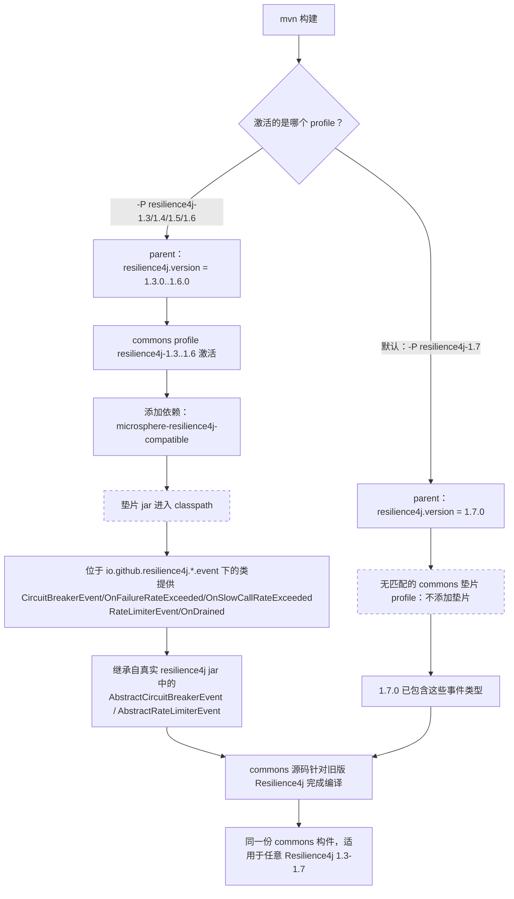

# microsphere-resilience4j-compatible — 开发者指南（1.x）

> 版本线：`0.1.x`（源分支 `release-1.x`） · 最新发布版本 `0.1.4` · 分支 revision `0.1.5-SNAPSHOT`
> 面向 Resilience4j `1.3.0 – 1.6.0` 的构建期事件类**垫片**；针对 `1.7.0` 构建时不会挂载。
> ← [指南索引](README.md) · [用户指南页面](../../user-guide/zh/microsphere-resilience4j-compatible.md)

路径均相对于 `microsphere-resilience4j-compatible/`。所有事实均来自只读快照 `.doc-tmp/release-1x/` 中的
`release-1.x` 源码。

---

## 1. 职责

提供 `microsphere-resilience4j-commons` 在编译时所依赖、但在较旧的 Resilience4j 1.x 版本中可能缺失的少量
Resilience4j **事件**类型，且无需改动 commons。该模块**仅**包含派生（fork）而来的类（不含任何库逻辑），
外加一个 `package-info.java`：

```
src/main/java/io/github/resilience4j/
├── package-info.java
├── circuitbreaker/event/
│   ├── CircuitBreakerEvent.java                        interface
│   ├── CircuitBreakerOnFailureRateExceededEvent.java   class
│   └── CircuitBreakerOnSlowCallRateExceededEvent.java  class
└── ratelimiter/event/
    ├── RateLimiterEvent.java                           interface
    └── RateLimiterOnDrainedEvent.java                  class
```

---

## 2. 设计依据——以及源码究竟能证明什么

关于设计意图的权威表述是该模块的 `package-info.java`：

```java
/**
 * The classes in this package or sub-packages are forked from the Resilience4j 1.7.x(latest),
 * which will be used to be compatible with the lower versions of Resilience4j.
 */
```

因此垫片中的类是 **Resilience4j 1.7.x 事件类型的派生副本**，保留它们是为了在构建被锁定到较低的 1.x 版本时
commons 源码仍能编译。在不超出证据的前提下，从派生副本的类体中可以推断出：

- 本副本中的 `CircuitBreakerEvent.Type` 枚举了 `ERROR, IGNORED_ERROR, SUCCESS, NOT_PERMITTED,
  STATE_TRANSITION, RESET, FORCED_OPEN, DISABLED, FAILURE_RATE_EXCEEDED, SLOW_CALL_RATE_EXCEEDED`，
  并将 `STATE_TRANSITION`/`RESET` 标记为 `forcePublish = true`。其中 `FAILURE_RATE_EXCEEDED` 与
  `SLOW_CALL_RATE_EXCEEDED` 这两个常量（以及对应的 `On…ExceededEvent` 类）就是 commons 通过
  `onFailureRateExceededEvent(...)` 和 `onSlowCallRateExceededEvent(...)` 所依赖的较新成员。
- `RateLimiterEvent.Type` 枚举了 `FAILED_ACQUIRE, SUCCESSFUL_ACQUIRE, DRAINED`。`DRAINED` 常量与
  `RateLimiterOnDrainedEvent` 共同支撑了 `RateLimiterTemplate.onDrainedEvent(...)` 这一 API。
- 具体的 `On…ExceededEvent` / `OnDrainedEvent` 类是 `public` 类，继承自 Resilience4j 中包级私有
  （package-private）的基类 `AbstractCircuitBreakerEvent` / `AbstractRateLimiterEvent`（这些基类未在此重新派生），
  并与 1.7.x 的事件类形态保持一致。

我们刻意**不**为每一个单独的类型断言精确的小版本号（诸如"引入于 1.6.0"之类）——仓库中并未给出逐类的引入版本。
代码唯一肯定的是：这些类型存在于 **1.7.x** 中；而构建装配则把垫片视为 **1.3–1.6** 需要、**1.7** 不需要
（第 5 节）。这条 profile 边界正是"哪些版本需要帮助"这一问题的具体、可验证的表达。

commons 为何要引用这些类型：`CircuitBreakerTemplate` 导入并使用了
`CircuitBreakerOnFailureRateExceededEvent` / `CircuitBreakerOnSlowCallRateExceededEvent`；`RateLimiterTemplate`
导入并使用了 `RateLimiterOnDrainedEvent`；而 `Resilience4jModule` 把 `CircuitBreakerEvent` / `RateLimiterEvent`
标为相应模块的事件类。如果目标 Resilience4j jar 中缺少这些符号，commons 就无法编译——垫片补上了这个缺口。

---

## 3. 包名重合（"影子兼容"）技术

这些类被声明在 **Resilience4j 自己的包名下**——`io.github.resilience4j.circuitbreaker.event`
和 `io.github.resilience4j.ratelimiter.event`——而不是放在私有的 `io.microsphere.…` 命名空间中。这正是该设计的核心：

- **类型同一性。** 由于全限定名与上游一致，被垫片化的类型*就是* commons 所导入的那些类型。没有别名，没有适配层，
  commons 中也没有任何 `import` 上的花招——无论符号来自 Resilience4j 1.7.x 还是来自这个 jar，同一份源码树都能编译。
- **访问同包内的基类。** 派生副本 `CircuitBreakerOnFailureRateExceededEvent extends AbstractCircuitBreakerEvent`
  与 `RateLimiterOnDrainedEvent extends AbstractRateLimiterEvent`，并且派生源码在引用这些 `Abstract…Event`
  基类时**使用简单名且不带 `import`**——这证明它们是在同一个包（`…circuitbreaker.event` /
  `…ratelimiter.event`）内被解析的。这些基类位于真实的 `resilience4j-circuitbreaker` / `resilience4j-ratelimiter` jar 中，
  并未在此重新派生。Java 是按*运行时包* =（类加载器，包名）来限制非 `public` 成员的，因此把派生副本放在完全相同的包中，
  就能让它继承上游基类，即便它位于另一个 jar 里。这恰恰是派生副本必须复用原包名、而不能放在 `io.microsphere.*` 下的原因。
- **派生接口遮蔽上游。** 派生的 `CircuitBreakerEvent` / `RateLimiterEvent` 接口复用了上游的接口名，因此在 classpath 上
  谁先出现谁生效。在 1.7 之前的 profile 下由垫片提供更丰富的 `Type` 枚举；在 1.7 下垫片缺席，使用上游 jar（它已含这些值）。
  并不需要派生接口与*另一个*同名的上游接口共存——profile 边界保证有且仅有一个提供方。

这项技术使该模块成为一个**构建期兼容层**，而非运行时库。它被刻意设为不发布（`maven-deploy-plugin`
`<skip>true</skip>`），因此已发布的应用永远不会从远程仓库解析到它；它只存在于编译 commons 的那个 reactor 内部。

---

## 4. 类清单（开发者视角）

| 类 | 继承 / 实现 | 垫片新增的成员 | commons 通过何处消费它 |
|-------|----------------------|-----------------------|--------------------------|
| `CircuitBreakerEvent`（接口） | — | `getCircuitBreakerName()`、`getEventType()`、`getCreationTime()`、`enum Type {…, FAILURE_RATE_EXCEEDED, SLOW_CALL_RATE_EXCEEDED, FORCED_OPEN, DISABLED}`（带 `forcePublish`） | `Resilience4jModule.CIRCUIT_BREAKER` 的事件类；测试中对 `CircuitBreakerEvent.Type.*` 的导入 |
| `CircuitBreakerOnFailureRateExceededEvent` | `AbstractCircuitBreakerEvent` | `float getFailureRate()`、构造器 `(String, float)`、`getEventType() → FAILURE_RATE_EXCEEDED`、`toString()` | `CircuitBreakerTemplate.onFailureRateExceededEvent(String, EventConsumer<…>)` |
| `CircuitBreakerOnSlowCallRateExceededEvent` | `AbstractCircuitBreakerEvent` | `float getSlowCallRate()`、构造器 `(String, float)`、`getEventType() → SLOW_CALL_RATE_EXCEEDED`、`toString()` | `CircuitBreakerTemplate.onSlowCallRateExceededEvent(...)` |
| `RateLimiterEvent`（接口） | — | `getRateLimiterName()`、`getEventType()`、`getNumberOfPermits()`、`getCreationTime()`、`enum Type { FAILED_ACQUIRE, SUCCESSFUL_ACQUIRE, DRAINED }` | `Resilience4jModule.RATE_LIMITER` 的事件类 |
| `RateLimiterOnDrainedEvent` | `AbstractRateLimiterEvent` | 构造器 `(String)`、`getEventType() → DRAINED`、`getNumberOfPermits() → 1` | `RateLimiterTemplate.onDrainedEvent(...)` |

这两个 `Abstract…Event` 基类**并未**被派生；它们来自被声明为可选依赖的真实 `resilience4j-circuitbreaker` /
`resilience4j-ratelimiter` jar（第 5 节）。

---

## 5. POM 依赖清单（已核验，完整）

`microsphere-resilience4j-compatible/pom.xml` 声明父工程为 `microsphere-resilience4j-parent:${revision}`，打包方式为
`jar`，并列出以下 compile 依赖——**全部标记为 `<optional>true</optional>`**——它们是派生源码得以编译所必需的构件：

1. `io.github.resilience4j:resilience4j-annotations`
2. `io.github.resilience4j:resilience4j-consumer`
3. `io.github.resilience4j:resilience4j-framework-common` —— 以显式的 `<version>${resilience4j.version}</version>` 锁定
4. `io.github.resilience4j:resilience4j-core`
5. `io.github.resilience4j:resilience4j-circuitbreaker`（提供 `AbstractCircuitBreakerEvent`）
6. `io.github.resilience4j:resilience4j-ratelimiter`（提供 `AbstractRateLimiterEvent`）
7. `io.github.resilience4j:resilience4j-retry`
8. `io.github.resilience4j:resilience4j-bulkhead`
9. `io.github.resilience4j:resilience4j-timelimiter`

完整清单共**九个**构件。除了 annotations/consumer/framework-common/core/circuitbreaker/
ratelimiter/retry 这一组之外，还包括 `resilience4j-bulkhead` 和 `resilience4j-timelimiter`。它们的版本取自
父工程的 dependency management / `${resilience4j.version}`（framework-common 还额外显式重述了一次），
与当前激活的 profile 保持一致。

值得注意的构建配置：

```xml
<build>
    <plugins>
        <plugin>
            <groupId>org.apache.maven.plugins</groupId>
            <artifactId>maven-deploy-plugin</artifactId>
            <configuration>
                <skip>true</skip>   <!-- never published -->
            </configuration>
        </plugin>
    </plugins>
</build>
```

该模块自身**不**定义任何 profile；版本选择以及"是否挂载垫片"的逻辑分别位于父工程（`resilience4j-1.3 … 1.7`）
和 commons（`resilience4j-1.3 … 1.6`）中。

---

## 6. profile → 垫片 → 编译 流程



---

## 7. 与 0.2.x 版本线的差异

`0.2.x` 版本线上没有 `compatible` 模块。Resilience4j 2.x 在受支持的 2.0–2.4 范围内拥有单一且稳定的事件模型，
因此不需要回移垫片，commons 也从不引用缺失的事件类型。该模块的全部存在理由——包名派生、可选依赖清单、跳过发布——
都是 `release-1.x` 多版本 Resilience4j 1.3–1.7 策略所特有的。

---

所有页面的中文译文位于 `zh/` 目录下，文件名与英文版本完全一致。
