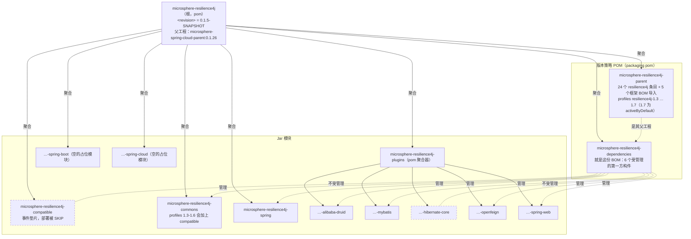
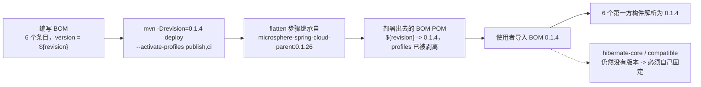

# microsphere-resilience4j-dependencies — 开发者指南（1.x / v0.1.x）

> 版本线 `0.1.x`（`release-1.x` 分支） · `${revision}` = `0.1.5-SNAPSHOT` · 最新发布版本 `0.1.4` · 管理 **6** 个构件 · [← 开发者指南索引](README.md)
> [English](../microsphere-resilience4j-dependencies.md)

本页把 BOM `microsphere-resilience4j-dependencies` 当作一件*被编写出来的*构件来记录：它在聚合反应堆（reactor）中的位置、它的 `<dependencyManagement>` 里究竟装着什么、哪些模块落在它之外，以及 `${revision}` 在发布时如何变成一个具体的版本。

## 坐标与位置

```
microsphere-resilience4j                 (reactor root, ${revision} = 0.1.5-SNAPSHOT)
  ├── microsphere-resilience4j-parent    (${revision}, pom)      <-- the BOM's <parent>
  └── microsphere-resilience4j-dependencies (${revision}, pom)   <-- the BOM
```

来自 `microsphere-resilience4j-dependencies/pom.xml`：

| 字段 | 值 |
|-------|-------|
| `<parent>` | `io.github.microsphere-projects:microsphere-resilience4j-parent:${revision}`，`relativePath ../microsphere-resilience4j-parent/pom.xml` |
| `artifactId` / `version` / `packaging` | `microsphere-resilience4j-dependencies` / `${revision}` / `pom` |
| `<name>` / `<description>` | `Microsphere :: Resilience4j :: Dependencies` / `Microsphere Resilience4j Dependencies` |
| 所存在的区块 | `<parent>`、坐标、`name`/`description`、`<dependencyManagement>` —— **再无其他**（没有 `<build>`，没有 `<profiles>`，没有 `<dependencies>`） |

由于父工程同时也是这条版本线的版本策略 POM，BOM *继承*了那五个框架 BOM 导入、24 个显式的 `io.github.resilience4j:*` 条目，以及 `resilience4j-1.3` … `resilience4j-1.7` 这些 profile——但它**自己**的 `<dependencyManagement>` 块只新增了下面这六个第一方构件。继承的那一部分对使用者究竟保证什么、不保证什么，见[父工程开发者页面](microsphere-resilience4j-parent.md)。

## 受管理的构件（完整、已核验的清单）

这六个条目全部是 `io.github.microsphere-projects`，且都带 `<version>${revision}</version>`；顺序正是文件中的顺序：

| # | artifactId | version | 它所发布的模块 |
|---|-----------|---------|---------------------|
| 1 | `microsphere-resilience4j-commons` | `${revision}` | `microsphere-resilience4j-commons`（jar） |
| 2 | `microsphere-resilience4j-alibaba-druid` | `${revision}` | `microsphere-resilience4j-plugins/microsphere-resilience4j-alibaba-druid`（jar） |
| 3 | `microsphere-resilience4j-openfeign` | `${revision}` | `…/microsphere-resilience4j-openfeign`（jar） |
| 4 | `microsphere-resilience4j-mybatis` | `${revision}` | `…/microsphere-resilience4j-mybatis`（jar） |
| 5 | `microsphere-resilience4j-spring-web` | `${revision}` | `…/microsphere-resilience4j-spring-web`（jar） |
| 6 | `microsphere-resilience4j-spring` | `${revision}` | `microsphere-resilience4j-spring`（jar） |

> 这份清单**与 `0.2.x` 的 BOM 完全一致**（通过比对两条分支上的 `microsphere-resilience4j-dependencies/pom.xml` 核验）。任何“1.x 的 BOM 所管理的集合比当前版本线更小”的印象，都不被这两个文件所支持：同样的六个坐标，同样的 `${revision}` 绑定。

## 刻意缺席于 BOM 的构件

| 构件 | 是聚合反应堆成员？ | 为什么缺席 / 会怎样 |
|----------|-----------------|-----------------------------------|
| `microsphere-resilience4j-hibernate-core` | 是，位于 `plugins` 之下 | 它产出代码并且会被部署，却不受管理 → 每一个使用者都必须自己写出它的版本。Hibernate 的*技术栈*是间接被管理的（父工程导入了 `microsphere-hibernate-dependencies:0.1.9`），缺的只是这个插件坐标 |
| `microsphere-resilience4j-compatible` | 是，顶层 `<module>` | 面向 profiles `resilience4j-1.3`–`1.6` 的构建期垫片；它自己的 POM 还把 `maven-deploy-plugin` 设为 `<skip>true</skip>`，因此它压根不会被发布 |
| `microsphere-resilience4j-spring-boot`、`microsphere-resilience4j-spring-cloud` | 是 | 占位模块：`packaging` 是 `jar`，但目录中只有一个 `pom.xml` |
| `microsphere-resilience4j-plugins` | 是 | `pom` 聚合器（aggregator），同样带 `maven-deploy-plugin <skip>true</skip>` |
| `microsphere-resilience4j`、`microsphere-resilience4j-parent` | 是 | 聚合反应堆根 / 构建父工程——通过 `<parent>` 消费，从不作为 BOM 被导入 |

维护规则：**一个新的第一方模块，在别人把它的 `${revision}` 条目加到这里之前，对使用者是不可见的。** Hibernate 插件就是一个长存的例子——它被构建、被部署、可以使用，但从来不受版本管理。

## 聚合反应堆与 BOM 的结构



在这条聚合反应堆里，有三种彼此不同的关系很容易被混淆：

| 关系 | 涉及谁 | 在哪里声明 |
|----------|-----|----------------|
| **聚合**（`<modules>`） | 根 → 全部 8 个子模块（parent、dependencies、compatible、commons、plugins、spring、spring-boot、spring-cloud）；plugins → 它的 5 个叶子 | 根 `pom.xml`、`microsphere-resilience4j-plugins/pom.xml` |
| **继承**（`<parent>`） | 每一个模块，包括 BOM 自己，都把 `microsphere-resilience4j-parent` 声明为它的父工程；而该父工程自己又把根声明为它的父工程 | 各模块 POM |
| **管理**（`<dependencyManagement>`） | BOM 管理 6 个构件；父工程管理框架技术栈 | `microsphere-resilience4j-dependencies/pom.xml`、父工程 POM |

## `${revision}` 如何变成真实的版本

这条版本线使用 Maven 的 “CI-friendly versions”（CI 友好版本）模式：每一个模块、每一个 BOM 条目都写成 `${revision}`，而这个值只被定义一次——聚合反应堆根 POM 中的 `<revision>0.1.5-SNAPSHOT</revision>`。构建/部署时的 `-Drevision=…` 会为整个聚合反应堆覆盖它。

发布过程，来自 `.github/workflows/maven-publish.yml`：

```bash
./mvnw --batch-mode --update-snapshots --file pom.xml \
    -Drevision=${{ inputs.revision }} -Dgpg.skip=true deploy \
    --activate-profiles publish,ci
```

其中 `inputs.revision` 会依据 `^[0-9]+\.[0-9]+\.[0-9]+$` 做校验。因此这六个条目会和 BOM 自己盖上同一个具体的发布版本：一个导入 `microsphere-resilience4j-dependencies:0.1.4` 的使用者，收到的是六个都固定为 `0.1.4` 的构件。

要让这件事成立，被部署的 POM 中就不允许含有字面量的 `${revision}`——使用者无法解析一个属于生产方模型的属性。承担这项工作的是在上级（grandparent）`microsphere-spring-cloud-parent:0.1.26` 那一代所配置的扁平化（flatten）步骤，由部署运行中的 `publish`/`ci` profile 启用。对于只读这一个 worktree 的人，有两条诚实的保留意见：

- 这里没有签入任何 `.flattened-pom.xml`，所以扁平化输出的形态无法从本快照中引证；[当前版本线的开发者页面](../../../current/developer-guide/zh/microsphere-resilience4j-dependencies.md#how-revision-is-resolved-ci-friendly-version--flatten)是根据 `0.2.x` 构建的一次实测记录来描述它的，而这条版本线所依赖的正是同一套上级机制；
- 因此，profile 能否存活到已发布的 BOM 之中，是一件需要去*核验*而不应去假设的事。请下载一份已部署的 BOM POM（或者在本地带着 `-Drevision=…` 运行 flatten 的 `process-resources`），确认其中还残留着哪一些 `${resilience4j.version}` 文本（如果有的话），然后再改动本文件里的任何内容。



### 为什么这个分支在 `0.1.4` 之后读到的是 `0.1.5-SNAPSHOT`

发布 workflow 的最后几个步骤会用一次对 `<revision>` 元素的 `sed` 重写，把根 `<revision>` 提升到 `<major>.<minor>.<patch+1>-SNAPSHOT`，提交它，打标签并发布，然后把 `release-1.x` 合并进 `dev-1.x`。这条版本线上的已发布版本：`0.1.0`–`0.1.4`。

## 使用者覆盖机制（开发者提醒）

使用者可以有两种途径覆盖一个受管理的坐标：要么把自己的一条 `<dependencyManagement>` 条目放在导入**之前**，要么在该依赖上设定一个显式的 `<version>`。`microsphere-resilience4j-hibernate-core` 和 `microsphere-resilience4j-compatible` 永远无法“免费地”被覆盖，因为它们在这里根本没有被管理。示例代码片段在[用户指南页面](../../user-guide/zh/microsphere-resilience4j-dependencies.md)上。

## 自行核验受管理的清单

上面的表格是读自源文件的。若要重新推导这份清单，或核验一个更新的版本：

```bash
# 在 release-1.x 分支的仓库根目录下执行
sed -n '/<dependencyManagement>/,/<\/dependencyManagement>/p' \
    microsphere-resilience4j-dependencies/pom.xml | grep '<artifactId>'
```

预期结果：恰好是那六个 `microsphere-resilience4j-*` artifactId，别无其他——每当你往聚合反应堆里新增一个模块时，这个数目就是应当跑一次的回归检查。

## 从源码核验的版本事实

| 事实 | 值 | 在哪里读到 |
|------|-------|-----------|
| BOM 的 packaging | `pom` | `microsphere-resilience4j-dependencies/pom.xml` |
| 受管理的第一方构件 | 6 个，全部为 `${revision}` | 同一个文件 |
| BOM 所继承的父工程 | `microsphere-resilience4j-parent:${revision}` | 同一个文件 |
| 聚合反应堆的 `${revision}` | `0.1.5-SNAPSHOT` | 根 `pom.xml` |
| 聚合反应堆模块 | 8 个，包含 `microsphere-resilience4j-compatible` | 根 `pom.xml` `<modules>` |
| 最新发布版本 | `0.1.4` | git 标签 `0.1.4`、`release-notes.md` |
| 发布的 JDK / 命令 | JDK 11，`deploy --activate-profiles publish,ci` | `.github/workflows/maven-publish.yml` |
| 被跳过部署的模块 | `microsphere-resilience4j-compatible`、`microsphere-resilience4j-plugins` | 它们的 POM（`maven-deploy-plugin <skip>true</skip>`） |

## 相关页面

- [用户指南 — microsphere-resilience4j-dependencies（1.x）](../../user-guide/zh/microsphere-resilience4j-dependencies.md)
- [开发者指南 — microsphere-resilience4j-parent（1.x）](microsphere-resilience4j-parent.md)
- [开发者指南 — 1.x 索引](README.md)
- [当前（0.2.x）BOM 开发者页面](../../../current/developer-guide/zh/microsphere-resilience4j-dependencies.md)
