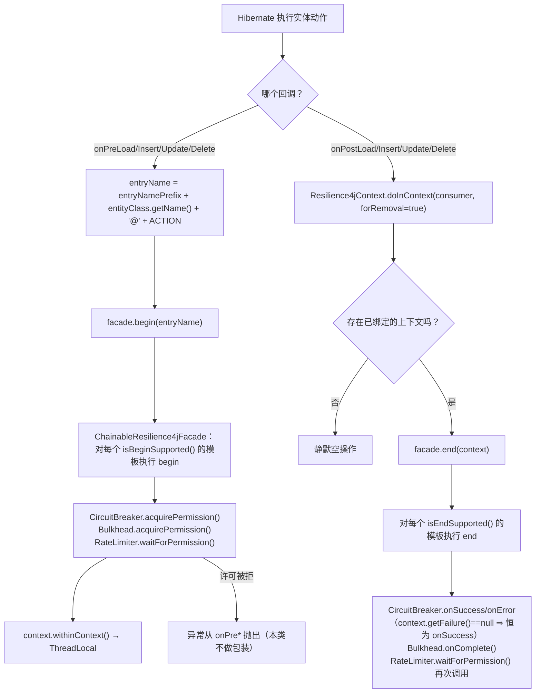
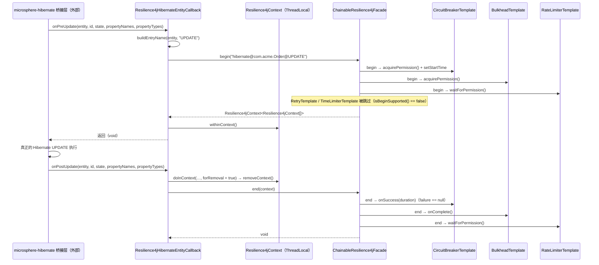
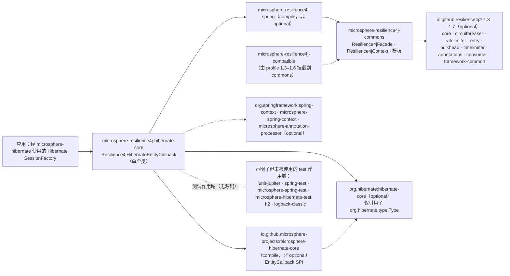

# microsphere-resilience4j-hibernate-core — 开发者指南（1.x）

> 简体中文 | [English](../microsphere-resilience4j-hibernate-core.md)

> 版本线 `0.1.x`（`release-1.x` 分支）· 最新发布版本 `0.1.4` · 当前 `${revision}` = `0.1.5-SNAPSHOT` · Resilience4j **1.3.0 – 1.7.0**（默认 `1.7.0`）· Spring Cloud Hoxton – 2021.0.x · [← 开发者指南索引](README.md)

模块路径：`microsphere-resilience4j-plugins/microsphere-resilience4j-hibernate-core`。

## 类清单

| 类型 | 文件 | 角色 |
|------|------|------|
| `Resilience4jHibernateEntityCallback` | `src/main/java/io/microsphere/resilience4j/hibernate/Resilience4jHibernateEntityCallback.java` | 除 `pom.xml` 之外该模块的**唯一**文件。实现 Microsphere-Hibernate 的 `EntityCallback`，把 8 个生命周期回调映射到门面的两阶段 `begin`/`end` 操作上 |
| 构建描述符 | `pom.xml` | `io.github.microsphere-projects:microsphere-resilience4j-hibernate-core`，`${revision}`，父工程 `microsphere-resilience4j-parent` |

以下都是有意留空的，全部通过在 `release-1.x` 上列出模块目录树予以核实：

| 缺失内容 | 后果 |
|-----------------|-------------|
| **`src/test` 不存在** | 该类在本分支上没有任何自动化覆盖。（0.2.x 带有 `Resilience4jHibernateEntityCallbackTest extends AbstractHibernateH2Test`；那个文件不属于 `release-1.x`。）关于它的任何行为性论断都是源自源码的推演，而非执行验证。 |
| `META-INF/spring.factories` | 没有注册为 `Resilience4jPlugin`；`@Enable*(plugins = …)` 无法发现它。 |
| 某个 `*Resilience4jPlugin` 类 | 与 Druid 和 MyBatis 不同，本插件对 spring 模块的 `Resilience4jPlugin` SPI 毫无贡献，因此不存在 `getName()` 取值（本分支上没有 `"hibernate"` 这个插件名）。 |
| 构造器与 getter | 仅有 JavaBean 式配置（`setFacade`、`setEntryNamePrefix`）；实例中没有任何内容可以被读回。 |

## 织入机制：实体生命周期回调（既无代理，也无装饰器）

`Resilience4jHibernateEntityCallback implements io.microsphere.hibernate.entity.EntityCallback`。该 SPI 属于 **`microsphere-hibernate-core`**（一个强制依赖），而不属于 Hibernate 本身。本模块 import 的唯一 `org.hibernate.*` 类型是 `org.hibernate.type.Type`，仅用作回调参数类型。Microsphere-Hibernate 如何把这些回调桥接进 Hibernate（拦截器、事件监听器还是 integrator）是在那个外部构件中定义的，**无法从本快照核实**。

每个动作都被拆成一对匹配的前置/后置方法：

```java
@Override
public void onPreLoad(Object entity, Object id, Object[] state, String[] propertyNames, Type[] types) {
    String entryName = buildEntryName(entity, "LOAD");
    Resilience4jContext<Resilience4jContext[]> begin = this.facade.begin(entryName);
    begin.withinContext();
}

@Override
public void onPostLoad(Object entity, Object id, String[] propertyNames, Type[] types) {
    doInContext(contextt -> this.facade.end(contextt), true);
}
```

该类使用的静态 import：`io.microsphere.resilience4j.common.Resilience4jContext.doInContext` 与 `io.microsphere.util.Assert.assertNotNull`。

依据源码的机制说明：

1. **`begin` 打开，`end` 关闭，`ThreadLocal` 是中继。** `facade.begin(name)` 返回 `Resilience4jContext<Resilience4jContext[]>`；`withinContext()` 调用 `Resilience4jContext.setContext(this)`（一个 `private static final ThreadLocal<Resilience4jContext>`）。`onPost*` 一侧调用 `doInContext(consumer, true)` → 先 `removeContext()`，然后 `facade.end(context)`。后置回调**不接收任何上下文参数**，因此 ThreadLocal 是两个阶段之间唯一的传递通道——这也正是本模块最主要的脆弱点（参见*设计风险*）。
2. **不包装任何 Hibernate 对象。** 这里没有 `Executor`/`Filter` 式的委托；该类纯粹是围绕一个由外部驱动之动作的观察者。因此关于 `Session`、`SessionFactory` 或实体状态，没有任何东西被拦截或修改——插件看不到操作的结果。
3. **命名基于类。** `buildEntryName(Object entity, String action)` 返回 `entryNamePrefix + entity.getClass().getName() + '@' + action`；只有四个动作（`LOAD`、`DELETE`、`INSERT`、`UPDATE`），字面量硬编码在每个调用点上。它是 `protected` 的，因此这是官方认可的扩展点。
4. **失败在这种 SPI 形态下不可观测。** 没有任何 `onPost*` 方法接收 `Throwable`，该类也从不调用 `Resilience4jContext.setFailure(...)`。`CircuitBreakerTemplate.doEnd` 依据 `context.getFailure() == null` 分支，所以它总是记录 `onSuccess`。对比 spring-web 插件，它确实调用了 `context.setResult(returnValue).setFailure(error)`——Hibernate 插件只是没有地方做同样的事。这是一个设计缺口，而不是本文档的疏漏。

### 回调生命周期流程图



### 被拦截的调用路径（时序）



## 所使用的 Resilience4j 1.x API

| 层次 | 类型 | 说明 |
|-------|-------|-------|
| 本模块的 main 源码 | **无** | `Resilience4jHibernateEntityCallback` 中不存在 `io.github.resilience4j.*` 的 import；协作者只有 `Resilience4jFacade` 与 `Resilience4jContext`（commons），再加上 `EntityCallback`/`org.hibernate.type.Type` |
| 所使用的 Microsphere commons API 表面 | `Resilience4jFacade.begin(String)`、`Resilience4jFacade.end(Resilience4jContext)`、`Resilience4jContext.withinContext()`、`Resilience4jContext.doInContext(Consumer, boolean)` | `Resilience4jOperations` 中两阶段的那一半；Druid/MyBatis 插件所使用的一次性 `call(...)` 在这里没有使用 |
| 测试源码 | **不存在** | 因此兄弟插件所使用的那些 test 作用域 Resilience4j 注册表（`BulkheadRegistry.ofDefaults()` 等）在这里是缺席的 |

**关于垫片的说明（1.x 特有）。** 在 `release-1.x` 上，`microsphere-resilience4j-compatible` 由 Maven profile `resilience4j-1.3` … `resilience4j-1.6` 挂载到 **commons**（见 `microsphere-resilience4j-commons/pom.xml`）。它提供 `io.github.resilience4j.circuitbreaker.event.CircuitBreakerOnFailureRateExceededEvent`、`CircuitBreakerOnSlowCallRateExceededEvent`、`io.github.resilience4j.ratelimiter.event.RateLimiterEvent` 与 `RateLimiterOnDrainedEvent`，这些类被 `CircuitBreakerTemplate`/`RateLimiterTemplate` import。本 Hibernate 模块不引用其中任何类——它自身的编译与版本 profile 无关；1.x/2.x 的分歧被限制在它所要调入的 commons 层内。

**三个插件之间唯一的 1.x 专有构建差异**是框架坐标本身：本 POM 声明的是 `org.hibernate:hibernate-core`（Hibernate 5 命名空间），而同一个文件在 `release`（0.2.x）上声明的是 `org.hibernate.orm:hibernate-core`（Hibernate 6）。除此之外，三个插件（`alibaba-druid`、`mybatis`、`hibernate-core`）的 Java 源码在两条版本线之间逐字节相同——分支间的分歧位于 commons/spring 以及版本属性中，而不在插件代码里。

## 设计模式（附证据）

| 模式 | 是否存在 | 证据 |
|---------|----------|----------|
| **观察者 / 生命周期回调** | 是——本模块的核心 | 8 个 `EntityCallback` 的 `on*` 实现；除注入的门面与前缀之外，该类不注册任何自己的状态 |
| **门面** | 是 | 只依赖 `io.microsphere.resilience4j.common.Resilience4jFacade` |
| **模板方法** | 是，在下游 | `ChainableResilience4jFacade.begin/end` 分派到 `Resilience4jTemplate.begin/end`，其 `doBegin`/`doEnd` 才是各模块的钩子；`isBeginSupported()`/`isEndSupported()` 是功能开关 |
| **线程局部作用域上下文** | 是 | 围绕外部驱动之动作的 `Resilience4jContext.withinContext()` / `doInContext(…, true)`——实际上就是手工的“打开/关闭作用域” |
| **装饰器** | **否** | 与 `Resilience4jExecutor`（MyBatis）和 `Resilience4jDruidFilter`（链的延续）不同，这里没有任何东西被包装；回调无法替换掉那个操作本身 |
| **代理** | **否** | 没有 `Plugin.wrap`，没有 `InvocationHandler` |
| **SPI（`Resilience4jPlugin`）** | **否** | 该类实现的是 Microsphere-Hibernate 的 `EntityCallback`，**不是** `io.microsphere.resilience4j.spring.common.Resilience4jPlugin`；并且本模块根本没有提供 `*Resilience4jPlugin` 类或 `spring.factories` 条目。对照：`DruidResilience4jPlugin` 与 `MyBatisResilience4jPlugin` 都实现了 spring 模块的 SPI（`plugin(ConfigurableListableBeanFactory, BeanDefinitionRegistry, ConfigurableEnvironment)` + `getName()`），并登记在各自模块 `META-INF/spring.factories` 的 `Resilience4jPlugin` 键之下。 |
| **JavaBean 配置** | 是 | 通过 `setFacade`/`setEntryNamePrefix` 做字段注入，并以 `assertNotNull` 做守卫；三个插件中唯一没有构造器注入的那个 |

## 依赖关系图（来自 `pom.xml`）



| 事实 | 细节 |
|------|--------|
| 强制依赖 | **两个**：`microsphere-resilience4j-spring` 与 `microsphere-hibernate-core`——本文所记录的三个插件中唯一拥有多于一个必需依赖的那个 |
| Hibernate 坐标 | `org.hibernate:hibernate-core`，本 POM 中没有 `<version>`；通过导入的 `microsphere-hibernate-dependencies` BOM 解析，属性 `microsphere-hibernate.version = 0.1.9` 位于 `microsphere-resilience4j-parent/pom.xml` |
| BOM 覆盖缺口 | `microsphere-resilience4j-dependencies` **不**管理本构件，因此下游构建必须自行锁定版本 |
| 测试依赖 | 存在但形同虚设——不存在测试源码，因此 `microsphere-hibernate-test` 与 `h2` 在本分支上不起任何作用 |

## 设计风险以及贡献者应当补充的测试套件

由于该模块没有测试，以下这些源码层面的风险目前无人看守：

1. **前置/后置不配对 → 泄漏 ThreadLocal。** `onPost*` 只有当配对在同一线程上触发时才会清除上下文。缺失的后置回调会让上下文保持在绑定状态，*并且*让一个已获取的 bulkhead 许可悬空。建议的测试：只驱动 `onPreInsert` 而不驱动 `onPostInsert`，断言 `Resilience4jContext.getContext()` 仍然非 null，然后记录其运维影响。
2. **嵌套/级联回调会覆盖已绑定的上下文。** 单个 ThreadLocal 槽位无法同时承载外层与内层操作。建议的测试：`onPreLoad(A) → onPreLoad(B) → onPostLoad(B) → onPostLoad(A)`，并断言哪些上下文真正到达了 `facade.end`。
3. **断路器永不记录失败**（在 `end` 处 `context.getFailure()` 恒为 `null`）。建议的测试：让该条目进入打开状态，并断言 `onError` *不会*被调用，然后决定 `EntityCallback` 是否应当新增一个携带失败的钩子。
4. **`facade` 未设置 → 第一个前置回调处抛 NPE。** 由于没有构造器，该类无法在构造时快速失败。建议的测试：在一个未配置的实例上调用 `onPreLoad`，并钉住当前行为。
5. **`RateLimiterTemplate.doEnd` 会再次阻塞**（在关闭阶段调用 `waitForPermission`），因此对实体流量启用限流器会使其成本翻倍。在把这条路径暴露到某个 starter 之前值得补一个测试。
6. **代理会破坏命名**：对 Hibernate 代理/byte-buddy 子类而言，`entity.getClass().getName()` 并不是被映射的实体名。

## 相关页面

- [用户指南 — 本模块](../../user-guide/zh/microsphere-resilience4j-hibernate-core.md)
- [开发者指南 — commons](microsphere-resilience4j-commons.md)（`Resilience4jOperations` 的两阶段契约、`Resilience4jContext`）
- [开发者指南 — mybatis](microsphere-resilience4j-mybatis.md)（装饰器风格的对应实现）
- [开发者指南 — spring](microsphere-resilience4j-spring.md)（本模块**并未**实现的 `Resilience4jPlugin` SPI）
