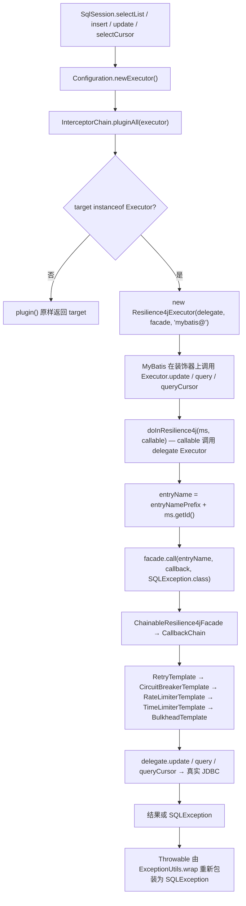
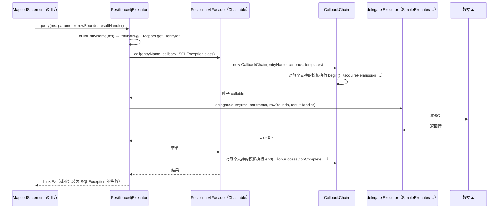
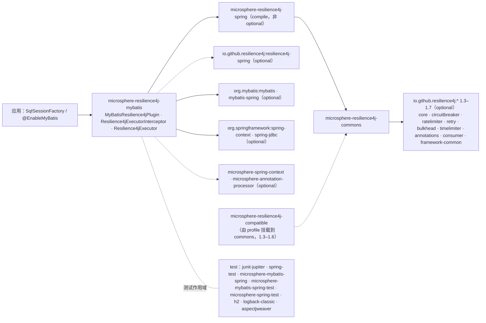

# microsphere-resilience4j-mybatis — 开发者指南（1.x）

> 简体中文 | [English](../microsphere-resilience4j-mybatis.md)

> 版本线 `0.1.x`（`release-1.x` 分支）· 最新发布版本 `0.1.4` · 当前 `${revision}` = `0.1.5-SNAPSHOT` · Resilience4j **1.3.0 – 1.7.0**（默认 `1.7.0`）· Spring Cloud Hoxton – 2021.0.x · [← 开发者指南索引](README.md)

模块路径：`microsphere-resilience4j-plugins/microsphere-resilience4j-mybatis`。

## 类清单

| 类型 | 文件 | 角色 |
|------|------|------|
| `MyBatisResilience4jPlugin` | `src/main/java/io/microsphere/resilience4j/mybatis/MyBatisResilience4jPlugin.java` | `Resilience4jPlugin` SPI 实现；注册拦截器的 bean 定义 |
| `Resilience4jExecutorInterceptor` | `src/main/java/io/microsphere/resilience4j/mybatis/plugin/Resilience4jExecutorInterceptor.java` | MyBatis `Interceptor`，其 `plugin()` 返回装饰器 |
| `Resilience4jExecutor` | `src/main/java/io/microsphere/resilience4j/mybatis/executor/Resilience4jExecutor.java` | 持有弹性边界的 `Executor` 装饰器 |
| 资源 | `src/main/resources/META-INF/spring.factories` | `io.microsphere.resilience4j.spring.common.Resilience4jPlugin=io.microsphere.resilience4j.mybatis.MyBatisResilience4jPlugin` |
| `MyBatisResilience4jPluginTest` | `src/test/java/io/microsphere/resilience4j/mybatis/` | Spring 上下文路径：`@EnableBulkhead(plugins = "mybatis")` + `@EnableCircuitBreaker` + `@EnableMyBatis` |
| `Resilience4jExecutorInterceptorTest` | `src/test/java/io/microsphere/resilience4j/mybatis/plugin/` | 编程式路径：`configuration.addInterceptor(...)`，5 个测试方法 |

`Resilience4jExecutor` **没有专门的测试类**；它通过拦截器测试（`testMapper`、`testSqlSession`、`testInvoke`）被间接覆盖。

## 织入机制：把 `Interceptor.plugin()` 当作装饰器工厂

### 关于 `@Intercepts` 的问题，以源码作答

本页的任务书要求“引用实际被注解的方法”。核实结果是：**一个都没有。** 在 `release-1.x` 上对整个仓库执行 `@Intercepts` / `@Signature` 检索，在本模块中毫无匹配（整个快照中唯一命中 `Signature` 的地方是 *openfeign* 插件里的 `io.microsphere.reflect.MethodUtils.getSignature`）。`Resilience4jExecutorInterceptor` 的完整注解清单是：

```java
public class Resilience4jExecutorInterceptor implements Interceptor {
    @Override public Object intercept(Invocation invocation) throws Throwable { … }
    @Override public Object plugin(Object target) { … }
}
```

它的 import 是 `org.apache.ibatis.executor.Executor`、`org.apache.ibatis.plugin.Interceptor`、`org.apache.ibatis.plugin.Invocation`——`org.apache.ibatis.plugin.Plugin`（*读取* `@Intercepts` 的那个包装器）与 `org.apache.ibatis.plugin.Signature` 都没有被 import。

为什么它仍然有效：MyBatis 的 `InterceptorChain.pluginAll(Object target)` 会对每个已注册的拦截器调用 `interceptor.plugin(target)`。常规实现是 `return Plugin.wrap(target, this)`，它要求有 `@Intercepts`，并构建一个 JDK 代理，之后由代理调用 `intercept(Invocation)`。而本实现返回的是一个**手写的装饰器**：

```java
@Override
public Object plugin(Object target) {
    if (target instanceof Executor) {
        return new Resilience4jExecutor((Executor) target, facade, entryNamePrefix);
    }
    return target;
}
```

这些后果全部可以从代码中读出：

1. 在 MyBatis 运行时路径中 `intercept(Invocation)` 是死代码。它的方法体是 `return invocation.proceed();`，前面有一行注释 `// Current method will be not executed`。唯一的调用者是单元测试，它手工构造了一个 `Invocation`。
2. 不会创建动态代理，因此没有 `InvocationHandler`，也没有反射式分派——拦截开销就是一次普通方法调用加上门面装饰。
3. 只有 `Executor` 目标会被包装。`StatementHandler`、`ParameterHandler` 与 `ResultSetHandler` 目标原样通过，因此当你与其他拦截器组合使用时，对于这些类型而言本插件必须是链中*唯一*的存在。
4. 由于缺少 `@Intercepts`，该拦截器无法通过 `mybatis-config.xml` 的 `<plugins>` 元素声明（那条路径需要一个默认构造器并会注入 `Properties`）；它必须通过 `Configuration.addInterceptor(...)` 添加，或作为被你工厂收集的 Spring bean。`Resilience4jExecutorInterceptor` 只暴露 `(Resilience4jFacade)` 与 `(Resilience4jFacade, String)` 两个构造器——没有 setter，没有无参构造器。

### `Resilience4jExecutor` 装饰了哪些方法

四个方法会打开边界，全部通过同一个汇聚点：

```java
protected <T> T doInResilience4j(MappedStatement ms, ThrowableSupplier<T> callback) throws SQLException {
    String entryName = buildEntryName(ms);
    return this.facade.call(entryName, callback, SQLException.class);
}

private String buildEntryName(MappedStatement ms) {
    return this.entryNamePrefix + ms.getId();
}
```

被装饰的：`update(MappedStatement, Object)`、`query(MappedStatement, Object, RowBounds, ResultHandler, CacheKey, BoundSql)`、`query(MappedStatement, Object, RowBounds, ResultHandler)`、`queryCursor(MappedStatement, Object, RowBounds)`。

透传（无弹性能力）：`flushStatements`、`commit`、`rollback`、`createCacheKey`、`isCached`、`clearLocalCache`、`deferLoad`、`getTransaction`、`close`、`isClosed`。

有一处委托**并不是**简单的透传：

```java
@Override
public void setExecutorWrapper(Executor executor) {
    delegate.setExecutorWrapper(new Resilience4jExecutor(executor, facade, entryNamePrefix));
}
```

传入的执行器在转发之前会被再次装饰。如果调用方传入一个已经被装饰的执行器，装饰就会嵌套——这是一个真实的重复进入风险，值得补一个回归测试；本分支没有。

### 各插件之间条目名称的不对称（已核实）

| 插件 | 前缀常量 | 前缀是否是条目名称的一部分？ |
|--------|-----------------|----------------------------------------|
| alibaba-druid | `"alibaba-druid@"` | **不是** —— `getEntryName(...)` 返回 `SELECT <table>` 等 |
| mybatis | `"mybatis@"` | **是** —— `entryNamePrefix + ms.getId()` |
| hibernate-core | `"hibernate@"` | **是** —— `entryNamePrefix + entityClass.getName() + '@' + action` |

## 被拦截的调用路径





## 所使用的 Resilience4j 1.x API

| 层次 | 类型 | 位置 |
|-------|-------|-------|
| 本模块的 **main** 源码 | **无** —— `MyBatisResilience4jPlugin`、`Resilience4jExecutorInterceptor`、`Resilience4jExecutor` 中都不存在 `io.github.resilience4j.*` 的 import | 已通过阅读三个文件核实 |
| 本模块的 **tests** | `io.github.resilience4j.bulkhead.BulkheadRegistry`、`circuitbreaker.CircuitBreakerRegistry`、`ratelimiter.RateLimiterRegistry`、`retry.RetryRegistry`、`timelimiter.TimeLimiterRegistry`（各自调用 `ofDefaults()`） | `Resilience4jExecutorInterceptorTest.createResilience4jFacade()` |
| MyBatis API 表面 | `org.apache.ibatis.executor.Executor`、`plugin.Interceptor`、`plugin.Invocation`、`mapping.MappedStatement`、`mapping.BoundSql`、`cache.CacheKey`、`cursor.Cursor`、`executor.BatchResult`、`reflection.MetaObject`、`session.ResultHandler`、`session.RowBounds`、`transaction.Transaction` | `Resilience4jExecutor`、`Resilience4jExecutorInterceptor` |
| Spring API 表面（仅插件类） | `ConfigurableListableBeanFactory`、`BeanDefinitionRegistry`、`ConfigurableEnvironment`、`AbstractBeanDefinition`、`BeanDefinitionBuilder.genericBeanDefinition`、`BeanDefinitionReaderUtils.generateBeanName`，以及 `io.microsphere.spring.beans.factory.support.BeanRegistrar.registerBeanDefinition` | `MyBatisResilience4jPlugin.registerResilience4jExecutorInterceptor(...)` |

**关于垫片的说明（1.x 特有）。** `microsphere-resilience4j-compatible` 的事件类（`CircuitBreakerOnFailureRateExceededEvent`、`CircuitBreakerOnSlowCallRateExceededEvent`、`RateLimiterEvent`、`RateLimiterOnDrainedEvent`）由 `resilience4j-1.3` … `resilience4j-1.6` Maven profile 作为 **commons** 的依赖挂载。本 MyBatis 模块不 import 其中任何一个；它的编译 classpath 与 profile 无关。1.x 与 2.x 的分歧存在于 commons/spring 之中（`io.github.resilience4j.core.Registry`、`core.EventProcessor`、`Registry.EventPublisher`、`io.github.resilience4j.common.*.configuration.*ConfigurationProperties`），而本插件只能通过 `Resilience4jFacade` 触达它们。

## 设计模式（附证据）

| 模式 | 证据 |
|---------|----------|
| **装饰器（具体实现，而非基于代理）** | `Resilience4jExecutor implements Executor` 并持有 `private final Executor delegate`，转发每一个方法，并在其中四个方法上增加行为。这是经典的 GoF 装饰器；MyBatis 基于代理的 `Plugin.wrap` 被刻意避开。 |
| **拦截器（框架钩子）** | `Resilience4jExecutorInterceptor implements Interceptor`，但只有 `plugin()` 携带行为——一种少见的“从不拦截的拦截器”。 |
| **门面** | 拦截器与执行器都只依赖 `io.microsphere.resilience4j.common.Resilience4jFacade`。 |
| **责任链** | MyBatis 的 `InterceptorChain`（多次 `plugin()` 调用）以及 commons 的 `CallbackChain`（嵌套的模板调用）。 |
| **模板方法** | `Resilience4jTemplate.begin/end` 配合各模块的 `doBegin`/`doEnd`；`RetryTemplate`/`TimeLimiterTemplate` 中的 `isBeginSupported()`/`isEndSupported()` 覆写返回 `false`。 |
| **工厂方法 / Bean 定义** | `MyBatisResilience4jPlugin` 构建一个 `AbstractBeanDefinition`，使用 `addConstructorArgReference("lazyResilience4jFacade")` 并生成 bean 名称。 |
| **SPI** | `MyBatisResilience4jPlugin implements io.microsphere.resilience4j.spring.common.Resilience4jPlugin`（spring 模块的 SPI——已确认），通过 `META-INF/spring.factories` 发布，由 `EnableResilience4jRegistrar.registerPlugins(...)` 发现，并以 `getName()` 是否匹配注解的 `plugins` 属性作为开关。这是三个被记录在案的插件中唯一一个 `plugin(...)` 真正做工作的。 |

## 依赖关系图（来自 `pom.xml`）



| 事实 | 细节 |
|------|--------|
| 强制依赖 | 仅 `microsphere-resilience4j-spring` |
| MyBatis 版本 | 此处不锁定；通过导入的 `microsphere-mybatis-dependencies` BOM 解析，`microsphere-mybatis.version = 0.1.15`（父 POM） |
| 相对 Druid 插件的额外内容 | 本 POM 额外声明了 `resilience4j-spring` 与 `spring-jdbc`（optional），以及 test 作用域的 `microsphere-mybatis-spring(-test)` + `aspectjweaver` |
| 被引用的门面 bean | `LazyResilience4jFacade.BEAN_NAME` = `"lazyResilience4jFacade"` |

## 面向贡献者的扩展点与注意事项

- `Resilience4jExecutorInterceptor.plugin(...)` 与 `Resilience4jExecutor.doInResilience4j(...)` 是两个天然的扩展点；两者都不是 final，因此通过子类化你可以增加 `StatementHandler` 支持（你需要让 `plugin()` 返回第二种装饰器类型）。
- 若要改为在 `Configuration` 层面提供 `@Intercepts` 实现，就需要把 `plugin()` 换成 `Plugin.wrap(target, this)`，并把边界移入 `intercept()`；这会改变与其他用户拦截器之间的顺序语义，因此需要一次设计讨论，而不是直接重构。
- `setExecutorWrapper` 的双重装饰在任何改动之前都值得先补一个单元测试。
- MyBatis 上下文测试（`MyBatisResilience4jPluginTest`）通过外部辅助方法 `assertConfiguration(configuration)` 与 `assertUserMapper(userMapper)` 进行断言，它们来自 Microsphere 的 MyBatis 测试构件（`io.microsphere.mybatis.test.*`），而这些构件**不属于本仓库**，因此无法审阅其实现。**该测试证明了**：上下文可以启动，由插件注册的 bean 定义是有效的，并且 mapper 调用仍然成功。**它没有证明**（在本仓库中不可见）：拦截器确实存在于 `Configuration.getInterceptors()` 之中，或者断路器确实打开过。如果你要扩展这套测试，请为后者补充专门的断言。
- 两个测试中的 `createResilience4jFacade()` 都把一个门面赋给字段，却*另外*返回一个不同实例；`setUp` 随后又覆盖该字段。无害，但属于复制粘贴的坏味道——不要照抄。

## 相关页面

- [用户指南 — 本模块](../../user-guide/zh/microsphere-resilience4j-mybatis.md)
- [开发者指南 — commons](microsphere-resilience4j-commons.md)
- [开发者指南 — spring](microsphere-resilience4j-spring.md)
- [开发者指南 — hibernate core](microsphere-resilience4j-hibernate-core.md)
