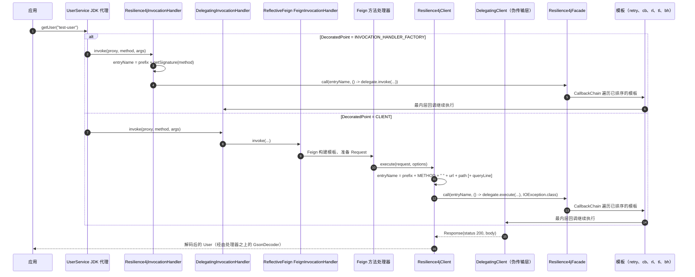
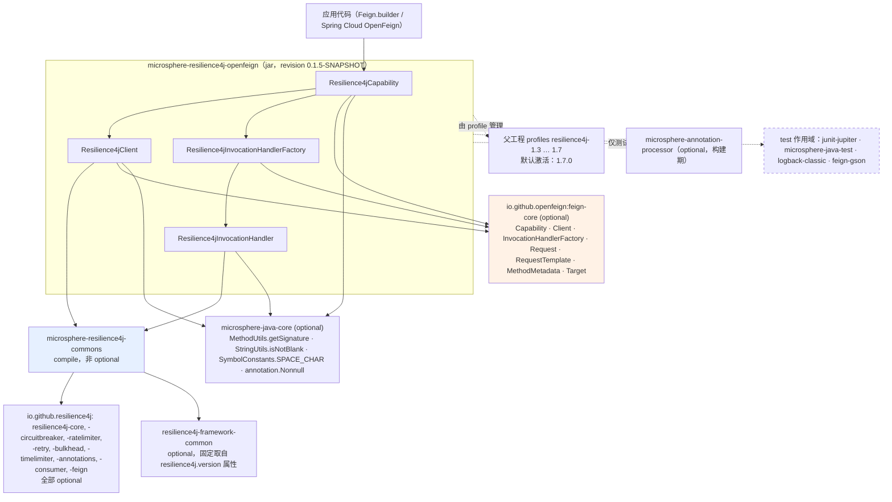

# microsphere-resilience4j-openfeign — 开发者指南（1.x）

> 版本线 `0.1.x`（`release-1.x` 分支） · 最新发布版本 `0.1.4` · 当前 `${revision}` = `0.1.5-SNAPSHOT` · Resilience4j **1.3.0 – 1.7.0**（默认 `1.7.0`） · Spring Cloud **Hoxton – 2021.0.x**（父工程 `microsphere-spring-cloud-parent` `0.1.26`） · JDK **8** 基线 · [← 指南索引](README.md)
> [English](../microsphere-resilience4j-openfeign.md)

模块路径：`microsphere-resilience4j-plugins/microsphere-resilience4j-openfeign`。包：`io.microsphere.resilience4j.feign`。

## 这个插件真正坐落在哪个模块之上：commons，而不是 spring

该插件的 POM 中恰好只有一个非 optional 的工程依赖：`io.github.microsphere-projects:microsphere-resilience4j-commons`（`${revision}`）。`microsphere-resilience4j-spring` 在 POM 中**并不存在**，并且模块中没有任何类 import `io.microsphere.resilience4j.spring.*`、`org.springframework.*` 或 `javax.servlet.*` 里的东西。来自本快照的佐证事实：

- 根本不存在 `src/main/resources` 目录——因此也就没有 `META-INF/spring.factories`，这一点与 `alibaba-druid`、`mybatis` 和 `spring-web` 插件不同；
- 该插件实现的是 `feign.Capability`，而不是 Spring 侧的 `io.microsphere.resilience4j.spring.common.Resilience4jPlugin` SPI；
- 唯一的注入点是 `io.microsphere.resilience4j.common.Resilience4jFacade`，一个来自 commons 的接口，由 `ChainableResilience4jFacade`（测试中）或你编写的任何其他门面来满足。

结论：该插件可以在一个纯粹的 Java 进程里工作，它内部没有任何东西知道注册中心、Spring 上下文或配置属性。

## 类清单

### 生产类（`src/main/java`）

| 类 | 实现 | 职责 |
|-------|-----------|------|
| `Resilience4jCapability` | `feign.Capability` | 用户唯一需要创建的注册对象；选定挂载点（`DecoratedPoint`）并构建与之匹配的装饰器 |
| `Resilience4jClient` | `feign.Client` | 装饰传输步骤；条目名称由 `Request`/`RequestTemplate`/`MethodMetadata` 推导而来 |
| `Resilience4jInvocationHandlerFactory` | `feign.InvocationHandlerFactory` | 装饰工厂本身，从而使 Feign 创建的每一个代理处理器都被包装 |
| `Resilience4jInvocationHandler` | `java.lang.reflect.InvocationHandler` | 代理层上真正的装饰；条目名称由 `Method` 签名推导而来 |

嵌套类型：`Resilience4jCapability.DecoratedPoint`（`CLIENT`、`INVOCATION_HANDLER_FACTORY`）。

### 测试类（`src/test/java`，全部位于 `io.microsphere.resilience4j.feign`）

| 类型 | 职责 |
|------|------|
| `AbstractResilience4jFeignTest` | 共享夹具：注册中心 → 门面 → `Feign` 实例 → `UserService` 代理；包含 `testProxy()` 与 `testUserService()`；声明 `protected abstract Resilience4jCapability createResilience4jCapability(Resilience4jFacade facade)` |
| `Resilience4jCapabilityTest` | 默认构造器路径；断言 `DEFAULT_ENTRY_NAME_PREFIX == "feign@"` 以及 `DEFAULT_DECORATED_POINT == CLIENT` |
| `Resilience4jClientTest` | `entryNamePrefix = this.getClass().getSimpleName()` 的 `CLIENT` 模式 |
| `Resilience4jInvocationHandlerFactoryTest` | `INVOCATION_HANDLER_FACTORY` 模式 |
| `DelegatingCapability` | 第二个 `Capability`，它只覆盖 `InvocationHandlerFactory enrich(InvocationHandlerFactory)`，用于证明多能力扩展的顺序 |
| `DelegatingInvocationHandlerFactory` | 把被委托的处理器包装进 `DelegatingInvocationHandler` |
| `DelegatingInvocationHandler` | 把本次调用的 `Object[] args` 存入一个 `ThreadLocal` 并通过 `static Object[] getArguments()` 暴露出来；为断言提供 `getDelegate()` |
| `DelegatingClient<T>` | 一个伪传输层：从 `request.requestTemplate().methodMetadata().method()` 解析出 `Method`，在本地实现上调用它，并把结果编码成一个状态为 `200` 的 `Response` |
| `api.User`、`api.UserService`、`server.SimpleUserService` | 夹具服务（`@RequestLine("POST /user/{name}")`、`@RequestLine("GET /user")`，一个内存中的 `Map<String, User>` 仓库） |

## 织入机制

### 1. `Resilience4jCapability` 在 Feign 的 `Capability` 架构中的位置

`feign.Capability` 是一个扁平接口，由若干单参数的 `enrich(...)` 钩子组成，每个钩子都返回它所接收的那个类型（默认是恒等返回）。通过 `javap` 检视本地 Maven 仓库中的 `feign-core` 构件得到：

| `feign-core` | `Capability` 静态辅助方法 | `enrich` 重载 |
|--------------|-----------------------------|----------------|
| `10.10.1`（Hoxton 时代的 OpenFeign） | `static <E> E enrich(E, List<Capability>)`、`static <E> E invoke(E, Capability)` | 11 个：`Client`、`Retryer`、`RequestInterceptor`、`Logger`、`Logger.Level`、`Contract`、`Request.Options`、`Encoder`、`Decoder`、`InvocationHandlerFactory`、`QueryMapEncoder` |
| `11.10`（Spring Cloud 2021 时代的 OpenFeign） | `static Object enrich(Object, Class<?>, List<Capability>)`、`static Object invoke(Object, Capability, Class<?>)` | 上述 11 个，另加 `AsyncClient<Object>`、`ResponseInterceptor`、`ErrorDecoder`、`AsyncResponseHandler`、`AsyncContextSupplier<C>`（列表已截断；未断言总数） |

`Resilience4jCapability` 覆盖了其中**两个**，其余所有钩子都保持继承而来的恒等默认行为。before → after 这一对应关系就是完整的装饰契约：

```java
// before：Feign 本来要使用的普通 Client  ->  after：同一条调用路径，被套上韧性包装
@Override
public Client enrich(Client client) {
    return isDecoratedClient() ? new Resilience4jClient(client, facade, entryNamePrefix) : client;
}

// before：普通的 InvocationHandlerFactory ->  after：一个其处理器会被包装的工厂
@Override
public InvocationHandlerFactory enrich(InvocationHandlerFactory invocationHandlerFactory) {
    return isDecoratedInvocationHandlerFactory()
            ? new Resilience4jInvocationHandlerFactory(invocationHandlerFactory, facade, entryNamePrefix)
            : invocationHandlerFactory;
}
```

由于 `DecoratedPoint` 只是一个单值的枚举，这两个钩子是互斥的：在使用默认的 `CLIENT` 挂载点时，`enrich(InvocationHandlerFactory)` 会原样返回它的入参，反之亦然。

Feign 在 `Feign.Builder` 中按顺序折叠能力扩展列表，因此**最后添加的能力扩展产出最外层的对象**。`AbstractResilience4jFeignTest` 从外部证明了这一点：

```java
this.feign = Feign.builder()
        .client(new DelegatingClient<>(encoder, new SimpleUserService()))
        .decoder(decoder)
        .encoder(encoder)
        .addCapability(new DelegatingCapability())   // 先添加  -> 在内侧
        .addCapability(this.capability)              // 后添加 -> 在外侧
        .build();
```

在 `INVOCATION_HANDLER_FACTORY` 模式下，`testProxy()` 随后断言栈为 `Resilience4jInvocationHandler → DelegatingInvocationHandler → feign.ReflectiveFeign$FeignInvocationHandler`；而在 `CLIENT` 模式下，代理处理器链停在 `DelegatingInvocationHandler`（Resilience4j 的包装在代理层根本不存在），装饰则落在 `Client` 之上。

### 2. `Resilience4jInvocationHandlerFactory`——一个生产工厂的工厂

```java
@Override
public InvocationHandler create(Target target, Map<Method, MethodHandler> dispatch) {
    InvocationHandler delegate = this.delegate.create(target, dispatch);
    return new Resilience4jInvocationHandler(delegate, facade, entryNamePrefix);
}
```

除了它的三个 `final` 字段之外它是无状态的，并且不对处理器做任何缓存：Feign 对每次 `newInstance(Target)`（即每个客户端代理）只调用一次 `create`，所以包装器的数量受代理数量约束，而不受调用数量约束。`target` 和 `dispatch` 只是被转发出去，这正是该模式下的条目名称基于方法而非基于 URL 的原因。

### 3. `Resilience4jInvocationHandler`——代理层的装饰

```java
@Override
public Object invoke(Object proxy, Method method, Object[] args) throws Throwable {
    String entryName = buildEntryName(method);
    return this.facade.call(entryName, () -> delegate.invoke(proxy, method, args));
}

private String buildEntryName(Method method) {
    return entryNamePrefix + getSignature(method);   // io.microsphere.reflect.MethodUtils
}
```

`throws Throwable` 与 `InvocationHandler#invoke` 完全一致，因此可以直接使用普通的 `call(String, ThrowableSupplier<T>)` 重载，什么都不做包装——Feign 的 `ReflectiveFeign` 处理器可能抛出受检异常，它们会原样穿过。构造参数用 `requireNonNull` 校验，而 `getDelegate()` / `getFacade()` 的存在，正是为了让测试（以及你自己的诊断代码）能够沿着这条链走下去。

### 4. `Resilience4jClient`——传输层的装饰

```java
@Override
public Response execute(Request request, Request.Options options) throws IOException {
    String entryName = buildEntryName(request);
    return this.facade.call(entryName, () -> this.delegate.execute(request, options), IOException.class);
}

private String buildEntryName(Request request) {
    StringBuilder entryNameBuilder = new StringBuilder(entryNamePrefix);
    Request.HttpMethod httpMethod = request.httpMethod();
    RequestTemplate requestTemplate = request.requestTemplate();
    MethodMetadata methodMetadata = requestTemplate.methodMetadata();
    String url = requestTemplate.feignTarget().url();
    String path = methodMetadata.template().path();
    String queryLine = requestTemplate.queryLine();
    entryNameBuilder.append(httpMethod.name()).append(SPACE_CHAR).append(url).append(path);
    if (isNotBlank(queryLine)) {
        entryNameBuilder.append(queryLine);
    }
    return entryNameBuilder.toString();
}
```

在你改动它之前值得了解的设计要点：

- **真相来源被劈成两半。** `path` 来自*由契约解析而来、尚未求值的*模板（`methodMetadata.template()`），所以 URI 变量保持字面量（`/user/{name}`）；`queryLine` 来自*按请求而变*的 `RequestTemplate`，所以查询值会成为键的一部分。因此条目名称的基数由查询串驱动，而不是由路径变量驱动。
- 三参数的 `call(..., IOException.class)` 是 `IOException` 能够穿过门面得以保留的唯一原因：`Resilience4jOperations#call(String, ThrowableSupplier<T>, Class<TR>)` 会执行两阶段的默认逻辑，并把任何 `Throwable` 经由 `ExceptionUtils.wrap(t, throwableClass)` 路由出去。
- 没有缓存，没有按实例的状态；每次调用都重建名称。

### 5. 门面内部发生了什么

两个装饰器都使用一次性的 `call(...)` 路径，`ChainableResilience4jFacade` 把它变成一条递归链（commons 源码）：

```java
public <T> T call(String name, ThrowableSupplier<T> callback) throws Throwable {
    CallbackChain<T> supplier = new CallbackChain<>(name, callback, this.templates);
    T result = supplier.get();
    ...
}
// CallbackChain.get()：templates[pos++].call(entryName, CallbackChain.this::get)，一直进行到模板耗尽，然后调用 delegate.get()
```

`createTemplates(registries)` 把每个注册中心映射到它对应的模板，`templates.sort(COMPARATOR)` 则按 `Resilience4jModule` 的默认优先级排序——`RETRY 0`、`CIRCUIT_BREAKER 1`、`RATE_LIMITER 2`、`TIME_LIMITER 3`、`BULKHEAD 4`、`THREAD_POOL_BULKHEAD 4`——所以**重试是最外层的装饰，舱壁隔离是最内层的**。在这条 1.x commons 版本线上，各模块的一次性行为为：`CircuitBreakerTemplate.call` → `circuitBreaker.decorateCheckedSupplier(...)`，`RetryTemplate.call` → `Retry.decorateCheckedSupplier(...)`，`RateLimiterTemplate.call` → `RateLimiter.decorateCheckedSupplier(...)`，`TimeLimiterTemplate.call` → 在一个内部执行器上调用 `timeLimiter.decorateFutureSupplier(...)`，`ThreadPoolBulkheadTemplate.call` → `executeCallable(...)` + `future.get()`，而 `BulkheadTemplate` 保留了继承而来的 begin/end 组合。条目的解析方式是 `registry.find(name)` → `registry.<module>(name, getConfiguration(name))`，因此一个**名称等于条目名称的注册中心配置**就会绑定到那个端点上。

### 时序图：一次被拦截的 Feign 调用（`UserService#getUser`）



## 设计模式证据

| 模式 | 所在位置 | 证据（源码） |
|---------|-------|-------------------|
| **装饰器（Decorator）** | `Resilience4jClient`、`Resilience4jInvocationHandler`、`Resilience4jInvocationHandlerFactory` | 每个类都持有 `private final <同一个接口> delegate`，实现的就是同一个接口，并在一个 lambda 内部转发调用 |
| **代理（Proxy，JDK 动态代理）** | `Resilience4jInvocationHandler` | `implements java.lang.reflect.InvocationHandler`，`invoke(Object proxy, Method method, Object[] args)`；测试用 `Proxy.getInvocationHandler(userService)` 取得它 |
| **抽象工厂 / 工厂装饰** | `Resilience4jInvocationHandlerFactory` | `create(Target, Map<Method, MethodHandler>)` 装饰的是产物，而不是工厂方法的入参 |
| **职责链（Chain of Responsibility）** | `Resilience4jCapability`（由 Feign 折叠的能力扩展列表）以及 `ChainableResilience4jFacade` + `CallbackChain` | `addCapability(...)` 的顺序由 `testProxy()` 证明；`CallbackChain.get()` 在已排序模板上的递归 |
| **策略（Strategy）** | `Resilience4jCapability.DecoratedPoint` | `enrich(Client)` / `enrich(InvocationHandlerFactory)` 通过 `isDecoratedClient()` / `isDecoratedInvocationHandlerFactory()` 来选择策略 |
| **门面（Facade）** | `Resilience4jFacade` 构造参数 | 该插件从不触碰任何 Resilience4j 的注册中心、条目或装饰器类 |
| **模板方法（Template Method）** | `Resilience4jClient#buildEntryName`、`Resilience4jInvocationHandler#buildEntryName` | 在固定的 `execute`/`invoke` 骨架之内一个私有的名称构建步骤 |
| **SPI** | *此处未使用* | 本模块既没有 `META-INF/services` 也没有 `META-INF/spring.factories`；注册方式是 `Feign.Builder#addCapability`（Feign 的扩展点）。对比同级的 `spring-web` 插件，它*确实*是 `io.microsphere.resilience4j.spring.common.Resilience4jPlugin` 的一个 SPI 实现，并通过 `META-INF/spring.factories` 发布 |
| 测试替身 / **适配器（Adapter）** | `DelegatingClient<T>`、`Delegating*` 一系列辅助类 | 把一个本地的 `SimpleUserService` 适配成 `feign.Client`，并记录下这条链以供断言 |

## 依赖图（来自各 POM）



关于这张图的说明，全部取自各 POM 文件：只有 `microsphere-resilience4j-commons` 是非 optional 的；`resilience4j-framework-common` 是本模块中唯一一个带显式 `${resilience4j.version}` 的依赖（其余版本都来自 `microsphere-resilience4j-parent` 的 `dependencyManagement`）；`feign-gson` 是 **test 作用域**的，所以真实应用要提供它自己的 `Encoder`/`Decoder`；而 `microsphere-resilience4j-compatible` 只在 profiles `resilience4j-1.3` … `resilience4j-1.6` 之下挂到 commons 上（见 [compatible 页面](microsphere-resilience4j-compatible.md)）。

## 核验状态

| 论断 | 状态 |
|-------|--------|
| 四个生产类以及测试夹具中所有的类/方法/字段名称与签名 | 已从 `release-1x` 源码核验 |
| `feign.Capability` 的重载清单以及静态的 `enrich` 辅助方法 | 已用 `javap` 针对本地 Maven 仓库中的 `feign-core` `10.10.1` 与 `11.10` 核验（二者都是 Hoxton/2020/2021 这些 profile 所能到达的 OpenFeign 世代） |
| 你的构建实际解析出的 `feign-core` 版本 | **不由本仓库固定**——继承自当前激活 profile 的 Spring Cloud BOM；请用 `mvn dependency:tree` 核验 |
| `io.microsphere.reflect.MethodUtils#getSignature(Method)` 所产生的确切字符串 | **未核验**——该工具类位于 `microsphere-java-core`，在本快照之外；只有 `entryNamePrefix + getSignature(method)` 这个拼接是经过核验的 |
| `Feign.Builder` 按插入顺序折叠能力扩展（最后添加 = 最外层） | 与 `testProxy()` 中所断言的处理器栈一致；Feign 自己的折叠循环在本快照中未被阅读 |
| Spring Cloud OpenFeign 会从某个客户端上下文中收集 `Capability` bean | **未核验**——属于外部行为；本模块没有任何东西依赖 Spring Cloud |

## 给维护者的说明

- 新增一个挂载点意味着既要新增一个 `DecoratedPoint` 常量，**也要**有一个与之匹配的 `enrich` 覆盖；那几个谓词是穷尽的 `equals` 检查，所以一个未被处理的挂载点会悄无声息地什么都不装饰。
- `entryNamePrefix` 是原样拼接的。默认值 `"feign@"` 自带了它的分隔符，而 `Resilience4jClientTest` 是故意传入一个不带分隔符的前缀的——如果你要把前缀做成可配置的，请在这里做归一化，而不是在各个调用方。
- 请考虑在 `CLIENT` 模式的查询串成为注册中心键之前是否应当对它做净化；如今每一条不同的查询行都会（并且会一直）在每个模块的注册中心里各占一个条目。
- 本模块没有针对真实 HTTP 服务器的集成测试；`DelegatingClient` 把传输过程短路了，这同时也意味着响应错误路径（`ErrorDecoder`、非 2xx）在这里未经测试。
