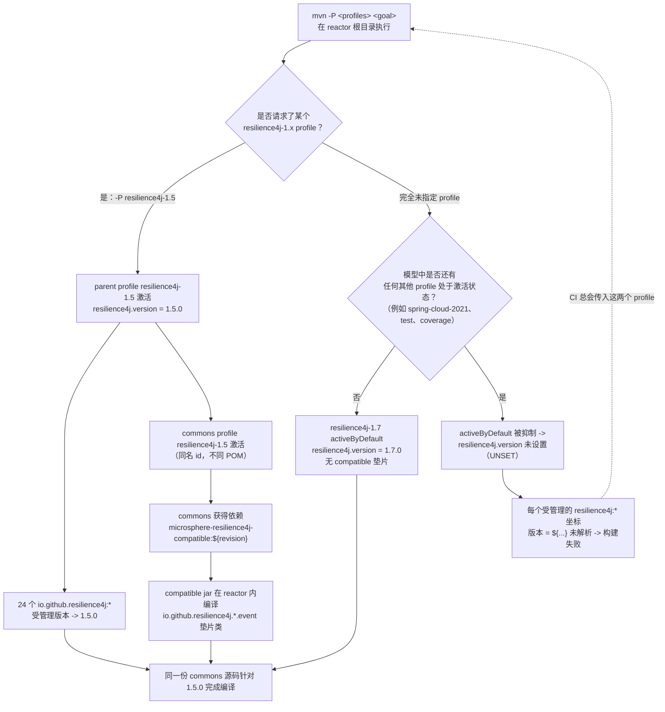

# microsphere-resilience4j-parent — 开发者指南（1.x / v0.1.x）

> 版本线 `0.1.x`（`release-1.x` 分支） · `${revision}` = `0.1.5-SNAPSHOT` · 最新发布版本 `0.1.4` · Resilience4j **1.3.0 – 1.7.0**（默认 `1.7.0`） · [← 开发者指南索引](README.md)

本页记录 1.x 构建父工程的内部实现：它的 POM 实际包含什么，五个 `resilience4j-1.x` profile 如何贯穿整个 reactor 完成解析，profile `1.3`–`1.6` 为何还会改变*依赖图*，以及 CI 如何驱动整个矩阵。

## POM 清单（`microsphere-resilience4j-parent/pom.xml`）

| 区段 | 是否存在 | 内容 |
|---------|----------|---------|
| `<parent>` | 是 | `io.github.microsphere-projects:microsphere-resilience4j:${revision}`，`relativePath ../pom.xml` |
| `<properties>` | 是 | 仅五个 `microsphere-*.version` 属性（见下方表格） |
| `<dependencyManagement>` | 是 | 24 条显式的 `io.github.resilience4j:*` 条目 + 5 个被导入的 `microsphere-*-dependencies` BOM |
| `<profiles>` | 是 | `resilience4j-1.3` … `resilience4j-1.7`；只有 `resilience4j-1.7` 带 `activeByDefault` |
| `<dependencies>` | **否** | 父工程不向消费者添加任何依赖 |
| `<build>`、`<pluginManagement>`、`<distributionManagement>`、`<repositories>` | **否** | 全部经由 reactor 根继承自 `microsphere-spring-cloud-parent:0.1.26` |

给维护者的经验法则：这个文件只负责**版本策略**。任何共享的*插件*行为（compiler level、flatten、sources/javadoc jar、deploy）都位于上级那条线中，必须在那里修改。

### 继承与聚合（两个不同的 POM）

| POM | artifactId | packaging | 有 `<modules>` 吗？ | 角色 |
|-----|-----------|-----------|------------------|------|
| reactor 根 | `microsphere-resilience4j` | `pom` | **有**（8 个模块） | 聚合器；`${revision} = 0.1.5-SNAPSHOT`；父工程 `microsphere-spring-cloud-parent:0.1.26` |
| 构建父工程 | `microsphere-resilience4j-parent` | `pom` | 无 | 其他每个模块所继承的父 POM；自身也作为 reactor 的一个 `<module>` 列出 |

### 受管理的 microsphere 集成版本

| 属性 | 值 | 被导入的 BOM |
|----------|-------|--------------|
| `microsphere-spring-cloud.version` | `0.1.26` | `microsphere-spring-cloud-dependencies` |
| `microsphere-alibaba-druid.version` | `0.1.20` | `microsphere-alibaba-druid-dependencies` |
| `microsphere-mybatis.version` | `0.1.15` | `microsphere-mybatis-dependencies` |
| `microsphere-hibernate.version` | `0.1.9` | `microsphere-hibernate-dependencies` |
| `microsphere-redis.version` | `0.1.13` | `microsphere-redis-dependencies` |

这五项全都是 `<type>pom</type>` `<scope>import</scope>`。它们就是叶层 POM 能够不带版本号地写出 `microsphere-hibernate-core`、`microsphere-mybatis-*`、Druid 或 Redis 坐标的原因。

### 显式的 Resilience4j 版本管理

1.x 父工程管理 **24** 个 `io.github.resilience4j` 坐标，每个都带 `<version>${resilience4j.version}</version>`：

`resilience4j-all`、`resilience4j-bulkhead`、`resilience4j-cache`、`resilience4j-circuitbreaker`、`resilience4j-circularbuffer`、`resilience4j-consumer`、`resilience4j-feign`、`resilience4j-framework-common`、`resilience4j-kotlin`、`resilience4j-metrics`、`resilience4j-micrometer`、`resilience4j-prometheus`、`resilience4j-ratelimiter`、`resilience4j-ratpack`、`resilience4j-reactor`、`resilience4j-retrofit`、`resilience4j-retry`、`resilience4j-rxjava2`、`resilience4j-rxjava3`、`resilience4j-spring`、`resilience4j-spring-boot2`、`resilience4j-spring-cloud2`、`resilience4j-timelimiter`、`resilience4j-vertx`。

**本版本线上没有 `resilience4j-bom` 导入**——这是与 `0.2.x` 的刻意差异，后者导入 `io.github.resilience4j:resilience4j-bom:${resilience4j.version}` 以及 `resilience4j-framework-common`。在本仓库中可见两个后果：

1. `resilience4j-annotations` 和 `resilience4j-core` 在此**未**被管理，然而 commons、compatible、druid、hibernate-core 和 openfeign 的 POM 都以不带 `<version>` 的方式声明它们；这两个坐标通过某个被导入的框架 BOM（`microsphere-spring-cloud-dependencies:0.1.26` 这条链）解析，而那在本工作树之外。请用 `./mvnw help:effective-pom` 核实，而不要假定它们跟随 `${resilience4j.version}`。
2. 往模块 POM 中新增一个 Resilience4j 构件，需要修改**这个**列表（或依赖那个被导入的 BOM）；而在 `0.2.x` 上，`resilience4j-bom` 导入会自动覆盖每个模块。

## profile 解析：两个 POM，同一个 profile id

版本 profile 被拆分到两个文件中，而两个文件里使用同一个 id，正是多版本构建得以成立的关键：

| profile id | `microsphere-resilience4j-parent/pom.xml` | `microsphere-resilience4j-commons/pom.xml` |
|------------|--------------------------------------------|---------------------------------------------|
| `resilience4j-1.3` | `<properties>` → `resilience4j.version = 1.3.0` | `<dependencies>` → 添加 `microsphere-resilience4j-compatible:${revision}`（compile、非 optional） |
| `resilience4j-1.4` | → `1.4.0` | → 同样的添加 |
| `resilience4j-1.5` | → `1.5.0` | → 同样的添加 |
| `resilience4j-1.6` | → `1.6.0` | → 同样的添加 |
| `resilience4j-1.7` | → `1.7.0`，**`activeByDefault = true`** | *无此 profile* |

因此 `microsphere-resilience4j-commons/pom.xml` **不**声明 `resilience4j-1.7` profile：在默认构建下 commons 模块什么都不会额外获得，因为 Resilience4j 1.7.0 已经包含垫片所回移的那些事件类型（`CircuitBreakerEvent`、`CircuitBreakerOnFailureRateExceededEvent`、`CircuitBreakerOnSlowCallRateExceededEvent`、`RateLimiterEvent`、`RateLimiterOnDrainedEvent`——全部位于原有的 `io.github.resilience4j.*.event` 包下，见 `microsphere-resilience4j-compatible/src/main/java`）。

`activeByDefault` 标志在整条版本线中恰好只出现一次（父工程，profile `resilience4j-1.7`）。

### profile 解析流程图



`activeByDefault` 被抑制的这一分支并非纸上谈兵：`.github/workflows/maven-build.yml` 每次运行都会激活 `test`、`coverage`、一个 `spring-cloud-*` 和一个 `resilience4j-1.x` profile，正是为了让矩阵中的任何一条腿都无法落入"属性未设置"的状态。

### compatible 模块的运作机制

| 事实 | 证据 |
|------|----------|
| `microsphere-resilience4j-compatible` 包含 5 个垫片类 + `package-info.java`，全部位于 `io.github.resilience4j.circuitbreaker.event` / `io.github.resilience4j.ratelimiter.event` | `microsphere-resilience4j-compatible/src/main/java/...` |
| 它自身的 POM 声明了与 commons 相同的九个可选 Resilience4j 模块，其中 `resilience4j-framework-common` 被锁定到 `${resilience4j.version}` | `microsphere-resilience4j-compatible/pom.xml` |
| 它**不被发布**：`maven-deploy-plugin` `<skip>true</skip>` | 同一文件 |
| 它**不被** `microsphere-resilience4j-dependencies` 管理 | 见 [BOM 开发者页面](microsphere-resilience4j-dependencies.md) |
| 它会传递地到达下游模块，因为 commons 的 profile 把它作为普通的 compile 依赖添加 | `microsphere-resilience4j-commons/pom.xml` 的 profile |

对 `1.3`–`1.6` 构建执行 `mvn deploy` 的后果：reactor 仍会*构建*该垫片（它是一个 `<module>`），commons 的 profile 仍会*引用* `microsphere-resilience4j-compatible:${revision}`，但垫片构件并不发布——于是一个外部消费者若解析了为 1.6 构建的 `0.1.x` commons，就会向 Central 请求一个并不存在的 `microsphere-resilience4j-compatible:0.1.4`。发布流程规避了这种情形：`.github/workflows/maven-publish.yml` 完全不传入任何 `resilience4j-*` profile（只有 `publish,ci`），所以被发布的那条线就是 `activeByDefault` 的 `resilience4j-1.7` 构建，而它不需要垫片。倘若你确实要交付一个 1.3–1.6 的构建，请去掉 compatible 模块上的 `<skip>true</skip>`**并且**把它加入 BOM，或者移除那条 profile 依赖——否则请在公布发布之前，从已部署的 POM 核验解析后的 classpath（`mvn dependency:tree`）。

## CI 与发布流程如何使用这些 profile

`.github/workflows/maven-build.yml`（触发条件：`push` → `dev-1.x`；`pull_request` → `dev-1.x`、`release-1.x`）：

| 矩阵维度 | 取值 |
|------------------|--------|
| `java` | `8`、`11`、`17`、`21`、`25` |
| `maven-profile-spring-cloud` | `spring-cloud-hoxton`、`spring-cloud-2020`、`spring-cloud-2021` |
| `maven-profile-resilience4j` | `resilience4j-1.3` … `resilience4j-1.7` |

```bash
mvn --batch-mode --update-snapshots --file pom.xml -Drevision=0.0.1-SNAPSHOT test \
    --activate-profiles test,coverage,<maven-profile-spring-cloud>,<maven-profile-resilience4j>
```

`spring-cloud-*` 这些 id **并不**定义在本仓库中——它们来自 `microsphere-spring-cloud-parent:0.1.26` 那条线。接纳一个新的 Spring Cloud train 是通过提升该上级版本来完成的，而不是修改 resilience4j 父工程。

`.github/workflows/maven-publish.yml`（触发条件：`push` → `release-1.x`，或带一个匹配 `^[0-9]+\.[0-9]+\.[0-9]+$` 的 `revision` 输入的 `workflow_dispatch`）：

1. `setup-java` 使用 `java-version: '11'`——本版本线的发布在 JDK 11 上产出，
2. `./mvnw -Drevision=${{ inputs.revision }} -Dgpg.skip=true deploy --activate-profiles publish,ci`，
3. 打标签 `v$revision` …… 然后提升版本：用 `sed` 把根的 `<revision>` 改写为 `<major>.<minor>.<patch+1}-SNAPSHOT`，提交并推送，
4. 把 `release-1.x` 合并进 `dev-1.x`。

这就是本快照在 `0.1.4` 发布之后立即停留在 `0.1.5-SNAPSHOT` 的原因。

## JDK 基线——基于本分支核验

| 问题 | 回答 | 证据 |
|----------|--------|----------|
| 1.x 版本线上是否有 `java.version` 属性？ | **没有**——reactor 根 POM 中没有（它只设置 `<revision>`），父工程没有，任何模块 POM 也没有 | 搜索了 `release-1x` 中的每个 `pom.xml`；整棵树中 `java.version` 的唯一命中是两处 `setup-java` 的 workflow 键名 |
| 实际构建并测试了哪些 JDK？ | 8、11、17、21、25 | `.github/workflows/maven-build.yml` 矩阵 |
| 哪个 JDK 产出发布？ | 11 | `.github/workflows/maven-publish.yml` 的 `setup-java` |
| compiler level 定义在哪里？ | 继承自 `microsphere-spring-cloud-parent:0.1.26`（外部，不在本工作树中） | 父 POM 完全没有 `<build>` 区段 |
| 表明基线较旧的其他信号 | spring-web 插件 POM 中的 `javax.servlet:javax.servlet-api` 依赖；`release-notes.md` v0.1.2："Reverted to `javax.servlet` API and enforced Java 11 compatibility." | `microsphere-resilience4j-plugins/microsphere-resilience4j-spring-web/pom.xml`、`release-notes.md` |

不要把 `0.2.x` 的说法（`java.version=17`）照搬到本版本线——它在这里不成立；`release-1x` 的 reactor 根只定义了 `<revision>0.1.5-SNAPSHOT</revision>`。

## 与 0.2.x 父工程的差异（供移植的维护者参考）

| 方面 | `0.1.x`（`release-1x`） | `0.2.x`（`release`） |
|--------|------------------------|---------------------|
| Resilience4j 版本来源 | 24 个逐一列出的坐标 | `resilience4j-bom` 导入 + `resilience4j-framework-common` |
| profile | `resilience4j-1.3` … `1.7`（默认 `1.7`） | `resilience4j-2.0` … `2.4`（默认 `2.4`） |
| 有副作用的 profile | 有——`1.3`–`1.6` 会在 commons POM 中添加 `compatible` 依赖 | 无（不存在垫片模块） |
| 额外的 reactor 模块 | `microsphere-resilience4j-compatible` | — |
| 上级父工程 | `microsphere-spring-cloud-parent:0.1.26` | `microsphere-spring-cloud-parent:0.2.26` |
| 受管理的 microsphere 版本 | spring-cloud `0.1.26`、druid `0.1.20`、mybatis `0.1.15`、hibernate `0.1.9`、redis `0.1.13` | `0.2.26`、`0.2.20`、`0.2.16`、`0.2.10`、`0.2.14` |
| `java.version` | 未声明 | reactor 根中为 `17` |
| reactor `<modules>` | 8 个（多出 `compatible`） | 7 个 |

## 基于源码核验的版本事实

| 事实 | 值 | 读取位置 |
|------|-------|-----------|
| reactor `${revision}` | `0.1.5-SNAPSHOT` | 根 `pom.xml` `<properties>` |
| reactor 模块 | `parent`、`dependencies`、`compatible`、`commons`、`plugins`、`spring`、`spring-boot`、`spring-cloud` | 根 `pom.xml` `<modules>` |
| 上级父工程 | `microsphere-spring-cloud-parent:0.1.26` | 根 `pom.xml` `<parent>` |
| 受管理的 resilience4j 坐标 | 24 | 父工程 `pom.xml` `<dependencyManagement>` |
| 被导入的框架 BOM | 5 | 父工程 `pom.xml` `<dependencyManagement>` |
| 默认 profile | `resilience4j-1.7` → `1.7.0`（`activeByDefault`） | 父工程 `pom.xml` `<profiles>` |
| 添加垫片的 commons profile | `resilience4j-1.3`、`1.4`、`1.5`、`1.6` | commons `pom.xml` `<profiles>` |
| CI JDK 矩阵 | 8 / 11 / 17 / 21 / 25 | `maven-build.yml` |
| 发布用 JDK | 11 | `maven-publish.yml` |

## 相关页面

- [用户指南 — microsphere-resilience4j-parent（1.x）](../../user-guide/zh/microsphere-resilience4j-parent.md)
- [开发者指南 — microsphere-resilience4j-dependencies（1.x）](microsphere-resilience4j-dependencies.md)
- [开发者指南 — 1.x 索引](README.md)
