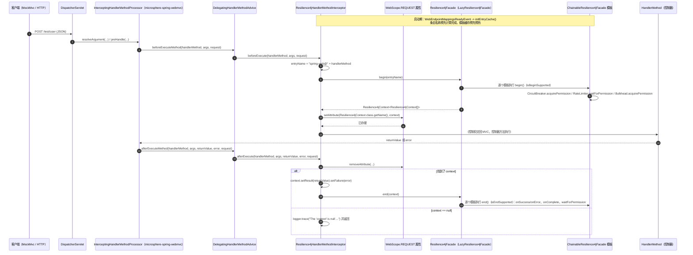

# microsphere-resilience4j-spring-web — 开发者指南（1.x）

> 版本线 `0.1.x`（`release-1.x` 分支） · 最新发布版本 `0.1.4` · 当前 `${revision}` = `0.1.5-SNAPSHOT` · Resilience4j **1.3.0 – 1.7.0**（默认 `1.7.0`） · Spring Cloud **Hoxton – 2021.0.x**（父工程 `microsphere-spring-cloud-parent` `0.1.26`） · JDK **8** 基线 · [← 指南索引](README.md)
> [English](../microsphere-resilience4j-spring-web.md)

模块路径：`microsphere-resilience4j-plugins/microsphere-resilience4j-spring-web`。包：`io.microsphere.resilience4j.spring.web`。

## 模块定位：这一个*确实*是一个 SPI 插件

与同级的 [openfeign 插件](microsphere-resilience4j-openfeign.md)（它坐落在 `microsphere-resilience4j-commons` 之上，只认识 Feign）不同，本插件坐落在 **`microsphere-resilience4j-spring`** 之上——那是它唯一的非 optional 工程依赖——并实现该模块的 SPI：

```java
public class SpringWebResilience4jPlugin implements Resilience4jPlugin {   // io.microsphere.resilience4j.spring.common.Resilience4jPlugin
```

这个 SPI 接口（来自 spring 模块的 `release-1x` 快照）只有两个方法：

```java
void plugin(ConfigurableListableBeanFactory beanFactory, BeanDefinitionRegistry registry, ConfigurableEnvironment environment);
String getName();
```

## 类清单

| 类型 | 文件 | 职责 |
|------|------|------|
| `SpringWebResilience4jPlugin` | `src/main/java/.../SpringWebResilience4jPlugin.java` | SPI 描述符：`getName() = "spring-web"`；`plugin(...)` 注册一个 bean 定义 |
| `Resilience4jHandlerMethodInterceptor` | `src/main/java/.../Resilience4jHandlerMethodInterceptor.java` | 装饰本体：`HandlerMethodInterceptor` + `ApplicationListener<WebEndpointMappingsReadyEvent>` + `Ordered` |
| 资源 | `src/main/resources/META-INF/spring.factories` | `io.microsphere.resilience4j.spring.common.Resilience4jPlugin=\ io.microsphere.resilience4j.spring.web.SpringWebResilience4jPlugin` |
| `SpringWebResilience4jPluginTest` | `src/test/java/.../SpringWebResilience4jPluginTest.java` | 唯一的测试：一个 `test()` 方法，用 `MockMvc` 发 POST `/test/user` |

拦截器自己的 Javadoc（“the abstract template class for Resilience4j's `HandlerMethodInterceptor`”）已经过时：该类是具体类，由插件实例化，而 `initEntryCache(...)` 是它唯一 `protected` 的成员。

## 织入机制

### 1. SPI 的发布与激活

该插件是通过 `META-INF/spring.factories` 以 SPI 接口名为键*发布*的，并由 spring 模块的注册器*激活*。来自 `io.microsphere.resilience4j.spring.common.annotation.EnableResilience4jRegistrar`（1.x 源码）：

```java
private void registerPlugins(ResolvablePlaceholderAnnotationAttributes attributes, BeanDefinitionRegistry registry) {
    String[] plugins = attributes.getStringArray("plugins");
    List<Resilience4jPlugin> resilience4jPlugins = loadFactories(this.beanFactory, Resilience4jPlugin.class);
    for (Resilience4jPlugin resilience4jPlugin : resilience4jPlugins) {
        String pluginName = resilience4jPlugin.getName();
        if (contains(plugins, pluginName)) {
            resilience4jPlugin.plugin(this.beanFactory, registry, this.environment);
        }
    }
}
```

因此激活需要三个条件恰好凑在一起：`spring.factories` 中的条目（存在）、一个 `@Enable*` 注解且其 `plugins` 属性列出 `spring-web`、以及名称与 `getName()` 相匹配。`plugins` 在 `@EnableResilience4j` 上声明为 `String[] plugins() default {}`（与 `publishEvents() default false`、`consumeEvents() default false` 并列），而每个模块注解（`@EnableBulkhead` 等）都通过 `@AliasFor(annotation = EnableResilience4j.class, attribute = "plugins")` 把它重新暴露出来。另外请注意 `registerBeanDefinitions` 内部的顺序：`registerEntryConfiguration` → `registerCommonConfigurations` → `registerEventComponentBeans` → **`registerPlugins`** → `registerResilience4jFacade`。

这些值是可占位符解析的（`ResolvablePlaceholderAnnotationAttributes`），所以 `plugins = "${...}"` 是一种受支持的写法（从那个包装类型推断而来；模块的测试并未对它做验证）。

### 2. `plugin(...)` 究竟做了什么——只有一个 bean 定义，别无其他

```java
@Override
public void plugin(ConfigurableListableBeanFactory beanFactory, BeanDefinitionRegistry registry, ConfigurableEnvironment environment) {
    registerResilience4jHandlerMethodInterceptor(registry);
}

private void registerResilience4jHandlerMethodInterceptor(BeanDefinitionRegistry registry) {
    registerBeanDefinition(registry, BEAN_NAME, Resilience4jHandlerMethodInterceptor.class);
}
```

`registerBeanDefinition(BeanDefinitionRegistry, String, Class)` 来自 `io.microsphere.spring.beans.factory.support.BeanRegistrar`（静态导入）。SPI 的另外两个参数没有被使用，也没有读取任何属性。

拦截器恰好只有一个构造器，它需要一个 `Resilience4jFacade`；该定义没有携带任何构造参数，所以这个协作对象由 Spring 在实例化时解析。这件事是确定的，因为同一个注册器把门面 bean 注册为 **primary**：`registerResilience4jFacade` 以名称 `LazyResilience4jFacade.BEAN_NAME = "lazyResilience4jFacade"` 创建 `genericBeanDefinition(LazyResilience4jFacade.class)` 并设置 `setPrimary(true)`，同时每次 `@Enable*` 调用都会向一个 `modules` 属性累加内容。`LazyResilience4jFacade` 实现了 `Resilience4jFacade`、`ApplicationListener<ContextRefreshedEvent>` 和 `DelegatingWrapper`，并在刷新时解析它的委托对象——这正是一个拦截器可以在任何注册中心存在之前就被创建出来的原因。

### 3. 1.x 世代 Spring Web 上的处理器方法拦截路径

本插件从不实现 Spring 的 `org.springframework.web.servlet.HandlerInterceptor`。它实现的是 **Microsphere Web** 的扩展接口，并且所涉及的类型都是基于 `javax.servlet` 的（Spring 5 / Boot 2.x 那一代）——与 profiles `Hoxton.SR12` → `2021.0.9` 相吻合。已用 `javap` 针对本地 Maven 仓库中同属 `0.1.x` 版本线的 `microsphere-spring-web` / `microsphere-spring-webmvc` `0.1.36` 构件核验：

| 类型（全限定名） | 在该字节码中核验到的形态 |
|------------------------|--------------------------------|
| `io.microsphere.spring.web.method.support.HandlerMethodInterceptor` | 一个恰好有两个 `default` 方法的接口：`beforeExecute(HandlerMethod, Object[], NativeWebRequest) throws Exception` 与 `afterExecute(HandlerMethod, Object[], Object, Throwable, NativeWebRequest) throws Exception`——正是本插件所覆盖的那两个方法 |
| `io.microsphere.spring.web.method.support.DelegatingHandlerMethodAdvice` | `extends OnceApplicationContextEventListener<ContextRefreshedEvent> implements HandlerMethodAdvice`，带有 `beforeExecuteMethod(HandlerMethod, Object[], NativeWebRequest)` / `afterExecuteMethod(HandlerMethod, Object[], Object, Throwable, NativeWebRequest)`；它是从 advice 回调通往各个 `HandlerMethodInterceptor` bean 的桥梁 |
| `io.microsphere.spring.webmvc.method.support.InterceptingHandlerMethodProcessor` | `extends OnceApplicationContextEventListener<WebEndpointMappingsReadyEvent>` 并实现 `HandlerMethodArgumentResolver`、`HandlerMethodReturnValueHandler`、`HandlerInterceptor`、`io.microsphere.spring.webmvc.config.WebMvcConfigurerAdapter`；它持有 `resolveArgument(...)`、`handleReturnValue(...)`、`preHandle/postHandle/afterCompletion(...)`，以及一个包级私有的 `afterExecute(HttpServletRequest, Object, Exception)` |
| `io.microsphere.spring.webmvc.annotation.EnableWebMvcExtension` | 属性：`registerWebEndpointMappings`、`interceptHandlerMethods`、`publishEvents`、`requestContextStrategy`、`registerHandlerInterceptors`、`handlerInterceptors`、`sources`、`storeRequestBodyArgument`、`storeResponseBodyReturnValue`、`reversedProxyHandlerMapping`（前两个的默认值在常量池中读作 `true`；其余默认值未逐一映射） |
| `io.microsphere.spring.web.event.WebEndpointMappingsReadyEvent` | `extends ApplicationContextEvent`，携带 `Collection<WebEndpointMapping> getMappings()`——即拦截器所监听的那个事件 |
| `io.microsphere.spring.web.util.WebScope` | 枚举 `REQUEST`、`SESSION`，带 `getAttribute/setAttribute/removeAttribute(RequestAttributes, String)`——`NativeWebRequest` 就是一个 `RequestAttributes`，上下文正是借此跨越这两个回调 |

把这些已核验的碎片拼在一起，调用路径是：DispatcherServlet → `InterceptingHandlerMethodProcessor`（实参解析 / 返回值 / 拦截器这几重角色）→ `HandlerMethodAdvice` → `DelegatingHandlerMethodAdvice` → 每一个 `HandlerMethodInterceptor` bean，其中就包括 `Resilience4jHandlerMethodInterceptor`。`@EnableWebMvcExtension` 正是装配起这套机制的东西，这解释了为什么模块的测试要带上它。

> 核验范围：本分支所解析出的*确切* `microsphere-spring-*` 版本由外部的父工程链管理（`microsphere-spring-cloud-parent` `0.1.26` → `microsphere-spring-boot-dependencies` `0.1.34`），而不是由本快照内的任何东西管理；`0.1.36` 是作为最接近的可用 `0.1.x` 构建来检视的。`InterceptingHandlerMethodProcessor` 内部的派发顺序并未从字节码中读出，上面只是在所核验到的类型与方法签名这个层面上描述了它。

### 4. 装饰本体：跨越两个回调的两阶段 `begin` / `end`

```java
@Override
public void beforeExecute(HandlerMethod handlerMethod, Object[] args, NativeWebRequest request) {
    Resilience4jContext<Resilience4jContext[]> context = resilience4jFacade.begin(getEntryName(handlerMethod));
    REQUEST.setAttribute(request, RESILIENCE4J_CONTEXT_ATTRIBUTE_NAME, context);
}

@Override
public void afterExecute(HandlerMethod handlerMethod, Object[] args, Object returnValue, Throwable error, NativeWebRequest request) {
    Resilience4jContext<Resilience4jContext[]> context = (Resilience4jContext<Resilience4jContext[]>)
            REQUEST.removeAttribute(request, RESILIENCE4J_CONTEXT_ATTRIBUTE_NAME);
    if (context == null) {
        logger.trace("The 'context' is null , please check whether the 'resilience4jFacade' is a 'ChainableResilience4jFacade'", error);
        return;
    }
    context.setResult(returnValue).setFailure(error);
    this.resilience4jFacade.end(context);
}
```

为什么用请求属性而不用 commons 的 `ThreadLocal`：`Resilience4jContext` 确实自带一个线程绑定的持有器（`contextHolder`，以 `getContext()` / `setContext(...)` / `removeContext()` / `doInContext(...)` 暴露），但本插件是刻意不去使用它——把上下文绑到请求上，能让这一对 `begin`/`end` 始终附着在被处理的那个请求上，而不是附着在完成派发的那个线程上。拦截器的构造器里，在那处 null 检查旁边带着源码注释 `// always keep self being a delegate`，这是唯一被写明的设计意图；交给它的门面通常就是那个可委托的 `LazyResilience4jFacade` bean，而不是一条链。

在 commons 这一侧，`ChainableResilience4jFacade` 会填满一个子上下文数组，每个模板一格，并由 `isBeginSupported()` / `isEndSupported()` 把关。在 1.x 这条版本线上，`RetryTemplate`、`TimeLimiterTemplate` 和 `ThreadPoolBulkheadTemplate` 对两者都返回 `false`，所以它们在这里被整体跳过——这就是与 openfeign 插件的结构性差异，后者使用一次性的 `call(...)` 路径，六个模块全都参与。在这条分支上，三个参与进来的模板各自所做的是：

| 模板 | `doBegin` | `doEnd` |
|----------|-----------|---------|
| `CircuitBreakerTemplate` | `long startTime = nanoTime(); circuitBreaker.acquirePermission(); context.setStartTime(startTime);` | `durationTime = nanoTime() - context.getStartTime()`，随后 `onSuccess(durationTime, NANOSECONDS)` 或 `onError(durationTime, NANOSECONDS, failure)`（固定为 `NANOSECONDS`，而不是条目自己的时间戳单位） |
| `BulkheadTemplate` | `bulkhead.acquirePermission()` | `bulkhead.onComplete()` —— 许可唯一的释放路径 |
| `RateLimiterTemplate` | `RateLimiter.waitForPermission(rateLimiter)` | **再次**调用 `RateLimiter.waitForPermission(rateLimiter)` —— 一个 1.x 的怪癖：一次两阶段调用会消耗两个许可 |

因为 `context.setResult(returnValue).setFailure(error)` 在 `end(...)` 之前执行，所以记录给断路器的结果来自 MVC 回调（`error` 是 Spring MVC 看到的异常，`returnValue` 是处理器的返回值），而不是来自围绕调用捕获的异常——这正是 `Retry` 那种重新执行在这条路径上根本无法表达的原因。

### 5. 启动期预计算：`initEntryCache`

```java
protected void initEntryCache(WebEndpointMappingsReadyEvent event) {
    Collection<WebEndpointMapping> webEndpointMappings = event.getMappings();
    Map<Method, String> methodEntryNamesCache = newFixedHashMap(webEndpointMappings.size());
    this.methodEntryNamesCache = methodEntryNamesCache;
    Iterator<WebEndpointMapping> iterator = webEndpointMappings.iterator();
    while (iterator.hasNext()) {
        Object endpoint = iterator.next().getEndpoint();
        if (endpoint instanceof HandlerMethod) {
            HandlerMethod handlerMethod = (HandlerMethod) endpoint;
            String entryName = getEntryName(handlerMethod);   // 副作用：把缓存填上
            logger.trace("Create the entryName : '{}' for HandlerMethod : {}", entryName, handlerMethod);
        }
    }
    ChainableResilience4jFacade facade = tryUnwrap(this.resilience4jFacade, ChainableResilience4jFacade.class);
    if (facade != null) {
        for (Resilience4jTemplate template : facade.getTemplates()) {
            template.initLocalEntriesCache(methodEntryNamesCache.values());
        }
    }
}
```

维护者应当记在心上的三点：

- 循环里那次 `getEntryName(handlerMethod)` 调用看起来像死代码，其实不是：正是它在填充那个 map，而其 `values()` 随后被用来预热每个模板的本地条目缓存（`newFixedHashMap` 来自 `io.microsphere.collection.MapUtils`，`tryUnwrap` 来自 `io.microsphere.lang.Wrapper`，logger 来自 `io.microsphere.logging`）。
- 预热就是那份线程安全契约：`Resilience4jTemplate#localEntriesCache` 在源码内被注释说明是一个 `HashMap`，它 “not thread-safe and can be thread-safe if and only if it's initialized by `initLocalEntriesCache` at the initialization phase”。
- `getEntryName` 执行的是 `methodEntryNamesCache.computeIfAbsent(method, m -> PLUGIN_NAME + "@" + handlerMethod)`。如果 `WebEndpointMappingsReadyEvent` 从未到达这个监听器，那个字段就仍是 `null`，第一个请求就会抛 `NullPointerException`；而一个不在已发布映射之中的处理器方法，会在请求时改动那个 map。这两点都是这个设计带来的后果，而不是框架带来的。

### 时序图：一次被拦截的处理器方法调用



## 设计模式证据

| 模式 | 所在位置 | 证据 |
|---------|-------|----------|
| **SPI / 服务加载** | `SpringWebResilience4jPlugin` | `META-INF/spring.factories` 以接口 `io.microsphere.resilience4j.spring.common.Resilience4jPlugin` 为键；由 `loadFactories(beanFactory, Resilience4jPlugin.class)` 加载，并按 `getName()` 匹配 |
| **观察者（Observer）** | `Resilience4jHandlerMethodInterceptor implements ApplicationListener<WebEndpointMappingsReadyEvent>`；`ChainableResilience4jFacade` 的各模板通过 `Resilience4jTemplate` 的注册中心/条目事件方法注册 `EventConsumer` | `onApplicationEvent` → `initEntryCache` 这条边 |
| **模板方法（Template Method）** | 固定的 `beforeExecute` → `facade.begin/end` 骨架，其中 `getEntryName` 与 `initEntryCache` 是可变步骤（`initEntryCache` 是 `protected`） | 类结构 |
| **职责链（Chain of Responsibility）** | `ChainableResilience4jFacade.begin/end` 按优先级顺序迭代各模板；`LazyResilience4jFacade` 委托给它，而拦截器自始至终只持有一个 `Resilience4jFacade` 引用 | commons / spring 模块源码；拦截器构造器自己的注释 `// always keep self being a delegate`，就写在 `assertNotNull(resilience4jFacade, …)` 的正上方 |
| **装饰器（结构上的，而非针对 Resilience4j 的）** | `LazyResilience4jFacade` 包装真正的门面；`tryUnwrap(...)` 在 `initEntryCache` 中把它剥回来 | 门面上的 `DelegatingWrapper`，拦截器里的 `Wrapper.tryUnwrap` |
| **Advice / 拦截器链** | `HandlerMethodInterceptor` bean 由 `InterceptingHandlerMethodProcessor` 内部的 `HandlerMethodAdvice` 驱动 | 已核验的字节码签名（见上表） |
| **标记 / 注册中心键策略** | 条目名称既等于 Resilience4j 的条目，**又**等于具名配置的查找键（`getConfiguration(name)`） | `AdvancedResilience4jOperations#getEntry/getConfiguration` |
| 未使用 | 没有 `Proxy`，没有 `Builder`，也没有 `DecoratedPoint` 式的策略：本插件恰好只有一个挂载点，也没有配置开关 | 上面的类清单 |

## 依赖图（来自各 POM）

```mermaid
graph TD
    APP["应用（Spring MVC / Spring Boot 2.x web 应用）"]
    subgraph WEB["microsphere-resilience4j-spring-web（jar，revision 0.1.5-SNAPSHOT）"]
        PLUGIN["SpringWebResilience4jPlugin"]
        INTERCEPTOR["Resilience4jHandlerMethodInterceptor"]
        FACTORIES["META-INF/spring.factories"]
    end
    SPRING["microsphere-resilience4j-spring<br/>compile，非 optional<br/>Resilience4jPlugin SPI · @Enable* · LazyResilience4jFacade"]
    COMMONS["microsphere-resilience4j-commons（compile，经由 spring 传递而来，非 optional）"]
    R4J["io.github.resilience4j 1.3 – 1.7（默认 1.7.0）<br/>core · circuitbreaker · ratelimiter · bulkhead · retry · timelimiter"]
    R4JSPRING["resilience4j-spring（在本模块和 spring 模块中都是 optional）"]
    MSCONTEXT["microsphere-spring-context<br/>在本模块中为 OPTIONAL，在 spring 模块中为 compile 且非 optional<br/>io.microsphere.spring.beans.factory.support.BeanRegistrar"]
    MSJC["microsphere-java-core<br/>在 commons 中声明为 OPTIONAL → 不传递<br/>io.microsphere.logging · util · lang · collection · annotation"]
    MSWEB["microsphere-spring-web (optional)<br/>HandlerMethodInterceptor · WebEndpointMapping · WebEndpointMappingsReadyEvent · WebScope"]
    MSWMVC["microsphere-spring-webmvc（在本模块中为 TEST 作用域）<br/>@EnableWebMvcExtension · InterceptingHandlerMethodProcessor"]
    SPRINGWEB["org.springframework:spring-web (optional)<br/>HandlerMethod · NativeWebRequest"]
    SPRINGMVC["org.springframework:spring-webmvc（optional，声明在 Testing 注释之下）"]
    TESTDEPS["test 作用域：junit-jupiter · spring-test · spring-aop ·<br/>microsphere-spring-test · microsphere-spring-webmvc · javax.servlet-api ·<br/>jackson-databind · aspectjweaver · jsonassert · hamcrest · logback-classic"]

    APP --> PLUGIN
    FACTORIES --> PLUGIN
    PLUGIN --> INTERCEPTOR
    PLUGIN --> SPRING
    PLUGIN -.直接 import.-> MSCONTEXT
    INTERCEPTOR --> SPRING
    INTERCEPTOR --> MSWEB
    INTERCEPTOR --> SPRINGWEB
    INTERCEPTOR -.经由 spring-webmvc（optional）在编译期可见.-> SPRINGMVC
    SPRING --> COMMONS
    SPRING --> MSCONTEXT
    SPRING --> R4JSPRING
    COMMONS --> R4J
    COMMONS -.声明为 optional，因此不传递.-> MSJC
    INTERCEPTOR -.io.microsphere.* 的 import；提供方未在本 POM 中声明.-> MSJC
    MSWMVC -.必须由应用自己声明：本模块只在 test 作用域中拥有它.-> APP
    WEB -.仅测试.-> TESTDEPS

    style SPRING fill:#e6f0ff
    style MSWMVC fill:#ffe6e6
    style MSJC stroke-dasharray: 5 5
    style TESTDEPS stroke-dasharray: 5 5
```

这些边是直接读自模块 POM 加上那两个主类的 import：实线 = 已声明的依赖（其 `optional`/`test` 标记写在节点标签里），虚线 = 要么是在本 POM 中没有对应声明的 import，要么是一个作用域陷阱。`microsphere-java-core` 在 `microsphere-resilience4j-commons` 中是 `optional` 的，所以它**不会**传递性地到达本模块——拦截器所 import 的那些 `io.microsphere.*` 类型（`annotation.Nonnull`、`collection.MapUtils`、`lang.Wrapper`、`logging.Logger`/`LoggerFactory`、`util.Assert`）因此必须由消费方应用中的另一条路径来提供；最终是哪一个构件在提供它们，在此**未经验证**，因为它是在本快照之外声明的。

三个 POM 层面的陷阱值得再强调一遍：`microsphere-spring-webmvc`（它提供 `@EnableWebMvcExtension`，也就是整套拦截机制）在本模块中是 **`test` 作用域**的，因此它必须成为应用的运行时依赖；`org.springframework:spring-webmvc` 坐在 “Testing” 注释之下，却声明为 **`optional`**，所以它在编译期可见但不传递；而 `resilience4j-spring`、`spring-web`、`microsphere-spring-context` 和 `microsphere-spring-web` 也全都是 `optional`。这里没有任何东西使用 `provided`。

## 核验状态

| 论断 | 状态 |
|-------|--------|
| `SpringWebResilience4jPlugin` 与 `Resilience4jHandlerMethodInterceptor` 的所有成员、签名与常量，`spring.factories` 的内容，以及测试配置 | 已从 `release-1x` 源码核验 |
| `Resilience4jPlugin` 接口形态、`EnableResilience4jRegistrar.registerPlugins`、`registerResilience4jFacade`（`setPrimary(true)`，bean 名称 `lazyResilience4jFacade`） | 已从 1.x 的 `microsphere-resilience4j-spring` 源码核验 |
| 各模板对两阶段的参与（`Retry`/`TimeLimiter`/`ThreadPoolBulkhead` 不可用；`RateLimiterTemplate` 在两个阶段都等待许可） | 已从 1.x 的 `microsphere-resilience4j-commons` 源码核验 |
| `HandlerMethodInterceptor` / `DelegatingHandlerMethodAdvice` / `InterceptingHandlerMethodProcessor` / `EnableWebMvcExtension` 的签名 | 已用 `javap` 针对 `microsphere-spring-web` 与 `microsphere-spring-webmvc` `0.1.36` 核验（同属 `0.1.x` 版本线，但未证明正是本分支所解析的那个版本） |
| `InterceptingHandlerMethodProcessor` 内部先调用实参解析 advice 还是先调用 `HandlerInterceptor` 回调的确切顺序 | **未核验**——字节码层的控制流未被分析 |
| 支撑 `methodEntryNamesCache` 的 `io.microsphere.collection.MapUtils.newFixedHashMap(int)` 底层 `Map` 实现 | **未核验**——外部工具类；在本分析中按普通 `Map` 对待 |
| `BeanRegistrar.registerBeanDefinition(...)` 是被 `SpringWebResilience4jPlugin` 静态导入的 | 已从源文件核验；提供它的构件被推断为 `microsphere-spring-context`（本 POM 中除 `microsphere-spring-web` 之外唯一的 Microsphere Spring 构件），而 `io.microsphere.*` 的提供方构件（拦截器用它来做日志、`Assert`、`Wrapper`、`MapUtils`、`@Nonnull`）**未核验**——这些 POM 中没有任何东西直接声明它 |
| `TestController` 的映射与响应体 | 由测试的断言推断而来（`POST /test/user`、`status().isOk()`、内容等于请求 JSON）；该控制器类本身住在 `microsphere-spring-test` 中 |

## 给维护者的说明

- 移植到 `0.2.x` 版本线时：上面所记录的是本分支的两阶段路径，而它也是此处唯一经过核验的行为。commons 的各个模板在那之后是否改动过 begin/end 的细节——尤其是断路器的时长是否尊重条目自己的 `TimestampUnit`，以及 `RateLimiterTemplate` 是否仍在**两个**阶段都等待许可——并未对照本 `release-1x` 快照之外的任何东西做过检查，所以在把 1.x 的许可计数假设搬过去之前，请重新阅读当前的源码。
- 如果你给本插件增加第二个挂载点（例如一个实参层面的 advice），请让 `plugins` 的名称保持稳定：`spring-web` 是现有每一处 `@Enable*(plugins = …)` 配置所列的名字，而一个被改名的插件会让该特性悄无声息地失效。
- 生产日志里出现一条 null 上下文的 `trace`，意味着下面情形之一：门面不是一个 `ChainableResilience4jFacade`、`beforeExecute` 从未存下那个属性、或者那个请求属性已经被消费掉了——日志消息本身只对第一种情形给了提示。
