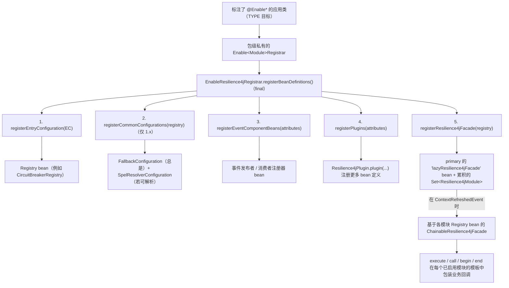
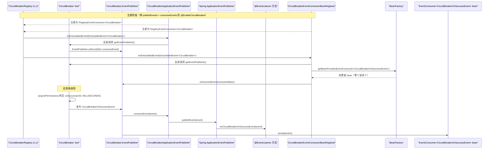
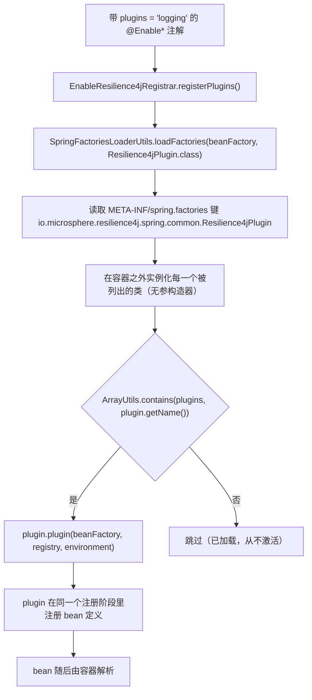
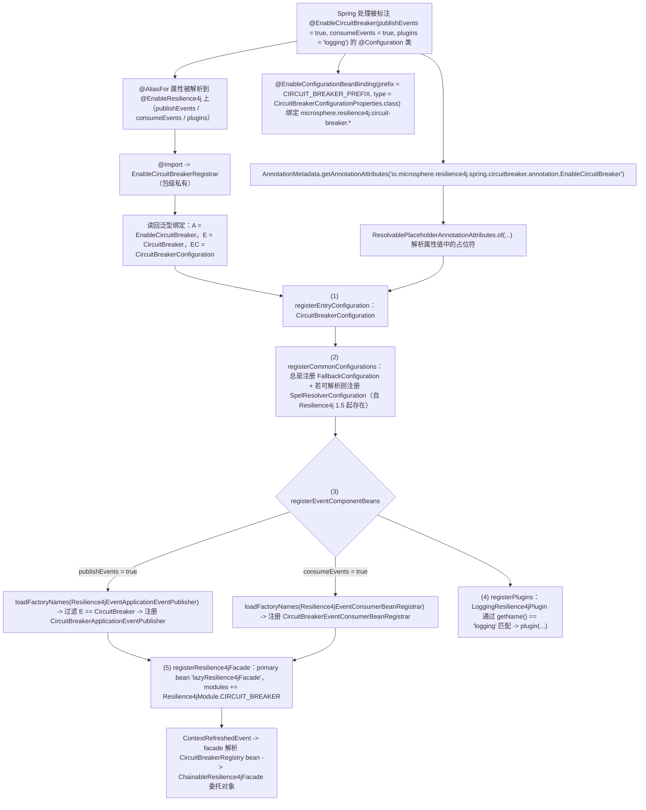
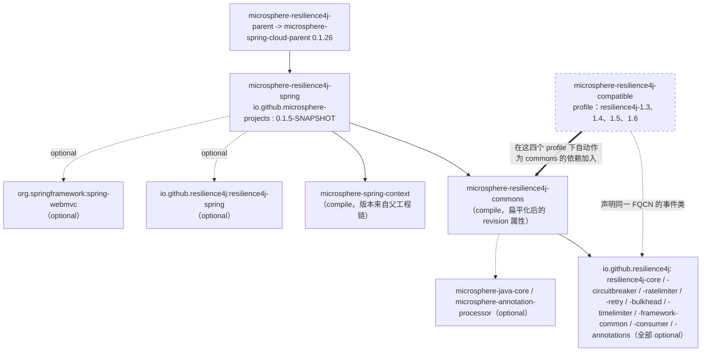

# microsphere-resilience4j-spring — 开发者指南（1.x）

> 源分支：`release-1.x` · 版本线：`0.1.x`（最新发布 `0.1.4`，分支 revision `0.1.5-SNAPSHOT`） · 目标：**Resilience4j 1.3.0 – 1.7.0**（默认 `1.7.0`） · Spring Cloud **Hoxton – 2021.0.x**
> 返回 [指南索引](README.md) · 终端用户视角：[用户指南](../../user-guide/zh/microsphere-resilience4j-spring.md) · 0.2.x 的对应页面：[current 开发者指南](../../../current/developer-guide/zh/microsphere-resilience4j-spring.md) · 英文原文：[microsphere-resilience4j-spring — Developer Guide](../microsphere-resilience4j-spring.md)

本页面剖析 `microsphere-resilience4j-spring` 在 **`release-1.x` 上的现状**：
注册器流水线、针对 Resilience4j 1.x 的 `EventPublisher` /
`EventConsumer` / `RegistryEventConsumer` API 编织而成的事件桥、`Resilience4jPlugin`
服务提供者接口（SPI）的生命周期，以及 1.x 独有的 `registerCommonConfigurations`
步骤。下面每一条陈述都能在 `release-1.x` 分支上
`microsphere-resilience4j-spring/src/{main,test}` 下的某个文件中溯源。

---

## 1. 架构：注解 → 注册器 → bean → 装饰



四个协作的层次：

| 层次 | 类 | 职责 |
|-------|---------|----------------|
| 注解 | `common.annotation.EnableResilience4j`（`@Target(ANNOTATION_TYPE)`）、六个按模块划分的注解 | 声明式的开关面板：`publishEvents`、`consumeEvents`、`plugins`，以及通过 `@EnableConfigurationBeanBinding(s)` 完成的属性绑定 |
| 注册器 | `common.annotation.EnableResilience4jRegistrar<A, E, EC>` + 六个包级私有的子类 | 编程式的 `ImportBeanDefinitionRegistrar` 流水线（5 个步骤，见 §2） |
| 运行时 bean | `LazyResilience4jFacade`、五个 `*ApplicationEventPublisher` 实现 + 五个 `*EventConsumerBeanRegistrar` 实现、`EventConsumerMethodFilter` | facade 组装 + 事件桥 |
| 装饰 | commons 的 `Resilience4jTemplate` / `ChainableResilience4jFacade`（本模块之外） | 真正执行业务回调包装的地方 |

### 1.1 源码地图（`src/main/java/io/microsphere/resilience4j/spring`）

| 路径 | 类 |
|------|---------|
| *（根）* | `LazyResilience4jFacade` |
| `common` | `Resilience4jPlugin`（服务提供者接口）、`Resilience4jUtils`（**仅 1.x**） |
| `common.annotation` | `EnableResilience4j`、`EnableResilience4jRegistrar` |
| `common.event` | `Resilience4jEventApplicationEventPublisher<E, ET>`、`Resilience4jEventConsumerBeanRegistrar<E>`、`EventConsumerMethodFilter` |
| `circuitbreaker.annotation` / `.event` | `EnableCircuitBreaker` + `EnableCircuitBreakerRegistrar`；`CircuitBreakerApplicationEventPublisher`、`CircuitBreakerEventConsumerBeanRegistrar` |
| `ratelimiter.annotation` / `.event` | `EnableRateLimiter` + `EnableRateLimiterRegistrar`；`RateLimiterApplicationEventPublisher`、`RateLimiterEventConsumerBeanRegistrar` |
| `retry.annotation` / `.event` | `EnableRetry` + `EnableRetryRegistrar`；`RetryApplicationEventPublisher`、`RetryEventConsumerBeanRegistrar` |
| `bulkhead.annotation` / `.event` | `EnableBulkhead`、`EnableThreadPoolBulkhead` 及各自的注册器；`BulkheadApplicationEventPublisher`、`BulkheadEventConsumerBeanRegistrar` |
| `timelimiter.annotation` / `.event` | `EnableTimeLimiter` + `EnableTimeLimiterRegistrar`；`TimeLimiterApplicationEventPublisher`、`TimeLimiterEventConsumerBeanRegistrar` |
| `src/main/resources/META-INF/spring.factories` | 两个事件组件键（见 §4.4） |

本模块的主源码中**没有任何 `@Bean` 方法、没有任何 `@Conditional*` 注解、也没有任何
`@Order` 声明**（已通过搜索核实）：每一个 bean 定义都是以编程方式注册的，而关于顺序/存在与否的决策
都编码在普通 Java 里（`if (supported)`、`Objects.equals(entryType, …)`、
`resolveClass(...) != null`）。

---

## 2. `EnableResilience4jRegistrar` —— 源码分析

```java
public abstract class EnableResilience4jRegistrar<A extends Annotation, E, EC>
        extends BeanCapableImportCandidate implements ImportBeanDefinitionRegistrar {

    private static final Map<String, Class<?>> attributedEventComponentClassesMap = ofMap(
            "publishEvents", Resilience4jEventApplicationEventPublisher.class,
            "consumeEvents", Resilience4jEventConsumerBeanRegistrar.class);

    protected EnableResilience4jRegistrar() {
        this.superType = resolveSuperType();
        this.annotationType = resolveGeneric(0);
        this.entryType = resolveGeneric(1);
        this.entryConfigurationType = resolveGeneric(2);
    }

    public final void registerBeanDefinitions(AnnotationMetadata metadata, BeanDefinitionRegistry registry) {
        String annotationClassName = annotationType.getName();
        Map<String, Object> annotationAttributes = metadata.getAnnotationAttributes(annotationClassName);
        ResolvablePlaceholderAnnotationAttributes attributes = of(annotationAttributes, annotationType, getEnvironment());

        registerEntryConfiguration(registry);       // (1)
        registerCommonConfigurations(registry);      // (2)  <-- 1.x-only step
        registerEventComponentBeans(attributes, registry); // (3)
        registerPlugins(attributes, registry);       // (4)
        registerResilience4jFacade(registry);        // (5)
    }
}
```

### 2.1 类型参数的绑定发生在构造时

子类不声明任何字段也不覆写任何东西；它*本身*就是那份泛型签名，例如：

```java
class EnableCircuitBreakerRegistrar extends EnableResilience4jRegistrar<EnableCircuitBreaker, CircuitBreaker,
        CircuitBreakerConfiguration> {
}
```

基类用 `ResolvableType` 把那份签名读回来：

```java
private static ResolvableType resolveSuperType(Class<?> targetClass, Class<?> superClass) {
    ResolvableType type = forType(targetClass);
    return type.as(superClass);
}

private <T> Class<T> resolveGeneric(int index) {
    return (Class<T>) this.superType.resolveGeneric(index);
}
```

于是 `A` = 那个 enable 注解（用于取 `AnnotationMetadata` 的属性），`E` = Resilience4j
的条目类型（`CircuitBreaker`），`EC` = Resilience4j 的入口配置类
（`io.github.resilience4j.circuitbreaker.configure.CircuitBreakerConfiguration`）。同样的手法在
`resolveEntryType(Class<?> targetClass, Class<?> superClass)` 中再次被使用，用来取回某个事件组件类的 `E`。

### 2.2 步骤 (1) + (2)：入口配置与 1.x 的通用配置

```java
private void registerEntryConfiguration(BeanDefinitionRegistry registry) {
    registerBeanDefinition(registry, getEntryConfigurationType());
}
```

`registerBeanDefinition` 来自 `io.microsphere.spring.beans.factory.support.BeanRegistrar`
（microsphere-spring-context）。注册 `CircuitBreakerConfiguration` 正是把
`CircuitBreakerRegistry` bean 放进上下文的动作 —— 注册表由 Resilience4j 自己的 1.x 配置类提供，
而本模块的测试会对它做 autowire。

步骤 (2) 是**只存在于本分支**的那个步骤：

```java
public abstract class Resilience4jUtils {           // io.microsphere.resilience4j.spring.common (1.x only)

    public static final String SPEL_RESOLVER_CONFIGURATION_CLASS_NAME =
            "io.github.resilience4j.spelresolver.configure.SpelResolverConfiguration";

    public static void registerCommonConfigurations(BeanDefinitionRegistry registry) {
        registerFallbackConfiguration(registry);
        registerSpelResolverConfiguration(registry);
    }

    public static void registerFallbackConfiguration(BeanDefinitionRegistry registry) {
        registerBeanDefinition(registry, FallbackConfiguration.class);
    }

    public static void registerSpelResolverConfiguration(BeanDefinitionRegistry registry) {
        Class<?> spelResolverConfigurationClass = resolveClass(SPEL_RESOLVER_CONFIGURATION_CLASS_NAME);
        if (spelResolverConfigurationClass != null) {
            registerBeanDefinition(registry, spelResolverConfigurationClass);
        }
    }
}
```

其理由引自这个类自己的 Javadoc：*"Resilience4j Spring 2.0+ Entry Configuration class
imports FallbackConfiguration and SpelResolverConfiguration default"*（Resilience4j Spring 2.0+
的入口配置类默认会导入 `FallbackConfiguration` 与 `SpelResolverConfiguration`）—— 也就是说，在 Resilience4j
**1.x** 上必须显式注册它们，这正是 1.x 的注册器里多出这一次调用的原因，也正是
`registerSpelResolverConfiguration` 要用 `resolveClass(...) != null` 加以保护的原因
（`SpelResolverConfiguration` *自 Resilience4j 1.5 起*才存在，因此 `resilience4j-1.3` / `1.4`
的构建会静默地跳过它）。
`FallbackConfiguration` 是一个普通的类型导入
（`io.github.resilience4j.fallback.configure.FallbackConfiguration`），因此编译期 classpath 上必须有它。

> 值得了解的命名冲突：这个类与 commons 的
> `io.microsphere.resilience4j.util.Resilience4jUtils`（`createTemplates(…)` 辅助类）简单名相同。它们是
> 不同构件中的不同类型；注册器并没有用限定名引用其中任何一个 —— 它静态导入了
> `io.microsphere.resilience4j.spring.common.Resilience4jUtils.registerCommonConfigurations`。

在 `release`（0.2.x）上，同样的方法序列是 `registerEntryConfiguration → registerEventComponentBeans →
registerPlugins → registerResilience4jFacade`，并且（Spring 这一路的）`Resilience4jUtils` 并不存在 ——
通过对两棵源码树做 diff 已核实。

### 2.3 步骤 (3)：`registerEventComponentBeans` —— spring.factories 加上一个泛型过滤器

```java
private void registerEventComponentBeans(ResolvablePlaceholderAnnotationAttributes attributes,
                                         BeanDefinitionRegistry registry) {
    for (Map.Entry<String, Class<?>> entry : attributedEventComponentClassesMap.entrySet()) {
        String attributeName = entry.getKey();
        boolean supported = attributes.getBoolean(attributeName);
        if (supported) {
            Class<?> eventComponentClass = entry.getValue();
            registerComponentBean(eventComponentClass, registry);
        }
    }
}

private void registerComponentBean(Class<?> componentClass, BeanDefinitionRegistry registry) {
    ClassLoader classLoader = this.getClassLoader();
    List<String> actualComponentClassNames = loadFactoryNames(componentClass, classLoader);
    for (String actualComponentClassName : actualComponentClassNames) {
        Class<?> actualComponentClass = resolveClassName(actualComponentClassName, classLoader);
        Class<E> entryTypeFromComponent = resolveEntryType(actualComponentClass, componentClass);
        if (Objects.equals(entryTypeFromComponent, this.entryType)) {
            registerBeanDefinition(registry, actualComponentClass);
        }
    }
}
```

这层间接是有意为之：那两个抽象超类型就是 **`spring.factories` 的键**，而每一个具体实现都把自己的条目类型
声明为泛型参数 `0`：

```properties
# src/main/resources/META-INF/spring.factories
io.microsphere.resilience4j.spring.common.event.Resilience4jEventApplicationEventPublisher=\
io.microsphere.resilience4j.spring.bulkhead.event.BulkheadApplicationEventPublisher,\
io.microsphere.resilience4j.spring.circuitbreaker.event.CircuitBreakerApplicationEventPublisher,\
io.microsphere.resilience4j.spring.ratelimiter.event.RateLimiterApplicationEventPublisher,\
io.microsphere.resilience4j.spring.retry.event.RetryApplicationEventPublisher,\
io.microsphere.resilience4j.spring.timelimiter.event.TimeLimiterApplicationEventPublisher

# Resilience4jEventConsumerBeanRegistrar
io.microsphere.resilience4j.spring.common.event.Resilience4jEventConsumerBeanRegistrar=\
io.microsphere.resilience4j.spring.bulkhead.event.BulkheadEventConsumerBeanRegistrar,\
io.microsphere.resilience4j.spring.circuitbreaker.event.CircuitBreakerEventConsumerBeanRegistrar,\
io.microsphere.resilience4j.spring.ratelimiter.event.RateLimiterEventConsumerBeanRegistrar,\
io.microsphere.resilience4j.spring.retry.event.RetryEventConsumerBeanRegistrar,\
io.microsphere.resilience4j.spring.timelimiter.event.TimeLimiterEventConsumerBeanRegistrar
```

实现者必须内心理解的几条推论：

- 第三方模块只要往这些键上追加内容，就能为一个新的条目类型加入新的事件组件 ——
  无需改动注册器（开闭原则）。
- 某个组件若其 `E` 不等于注解的 `E`，就会被跳过。由于没有随附任何
  `ThreadPoolBulkhead` 类型的组件，`@EnableThreadPoolBulkhead(publishEvents = true,
  consumeEvents = true)` 什么都不会注册（它的 `E` 是 `ThreadPoolBulkhead`）。
- `loadFactoryNames` 就是 Spring 的 `SpringFactoriesLoader`，使用注册器从
  `BeanCapableImportCandidate` 继承来的 `getClassLoader()`。

### 2.4 步骤 (4)：`registerPlugins`

```java
private void registerPlugins(ResolvablePlaceholderAnnotationAttributes attributes,
                             BeanDefinitionRegistry registry) {
    String[] plugins = attributes.getStringArray("plugins");
    List<Resilience4jPlugin> resilience4jPlugins = loadFactories(this.getBeanFactory(), Resilience4jPlugin.class);
    for (Resilience4jPlugin resilience4jPlugin : resilience4jPlugins) {
        String pluginName = resilience4jPlugin.getName();
        if (contains(plugins, pluginName)) {
            resilience4jPlugin.plugin(this.beanFactory, registry, this.environment);
        }
    }
}
```

`loadFactories` 是 `io.microsphere.spring.core.io.support.SpringFactoriesLoaderUtils.loadFactories`
（microsphere-spring-context），它返回的是已经实例化好的插件（因此要求无参构造器）；`contains`
是 `io.microsphere.util.ArrayUtils.contains`。传给 `plugin(...)` 的
`registry` 和 `this.environment` 就是注册器自身的协作者，因此插件所动作的阶段与注册器完全相同。

### 2.5 步骤 (5)：`registerResilience4jFacade` —— 一个 facade，累积模块

```java
private void registerResilience4jFacade(BeanDefinitionRegistry registry) {
    Resilience4jModule module = valueOf(this.entryType);
    String beanName = BEAN_NAME;
    String propertyName = "modules";

    Set<Resilience4jModule> modules;
    AbstractBeanDefinition beanDefinition;
    PropertyValue modulesPropertyValue;
    if (registry.containsBeanDefinition(beanName)) {
        beanDefinition = (AbstractBeanDefinition) registry.getBeanDefinition(beanName);
        modulesPropertyValue = beanDefinition.getPropertyValues().getPropertyValue(propertyName);
        modules = (Set<Resilience4jModule>) modulesPropertyValue.getValue();
    } else {
        modules = newHashSet(Resilience4jModule.values().length);
        beanDefinition = genericBeanDefinition(LazyResilience4jFacade.class);
        beanDefinition.setPrimary(true);
        MutablePropertyValues propertyValues = beanDefinition.getPropertyValues();
        propertyValues.add(propertyName, modules);
        registerBeanDefinition(registry, beanName, beanDefinition);
    }
    modules.add(module);
}
```

要点：

- 跨注解被改动的是**同一个 `Set` 实例**，因此 `@EnableRetry` +
  `@EnableCircuitBreaker` + `@EnableRateLimiter` 会在同一个 bean 定义上累积三个模块。这个属性值是一个活对象，
  而不是一个值字符串 —— 之所以能这么做，是因为注册与刷新在时间上是分离的。
- `setPrimary(true)` 正是让应用能够 `@Autowired Resilience4jFacade` 的那一步。
- `Resilience4jModule.valueOf(Class)`（commons）会逐个枚举成员搜索其条目 / 配置 / 属性 / 事件 /
  注册表类，若类型未知则抛出 `IllegalArgumentException` —— 因此注册器的条目类型 `E`
  必须是 commons 认识的类型。
- 在 `release`（0.2.x）上这个方法完全相同（diff 显示没有变化）；不同的只是它所身处的那条流水线。

---

## 3. 按模块划分的注册器

| 注册器（包级私有） | `A` | `E` | `EC`（被注册的类） |
|---|---|---|---|
| `EnableCircuitBreakerRegistrar` | `EnableCircuitBreaker` | `CircuitBreaker` | `…circuitbreaker.configure.CircuitBreakerConfiguration` |
| `EnableRateLimiterRegistrar` | `EnableRateLimiter` | `RateLimiter` | `…ratelimiter.configure.RateLimiterConfiguration` |
| `EnableRetryRegistrar` | `EnableRetry` | `Retry` | `…retry.configure.RetryConfiguration` |
| `EnableTimeLimiterRegistrar` | `EnableTimeLimiter` | `TimeLimiter` | `…timelimiter.configure.TimeLimiterConfiguration` |
| `EnableBulkheadRegistrar` | `EnableBulkhead` | `Bulkhead` | `…bulkhead.configure.BulkheadConfiguration` |
| `EnableThreadPoolBulkheadRegistrar` | `EnableThreadPoolBulkhead` | `ThreadPoolBulkhead` | `…bulkhead.configure.BulkheadConfiguration` —— **不是** `…bulkhead.configure.threadpool.ThreadPoolBulkheadConfiguration`，后者只出现在它的 Javadoc 里 |

每个文件都是一条不含任何成员的类声明；全部行为都来自继承。在 Resilience4j
`1.7.0` 上，`BulkheadConfiguration` 自身就带有 `@Configuration @Import({ThreadPoolBulkheadConfiguration.class,
FallbackConfiguration.class, SpelResolverConfiguration.class})`，这正是 `@EnableThreadPoolBulkhead`
在 `EnableThreadPoolBulkheadTest` 中仍然能产出 `ThreadPoolBulkheadRegistry` 的原因。

按模块划分的注解额外提供了属性绑定，例如：

```java
@Target(TYPE)
@Retention(RUNTIME)
@Documented
@Inherited
@Import(EnableCircuitBreakerRegistrar.class)
@EnableResilience4j
@EnableConfigurationBeanBinding(prefix = CIRCUIT_BREAKER_PREFIX, type = CircuitBreakerConfigurationProperties.class)
public @interface EnableCircuitBreaker { … }
```

其中 `CIRCUIT_BREAKER_PREFIX = "microsphere.resilience4j.circuit-breaker."` 来自 commons 的
`Resilience4jConstants`，而（1.x 特有的）`type` 指向
`io.github.resilience4j.circuitbreaker.configure.CircuitBreakerConfigurationProperties`。
`@EnableBulkhead` / `@EnableThreadPoolBulkhead` 改用 `@EnableConfigurationBeanBindings({…})`，
同时包含 `…bulkhead.configure.BulkheadConfigurationProperties`（`BULKHEAD_PREFIX`）和
`io.github.resilience4j.common.bulkhead.configuration.ThreadPoolBulkheadConfigurationProperties`
（`THREAD_POOL_BULKHEAD_PREFIX`）。在 0.2.x 分支上第二个类型是
`…common.bulkhead.configuration.CommonThreadPoolBulkheadConfigurationProperties` —— 这是两个分支的
bulkhead 注解源码之间唯一的差别。

---

## 4. 事件桥与 Resilience4j **1.x** 事件 API

### 4.1 源码导入了什么 —— 以及这些导入分别解析到什么

`io.microsphere.resilience4j.spring.common.event.Resilience4jEventApplicationEventPublisher` 导入了：

```java
import io.github.resilience4j.core.EventConsumer;
import io.github.resilience4j.core.EventPublisher;
import io.github.resilience4j.core.registry.EntryAddedEvent;
import io.github.resilience4j.core.registry.EntryRemovedEvent;
import io.github.resilience4j.core.registry.EntryReplacedEvent;
import io.github.resilience4j.core.registry.RegistryEventConsumer;
```

而各模块的子类把自己绑定到 1.x 的事件类型上，例如 `CircuitBreakerApplicationEventPublisher`
的导入是：

```java
import io.github.resilience4j.circuitbreaker.CircuitBreaker;
import io.github.resilience4j.circuitbreaker.event.CircuitBreakerEvent;   // <-- may come from the shim!
import io.github.resilience4j.core.EventConsumer;
import io.microsphere.resilience4j.spring.common.event.Resilience4jEventApplicationEventPublisher;
```

这个 `io.github.resilience4j.circuitbreaker.event.CircuitBreakerEvent` 导入是 1.x
特有的、需要留意的细节：在 Resilience4j `1.7.0` 上该类型随 `resilience4j-circuitbreaker` 发布，但在
`resilience4j-1.3` … `resilience4j-1.6` 这些构建 profile 下，同一个 FQCN 由本分支的
**`microsphere-resilience4j-compatible`** 构件提供（由这些 profile 挂载到 `…-commons`
上），后者声明了 `io.github.resilience4j.circuitbreaker.event.{CircuitBreakerEvent,
CircuitBreakerOnFailureRateExceededEvent, CircuitBreakerOnSlowCallRateExceededEvent}` 和
`io.github.resilience4j.ratelimiter.event.{RateLimiterEvent, RateLimiterOnDrainedEvent}`。具体来说：
`RateLimiterOnDrainedEvent` 在 `resilience4j-ratelimiter` 1.4.0/1.6.1 中并不存在，而从 1.7.0
开始存在，这正是垫片所覆盖的典型情形。而 `…event.RetryEvent`、`…event.TimeLimiterEvent` 和
`…event.BulkheadEvent`（由各自的发布者导入）没有对应的垫片，必须来自 Resilience4j 自己的构件。

同样的解析逻辑适用于 commons 的 `Resilience4jModule`，它的 `CIRCUIT_BREAKER` 与 `RATE_LIMITER`
常量把 `…event.CircuitBreakerEvent` / `…event.RateLimiterEvent` 作为其 `eventClass`。

### 4.2 发布侧：`Resilience4jEventApplicationEventPublisher<E, ET>`

```java
public abstract class Resilience4jEventApplicationEventPublisher<E, ET>
        implements EventConsumer<ET>, RegistryEventConsumer<E>, ApplicationEventPublisherAware {

    @Override
    public void consumeEvent(ET event) {
        applicationEventPublisher.publishEvent(event);
        logger.trace("The Resilience4j Event : {} was published on the Spring ApplicationListener(s)", event);
    }

    @Override
    public void onEntryAddedEvent(EntryAddedEvent<E> entryAddedEvent) {
        register(entryAddedEvent::getAddedEntry);
    }

    @Override
    public void onEntryRemovedEvent(EntryRemovedEvent<E> entryRemoveEvent) {
    }                                       // deliberate no-op: subscriptions are not undone

    @Override
    public void onEntryReplacedEvent(EntryReplacedEvent<E> entryReplacedEvent) {
        register(entryReplacedEvent::getNewEntry);
    }

    private void register(Supplier<E> entrySupplier) {
        E entry = entrySupplier.get();
        Class<?> entryClass = entry.getClass();
        Method eventPublisherMethod = findMethod(entryClass, "getEventPublisher");
        EventPublisher<ET> eventPublisher = (EventPublisher) invokeMethod(eventPublisherMethod, entry);
        eventPublisher.onEvent(this::consumeEvent);
    }
}
```

设计说明：

- 它是一个 **`RegistryEventConsumer`**，因此在 Resilience4j 1.x 的注册表被构建时就会被它采纳；正是这个钩子
  让事件桥能够感知条目的生命周期。
- `getEventPublisher()` 是**通过反射**取得的（`ReflectionUtils.findMethod`/`invokeMethod`），
  而不是通过某个共享接口，因为在 1.x 中每个条目类型（`CircuitBreaker`、`Retry`、`Bulkhead`……）
  都声明了自己的嵌套发布者类型和自己的 `getEventPublisher()` 签名；一次反射调用即可覆盖全部。
- `EventPublisher#onEvent(EventConsumer)`（1.x 的单参数形式）会把该发布者订阅到那个条目的
  **全部**事件上，于是整个事件族都能到达 Spring。
- `publishEvent(event)` 发布的就是 Resilience4j 事件对象本身；Spring 会把非 `ApplicationEvent`
  的负载包装进一个 `PayloadApplicationEvent`，这正是 `@EventListener(CircuitBreakerOnSuccessEvent.class)`
  能够原样工作的原因（见 `EnableCircuitBreakerTest`、`CircuitBreakerApplicationEventPublisherTest`）。

### 4.3 消费侧：`Resilience4jEventConsumerBeanRegistrar<E>`

```java
public abstract class Resilience4jEventConsumerBeanRegistrar<E>
        implements RegistryEventConsumer<E>, BeanFactoryAware {

    private void register(E entry) {
        Class<?> entryClass = entry.getClass();
        Method eventPublisherMethod = findMethod(entryClass, "getEventPublisher");
        Class<?> eventPublisherClass = eventPublisherMethod.getReturnType();
        Object eventPublisher = invokeMethod(eventPublisherMethod, entry);
        doWithMethods(eventPublisherClass, method -> {
            ResolvableType type = forMethodParameter(method, 0);
            ObjectProvider objectProvider = beanFactory.getBeanProvider(type);
            objectProvider.forEach(eventConsumerBean -> invokeMethod(method, eventPublisher, eventConsumerBean));
        }, INSTANCE);
    }
}
```

那个泛型参数类型（`EventConsumer<CircuitBreakerOnSuccessEvent>`）就是查找 bean 的键，而
`ObjectProvider#forEach` 意味着*零个或多个*：同一事件类型的多个 bean 都会被订阅。
`onEntryAddedEvent` / `onEntryReplacedEvent` 会在 trace 级别记录条目生命周期日志，然后进行注册；
`onEntryRemovedEvent` 只记录日志。

### 4.4 方法过滤器

```java
public class EventConsumerMethodFilter implements MethodFilter {          // org.springframework.util.ReflectionUtils.MethodFilter

    public static EventConsumerMethodFilter INSTANCE = new EventConsumerMethodFilter();

    @Override
    public boolean matches(Method method) {
        return method.getParameterCount() == 1 && EventConsumer.class.equals(method.getParameterTypes()[0]);
    }
}
```

测试 `EventConsumerMethodFilterTest` 把这个契约钉在了 **1.x** 的发布者接口上 ——
`io.github.resilience4j.core.EventPublisher` 加上嵌套的 `Retry.EventPublisher`、
`CircuitBreaker.EventPublisher`、`RateLimiter.EventPublisher`、`TimeLimiter.EventPublisher`、
`Bulkhead.EventPublisher`：其中每一个本地声明的方法都必须匹配（`doWithLocalMethods` +
`assertEquals(matched, INSTANCE.matches(method))`），而测试类自身的方法必须不匹配。在 1.7.0 上
CircuitBreaker 的发布者正是这个形状 —— `onSuccess`、`onError`、`onStateTransition`、`onReset`、
`onIgnoredError`、`onCallNotPermitted`、`onFailureRateExceeded`、`onSlowCallRateExceeded`，每个方法都只接受
一个 `EventConsumer<…>`。由于比较的是**裸**参数类型，`EventConsumer`
这个类型本身并不提供任何泛型信息；泛型是在
`Resilience4jEventConsumerBeanRegistrar` 中通过 `ResolvableType.forMethodParameter(method, 0)`
单独读取的。

> 给维护者的关于可变静态字段的提示：`INSTANCE` 是一个非 `final` 的 public 静态字段。当前代码从不重新赋值它，
> 但也没有任何东西保护它；如果你要给这个过滤器加入状态，请把它改成 `final`。

### 4.5 事件桥的覆盖范围

| 条目类型 `E` | 发布者组件 | 消费者注册器组件 |
|----------------|---------------------|------------------------------|
| `CircuitBreaker` | `CircuitBreakerApplicationEventPublisher` | `CircuitBreakerEventConsumerBeanRegistrar` |
| `RateLimiter` | `RateLimiterApplicationEventPublisher` | `RateLimiterEventConsumerBeanRegistrar` |
| `Retry` | `RetryApplicationEventPublisher` | `RetryEventConsumerBeanRegistrar` |
| `TimeLimiter` | `TimeLimiterApplicationEventPublisher` | `TimeLimiterEventConsumerBeanRegistrar` |
| `Bulkhead` | `BulkheadApplicationEventPublisher` | `BulkheadEventConsumerBeanRegistrar` |
| `ThreadPoolBulkhead` | *未随附* | *未随附* |

每个具体类都是一行而已：例如
`public class RetryApplicationEventPublisher extends Resilience4jEventApplicationEventPublisher<Retry, RetryEvent> {}`。

### 4.6 图 (b)：一个 Resilience4j 1.x 事件在两个方向上的旅程



---

## 5. `LazyResilience4jFacade`：延迟初始化分析

```java
public class LazyResilience4jFacade implements Resilience4jFacade,
        ApplicationListener<ContextRefreshedEvent>, DelegatingWrapper {

    public static final String BEAN_NAME = "lazyResilience4jFacade";

    @Override
    public void onApplicationEvent(ContextRefreshedEvent event) {
        initDelegate(event.getApplicationContext());
    }

    private void initDelegate(ApplicationContext context) {
        Set<Resilience4jModule> modules = getModules();
        List<Registry> registries = newArrayList(modules.size());
        for (Resilience4jModule module : modules) {
            Class<? extends Registry> registryClass = module.getRegistryClass();
            Registry registry = context.getBean(registryClass);
            registries.add(registry);
        }
        this.delegate = new ChainableResilience4jFacade(registries);
    }
}
```

- 这里的 `Registry` 是 `io.github.resilience4j.core.Registry` —— 1.x 的（裸类型）注册表类型；commons 的
  `ChainableResilience4jFacade(Collection<Registry>)` 构造器会通过
  `io.microsphere.resilience4j.util.Resilience4jUtils.createTemplates` 把每个注册表转换成它的模板，
  随后去重，并用 `Prioritized.COMPARATOR` 排序。
- facade 的每个方法都是对 `delegate` 纯粹的一行委托（`execute`、`call` ×4、`begin`、`end`、
  `isBeginSupported`、`isEndSupported`）；`getDelegate()` 实现的是 `DelegatingWrapper`，而继承来的
  `unwrap(Class)` 返回带类型的委托对象（在 `LazyResilience4jFacadeTest#testGetDelegate` 中有断言）。
- 失败模式是设计上刻意留给运行期的：刷新之前 `delegate == null` → `NullPointerException`；某个已启用模块
  缺少注册表 bean → 在 `ContextRefreshedEvent` 时抛出 `NoSuchBeanDefinitionException`
  （这正是即便 `resilience4j-spring` 在 POM 中是可选的，它也必须出现在 classpath 上的原因）。
- `onApplicationEvent` 在每一次 `ContextRefreshedEvent` 上都会重新执行（可刷新的上下文会重建委托对象），
  这正是让后加入的 `Registry` bean 无需重启也能被取到的机制。

---

## 6. 插件 SPI 生命周期



test 作用域内有关于完整周期的证据：`src/test/resources/META-INF/spring.factories` 列出了
`LoggingResilience4jPlugin`（名称 `"logging"`）和 `NoOpResilience4jPlugin`（名称 `"no-operation"`），而
`EnableBulkheadTest` 只激活前者（`plugins = NAME`）。生产环境的插件使用同一套机制：
`MyBatisResilience4jPlugin`（`PLUGIN_NAME = "mybatis"`）注册一个 bean 定义，其构造器参数引用了
`LazyResilience4jFacade.BEAN_NAME`，而
`SpringWebResilience4jPlugin`（`PLUGIN_NAME = "spring-web"`）在它自己的 `BEAN_NAME`
下注册 `Resilience4jHandlerMethodInterceptor` —— 这印证了插件的职责是注册 bean 定义，而不是实例化 bean。

---

## 7. 图 (a)：`@EnableCircuitBreaker` 的引导流程



---

## 8. 设计模式 —— 及其证据

| 模式 | 所在位置 | 1.x 源码中的证据 |
|---------|-------|----------------------------|
| **模板方法**（固定的流水线，可变的泛型） | `EnableResilience4jRegistrar` | `public final void registerBeanDefinitions(...)` 依次调用五个私有步骤；子类除了 `<A, E, EC>` 声明之外什么都不提供 |
| **自配置的泛型类型** | 同一个类 | `resolveSuperType(this.getClass(), EnableResilience4jRegistrar.class).resolveGeneric(0/1/2)`；`resolveEntryType(actualComponentClass, componentClass)` |
| **观察者 / 事件总线** | `Resilience4jEventApplicationEventPublisher` | 实现 `EventConsumer<ET>` + `RegistryEventConsumer<E>`；用 `EventPublisher.onEvent(this::consumeEvent)` 把自己订阅上去，并转发给 `ApplicationEventPublisher.publishEvent` |
| **适配器** | 事件桥的两个基类 | Resilience4j 的 `EventConsumer` 世界被适配到 Spring 的 `ApplicationEventPublisher`，而 Spring 的 `ObjectProvider<EventConsumer<…>>` bean 又被适配回各个 `getEventPublisher()` 方法 |
| **规约 / 过滤器** | `EventConsumerMethodFilter` | 单个谓词 `matches(Method)`，被 `ReflectionUtils.doWithMethods` 复用 |
| **SPI / 插件** | `Resilience4jPlugin` | 由 `SpringFactoriesLoaderUtils.loadFactories` 从 `META-INF/spring.factories` 加载；按名称匹配来激活 |
| **门面 + 延迟代理（虚拟代理风格）** | `LazyResilience4jFacade` | 实现 `Resilience4jFacade`，持有一个只在 `ContextRefreshedEvent` 上构建的 `delegate`，并通过 `DelegatingWrapper#getDelegate()` / `unwrap` 暴露它 |
| **责任链**（委托给 commons） | `initDelegate` | 构建 `ChainableResilience4jFacade(registries)`，后者会让回调穿过每个模块的模板 |
| **注册表** | 整个模块 | 每个 `Resilience4jModule` 一个 `Registry` bean，在调用时按条目名称取用 |
| **累积式 bean 定义（共享的可变属性值）** | `registerResilience4jFacade` | 同一个 `Set<Resilience4jModule>` 实例从一个已存在的 `PropertyValue` 中被读回并继续改动 |
| **标记/工具类封装** | `Resilience4jUtils`（spring，1.x） | `private Resilience4jUtils() {}`，抽象类，只有静态方法 |

---

## 9. `@EnableBulkhead(publishEvents = true, consumeEvents = true, plugins = "logging")` 的 bean 清单

| bean 定义 | 注册来源 | 说明 |
|-----------------|------------------------|-------|
| `BulkheadConfiguration` | 步骤 (1) | 提供 `BulkheadRegistry`（并且在 1.7.0 上还会传递性地提供 `ThreadPoolBulkheadConfiguration`） |
| `FallbackConfiguration` | 步骤 (2) | 无条件 |
| `SpelResolverConfiguration` | 步骤 (2) | 仅当该类可解析时（Resilience4j ≥ 1.5） |
| `BulkheadApplicationEventPublisher` | 步骤 (3)，`publishEvents` | 条目类型 `Bulkhead` |
| `BulkheadEventConsumerBeanRegistrar` | 步骤 (3)，`consumeEvents` | 条目类型 `Bulkhead` |
| `LoggingResilience4jPlugin`（*没有*对应 bean） | 步骤 (4) | 由 SPI 加载器实例化，从来不是容器 bean；它的 `plugin(...)` 将会注册定义 |
| `lazyResilience4jFacade` | 步骤 (5) | primary，`modules = {BULKHEAD}` |
| `…bulkhead.configure.BulkheadConfigurationProperties` 和 `io.github.resilience4j.common.bulkhead.configuration.ThreadPoolBulkheadConfigurationProperties` | `@EnableConfigurationBeanBinding(s)` 元注解，**不是**注册器 | 分别由 `microsphere.resilience4j.bulkhead.*` 和 `microsphere.resilience4j.thread-pool-bulkhead.*` 绑定 |

---

## 10. 模块依赖（来自 `microsphere-resilience4j-spring/pom.xml`）



图背后的事实：

- `microsphere-resilience4j-commons` 和 `microsphere-spring-context` 是本模块仅有的两个**非可选**
  编译依赖（除此之外是 test 作用域的 `junit-jupiter`、`spring-test`、
  `microsphere-spring-test`、`aspectjweaver`、`logback-classic`）。
- `resilience4j-spring` 和 `spring-webmvc` 是 `<optional>true</optional>` —— 应用必须自行添加所使用的
  Resilience4j 构件。
- 那个由 profile 控制的垫片声明在 `microsphere-resilience4j-commons/pom.xml` 中，而不是这里：
  profile `resilience4j-1.3`、`resilience4j-1.4`、`resilience4j-1.5`、`resilience4j-1.6`
  各自添加一个对 `microsphere-resilience4j-compatible`（`${revision}`）的依赖；profile
  `resilience4j-1.7`（`activeByDefault`，`1.7.0`）则不添加。因此缺失的那些事件类型是通过
  `spring → commons → (compatible)?` 到达本模块 classpath 的。
- 版本 profile 本身位于 `microsphere-resilience4j-parent/pom.xml`，而本模块的 POM
  **没有**添加任何自己的 profile（这与 0.2.x 的 `microsphere-resilience4j-spring/pom.xml`
  不同，后者用 `2.3.0` 重新声明了 `resilience4j-2.4`）。

---

## 11. 测试约定（以及 initializer 为何存在于本分支）

| 测试 | 接线方式 | 断言内容 |
|------|--------------|---------|
| `EnableCircuitBreakerTest`、`EnableRateLimiterTest`、`EnableRetryTest`、`EnableTimeLimiterTest`、`EnableBulkheadTest`、`EnableThreadPoolBulkheadTest` | `@SpringJUnitConfig(classes = <测试类自身>)` + `@Enable*` 注解 + `@TestPropertySource` + `@EnableSpringConverterAdapter` | 注册表 bean 存在、属性被绑定进 `…<module>.configure.<Module>ConfigurationProperties.InstanceProperties`、条目行为 |
| `CircuitBreakerApplicationEventPublisherTest` | `@ExtendWith(SpringExtension.class)` + `@ContextConfiguration(classes = {CircuitBreakerConfiguration, CircuitBreakerConfigurationProperties, CircuitBreakerApplicationEventPublisher, 测试类本身}, initializers = {CommonConfigurationsApplicationContextInitializer})` + 一个 `@EventListener` | Resilience4j 事件确实到达了 Spring 监听器 |
| `CircuitBreakerEventConsumerBeanRegistrarTest` | 同样的形态，但注册了一个 `@Bean EventConsumer<CircuitBreakerOnSuccessEvent>` | 带类型的消费者确实被调用 |
| `EventConsumerMethodFilterTest` | 普通 JUnit 5，`ReflectionUtils.doWithLocalMethods` | 该过滤器的谓词在 1.x 发布者接口上的表现 |
| `LazyResilience4jFacadeTest` | `@SpringJUnitConfig` + `@EnableBulkhead` | 委托式 facade 的 API、`unwrap`/`getDelegate` |

`io.microsphere.resilience4j.spring.context.CommonConfigurationsApplicationContextInitializer`
是 1.x 独有的测试辅助类：

```java
public class CommonConfigurationsApplicationContextInitializer implements ApplicationContextInitializer<ConfigurableApplicationContext> {

    @Override
    public void initialize(ConfigurableApplicationContext context) {
        ConfigurableListableBeanFactory beanFactory = context.getBeanFactory();
        BeanDefinitionRegistry registry = asBeanDefinitionRegistry(beanFactory);
        registerCommonConfigurations(registry);
    }
}
```

它的存在恰恰是因为那两个 `*event*` 测试绕开了 `@Enable*` 注解，直接声明
`CircuitBreakerConfiguration` / 发布者 / 注册器这些类，因此 §2.2 中的步骤 (2)
本来永远不会执行，而 Resilience4j 1.x 的配置类也会缺少 `FallbackConfiguration` /
`SpelResolverConfiguration`。在 0.2.x 分支上这个 initializer 类并不存在，测试也不带
`initializers` 属性（已通过 diff 核实）。

因此，要在本分支上新增一个模块，你需要：一个带三个被 `@AliasFor` 别名的属性的 `@Enable*`
注解、一个 `Enable<Module>Registrar extends EnableResilience4jRegistrar<A, E, EC>`
的包级私有注册器、两个事件组件类、两行 `spring.factories`，以及 —— 如果该条目类型或事件类并非在所有受支持的
Resilience4j 1.x 版本中都存在 —— `microsphere-resilience4j-compatible`
中对应的那些类型。

---

## 12. 已知的坑点（1.x）

1. **Javadoc 与代码不符**：`publishEvents` / `consumeEvents` 在
   `EnableResilience4j` 以及全部六个注解中都被写成“默认 `true`”，但声明是 `default false`。
   按模块划分的注解中 `plugins()` 的 Javadoc 说的是“Spring Bean 名称”，而注册器匹配的是
   `Resilience4jPlugin#getName()`。
2. **`EnableThreadPoolBulkheadRegistrar` 注册的是 `BulkheadConfiguration`**（第三个泛型参数），
   尽管它的 Javadoc `@see` 写的是 `ThreadPoolBulkheadConfiguration`。在 1.7.0 上的行为取决于
   Resilience4j 自己的 `@Import` 链 —— 改动 Resilience4j profile 时请一并核查。
3. **`spring.factories` 中没有随附任何 `ThreadPoolBulkhead`
   事件组件**，因此 `@EnableThreadPoolBulkhead` 对两个事件开关都静默地什么都不注册。
4. **对 `getEventPublisher()` 的反射式耦合**：事件桥的两个基类都会 `findMethod(entryClass,
   "getEventPublisher")` 然后 `invokeMethod(...)`，中间没有判空。如果将来某个 1.x
   条目类型缺少这个方法，`invokeMethod(null, entry)` 就会抛出 `NullPointerException`/`IllegalArgumentException` ——
   这是一个有意为之的 1.x 假设（每个 1.x 条目都暴露自己的发布者）。
5. **被移除的条目永远不会退订**（两侧的 `onEntryRemovedEvent`
   都是空的）；频繁增删条目的长期运行注册表会一直保留着监听者。
6. **设计上的未检查转换**：`(EventPublisher) invokeMethod(...)`、
   `(Set<Resilience4jModule>) modulesPropertyValue.getValue()`、裸类型 `Registry` / `ObjectProvider`
   的使用。正是它们让同一份源码树能够同时对 `1.3` – `1.7` 编译通过。
7. **facade 由刷新驱动，刷新之前为 null**；`ContextRefreshedEvent`
   在上下文刷新时同样会触发，每次都会重建委托对象。
8. **对 classpath 敏感的通用配置**：`registerSpelResolverConfiguration` 只有在
   `io.github.resilience4j.spelresolver.configure.SpelResolverConfiguration` 可解析时才会成功（Resilience4j ≥
   1.5）；`registerFallbackConfiguration` 要求 `resilience4j-framework-common` 中包含
   `io.github.resilience4j.fallback.configure.FallbackConfiguration`，而且它对*每一个*
   `@Enable*` 都会执行，包括 bulkhead —— 在 1.7.0 上 bulkhead 自己的 `BulkheadConfiguration`
   已经同时导入了这两个类。

---

## 13. 参见

- [1.x 开发者指南索引](README.md) · [spring 模块用户指南（1.x）](../../user-guide/zh/microsphere-resilience4j-spring.md)
- [commons 模块 —— 开发者指南](microsphere-resilience4j-commons.md) · [兼容性垫片 —— 开发者指南](microsphere-resilience4j-compatible.md) · [父工程 / BOM](microsphere-resilience4j-parent.md)
- 0.2.x 的对应分析：[../../../current/developer-guide/zh/microsphere-resilience4j-spring.md](../../../current/developer-guide/zh/microsphere-resilience4j-spring.md)
