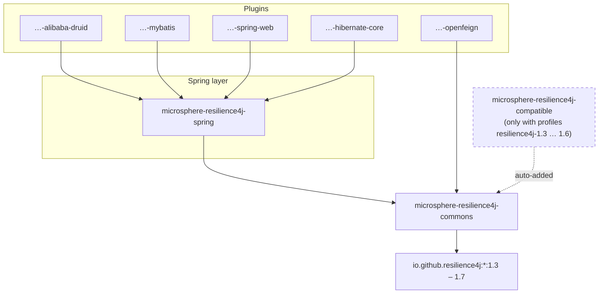

# User Guide — 1.x (release-1.x branch, v0.1.x)

> Source branch: `release-1.x` · Version line: `0.1.x` (latest release `0.1.4`) · Target: **Resilience4j 1.3.0 – 1.7.0**
> 中文版本见 [zh/README.md](zh/README.md)

**microsphere-resilience4j 1.x** is the maintenance line of the unified Resilience4j programming layer for applications that are pinned to **Resilience4j 1.x** and older Spring stacks (**Spring Cloud Hoxton – 2021.0.x**). It offers the same programming model as the [current line](../../current/user-guide/README.md) — templates, a chainable facade, `@Enable*` Spring annotations, and framework plugins — plus a compatibility shim so one source tree compiles against every Resilience4j 1.3 – 1.7 release.

## Version and Compatibility

| Component | Compatible Range | Notes |
|-----------|------------------|-------|
| microsphere-resilience4j | `0.1.x` (`release-1.x` branch) | latest release `0.1.4`, next `0.1.5-SNAPSHOT` |
| Resilience4j | 1.3.0, 1.4.0, 1.5.0, 1.6.0, 1.7.0 | Maven profiles `resilience4j-1.3` … `resilience4j-1.7` |
| Spring Cloud | Hoxton – 2021.0.x | via parent `microsphere-spring-cloud-parent` 0.1.26 |
| JDK | 8+ (inherited `java.version=8`; CI matrix 8/11/17/21/25, releases built on JDK 11) | see [parent page](microsphere-resilience4j-parent.md) |

For Resilience4j **2.x** / Spring Cloud 2022+, use the [current (0.2.x) user guide](../../current/user-guide/README.md) instead. The two lines publish different artifact versions (`0.1.x` vs `0.2.x`) and must not be mixed in one application.

## What differs from the current (0.2.x) line

- Extra Maven module: **`microsphere-resilience4j-compatible`** — back-ports Resilience4j event classes (e.g. `CircuitBreakerOnFailureRateExceededEvent`, `RateLimiterOnDrainedEvent`) that are missing in Resilience4j 1.3–1.6. It is attached automatically as a dependency when building with the `resilience4j-1.3` … `resilience4j-1.6` profiles; nothing is needed for 1.7.
- Plugin **Java sources are identical** to the 0.2.x line; the difference lives in the build — dependency coordinates (e.g. `org.hibernate:hibernate-core` 5.x vs `org.hibernate.orm:hibernate-core` 6.x) and the Resilience4j 1.x APIs used by commons/spring.
- The `0.1.x` BOM manages the **same six artifacts** as the current line (commons, spring, alibaba-druid, mybatis, openfeign, spring-web); `microsphere-resilience4j-hibernate-core` is NOT managed on either line — pin its version explicitly. See the [dependencies page](microsphere-resilience4j-dependencies.md).

## Installation

```xml
<dependencyManagement>
    <dependencies>
        <dependency>
            <groupId>io.github.microsphere-projects</groupId>
            <artifactId>microsphere-resilience4j-dependencies</artifactId>
            <version>0.1.4</version>
            <type>pom</type>
            <scope>import</scope>
        </dependency>
    </dependencies>
</dependencyManagement>

<dependencies>
    <dependency>
        <groupId>io.github.microsphere-projects</groupId>
        <artifactId>microsphere-resilience4j-commons</artifactId>
    </dependency>
    <dependency>
        <groupId>io.github.microsphere-projects</groupId>
        <artifactId>microsphere-resilience4j-spring</artifactId>
    </dependency>
</dependencies>
```

## Module Dependency Map



## User Guide Pages

| Page | Module | When to read |
|------|--------|--------------|
| [microsphere-resilience4j-commons.md](microsphere-resilience4j-commons.md) | commons | Templates for all six modules, `Resilience4jOperations`, facade & chain |
| [microsphere-resilience4j-spring.md](microsphere-resilience4j-spring.md) | spring | `@Enable*` annotations, event consumers, plugin SPI on Spring Hoxton–2021 |
| [microsphere-resilience4j-compatible.md](microsphere-resilience4j-compatible.md) | compatible | What it back-ports and when it is pulled in |
| [microsphere-resilience4j-alibaba-druid.md](microsphere-resilience4j-alibaba-druid.md) | plugin | Druid filter resilience |
| [microsphere-resilience4j-mybatis.md](microsphere-resilience4j-mybatis.md) | plugin | MyBatis executor resilience |
| [microsphere-resilience4j-openfeign.md](microsphere-resilience4j-openfeign.md) | plugin | Feign client resilience |
| [microsphere-resilience4j-spring-web.md](microsphere-resilience4j-spring-web.md) | plugin | Spring MVC handler resilience |
| [microsphere-resilience4j-hibernate-core.md](microsphere-resilience4j-hibernate-core.md) | plugin | Hibernate callback resilience |
| [microsphere-resilience4j-dependencies.md](microsphere-resilience4j-dependencies.md) | BOM | Managed artifacts and versions on the 0.1.x line |
| [microsphere-resilience4j-parent.md](microsphere-resilience4j-parent.md) | parent | Version profiles 1.3 – 1.7 |

Chinese translations of every page live in `zh/` with identical file names.

## Quick Start

```java
import io.github.resilience4j.circuitbreaker.CircuitBreakerRegistry;
import io.microsphere.resilience4j.circuitbreaker.CircuitBreakerTemplate;
import io.microsphere.resilience4j.common.Resilience4jFacade;

CircuitBreakerTemplate template =
        new CircuitBreakerTemplate(CircuitBreakerRegistry.ofDefaults());

String result = template.execute("backend-service", () -> callRemoteService());
```

The API shape (`execute / call / begin / end`) is identical to the current line, so code written against 0.1.x templates ports to 0.2.x without change — only the underlying Resilience4j version differs.
