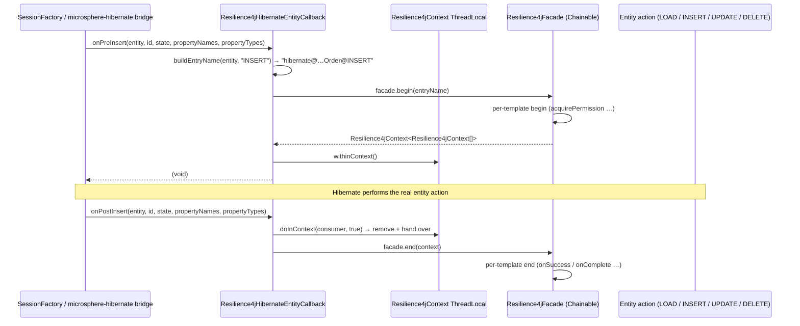

# microsphere-resilience4j-hibernate-core — User Guide (1.x)

> Version line `0.1.x` (`release-1.x` branch) · latest release `0.1.4` · current `${revision}` = `0.1.5-SNAPSHOT` · Resilience4j **1.3.0 – 1.7.0** (default `1.7.0`) · Spring Cloud Hoxton – 2021.0.x · [← user guide index](README.md)

Module path in the source tree: `microsphere-resilience4j-plugins/microsphere-resilience4j-hibernate-core`.

> **Testing status on this branch — read first.** This module has **no `src/test` directory on `release-1.x`.** The tree contains exactly one production file (`Resilience4jHibernateEntityCallback.java`) plus `pom.xml`. (The 0.2.x line does ship `Resilience4jHibernateEntityCallbackTest`; it does not exist here.) Everything below that is not copied from the class source is therefore labelled as derived from Javadoc / constructor contracts / the commons API, and none of it is execution-verified on this branch.

## Problem statement

Hibernate materializes and flushes entities deep inside session machinery — lazy loads, cascades, second-level-cache misses and `Session.save/update/delete` calls are not places where you want to sprinkle `@CircuitBreaker` annotations, and application-level wrappers cannot see the loads triggered by association traversal.

This plugin hooks the **entity lifecycle** instead: every pre-action opens a Resilience4j context, every post-action closes it. The result is per-entity, per-action protection (`LOAD`, `INSERT`, `UPDATE`, `DELETE`) without touching your DAOs.

## Hook point in the framework

The class implements the **Microsphere Hibernate** entity-callback SPI, not a Hibernate-native extension point:

```java
public class Resilience4jHibernateEntityCallback implements EntityCallback {
```

`io.microsphere.hibernate.entity.EntityCallback` comes from `io.github.microsphere-projects:microsphere-hibernate-core`, and the only Hibernate type referenced anywhere in the module is `org.hibernate.type.Type` (a parameter type). There is no `org.hibernate.integrator.spi.Integrator`, no `SessionFactoryServiceContributor`, no `EmptyInterceptor` subclass, and no `EventType` listener registration in this module.

The eight lifecycle methods it overrides (verbatim signatures from the source):

```java
@Override public void onPreLoad(Object entity, Object id, Object[] state, String[] propertyNames, Type[] types);
@Override public void onPostLoad(Object entity, Object id, String[] propertyNames, Type[] types);
@Override public void onPreDelete(Object entity, Object id, Object[] state, String[] propertyNames, Type[] types);
@Override public void onPostDelete(Object entity, Object id, Object[] state, String[] propertyNames, Type[] types);
@Override public void onPreInsert(Object entity, Object id, Object[] state, String[] propertyNames, Type[] propertyTypes);
@Override public void onPostInsert(Object entity, Object id, Object[] state, String[] propertyNames, Type[] propertyTypes);
@Override public void onPreUpdate(Object entity, Object id, Object[] state, String[] propertyNames, Type[] propertyTypes);
@Override public void onPostUpdate(Object entity, Object id, Object[] state, String[] propertyNames, Type[] propertyTypes);
```

Note the asymmetric `onPostLoad` signature (no `state` array) — it is not a typo in this document; it is what the interface offers.

How the pair works — `onPre*` opens, `onPost*` closes:

```java
@Override
public void onPreInsert(Object entity, Object id, Object[] state, String[] propertyNames, Type[] propertyTypes) {
    String entryName = buildEntryName(entity, "INSERT");
    Resilience4jContext<Resilience4jContext[]> begin = this.facade.begin(entryName);
    begin.withinContext();
}

@Override
public void onPostInsert(Object entity, Object id, Object[] state, String[] propertyNames, Type[] propertyTypes) {
    doInContext(contextt -> this.facade.end(contextt), true);
}
```

`withinContext()` binds the context to a `ThreadLocal`; `doInContext(consumer, true)` (`Resilience4jContext.doInContext`, static import) removes that binding and feeds it to `facade.end(...)`.

This is the **two-phase** side of the commons API — `begin`/`end` rather than `call`. See *Behavioral notes* for what that implies for each Resilience4j module.

## Maven coordinates

```xml
<dependency>
    <groupId>io.github.microsphere-projects</groupId>
    <artifactId>microsphere-resilience4j-hibernate-core</artifactId>
    <version>0.1.4</version><!-- ← explicit version required, see the BOM note -->
</dependency>
```

**BOM caveat (verified):** `microsphere-resilience4j-dependencies/pom.xml` on `release-1.x` manages only `microsphere-resilience4j-commons`, `-alibaba-druid`, `-openfeign`, `-mybatis`, `-spring-web` and `-spring`. **`microsphere-resilience4j-hibernate-core` is not in that list**, so importing the BOM does not give you a version for this artifact — declare it explicitly (or build inside the reactor, where `${revision}` applies).

Dependency table from the module POM:

| Dependency | Declared scope |
|------------|----------------|
| `io.github.microsphere-projects:microsphere-resilience4j-spring` | compile, **non-optional** |
| `io.github.microsphere-projects:microsphere-hibernate-core` | compile, **non-optional** — you cannot use this plugin without Microsphere's Hibernate module |
| `org.hibernate:hibernate-core` | **optional** — you provide it |
| `org.springframework:spring-context`, `microsphere-spring-context`, `microsphere-annotation-processor` | **optional** |
| `io.github.resilience4j:resilience4j-{core,circuitbreaker,ratelimiter,retry,bulkhead,timelimiter,annotations,consumer,framework-common}` | **optional** |
| `junit-jupiter`, `spring-test`, `microsphere-spring-test`, `microsphere-hibernate-test`, `h2`, `logback-classic` | **test** — currently unused, since the module has no test sources |

## Compatibility

| Item | Value on `release-1.x` | Evidence |
|------|------------------------|----------|
| microsphere-resilience4j | `0.1.x`, latest release `0.1.4`, `${revision}` = `0.1.5-SNAPSHOT` | root `pom.xml` |
| Resilience4j | 1.3.0 – 1.7.0, default `1.7.0` | parent POM profiles `resilience4j-1.3` … `resilience4j-1.7` |
| Spring Cloud | Hoxton – 2021.0.x | CI matrix `maven-profile-spring-cloud` |
| **Hibernate generation** | **Hibernate 5 coordinates: `org.hibernate:hibernate-core`** | module POM `<groupId>org.hibernate</groupId>`. The 0.2.x line uses `org.hibernate.orm:hibernate-core` (Hibernate 6). Version is not pinned in this repository; it is resolved through the imported `microsphere-hibernate-dependencies` BOM (`microsphere-hibernate.version = 0.1.9`). |
| microsphere-hibernate | 0.1.9 (property in `microsphere-resilience4j-parent/pom.xml`) | supplies `io.microsphere.hibernate.entity.EntityCallback` |
| JDK | not pinned in this snapshot | no compiler properties in the branch POMs; inherited from `microsphere-spring-cloud-parent` 0.1.26. CI matrix `java: ['8','11','17','21','25']`; publish workflow Java `11`. |
| `hibernate-core` release | not verifiable here | declared without `<version>`; check the resolved version in your build |

## API

```java
public class Resilience4jHibernateEntityCallback implements EntityCallback {

    /** The default entry name prefix : "hibernate@" */
    public static final String DEFAULT_ENTRY_NAME_PREFIX = "hibernate@";

    @Nonnull private Resilience4jFacade facade;                       // no constructor — setter only
    @Nonnull private String entryNamePrefix = DEFAULT_ENTRY_NAME_PREFIX;

    public void setFacade(@Nonnull Resilience4jFacade facade);
    public void setEntryNamePrefix(@Nonnull String entryNamePrefix);

    // 8 lifecycle overrides (see the previous section for exact signatures)

    protected String buildEntryName(Object entity, String action);
}
```

Contract details that follow directly from the source:

- **There is no constructor.** The class is JavaBean-style: `setFacade(...)` must be called before any callback fires, otherwise `this.facade.begin(...)` throws `NullPointerException` on the first `onPre*`. Both setters guard their argument with `io.microsphere.util.Assert.assertNotNull`, failing with `"'Resilience4jFacade' argument must not be null!"` / `"'entryNamePrefix' argument must not be null!"`.
- **No getters** are exposed for `facade` or `entryNamePrefix` (unlike the Druid and MyBatis classes).
- **Entry names** are built by `buildEntryName`: `entryNamePrefix + entity.getClass().getName() + '@' + action`, i.e.

```
hibernate@com.acme.domain.Order@LOAD
hibernate@com.acme.domain.Order@INSERT
hibernate@com.acme.domain.Order@UPDATE
hibernate@com.acme.domain.Order@DELETE
```

  The prefix **is** applied (consistent with MyBatis, inconsistent with the Druid filter). Because the action is a fixed literal, you get exactly four protected resources per entity class; `buildEntryName` is `protected`, so a subclass can change the scheme.

## Wiring / registration

Verified facts: this module ships **no `META-INF/spring.factories`** and **no `Resilience4jPlugin` implementation** (there is no `HibernateResilience4jPlugin` class on this branch). Consequently:

- it is *not* discovered by `@Enable*(plugins = "hibernate")`; there is no such plugin name;
- nothing in this repository instantiates or registers the callback. Registration goes through `microsphere-hibernate`'s own Hibernate integration, which lives outside this repository and cannot be verified from this snapshot — check the `microsphere-hibernate-core` 0.1.9 documentation for how `EntityCallback` implementations are contributed.

What you control, verifiably, is the instance itself. Build it as a Spring bean and inject the facade the spring module registers (`LazyResilience4jFacade.BEAN_NAME` = `"lazyResilience4jFacade"`), or wire it manually:

```java
// Derived from the class's public setter contract (no test exists on this branch to copy).
BulkheadRegistry bulkheadRegistry = BulkheadRegistry.ofDefaults();
RateLimiterRegistry rateLimiterRegistry = RateLimiterRegistry.ofDefaults();
RetryRegistry retryRegistry = RetryRegistry.ofDefaults();
TimeLimiterRegistry timeLimiterRegistry = TimeLimiterRegistry.ofDefaults();
CircuitBreakerRegistry circuitBreakerRegistry = CircuitBreakerRegistry.ofDefaults();

Resilience4jFacade facade = new ChainableResilience4jFacade(
        bulkheadRegistry, rateLimiterRegistry, retryRegistry, timeLimiterRegistry, circuitBreakerRegistry);

Resilience4jHibernateEntityCallback callback = new Resilience4jHibernateEntityCallback();
callback.setFacade(facade);                       // mandatory — no constructor does it for you
callback.setEntryNamePrefix("hibernate@");        // optional, this is the default value
```

Spring equivalent (property injection matches the setter-only shape; constructor injection is impossible here):

```java
@Bean
public Resilience4jHibernateEntityCallback resilience4jHibernateEntityCallback(Resilience4jFacade facade) {
    Resilience4jHibernateEntityCallback callback = new Resilience4jHibernateEntityCallback();
    callback.setFacade(facade);   // e.g. @Qualifier(LazyResilience4jFacade.BEAN_NAME)
    return callback;
}
```

## Full example

Because there is no test resource on this branch, the example below is a **source-derived scenario**, not a copied test. Given the wiring above, loading and persisting `com.acme.domain.Order` produces this sequence of protected resources (names from `buildEntryName`):

| Callback fired | Entry name | Facade operation |
|----------------|------------|------------------|
| `onPreLoad` | `hibernate@com.acme.domain.Order@LOAD` | `facade.begin(name)` + `withinContext()` |
| `onPostLoad` | same context (from `ThreadLocal`) | `doInContext(c -> facade.end(c), true)` |
| `onPreInsert` | `hibernate@com.acme.domain.Order@INSERT` | `begin` + `withinContext()` |
| `onPostInsert` | that context | `end`, context removed |
| `onPreUpdate` / `onPostUpdate` | `hibernate@com.acme.domain.Order@UPDATE` | begin / end |
| `onPreDelete` / `onPostDelete` | `hibernate@com.acme.domain.Order@DELETE` | begin / end |



## Behavioral notes

1. **Only three of the five modules do anything on this path.** `begin`/`end` consult `isBeginSupported()`/`isEndSupported()`. `RetryTemplate` and `TimeLimiterTemplate` return `false` for both, so **retry and time limiting never apply to entity lifecycle events**; only CircuitBreaker, Bulkhead and RateLimiter participate (via `CircuitBreakerTemplate`, `BulkheadTemplate`, `RateLimiterTemplate`). This is commons behaviour, not a Hibernate-specific choice.
2. **Failures are never reported to the circuit breaker by this class.** `CircuitBreakerTemplate.doEnd` decides success vs. failure from `Resilience4jContext.getFailure()`, and nothing in `Resilience4jHibernateEntityCallback` ever calls `setFailure(...)` (the spring-web plugin's interceptor does; this one does not). Derived from source: an open breaker will reject calls at `onPre*` (`acquirePermission`), but failing loads/inserts will not trip it. **Mark: not execution-verified on this branch — no tests exist.** If you need failure reporting, subclass and record the failure before `end`.
3. **ThreadLocal pairing is strict.** The context is bound in `onPre*` and removed in `onPost*` (`forRemoval = true`). If Hibernate skips a post-callback, or the pre/post pair crosses threads, `onPost*` becomes a no-op (`doInContext` silently returns when no context is bound) and the previous context stays bound — leaking a bulkhead permit on that pool thread. Treat unmatched callbacks as a resource leak, not a statistics glitch. Derived from source; untested.
4. **Nested entity graphs overwrite each other's context.** Because there is a single `ThreadLocal` slot, a cascade that triggers `onPreLoad` for an association before the outer `onPostLoad` replaces the bound context; the outer close then ends the *inner* context. Derived from source; no test covers cascades.
5. **`RateLimiterTemplate.doEnd` calls `waitForPermission(rateLimiter)` again** (same body as `doBegin`). On the two-phase path this means the post-callback can block. Sourced from `microsphere-resilience4j-commons`; flag it before enabling a rate limiter on entity lifecycle traffic.
6. **Entry names key on the entity class**, not the mapping unit — proxies and Hibernate-generated subclasses produce their own `entity.getClass().getName()`. Derived from `buildEntryName`; check your proxy strategy.
7. **No Spring Boot auto-configuration** for Hibernate exists on this branch (`microsphere-resilience4j-spring-boot` has only a `pom.xml`).

## Related pages

- [Developer guide — this module](../developer-guide/microsphere-resilience4j-hibernate-core.md)
- [User guide — commons](microsphere-resilience4j-commons.md) (facade, two-phase operations, context)
- [User guide — mybatis](microsphere-resilience4j-mybatis.md) (the one-time-`call` counterpart)
