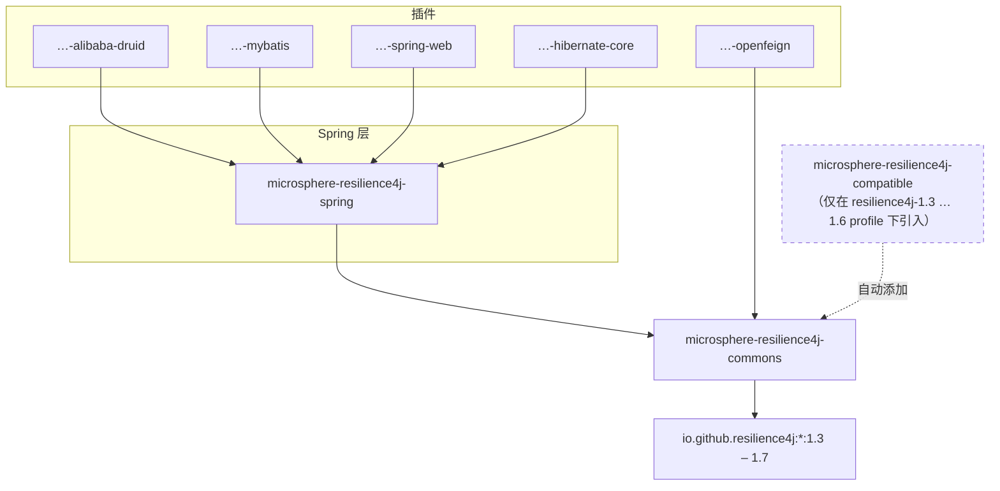

# 用户指南 — 1.x（release-1.x 分支，v0.1.x）

> 源分支：`release-1.x` · 版本线：`0.1.x`（最新发布版本 `0.1.4`） · 目标：**Resilience4j 1.3.0 – 1.7.0**
> 英文版本见 [README.md](../README.md)

**microsphere-resilience4j 1.x** 是统一 Resilience4j 编程线的维护版本，面向被锁定在 **Resilience4j 1.x** 以及更旧 Spring 技术栈（**Spring Cloud Hoxton – 2021.0.x**）上的应用。它提供与[当前版本线](../../../current/user-guide/zh/README.md)完全相同的编程模型——模板、可链式调用的门面、`@Enable*` Spring 注解以及框架插件——并额外提供一个兼容性垫片，使同一份源码树能够针对 Resilience4j 1.3 至 1.7 的每一个发布版本进行编译。

## 版本与兼容性

| 组件 | 兼容范围 | 说明 |
|-----------|------------------|-------|
| microsphere-resilience4j | `0.1.x`（`release-1.x` 分支） | 最新发布版本 `0.1.4`，下一个版本 `0.1.5-SNAPSHOT` |
| Resilience4j | 1.3.0、1.4.0、1.5.0、1.6.0、1.7.0 | Maven profile `resilience4j-1.3` … `resilience4j-1.7` |
| Spring Cloud | Hoxton – 2021.0.x | 经由父工程 `microsphere-spring-cloud-parent` 0.1.26 |
| JDK | 8+（继承 `java.version=8`；CI 矩阵为 8/11/17/21/25，发布构建基于 JDK 11） | 参见[父工程页面](microsphere-resilience4j-parent.md) |

若需使用 Resilience4j **2.x** / Spring Cloud 2022+，请改用[当前（0.2.x）用户指南](../../../current/user-guide/zh/README.md)。这两条版本线发布的是不同的构件版本（`0.1.x` 与 `0.2.x`），不得在同一个应用中混用。

## 与当前（0.2.x）版本线的差异

- 额外的 Maven 模块：**`microsphere-resilience4j-compatible`** —— 回移（back-port）Resilience4j 事件类（例如 `CircuitBreakerOnFailureRateExceededEvent`、`RateLimiterOnDrainedEvent`），这些类在 Resilience4j 1.3–1.6 中缺失。当使用 `resilience4j-1.3` … `resilience4j-1.6` profile 构建时，它会作为依赖被自动挂载；在 1.7 下无需任何操作。
- 插件的 **Java 源码与 0.2.x 版本线完全一致**；差异存在于构建层面——依赖坐标（例如 `org.hibernate:hibernate-core` 5.x 与 `org.hibernate.orm:hibernate-core` 6.x）以及 commons/spring 所使用的 Resilience4j 1.x API。
- `0.1.x` BOM 管理的构件与当前版本线**同样是那六个**（commons、spring、alibaba-druid、mybatis、openfeign、spring-web）；两条版本线都**不**管理 `microsphere-resilience4j-hibernate-core`——请显式锁定其版本。参见[依赖页面](microsphere-resilience4j-dependencies.md)。

## 安装

```xml
<dependencyManagement>
    <dependencies>
        <dependency>
            <groupId>io.github.microsphere-projects</groupId>
            <artifactId>microsphere-resilience4j-dependencies</artifactId>
            <version>0.1.4</version>
            <type>pom</type>
            <scope>import</scope>
        </dependency>
    </dependencies>
</dependencyManagement>

<dependencies>
    <dependency>
        <groupId>io.github.microsphere-projects</groupId>
        <artifactId>microsphere-resilience4j-commons</artifactId>
    </dependency>
    <dependency>
        <groupId>io.github.microsphere-projects</groupId>
        <artifactId>microsphere-resilience4j-spring</artifactId>
    </dependency>
</dependencies>
```

## 模块依赖关系图



## 用户指南页面

| 页面 | 模块 | 何时阅读 |
|------|--------|--------------|
| [microsphere-resilience4j-commons.md](microsphere-resilience4j-commons.md) | commons | 全部六个模块的模板、`Resilience4jOperations`、门面与链 |
| [microsphere-resilience4j-spring.md](microsphere-resilience4j-spring.md) | spring | `@Enable*` 注解、事件消费者、Spring Hoxton–2021 上的插件 SPI |
| [microsphere-resilience4j-compatible.md](microsphere-resilience4j-compatible.md) | compatible | 它回移了什么内容，以及何时会被引入 |
| [microsphere-resilience4j-alibaba-druid.md](microsphere-resilience4j-alibaba-druid.md) | 插件 | Druid 过滤器弹性能力 |
| [microsphere-resilience4j-mybatis.md](microsphere-resilience4j-mybatis.md) | 插件 | MyBatis 执行器弹性能力 |
| [microsphere-resilience4j-openfeign.md](microsphere-resilience4j-openfeign.md) | 插件 | Feign 客户端弹性能力 |
| [microsphere-resilience4j-spring-web.md](microsphere-resilience4j-spring-web.md) | 插件 | Spring MVC 处理器弹性能力 |
| [microsphere-resilience4j-hibernate-core.md](microsphere-resilience4j-hibernate-core.md) | 插件 | Hibernate 回调弹性能力 |
| [microsphere-resilience4j-dependencies.md](microsphere-resilience4j-dependencies.md) | BOM | 0.1.x 版本线上被管理的构件与版本 |
| [microsphere-resilience4j-parent.md](microsphere-resilience4j-parent.md) | parent | 版本 profile 1.3 – 1.7 |

所有页面的中文译文位于 `zh/` 目录下，文件名与英文版本完全一致。

## 快速开始

```java
import io.github.resilience4j.circuitbreaker.CircuitBreakerRegistry;
import io.microsphere.resilience4j.circuitbreaker.CircuitBreakerTemplate;
import io.microsphere.resilience4j.common.Resilience4jFacade;

CircuitBreakerTemplate template =
        new CircuitBreakerTemplate(CircuitBreakerRegistry.ofDefaults());

String result = template.execute("backend-service", () -> callRemoteService());
```

API 形态（`execute / call / begin / end`）与当前版本线完全一致，因此基于 0.1.x 模板编写的代码可以无需改动即可迁移到 0.2.x——只有底层的 Resilience4j 版本不同。
