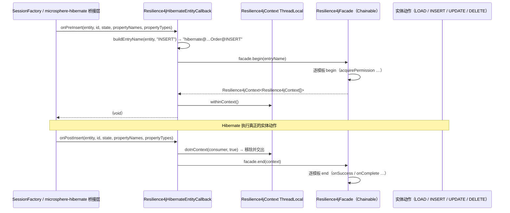

# microsphere-resilience4j-hibernate-core — 用户指南（1.x）

> 简体中文 | [English](../microsphere-resilience4j-hibernate-core.md)

> 版本线 `0.1.x`（`release-1.x` 分支）· 最新发布版本 `0.1.4` · 当前 `${revision}` = `0.1.5-SNAPSHOT` · Resilience4j **1.3.0 – 1.7.0**（默认 `1.7.0`）· Spring Cloud Hoxton – 2021.0.x · [← 用户指南索引](README.md)

源码树中的模块路径：`microsphere-resilience4j-plugins/microsphere-resilience4j-hibernate-core`。

> **本分支的测试状态——请先阅读。** 本模块在 `release-1.x` 上**没有 `src/test` 目录**。该目录树中恰好只有一个生产文件（`Resilience4jHibernateEntityCallback.java`）加上 `pom.xml`。（0.2.x 版本线确实带有 `Resilience4jHibernateEntityCallbackTest`；它在这里不存在。）因此下文凡是未从该类源码直接摘录的内容，都被标注为源自 Javadoc / 构造器契约 / commons API，并且这些内容在本分支上都没有经过执行验证。

## 问题陈述

Hibernate 在会话机制的深处物化并刷写实体——延迟加载、级联、二级缓存未命中以及 `Session.save/update/delete` 调用，都不是你想散布 `@CircuitBreaker` 注解的地方，而应用层的包装者也看不到由关联遍历所触发的加载。

本插件转而挂钩**实体生命周期**：每个前置动作（pre-action）打开一个 Resilience4j 上下文，每个后置动作（post-action）关闭它。其结果是以实体、以动作粒度的保护（`LOAD`、`INSERT`、`UPDATE`、`DELETE`），且无需改动你的 DAO。

## 框架中的钩子位置

该类实现的是 **Microsphere Hibernate** 的实体回调 SPI，而不是 Hibernate 原生的扩展点：

```java
public class Resilience4jHibernateEntityCallback implements EntityCallback {
```

`io.microsphere.hibernate.entity.EntityCallback` 来自 `io.github.microsphere-projects:microsphere-hibernate-core`，而整个模块中唯一被引用的 Hibernate 类型是 `org.hibernate.type.Type`（一个参数类型）。本模块里没有 `org.hibernate.integrator.spi.Integrator`，没有 `SessionFactoryServiceContributor`，没有 `EmptyInterceptor` 子类，也没有 `EventType` 监听器注册。

它覆盖的八个生命周期方法（签名逐字取自源码）：

```java
@Override public void onPreLoad(Object entity, Object id, Object[] state, String[] propertyNames, Type[] types);
@Override public void onPostLoad(Object entity, Object id, String[] propertyNames, Type[] types);
@Override public void onPreDelete(Object entity, Object id, Object[] state, String[] propertyNames, Type[] types);
@Override public void onPostDelete(Object entity, Object id, Object[] state, String[] propertyNames, Type[] types);
@Override public void onPreInsert(Object entity, Object id, Object[] state, String[] propertyNames, Type[] propertyTypes);
@Override public void onPostInsert(Object entity, Object id, Object[] state, String[] propertyNames, Type[] propertyTypes);
@Override public void onPreUpdate(Object entity, Object id, Object[] state, String[] propertyNames, Type[] propertyTypes);
@Override public void onPostUpdate(Object entity, Object id, Object[] state, String[] propertyNames, Type[] propertyTypes);
```

请注意 `onPostLoad` 签名是不对称的（没有 `state` 数组）——这不是本文档的笔误；接口提供的就是这样。

这一对方法如何协作——`onPre*` 打开，`onPost*` 关闭：

```java
@Override
public void onPreInsert(Object entity, Object id, Object[] state, String[] propertyNames, Type[] propertyTypes) {
    String entryName = buildEntryName(entity, "INSERT");
    Resilience4jContext<Resilience4jContext[]> begin = this.facade.begin(entryName);
    begin.withinContext();
}

@Override
public void onPostInsert(Object entity, Object id, Object[] state, String[] propertyNames, Type[] propertyTypes) {
    doInContext(contextt -> this.facade.end(contextt), true);
}
```

`withinContext()` 把上下文绑定到一个 `ThreadLocal`；`doInContext(consumer, true)`（`Resilience4jContext.doInContext`，静态 import）解除该绑定并把它交给 `facade.end(...)`。

这就是 commons API 中**两阶段**的那一侧——`begin`/`end`，而不是 `call`。关于这对每个 Resilience4j 模块意味着什么，参见*行为说明*。

## Maven 坐标

```xml
<dependency>
    <groupId>io.github.microsphere-projects</groupId>
    <artifactId>microsphere-resilience4j-hibernate-core</artifactId>
    <version>0.1.4</version><!-- ← explicit version required, see the BOM note -->
</dependency>
```

**BOM 注意事项（已核实）：** `release-1.x` 上的 `microsphere-resilience4j-dependencies/pom.xml` 只管理 `microsphere-resilience4j-commons`、`-alibaba-druid`、`-openfeign`、`-mybatis`、`-spring-web` 与 `-spring`。**`microsphere-resilience4j-hibernate-core` 不在该列表中**，因此导入 BOM 并不会为该构件提供版本——请显式声明版本（或者在 reactor 内构建，那里 `${revision}` 生效）。

来自模块 POM 的依赖表：

| 依赖 | 声明的作用域 |
|------------|----------------|
| `io.github.microsphere-projects:microsphere-resilience4j-spring` | compile，**非 optional** |
| `io.github.microsphere-projects:microsphere-hibernate-core` | compile，**非 optional** —— 没有 Microsphere 的 Hibernate 模块你就无法使用本插件 |
| `org.hibernate:hibernate-core` | **optional** —— 由你提供 |
| `org.springframework:spring-context`、`microsphere-spring-context`、`microsphere-annotation-processor` | **optional** |
| `io.github.resilience4j:resilience4j-{core,circuitbreaker,ratelimiter,retry,bulkhead,timelimiter,annotations,consumer,framework-common}` | **optional** |
| `junit-jupiter`、`spring-test`、`microsphere-spring-test`、`microsphere-hibernate-test`、`h2`、`logback-classic` | **test** —— 目前未被使用，因为本模块没有测试源码 |

## 兼容性

| 条目 | `release-1.x` 上的取值 | 证据 |
|------|------------------------|----------|
| microsphere-resilience4j | `0.1.x`，最新发布版本 `0.1.4`，`${revision}` = `0.1.5-SNAPSHOT` | 根 `pom.xml` |
| Resilience4j | 1.3.0 – 1.7.0，默认 `1.7.0` | 父 POM profile `resilience4j-1.3` … `resilience4j-1.7` |
| Spring Cloud | Hoxton – 2021.0.x | CI 矩阵 `maven-profile-spring-cloud` |
| **Hibernate 代际** | **Hibernate 5 坐标：`org.hibernate:hibernate-core`** | 模块 POM 的 `<groupId>org.hibernate</groupId>`。0.2.x 版本线使用 `org.hibernate.orm:hibernate-core`（Hibernate 6）。版本未在本仓库中锁定；它通过导入的 `microsphere-hibernate-dependencies` BOM 解析（`microsphere-hibernate.version = 0.1.9`）。 |
| microsphere-hibernate | 0.1.9（属性位于 `microsphere-resilience4j-parent/pom.xml`） | 提供 `io.microsphere.hibernate.entity.EntityCallback` |
| JDK | 未在本快照中锁定 | 该分支的 POM 中没有编译器属性；从 `microsphere-spring-cloud-parent` 0.1.26 继承。CI 矩阵 `java: ['8','11','17','21','25']`；发布流程 Java `11`。 |
| `hibernate-core` 发布版本 | 此处无法核实 | 声明时不带 `<version>`；请在你自己的构建中查看解析出的版本 |

## API

```java
public class Resilience4jHibernateEntityCallback implements EntityCallback {

    /** The default entry name prefix : "hibernate@" */
    public static final String DEFAULT_ENTRY_NAME_PREFIX = "hibernate@";

    @Nonnull private Resilience4jFacade facade;                       // no constructor — setter only
    @Nonnull private String entryNamePrefix = DEFAULT_ENTRY_NAME_PREFIX;

    public void setFacade(@Nonnull Resilience4jFacade facade);
    public void setEntryNamePrefix(@Nonnull String entryNamePrefix);

    // 8 lifecycle overrides (see the previous section for exact signatures)

    protected String buildEntryName(Object entity, String action);
}
```

可以直接从源码得出的契约细节：

- **没有构造器。** 该类是 JavaBean 风格：在任何回调触发之前必须先调用 `setFacade(...)`，否则 `this.facade.begin(...)` 会在第一次 `onPre*` 时抛出 `NullPointerException`。两个 setter 都用 `io.microsphere.util.Assert.assertNotNull` 校验参数，失败信息为 `"'Resilience4jFacade' argument must not be null!"` / `"'entryNamePrefix' argument must not be null!"`。
- **没有 getter** 暴露 `facade` 或 `entryNamePrefix`（与 Druid 和 MyBatis 的类不同）。
- **条目名称** 由 `buildEntryName` 构造：`entryNamePrefix + entity.getClass().getName() + '@' + action`，也就是：

```
hibernate@com.acme.domain.Order@LOAD
hibernate@com.acme.domain.Order@INSERT
hibernate@com.acme.domain.Order@UPDATE
hibernate@com.acme.domain.Order@DELETE
```

  前缀在这里**确实**被应用（与 MyBatis 一致，与 Druid 过滤器不一致）。由于动作是一个固定字面量，每个实体类恰好得到四个被保护的资源；`buildEntryName` 是 `protected` 的，因此子类可以改变这一命名方案。

## 装配 / 注册

已核实的事实：本模块**不提供 `META-INF/spring.factories`**，也**没有 `Resilience4jPlugin` 实现**（本分支上不存在 `HibernateResilience4jPlugin` 类）。因此：

- 它*不会*被 `@Enable*(plugins = "hibernate")` 发现；并不存在这样的插件名；
- 本仓库中没有任何东西实例化或注册该回调。注册要经由 `microsphere-hibernate` 自身的 Hibernate 集成，而那部分位于本仓库之外，无法从本快照核实——请查阅 `microsphere-hibernate-core` 0.1.9 的文档，了解 `EntityCallback` 实现是如何被贡献出去的。

你可以确凿控制的是实例本身。把它构造成一个 Spring bean，并注入 spring 模块所注册的那个门面（`LazyResilience4jFacade.BEAN_NAME` = `"lazyResilience4jFacade"`），或者手工装配：

```java
// Derived from the class's public setter contract (no test exists on this branch to copy).
BulkheadRegistry bulkheadRegistry = BulkheadRegistry.ofDefaults();
RateLimiterRegistry rateLimiterRegistry = RateLimiterRegistry.ofDefaults();
RetryRegistry retryRegistry = RetryRegistry.ofDefaults();
TimeLimiterRegistry timeLimiterRegistry = TimeLimiterRegistry.ofDefaults();
CircuitBreakerRegistry circuitBreakerRegistry = CircuitBreakerRegistry.ofDefaults();

Resilience4jFacade facade = new ChainableResilience4jFacade(
        bulkheadRegistry, rateLimiterRegistry, retryRegistry, timeLimiterRegistry, circuitBreakerRegistry);

Resilience4jHibernateEntityCallback callback = new Resilience4jHibernateEntityCallback();
callback.setFacade(facade);                       // mandatory — no constructor does it for you
callback.setEntryNamePrefix("hibernate@");        // optional, this is the default value
```

Spring 等价写法（属性注入契合这里只有 setter 的形态；此处无法使用构造器注入）：

```java
@Bean
public Resilience4jHibernateEntityCallback resilience4jHibernateEntityCallback(Resilience4jFacade facade) {
    Resilience4jHibernateEntityCallback callback = new Resilience4jHibernateEntityCallback();
    callback.setFacade(facade);   // e.g. @Qualifier(LazyResilience4jFacade.BEAN_NAME)
    return callback;
}
```

## 完整示例

由于本分支没有测试资源可依据，下面这个示例是一个**源自源码的推演场景**，而不是摘录的测试。基于上面的装配，加载并持久化 `com.acme.domain.Order` 会产生这样一串被保护资源（名称来自 `buildEntryName`）：

| 触发的回调 | 条目名称 | 门面操作 |
|----------------|------------|------------------|
| `onPreLoad` | `hibernate@com.acme.domain.Order@LOAD` | `facade.begin(name)` + `withinContext()` |
| `onPostLoad` | 同一个上下文（来自 `ThreadLocal`） | `doInContext(c -> facade.end(c), true)` |
| `onPreInsert` | `hibernate@com.acme.domain.Order@INSERT` | `begin` + `withinContext()` |
| `onPostInsert` | 那个上下文 | `end`，上下文被移除 |
| `onPreUpdate` / `onPostUpdate` | `hibernate@com.acme.domain.Order@UPDATE` | begin / end |
| `onPreDelete` / `onPostDelete` | `hibernate@com.acme.domain.Order@DELETE` | begin / end |



## 行为说明

1. **五个模块中只有三个在这条路径上真正起作用。** `begin`/`end` 会查阅 `isBeginSupported()`/`isEndSupported()`。`RetryTemplate` 与 `TimeLimiterTemplate` 对两者都返回 `false`，因此**重试与超时限制永远不会作用于实体生命周期事件**；只有 CircuitBreaker、Bulkhead 与 RateLimiter 参与（经由 `CircuitBreakerTemplate`、`BulkheadTemplate`、`RateLimiterTemplate`）。这是 commons 的行为，而不是 Hibernate 特有的选择。
2. **本类从不会把失败上报给断路器。** `CircuitBreakerTemplate.doEnd` 依据 `Resilience4jContext.getFailure()` 来判定成功还是失败，而 `Resilience4jHibernateEntityCallback` 中没有任何地方调用 `setFailure(...)`（spring-web 插件的拦截器会调用；本类不会）。源自源码的推论：打开的断路器会在 `onPre*`（`acquirePermission`）处拒绝调用，但失败的加载/插入不会让它跳闸。**标注：本分支未经执行验证——不存在测试。** 如果你需要失败上报，请子类化并在 `end` 之前记录失败。
3. **ThreadLocal 的配对是严格的。** 上下文在 `onPre*` 中绑定，在 `onPost*` 中移除（`forRemoval = true`）。如果 Hibernate 跳过了某个后置回调，或者前置/后置配对跨越了不同线程，那么 `onPost*` 会成为空操作（`doInContext` 在没有绑定上下文时静默返回），而先前的上下文会一直留在绑定上——在该线程池线程上泄漏一个 bulkhead 许可。请把不匹配的回调视为资源泄漏，而不是统计数据的瑕疵。源自源码的推论；未经测试。
4. **嵌套的实体图会相互覆盖上下文。** 因为只有单个 `ThreadLocal` 槽位，级联如果在外层 `onPostLoad` 之前为某个关联触发了 `onPreLoad`，就会替换掉已绑定的上下文；随后外层的关闭动作结束的其实是*内层*上下文。源自源码的推论；没有测试覆盖级联场景。
5. **`RateLimiterTemplate.doEnd` 会再次调用 `waitForPermission(rateLimiter)`**（方法体与 `doBegin` 相同）。在两阶段路径上，这意味着后置回调可能阻塞。来源为 `microsphere-resilience4j-commons`；在为实体生命周期流量启用限流器之前，请先标记这一点。
6. **条目名称以实体类为键**，而不是以映射单元为键——代理对象与 Hibernate 生成的子类会产生各自不同的 `entity.getClass().getName()`。源自 `buildEntryName` 的推论；请检查你的代理策略。
7. **本分支上不存在面向 Hibernate 的 Spring Boot 自动配置**（`microsphere-resilience4j-spring-boot` 只有一个 `pom.xml`）。

## 相关页面

- [开发者指南 — 本模块](../../developer-guide/zh/microsphere-resilience4j-hibernate-core.md)
- [用户指南 — commons](microsphere-resilience4j-commons.md)（门面、两阶段操作、上下文）
- [用户指南 — mybatis](microsphere-resilience4j-mybatis.md)（使用一次性 `call` 的对应实现）
