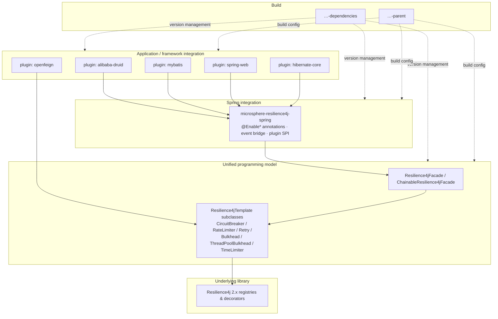

# Developer Guide — Current (release branch, v0.2.x)

> Source branch: `release` · Version line: `0.2.x` · Target: **Resilience4j 2.0.0 – 2.4.0**
> 中文版本见 [zh/README.md](zh/README.md)

This guide is for contributors and for teams that want to understand — or extend — the internals of microsphere-resilience4j. It covers architecture, module-by-module source analysis, the design patterns in use, and flow diagrams for the non-trivial control and event paths.

## System Architecture

The project is a layered Maven multi-module reactor:



### Layer responsibilities

| Layer | Module(s) | Responsibility | Must not depend on |
|-------|-----------|----------------|--------------------|
| Programming model | commons | Template abstraction over the six Resilience4j decorators; facade & chain composition | Spring |
| Spring integration | spring | Bean registration via `@Enable*`, `Resilience4jPlugin` SPI, event → `ApplicationEvent` bridge | web frameworks |
| Integration plugins | plugins/* | Weave the templates into a specific framework's execution path (filters, interceptors, callbacks) | application code |
| Build | parent, dependencies | Resilience4j version profiles, dependency management, BOM (JDK baseline 17+) | code |

## Design Patterns Used

| Pattern | Where | Why |
|---------|-------|-----|
| **Template Method** | `Resilience4jTemplate` and its six subclasses | One skeleton (`begin` → decorate → `end`) with per-module hook implementations |
| **Facade** | `Resilience4jFacade`, `LazyResilience4jFacade` | Single entry point hiding registry/template plumbing |
| **Chain of Responsibility** | `ChainableResilience4jFacade`, `CallbackChain` | Compose multiple resilience modules around one call, in priority order |
| **Registry** (from Resilience4j) | All template constructors | Templates wrap a `Registry` and resolve/create named instances lazily |
| **Strategy** | `EventConsumerMethodFilter`, plugin selection | Swappable resolution of consumer methods / plugin behaviour |
| **Observer / Event Bridge** | `*ApplicationEventPublisher` classes | Adapt Resilience4j event publishers to Spring `ApplicationEventPublisher` |
| **SPI / Plug-in** | `Resilience4jPlugin` + `microsphere-resilience4j-plugins/*` | Framework integrations register themselves without core changes |
| **Proxy / Decorator** | openfeign `Resilience4jClient`, mybatis `Resilience4jExecutor`, druid filter, hibernate callback | Wrap framework calls with resilience decoration |

## Complex Flows (diagrammed in module pages)

1. **Template execution** — `execute/call/begin/end` inside a single template. → [commons page](microsphere-resilience4j-commons.md)
2. **Chainable facade execution** — how N templates wrap one callback and how context nests. → [commons page](microsphere-resilience4j-commons.md)
3. **`@EnableResilience4j` bootstrap** — registrar hierarchy, bean registration, plugin discovery. → [spring page](microsphere-resilience4j-spring.md)
4. **Resilience4j event → Spring event** — consumer bean registration and publishing path. → [spring page](microsphere-resilience4j-spring.md)
5. **Framework weaving per plugin** — druid filter chain, mybatis interceptor, feign capability, mvc interceptor, hibernate callback. → respective plugin pages

## Developer Guide Pages

| Page | Module |
|------|--------|
| [microsphere-resilience4j-commons.md](microsphere-resilience4j-commons.md) | commons — templates, facade, chain, context |
| [microsphere-resilience4j-spring.md](microsphere-resilience4j-spring.md) | spring — annotations, registrars, events, plugin SPI |
| [microsphere-resilience4j-alibaba-druid.md](microsphere-resilience4j-alibaba-druid.md) | plugin |
| [microsphere-resilience4j-mybatis.md](microsphere-resilience4j-mybatis.md) | plugin |
| [microsphere-resilience4j-openfeign.md](microsphere-resilience4j-openfeign.md) | plugin |
| [microsphere-resilience4j-spring-web.md](microsphere-resilience4j-spring-web.md) | plugin |
| [microsphere-resilience4j-hibernate-core.md](microsphere-resilience4j-hibernate-core.md) | plugin |
| [microsphere-resilience4j-dependencies.md](microsphere-resilience4j-dependencies.md) | BOM |
| [microsphere-resilience4j-parent.md](microsphere-resilience4j-parent.md) | build parent |
| [microsphere-resilience4j-spring-boot.md](microsphere-resilience4j-spring-boot.md) | placeholder module |
| [microsphere-resilience4j-spring-cloud.md](microsphere-resilience4j-spring-cloud.md) | placeholder module |

Chinese translations of every page live in `zh/` with identical file names.

## Building the Project

```bash
# default build (Resilience4j 2.4.0 — profile 'resilience4j-2.4' is activeByDefault)
./mvnw clean install

# build against another Resilience4j line
./mvnw clean install -P resilience4j-2.0   # or -2.1 / -2.2 / -2.3
```

- `${revision}` (currently `0.2.5-SNAPSHOT`) is flattened by the parent `microsphere-spring-cloud-parent`; released artifacts on this line are `0.2.0` – `0.2.4`.
- The Maven profiles `resilience4j-2.0` … `resilience4j-2.4` only switch `resilience4j.version`; the source is written against the stable 2.x API surface so it compiles under every profile.
- Tests use JUnit 5 plus `microsphere-java-test` / `microsphere-spring-test`; many templates and plugins have dedicated unit tests that double as usage examples (see the user guide).

## Versioning & Compatibility Policy

- **Minor lines track Resilience4j majors**: `0.2.x` ⇔ Resilience4j **2.x**, `0.1.x` ⇔ Resilience4j **1.x** (see the [1.x developer guide](../../1.x/developer-guide/README.md)).
- Spring compatibility follows the parent line: `microsphere-spring-cloud-parent` 0.2.26 ⇒ Spring Cloud 2022.0.x – 2025.0.x.
- A breaking change to `Resilience4jOperations`/`Resilience4jTemplate` contracts requires a new release line, not a patch bump.
