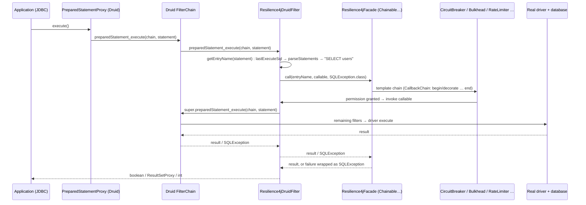
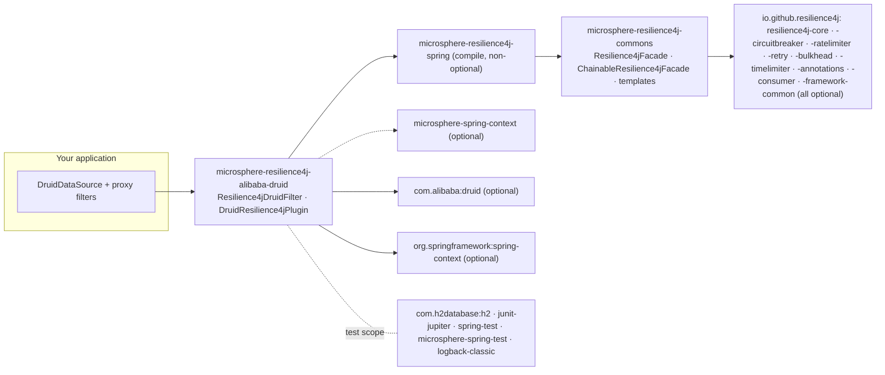

# microsphere-resilience4j-alibaba-druid — Developer Guide

> Version line `0.2.x` (`release` branch) · latest release `0.2.4` · current `${revision}` = `0.2.5-SNAPSHOT` · Resilience4j **2.0.0 – 2.4.0** (default `2.4.0`) · Spring Cloud 2022.0.x – 2025.0.x · JDK **17+** · [← developer guide index](README.md)

Module path: `microsphere-resilience4j-plugins/microsphere-resilience4j-alibaba-druid`.

## Class inventory

| Type | File | Role |
|------|------|------|
| `Resilience4jDruidFilter` | `src/main/java/io/microsphere/resilience4j/alibaba/druid/filter/Resilience4jDruidFilter.java` | The only production hook: a Druid `Filter` that decorates statement execution with `Resilience4jFacade.call(...)` |
| `DruidResilience4jPlugin` | `src/main/java/io/microsphere/resilience4j/alibaba/druid/DruidResilience4jPlugin.java` | `Resilience4jPlugin` descriptor, `getName() = "alibaba-druid"`; `plugin(...)` body is **empty** |
| resource | `src/main/resources/META-INF/spring.factories` | Key `io.microsphere.resilience4j.spring.common.Resilience4jPlugin` → `io.microsphere.resilience4j.alibaba.druid.DruidResilience4jPlugin` |
| `Resilience4jDruidFilterTest` | `src/test/java/.../filter/Resilience4jDruidFilterTest.java` | 4 test methods: `testConstants`, `testExecuteStatement`, `testExecutePreparedStatement`, `testGetter` |

There is **no test** for `DruidResilience4jPlugin`; its behaviour is the empty method plus the name, and it is intentionally excluded from the wiring story (see below).

## Weaving mechanism: the Druid filter chain, not `FilterEventAdapter`

`Resilience4jDruidFilter extends com.alibaba.druid.filter.FilterAdapter` — the *base* adapter that implements the `Filter` interface with pass-through defaults. It is **not** built on `FilterEventAdapter` (the higher-level event adapter with `statementExecute`/`statementUpdate` hooks). The consequences, straight from the source:

1. Druid's `Filter` SPI exposes one method per JDBC execution shape, each taking the `FilterChain`, the proxy object and the SQL. The plugin overrides exactly the 12 execution methods it cares about (`preparedStatement_execute`, `preparedStatement_executeQuery`, `preparedStatement_executeUpdate`, `statement_execute` ×4, `statement_executeQuery`, `statement_executeBatch`, `statement_executeUpdate` ×4) and every override has the same shape:

```java
@Override
public boolean preparedStatement_execute(FilterChain chain, PreparedStatementProxy statement) throws SQLException {
    return doInResilience4j(statement, () -> super.preparedStatement_execute(chain, statement));
}
```

The continuation of Druid's chain (`super.<method>(chain, …)`) is the **guarded callable** — the boundary therefore covers every downstream filter and the real driver call, and the plugin adds no proxy of its own.

2. A single decoration funnel:

```java
protected final <T> T doInResilience4j(StatementProxy statement, Callable<T> callable) throws SQLException {
    String entryName = getEntryName(statement);
    return this.facade.call(entryName, callable::call, SQLException.class);
}
```

`facade.call(name, ThrowableSupplier, Class)` is a default method of `Resilience4jOperations` (commons) that runs the whole template chain and converts any failure into the declared throwable type (`SQLException`) via `io.microsphere.util.ExceptionUtils.wrap`. This is why an open CircuitBreaker surfaces as a `SQLException`.

3. Filter lifecycle. `init(DataSourceProxy)` is Druid's own `Filter.init` callback, invoked while the `DruidDataSource` registers its proxy filters. The plugin captures the data source and — only when it is a `DruidDataSource` — the `getValidationQuery()` value, which later short-circuits SQL parsing for pool validation traffic.

4. Resource naming is derived by parsing SQL with Druid's parser (`com.alibaba.druid.sql.SQLUtils.parseStatements(sql, dbType)`), then dispatching on the AST node type (`SQLSelectStatement`, `SQLUpdateStatement`, `SQLInsertStatement`, `SQLDeleteStatement`) and reading the table source alias through `SQLTableSource.computeAlias()`. Unrecognised or failed parsing degrades to the constant `"UNRECOGNIZED"`; the private `getEntryName(SQLStatement)` swallows `Throwable` at `debug` level, so naming can never break the call path.

### Intercepted call path



### Entry-name decision flow

```mermaid
flowchart TD
    A["getEntryName(StatementProxy)"] --> B["sql = statement.getLastExecuteSql()"]
    B --> C{sql == validationSQL ?}
    C -- yes --> R1["entry = sql (raw)"]
    C -- no --> D["parseStatements(sql, dataSource.getDbType())"]
    D --> E{first statement type}
    E -- SQLSelectStatement --> F1["SELECT " + queryBlock.from.computeAlias()"]
    E -- SQLUpdateStatement --> F2["UPDATE " + from.computeAlias()"]
    E -- SQLInsertStatement --> F3["INSERT " + tableSource.computeAlias()"]
    E -- SQLDeleteStatement --> F4["DELETE " + tableSource.computeAlias()"]
    E -- none / parse error --> F5["UNRECOGNIZED"]
    F1 --> G["facade.call(entry, callable, SQLException.class)"]
    F2 --> G
    F3 --> G
    F4 --> G
    F5 --> G
    R1 --> G
```

## Design patterns (with evidence)

| Pattern | Evidence in this module |
|---------|--------------------------|
| **Decorator** | Each override adds behaviour around `super.<method>(chain, …)` instead of replacing it; the decorated unit is passed as a `Callable<T>` lambda. |
| **Adapter** | The class adapts Druid's `Filter` SPI (12 heterogeneous execution callbacks) to the single `Resilience4jFacade.call(name, supplier, throwableClass)` contract. |
| **Facade** | `Resilience4jDruidFilter` depends on `io.microsphere.resilience4j.common.Resilience4jFacade` only. The main source imports **no** `io.github.resilience4j.*` class — registries, decorators and templates are hidden behind the facade (the test wires the concrete `ChainableResilience4jFacade`). |
| **Template Method / Chain of Responsibility** | Deeper in commons: `ChainableResilience4jFacade.call` builds a `CallbackChain` over the priority-sorted `Resilience4jTemplate` list; this plugin only supplies the name and the leaf callable. |
| **Observer** | Only indirectly: `Resilience4jTemplate` event registration (`onCallNotPermittedEvent` …) is reachable through the facade the filter holds; the filter itself registers no listeners. |
| **SPI (Spring factories)** | `META-INF/spring.factories` declares `DruidResilience4jPlugin` under `Resilience4jPlugin`; `EnableResilience4jRegistrar.registerPlugins(...)` loads it with `loadFactories(...)` and calls `plugin(...)` when the annotation's `plugins` list contains `getName()`. In this module that call is a **no-op** — the plugin is a name stub, and filter registration is left to the user. |

## Dependency map



| Aspect | Fact |
|--------|------|
| Spring vs commons | This plugin depends on **`microsphere-resilience4j-spring`** (compile), which in turn brings `microsphere-resilience4j-commons`. Contrast: `microsphere-resilience4j-openfeign` depends on `commons` only. |
| Resilience4j components used | Compile-time: none directly. Runtime: whatever the injected facade holds — in the test: `BulkheadRegistry`, `RateLimiterRegistry`, `RetryRegistry`, `TimeLimiterRegistry`, `CircuitBreakerRegistry` (all `ofDefaults()`). |
| Druid API surface used | `Filter`, `FilterAdapter`, `FilterChain`, `DruidDataSource`, `DataSourceProxy`, `StatementProxy`, `PreparedStatementProxy`, `ResultSetProxy`, `SQLUtils.parseStatements` and the `com.alibaba.druid.sql.ast.*` statement/table-source types. |
| Framework-neutral? | No — it needs Druid on the classpath, but nothing Spring-specific is required to run the filter itself (`DruidResilience4jPlugin` is the only Spring-facing class). |

## Extension points for contributors

- `doInResilience4j(StatementProxy, Callable<T>)` is `protected final` — override points are the individual `statement_*` / `preparedStatement_*` methods, or the entry-name algorithm (`getEntryName(StatementProxy)` is `public final`, so sub-classes cannot widen it; add a new `Filter` if you need different naming).
- Adding `CallableStatement` support means overriding the `callableStatement_*` methods of `FilterAdapter`/`FilterEventAdapter` and reusing `doInResilience4j` with a `CallableProxy`.
- If `DruidResilience4jPlugin` is ever implemented, the expected shape is what the MyBatis plugin already does: register a `Resilience4jDruidFilter` bean definition with `LazyResilience4jFacade.BEAN_NAME` as its constructor argument (see the [MyBatis developer page](microsphere-resilience4j-mybatis.md)).
- Naming caveat to watch: `entryNamePrefix` is currently never combined into the entry name. A change here alters every Resilience4j instance name and is a **breaking change** for user configuration.

## Related pages

- [User guide — microsphere-resilience4j-alibaba-druid](../user-guide/microsphere-resilience4j-alibaba-druid.md)
- [User guide — commons](../user-guide/microsphere-resilience4j-commons.md)
