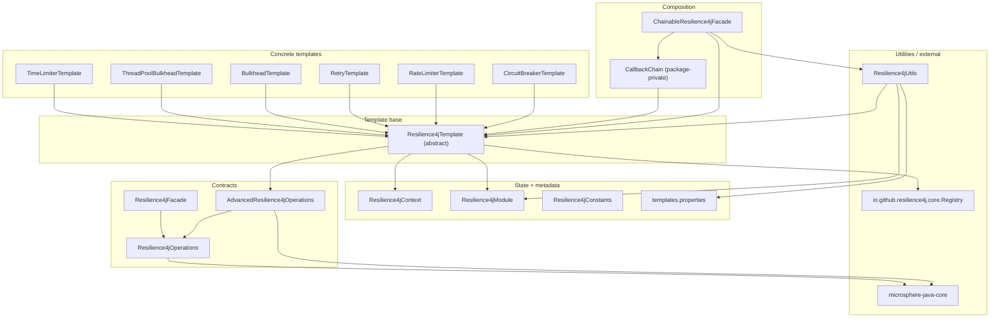
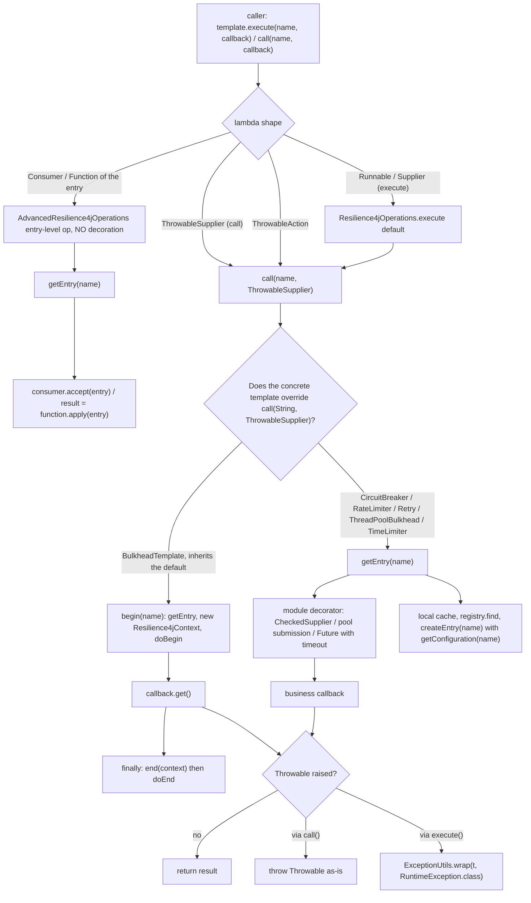
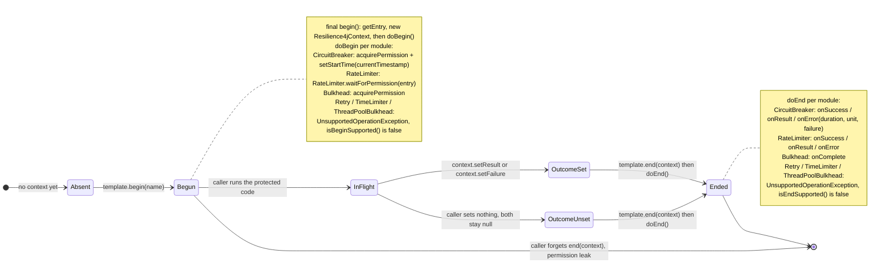
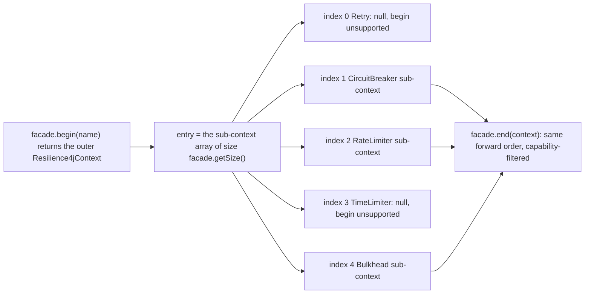
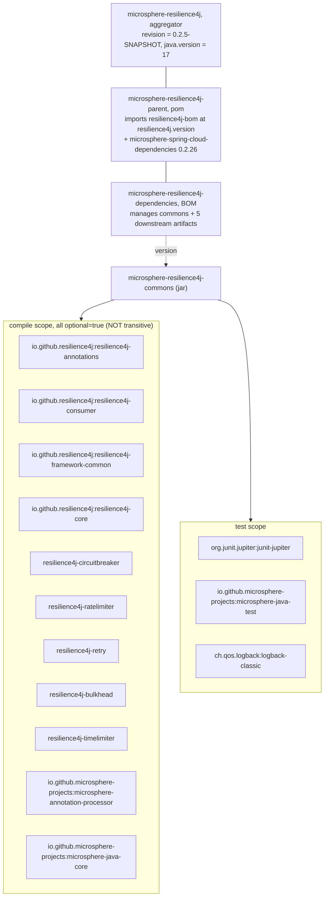

# microsphere-resilience4j-commons — Developer Guide

> Version line: `0.2.x` (source branch `release`) · latest release `0.2.4` · branch revision `0.2.5-SNAPSHOT`
> Resilience4j `2.0.0` – `2.4.0` (Maven profiles, default `2.4.0`) · built for JDK 17 (`17`/`21`/`25` in CI)
> This module has **no Spring dependency**; it depends on Resilience4j 2.x and `microsphere-java-core` only.
> ← [Developer Guide index](README.md) · [User Guide page](../user-guide/microsphere-resilience4j-commons.md)

All file paths below are relative to the module root `microsphere-resilience4j-commons/`, e.g.
`src/main/java/io/microsphere/resilience4j/common/Resilience4jTemplate.java`. Line numbers refer to the
`release` branch.

---

## 1. Responsibility

`microsphere-resilience4j-commons` is the bottom layer of the project. It turns the six independent
Resilience4j modules into one uniform, extensible programming model:

- one contract (`Resilience4jOperations` → `AdvancedResilience4jOperations`) for *execute a callback under
  one module's decoration*;
- one abstract template (`Resilience4jTemplate`) that owns a `Registry`, resolves named entries, caches them,
  exposes the two-phase `begin`/`end` lifecycle and adapts Resilience4j events;
- six concrete templates, one per module;
- one composable façade (`ChainableResilience4jFacade` + package-private `CallbackChain`) that wraps N modules
  around a single callback in priority order;
- one per-execution context object (`Resilience4jContext`) with a `ThreadLocal` binding;
- one metadata + reflection layer (`Resilience4jModule`, `Resilience4jConstants`,
  `META-INF/default/templates.properties`, `Resilience4jUtils`).

Everything above it — `microsphere-resilience4j-spring`, the plugins — consumes only these types. Nothing in
this module knows about Spring.

---

## 2. Package layout and class inventory

```
src/main/java/io/microsphere/resilience4j/
├── common/            contract + abstraction + composition + state + metadata
├── circuitbreaker/    CircuitBreakerTemplate
├── ratelimiter/       RateLimiterTemplate
├── retry/             RetryTemplate
├── bulkhead/          BulkheadTemplate, ThreadPoolBulkheadTemplate
├── timelimiter/       TimeLimiterTemplate
└── util/              Resilience4jUtils
src/main/resources/META-INF/default/templates.properties
```

### 2.1 `io.microsphere.resilience4j.common`

| Type | Kind | Visibility | One-line role |
|------|------|------------|---------------|
| `Resilience4jOperations<E>` | interface | public | Minimal contract: one-time `execute`/`call` overloads + two-phase `begin`/`end`. |
| `AdvancedResilience4jOperations<E, C, R>` | interface | public | Adds registry/config/entry management, raw-entry `Consumer`/`Function` operations, `Prioritized`, `Logger`. |
| `Resilience4jTemplate<E, C, R>` | abstract class | public | Registry-owning base template: entry resolution + local cache, `final begin/end` with `doBegin/doEnd` hooks, event registration, priority. |
| `Resilience4jContext<E>` | class | public (constructor `protected`) | Mutable per-execution state: entry name, entry, start time, result, failure, attributes, `ThreadLocal` binding. |
| `Resilience4jFacade` | interface | public | Marker: `Resilience4jOperations<Resilience4jContext[]>` — a facade whose "entry" is the array of sub-contexts. |
| `ChainableResilience4jFacade` | class | public | Facade implementation delegating to an ordered, de-duplicated list of `Resilience4jTemplate`s. |
| `CallbackChain<T>` | class | **package-private** | Iterator-style `ThrowableSupplier` that walks the template list, nesting each template's decoration around the remaining chain. |
| `Resilience4jModule` | enum | public | Metadata table of the six modules (entry/config/properties/event/registry classes + default aspect order) and `valueOf(Class)` lookup. |
| `Resilience4jConstants` | interface | public | `String` configuration-namespace constants (`microsphere.resilience4j.<module>.`). |

### 2.2 Template packages

| Type | Entry / Config / Registry triple | Notes |
|------|----------------------------------|-------|
| `circuitbreaker.CircuitBreakerTemplate` | `CircuitBreaker` / `CircuitBreakerConfig` / `CircuitBreakerRegistry` | Overrides `call` with `decorateCheckedSupplier`; implements `doBegin`/`doEnd` with duration tracking; 8 entry-event registration methods. |
| `ratelimiter.RateLimiterTemplate` | `RateLimiter` / `RateLimiterConfig` / `RateLimiterRegistry` | Overrides `call` with `RateLimiter.decorateCheckedSupplier`; `public doBegin` uses `RateLimiter.waitForPermission`; 3 event methods. |
| `retry.RetryTemplate` | `Retry` / `RetryConfig` / `RetryRegistry` | Overrides `call` with `Retry.decorateCheckedSupplier`; two-phase disabled; 4 event methods. |
| `bulkhead.BulkheadTemplate` | `Bulkhead` / `BulkheadConfig` / `BulkheadRegistry` | **Does not** override `call` → one-time ops run through `begin`/`end`; 3 event methods. |
| `bulkhead.ThreadPoolBulkheadTemplate` | `ThreadPoolBulkhead` / `ThreadPoolBulkheadConfig` / `ThreadPoolBulkheadRegistry` | Overrides `call` to submit to the bulkhead pool and block on `future.get()`, rethrowing the root cause; two-phase disabled; 3 event methods; package-private `getRootCause`. |
| `timelimiter.TimeLimiterTemplate` | `TimeLimiter` / `TimeLimiterConfig` / `TimeLimiterRegistry` | Overrides `call` with `decorateFutureSupplier` over an `ExecutorService` (default `ForkJoinPool.commonPool()`); two-phase disabled; 3 event methods; 4 constructors. |

### 2.3 `io.microsphere.resilience4j.util`

| Type | Role |
|------|------|
| `Resilience4jUtils` | `abstract class ... implements Utils` with a private constructor: reflective registry→template factories, entry lookup by reflection, `EventProcessor` adapters, default-template loading from `templates.properties`, template-list creation + ordering. |

### 2.4 Resource

`src/main/resources/META-INF/default/templates.properties` — the module-name → template-class table consumed by
`Resilience4jUtils.loadDefaultTemplates()`:

```properties
bulkhead = io.microsphere.resilience4j.bulkhead.BulkheadTemplate
thread-pool-bulkhead = io.microsphere.resilience4j.bulkhead.ThreadPoolBulkheadTemplate
circuit-breaker = io.microsphere.resilience4j.circuitbreaker.CircuitBreakerTemplate
rate-limiter = io.microsphere.resilience4j.ratelimiter.RateLimiterTemplate
retry = io.microsphere.resilience4j.retry.RetryTemplate
time-limiter = io.microsphere.resilience4j.timelimiter.TimeLimiterTemplate
```

Keys are exactly `Resilience4jModule.getName()` values — that is the join key between the enum and the
resource.

---

## 3. Layering



Dependency direction inside the module is strictly downward: contracts know nothing about templates,
templates know nothing about the facade, and `Resilience4jContext` is known by both but depends on neither.
The only upward edge is `Resilience4jUtils → concrete template classes`, and it is *reflective* (through
`templates.properties` + `ConstructorUtils.newInstance`), so the package graph stays acyclic at compile time.

---

## 4. Core flow: how `execute` / `call` delegate to `begin` / `end`

### 4.1 The single funnel

`Resilience4jOperations` defines six one-time overloads, but every one of them ends in the same method. The
interface defaults form a strict funnel:

```java
// Resilience4jOperations (source, abbreviated)
default void execute(String name, Runnable callback) {
    execute(name, () -> { callback.run(); return null; });          // -> Supplier
}

default <T> T execute(String name, Supplier<T> callback) {
    try {
        return call(name, callback::get);                           // -> ThrowableSupplier
    } catch (Throwable t) {
        throw wrap(t, RuntimeException.class);                      // unchecked façade
    }
}

default void call(String name, ThrowableAction callback) throws Throwable {
    call(name, () -> { callback.execute(); return null; });          // -> ThrowableSupplier
}

default <T> T call(String name, ThrowableSupplier<T> callback) throws Throwable {
    Resilience4jContext context = begin(name);                       // FIRST PHASE
    try {
        return callback.get();
    } finally {
        end(context);                                                // SECOND PHASE
    }
}
```

Four consequences that drive the whole design:

1. **`call(String, ThrowableSupplier)` is the extension point.** A subclass that overrides it replaces the
   decoration *and* skips `begin`/`end` for the one-time path. Five of the six templates do exactly that.
2. **`BulkheadTemplate` is the only template whose one-time path really runs `begin` → body → `end`**,
   because it does not override `call`.
3. **`execute` is the `RuntimeException` façade of `call`.** Both `execute` overloads re-enter `call` and
   convert the failure with `ExceptionUtils.wrap(t, RuntimeException.class)`, which returns the *same*
   instance when it is already a `RuntimeException` and otherwise constructs the target type. So
   `CallNotPermittedException` / `BulkFullException` are not double-wrapped, while a checked
   `TimeoutException` surfaces as a `RuntimeException` (or as the target type if it matches).
4. The `Class<TR>` variants of `call` add one more hop: they call the base `call` and re-`wrap` into
   `throwableClass`, which is how the tests assert `assertThrows(NULL_POINTER_EXCEPTION_CLASS, ...)`.

The default `call` never writes into the context it created — `begin()` … `end()` carry no result/failure
unless the caller sets them. This is coherent because the only template that uses the default path
(`BulkheadTemplate.doEnd`) just calls `bulkhead.onComplete()` and ignores both fields.

### 4.2 `Resilience4jTemplate`: `final` lifecycle + overridable hooks

`begin`/`end` are `final` (lines 271–292) so that cross-cutting steps cannot be forgotten by subclasses:

```java
@Override
public final Resilience4jContext<E> begin(String name) {
    E entry = getEntry(name);
    Resilience4jContext<E> context = new Resilience4jContext(name, entry);
    doBegin(context);
    logger.trace("begin() operation was executed -> ", context);
    return context;
}

protected void doBegin(Resilience4jContext<E> context) {
    throw create(UnsupportedOperationException.class, format("{} does not support begin operation", this.getClass()));
}

@Override
public final void end(Resilience4jContext<E> context) {
    doEnd(context);
    logger.trace("end() operation was executed -> {}", context);
}

protected void doEnd(Resilience4jContext<E> context) {
    throw create(UnsupportedOperationException.class, format("{} does not support end operation", this.getClass()));
}
```

Design points:

- **Fail-fast defaults.** The base hooks throw `UnsupportedOperationException`, so "not two-phase capable" is
  the default state. `RetryTemplate`, `TimeLimiterTemplate` and `ThreadPoolBulkheadTemplate` then only flip
  the *capability flags* (`isBeginSupported()`/`isEndSupported()` → `false`) and leave the hooks alone;
  `ChainableResilience4jFacade` consults those flags before calling `begin`/`end`.
  `AbstractResilience4jTemplateTest#testBegin` asserts both sides of this contract.
- **The per-entry context is created by `begin()`**, which is why `Resilience4jContext`'s constructor is
  `protected`: the type parameter `E` is bound to the entry, and the template guarantees non-null
  name + entry. Two other places construct one directly: `ChainableResilience4jFacade.begin()` builds the
  *outer* context (entry = the `Resilience4jContext[]` array), and `AbstractResilience4jTemplateTest#testEnd`
  fabricates one because that test lives in the same package.
- `getEntry(name)` is `final` too, so the local cache cannot be bypassed by a subclass.

### 4.3 Entry resolution and the local cache

```
getEntry(name)
  └─ getEntryFromCache(name)            // HashMap.get, when isLocalEntriesCached()
       └─ hit -> return
  └─ AdvancedResilience4jOperations.super.getEntry(name)
       ├─ registry.find(name) -> hit -> return
       └─ createEntry(name)
            └─ template-specific, always: registry.<entry>(name, getConfiguration(name))
                                             (bulkheads also pass registry.getTags())
```

`getConfiguration(name)` resolves a **named configuration** from the registry and silently falls back to
`getDefaultConfig()`. Because `createEntry` passes the *entry name* as the configuration name, "configure one
entry" means "register a configuration under the entry's name". This convention is the reason every test calls
`template.addConfiguration(entryName, entryConfig)` in `setUp()` before touching the entry.

`initLocalEntriesCache(name)` deliberately goes through `getEntry(name)` — i.e. it *creates and registers* the
entry as a side effect, which is what makes the later `HashMap` reads safe under concurrency (documented in the
class Javadoc: the `HashMap` is not thread-safe, and becomes effectively safe only when pre-populated at
initialization). `destroy()` → `clearLocalEntriesCache()`.

### 4.4 How each subclass decorates

| Template | Decoration performed by the override | Uses `begin`/`end` for one-time ops? |
|----------|-------------------------------------|--------------------------------------|
| `CircuitBreakerTemplate` | `circuitBreaker.decorateCheckedSupplier(callback::get).get()` | No (overrode `call`); `doBegin` = `acquirePermission()` + `setStartTime(getCurrentTimestamp())`; `doEnd` = `onSuccess/onResult/onError(duration, timestampUnit, …)` |
| `RateLimiterTemplate` | `RateLimiter.decorateCheckedSupplier(rateLimiter, callback::get).get()` | No; `doBegin` = `RateLimiter.waitForPermission(rateLimiter)`; `doEnd` = `onSuccess/onResult/onError` (no duration) |
| `RetryTemplate` | `Retry.decorateCheckedSupplier(retry, callback::get).get()` | No; two-phase explicitly unsupported |
| `BulkheadTemplate` | *inherits the interface default* | **Yes** — `doBegin` = `acquirePermission()`, `doEnd` = `onComplete()` |
| `ThreadPoolBulkheadTemplate` | `executeCallable(() -> ThrowableSupplier.execute(callback))` → `toCompletableFuture().get()` → rethrow `getRootCause(e)` | No; two-phase unsupported |
| `TimeLimiterTemplate` | `timeLimiter.decorateFutureSupplier(() -> executorService.submit(...)).call()`; the task converts `Throwable` via `wrap(t, Exception.class)` because `Callable` may only throw `Exception` | No; two-phase unsupported |

> `RateLimiterTemplate` and `RetryTemplate` reach the decorators through static imports
> (`decorateCheckedSupplier(rateLimiter, callback::get)`, `waitForPermission(rateLimiter)`); the table shows the
> class-qualified form for readability. `CircuitBreakerTemplate` genuinely uses the *instance* decorator
> (`circuitBreaker.decorateCheckedSupplier(...)`), which is why it resolves against the entry rather than the
> static helper.

Two subtle behaviours worth reviewing if you touch these classes:

- `ThreadPoolBulkheadTemplate` relies on `ThrowableSupplier.execute(callback)` (a `microsphere-java-core`
  default method) to turn any `Throwable` into a `RuntimeException` **inside** the pool thread, because
  `Callable` cannot throw checked exceptions. The outer `getRootCause` walk then strips
  `ExecutionException` *and* that wrapper, so the caller sees the original throwable. Side effect: a throwable
  that itself has a cause is reduced to its deepest cause.
- `CircuitBreakerTemplate.doEnd` reads `long startTime = context.getStartTime();` — an unboxing read. A context
  produced by `begin()` is safe (`doBegin` set it), but a caller-constructed context without `setStartTime(...)`
  would throw `NullPointerException`. The project's own test (`testEnd`) always sets the start time first.

### 4.5 Event plumbing

`Resilience4jTemplate` keeps two plumbing objects:

- `registryEventProcessor` — resolved once in the constructor via `Resilience4jUtils.getEventProcessor(registry)`
  (it must be an `EventProcessor`, else `IllegalArgumentException`);
- per-entry processors — resolved on demand by `getEventProcessor(entry)` inside
  `registerEntryEventConsumer(entryName, eventType, consumer)`.

Both funnel into one private method:

```java
private <T> Resilience4jTemplate<E, C, R> registerEventConsumer(EventProcessor eventProcessor,
                                                                Class<? super T> eventType, EventConsumer<T> eventConsumer) {
    String name = eventType.getName();
    eventProcessor.registerConsumer(name, eventConsumer);
    ...
}
```

i.e. consumers are registered under the **fully qualified event class name** — the key format Resilience4j's
`EventProcessor` expects. Note the side effect in `registerEntryEventConsumer(...)`: it starts with
`E entry = getEntry(entryName)`, so registering an entry-level consumer **creates and registers the entry**
(through `createEntry`, i.e. with `getConfiguration(entryName)`) and therefore fires the registry
`EntryAddedEvent` before the consumer is attached. Registering listeners is not a passive operation. Registry-lifecycle events are exposed as `final` methods
(`onEntryAddedEvent` / `onEntryRemovedEvent` / `onEntryReplacedEvent`), while module-specific events are
exposed by each concrete template through the `protected final registerEntryEventConsumer(...)`, giving the
catalogue: 8 (CircuitBreaker) + 3 (RateLimiter) + 4 (Retry) + 3 (Bulkhead) + 3 (ThreadPoolBulkhead) +
3 (TimeLimiter) = 24 registration methods, all fluent (`return this`).

`Resilience4jUtils.getEventProcessor(E)` is an `instanceof` dispatch chain over the six entry types and throws
`UnsupportedOperationException` for anything else — the reason the utility requires all six module artifacts
at runtime (see §11).

---

## 5. `ChainableResilience4jFacade`

### 5.1 Construction pipeline

Three constructors converge on one canonical form:

```
(Registry... registries) -> (Collection<Registry>) -> Resilience4jUtils.createTemplates(registries)
                                                            ├─ map keyed on the Registry instance (dedup)
                                                            ├─ Resilience4jUtils.createTemplate(registry)
                                                            └─ sort(Prioritized.COMPARATOR)  -> unmodifiable List
(List<Resilience4jTemplate>) -> manual loop, `effectiveTemplates.contains(template)` (identity dedup,
                                because Resilience4jTemplate does not override equals)
                                then sort(Prioritized.COMPARATOR)
```

`io.microsphere.lang.Prioritized.COMPARATOR` is a `Comparator<Object>`: it checks `instanceof Prioritized` on
both operands (a non-`Prioritized` side sorts *before* / equal, never throws) and otherwise delegates to
`Prioritized.compareTo`, which is `Integer.compare(this.getPriority(), that.getPriority())` — **ascending**, so
the smallest priority value ends up at index 0, i.e. becomes the *outer* wrapper. The `size` field is the
post-dedup count and is what `getSize()` and `begin()` (array allocation) use.

Watch the inverted constants when you hand-set a priority: `Prioritized.MAX_PRIORITY == Integer.MIN_VALUE` and
`MIN_PRIORITY == Integer.MAX_VALUE` (`NORMAL_PRIORITY == 0`). "Maximum priority" therefore sorts **first**, i.e.
it is the outermost template in the chain.

Because `createTemplates` builds a `HashMap` keyed on registries, ties in priority
(`BULKHEAD` = 4 and `THREAD_POOL_BULKHEAD` = 4) are resolved by hash iteration order; `List.sort` is stable,
so a tie is not a bug but is not deterministic either. Callers who care must `setPriority(...)`.

### 5.2 `call` — the composition engine

```java
@Override
public <T> T call(String name, ThrowableSupplier<T> callback) throws Throwable {
    CallbackChain<T> supplier = new CallbackChain<>(name, callback, this.templates);
    T result = supplier.get();
    ...
    return result;
}
```

Everything else on the facade is inherited: `execute(name, Runnable)`, `execute(name, Supplier)`,
`call(name, ThrowableAction)` and the `Class<TR>` variants all re-enter this method through the interface
defaults (§4.1). The facade implements only `Resilience4jOperations<Resilience4jContext[]>`, so
`getRegistry()`/`getEntry()`/raw-entry overloads are *not* part of its surface.

### 5.3 `begin` / `end` — the fan-out engine

```java
@Override
public Resilience4jContext<Resilience4jContext[]> begin(String name) {
    Resilience4jContext[] subContexts = new Resilience4jContext[size];
    Resilience4jContext<Resilience4jContext[]> context = new Resilience4jContext<>(name, subContexts);
    for (int i = 0; i < size; i++) {
        Resilience4jTemplate template = templates.get(i);
        if (template.isBeginSupported()) {
            subContexts[i] = template.begin(name);
        }
    }
    ...
}

@Override
public void end(Resilience4jContext<Resilience4jContext[]> context) {
    Resilience4jContext[] subContexts = context.getEntry();
    for (int i = 0; i < size; i++) {
        Resilience4jTemplate template = templates.get(i);
        if (template.isEndSupported()) {
            template.end(subContexts[i]);
        }
    }
}
```

The nesting trick: `Resilience4jFacade extends Resilience4jOperations<Resilience4jContext[]>`, so a facade
context's "entry" is literally the array of child contexts. That is the only place the type parameter carries
composition state; it also explains the `@SuppressWarnings`-free but unchecked `Resilience4jContext[]` raw
array.

Review notes (true of the current implementation, worth knowing before extending):

- `end()` runs in the **same forward order** as `begin()`, not LIFO. For symmetric teardown you would expect
  `for (i = size - 1; i >= 0; i--)`.
- `begin()` has no `try/catch`. If template *i* throws (e.g. `CallNotPermittedException` from a circuit
  breaker, `BulkFullException` from a bulkhead), the already-begun sub-contexts `0..i-1` are never returned to
  the caller and therefore can never be ended — permits acquired by the earlier templates leak. With the
  default priorities the risky modules happen to be ordered so that this rarely bites
  (Retry is skipped, then CircuitBreaker, RateLimiter, TimeLimiter, Bulkhead), but a custom
  `setPriority(...)` can reorder the fan-out and expose the leak.
- Unsupported templates leave `null` in `subContexts`; `end()` skips them via the same capability flag, so
  `null` slots are never dereferenced as long as `begin`/`end` flags do not change between the two calls.

---

## 6. `CallbackChain<T>`

Package-private, 20 effective lines, and the whole composition semantics live in `get()`:

```java
@Override
public T get() throws Throwable {
    if (pos < size) {
        Resilience4jTemplate template = templates.get(pos++);
        return (T) template.call(this.entryName, CallbackChain.this::get);
    }
    return delegate.get();
}
```

Properties a reviewer should note:

- **Cursor, not recursion by construction.** `pos++` advances once per template. Because the cursor is
  instance state, an *inner* template that re-executes the continuation (which `RetryTemplate` does on every
  retry attempt) re-runs only the *remaining* inner chain — the retry decorator retries the circuit breaker +
  rate limiter + time limiter + bulkhead + business logic, not itself. That is exactly the aspect-order
  semantics Resilience4j documents.
- **Single use.** A second pass through the same `CallbackChain` from the outer position would start with
  `pos == size` and jump straight to `delegate`; the chain is therefore per-`call`, which is how the facade
  uses it.
- **Unchecked cast.** `(T)` is needed because `Resilience4jTemplate` is used as a raw type in
  `List<Resilience4jTemplate>`; the type safety of the composition rests on `pos` ordering, not on generics.
- **Not thread-safe by design** (`pos` is a plain `int`), but each facade `call` creates a fresh instance, so
  no sharing occurs — unless you reuse a chain yourself.
- The chain terminates in `delegate.get()`, the user callback; every exception type therefore propagates
  through the decorator stack untouched, which is what makes `call(...)` on the facade a `throws Throwable`
  operation.

---

## 7. `Resilience4jContext`

| Aspect | Implementation | Consequence |
|--------|----------------|-------------|
| Identity | `final String entryName`, `final E entry` | the entry is fixed at `begin()`; for a facade the "entry" is the `Resilience4jContext[]` array |
| Timing | `Long startTime` (boxed, nullable) | only `CircuitBreakerTemplate.doBegin` sets it; `doEnd` unboxes it — NPE if you fabricate a context |
| Outcome | `Object result`, `Throwable failure` | written only by application code in two-phase usage; `doEnd` dispatches `onSuccess` / `onResult` / `onError` on them |
| Extension | `Map<String, Object> attributes`, created lazily by `getOrCreateAttributes()` | `getAttributes()` returns `Collections.emptyMap()` until the first write, then a *live* `unmodifiableMap` view; `removeAttributes()` clears but keeps the map |
| Thread binding | `static ThreadLocal<Resilience4jContext> contextHolder` + `withinContext()`, `getContext()`, `setContext()`, `removeContext()`, `doInContext(...)` | a single slot, not a stack: nested scopes overwrite. `doInContext` silently does nothing when unbound (proved by the final statement of `Resilience4jContextTest#testContext`) |
| Construction | `protected Resilience4jContext(String, E)` with `Assert.assertNotNull` on both arguments | production code obtains one from `begin()`; the same package and subclasses may build one directly — `AbstractResilience4jTemplateTest#testEnd` does exactly that to inject a fabricated `startTime` |

The class is intentionally dumb state: no Resilience4j type appears in its signature (`E` is unbounded), which
keeps `common` independent of the per-module packages and avoids a dependency cycle
(`context` ← `template` but not `context` → `module`).

---

## 8. Metadata layer: `Resilience4jModule` + `Resilience4jUtils`

`Resilience4jModule` is the module's only source of truth about Resilience4j's type graph. Each constant carries
`name`, `entryClass`, `configClass`, `configurationPropertiesClass` (a `resilience4j-framework-common`
`CommonProperties` subtype, used by the Spring layer), `eventClass`, `registryClass`, `defaultAspectOrder`:

| Constant | name | entry / config / registry | event | order |
|----------|------|---------------------------|-------|-------|
| `RETRY` | `retry` | `Retry` / `RetryConfig` / `RetryRegistry` | `RetryEvent` | 0 |
| `CIRCUIT_BREAKER` | `circuit-breaker` | `CircuitBreaker` / `CircuitBreakerConfig` / `CircuitBreakerRegistry` | `CircuitBreakerEvent` | 1 |
| `RATE_LIMITER` | `rate-limiter` | `RateLimiter` / `RateLimiterConfig` / `RateLimiterRegistry` | `RateLimiterEvent` | 2 |
| `TIME_LIMITER` | `time-limiter` | `TimeLimiter` / `TimeLimiterConfig` / `TimeLimiterRegistry` | `TimeLimiterEvent` | 3 |
| `BULKHEAD` | `bulkhead` | `Bulkhead` / `BulkheadConfig` / `BulkheadRegistry` | `BulkheadEvent` | 4 |
| `THREAD_POOL_BULKHEAD` | `thread-pool-bulkhead` | `ThreadPoolBulkhead` / `ThreadPoolBulkheadConfig` / `ThreadPoolBulkheadRegistry` | `BulkheadEvent` | 4 |

`valueOf(Class)` is a linear scan in declaration order over five assignable checks; first match wins, otherwise
`IllegalArgumentException`. Note that `THREAD_POOL_BULKHEAD` reuses `BulkheadEvent` (Resilience4j models
thread-pool bulkhead events as `BulkheadEvent`), so `valueOf(BulkheadEvent.class)` returns `BULKHEAD`.

`Resilience4jUtils` adds two reflective caches, both `private static final` and populated during class
initialization. Only one of them is actually immutable: `getEntryMethodsCache` is wrapped with
`Collections.unmodifiableMap(...)` in the static block, while `defaultTemplates` is the plain
`newFixedHashMap(...)` returned by `loadDefaultTemplates()` — the reference cannot change, the map can (it is
private, so nothing outside the class mutates it).

1. `defaultTemplates : Map<Resilience4jModule, Class<? extends Resilience4jTemplate>>`, loaded from
   `META-INF/default/templates.properties` through `ClassLoaderUtils.getClassLoader(Resilience4jTemplate.class)`
   and `loadClass(...)`. One entry per enum constant, keyed by `module.getName()`. Missing resource →
   `RuntimeException`; missing/renamed class → class-loading failure.
2. `getEntryMethodsCache : Map<Resilience4jModule, Method>`, built with
   `decapitalize(entryClass.getSimpleName())` + `findMethod(registryClass, methodName, String.class, configClass)`
   — i.e. `circuitBreaker(String, CircuitBreakerConfig)`, `retry(String, RetryConfig)`,
   `bulkhead(String, BulkheadConfig)`, `threadPoolBulkhead(String, ThreadPoolBulkheadConfig)`, …
   `Resilience4jUtils.getEntry(registry, name[, config])` then invokes that cached `Method`; a reflective failure
   is rethrown as `IllegalArgumentException`.

`createTemplate(R)` is the factory used by `createTemplates(Collection<Registry>)`:
`newInstance(defaultTemplates.get(module), registry)` — which is why every concrete template must keep a public
single-argument `(registry)` constructor. `createTemplates` returns `Collections.unmodifiableList(...)` of the
sorted templates.

**Initialization coupling to be aware of:** because both maps are built for *all six* enum constants, touching
`Resilience4jUtils` (directly, or via `new ChainableResilience4jFacade(Registry...)`) pulls in every
Resilience4j module artifact and `resilience4j-framework-common`. Instantiating `CircuitBreakerTemplate` by
hand does not.

---

## 9. Design patterns present in this module

| Pattern | Evidence in source | Why it is used here |
|---------|--------------------|---------------------|
| **Template Method** | `Resilience4jTemplate` with `final begin()/end()` + `protected doBegin()/doEnd()`; `AdvancedResilience4jOperations.getEntry()` (skeleton) calling the abstract `createEntry()` | The lifecycle order (resolve entry → wrap in context → per-module hook) is fixed; only the module-specific step varies. Making `begin`/`end` final is what prevents subclasses from forgetting cache/context steps. |
| **Strategy (per-module decoration)** | `call(String, ThrowableSupplier)` overridden by 5 templates, left as the default for `BulkheadTemplate` | Each module needs a different decoration primitive (`decorateCheckedSupplier`, `waitForPermission`+`onComplete`, pool submission, `Future` timeout) behind one contract. |
| **Facade** | `Resilience4jFacade` (marker) + `ChainableResilience4jFacade` | Application code should ask for "one resilient call", not for six registries. The facade hides dedup, ordering and the sub-context array. |
| **Chain of Responsibility** | `CallbackChain.get()` advancing `pos` and passing `CallbackChain.this::get` as the continuation to each handler | Nesting N decorators without hand-written lambdas; the "next" link is the remaining chain, which is also what makes re-entrant handlers (Retry) work. |
| **Composite / transparent component** | `ChainableResilience4jFacade implements Resilience4jFacade extends Resilience4jOperations<Resilience4jContext[]>` | A facade *is* an operation, so `execute`/`call`/`begin`/`end` compose recursively; a facade could wrap another facade's template list. |
| **Registry adapter / delegation** | `Resilience4jTemplate.registry` field + `AdvancedResilience4jOperations` default methods (`find`, `remove`, `replace`, `addConfiguration`) | The module adapts Resilience4j's `Registry` to a typed, named-configuration-aware, cached API instead of re-implementing storage. |
| **Observer (two levels)** | `registryEventProcessor`, `registerEntryEventConsumer(...)`, the 24 `onXxxEvent(...)` methods | Resilience4j publishes events through `EventPublisher`/`EventProcessor`; the templates expose them as fluent, typed registrations. |
| **Flyweight-ish local cache + lazy init** | `localEntriesCache` (`HashMap`), `createLocalEntriesCache()`, `initLocalEntriesCache(...)`, `clearLocalEntriesCache()` | Avoids repeated registry lookups on hot paths while keeping a documented thread-safety contract. |
| **Metadata enum / table-driven design** | `Resilience4jModule` + `templates.properties` + `getEntryMethodsCache` | One place declares "what a module is"; reflection-based lookups (`valueOf`, cached `Method`s) replace `switch`/`if` ladders in the utility layer. |
| **Null Object–ish capability flags** | `isBeginSupported()` / `isEndSupported()` defaults + `UnsupportedOperationException` hooks | Lets `ChainableResilience4jFacade.begin/end` skip modules generically instead of special-casing three of them. |
| **Factory Method / reflective factory** | `createEntry(String)` (per template) and `Resilience4jUtils.createTemplate(R)` | Entry creation needs the module's own registry call; template creation needs the properties-driven class table. |
| **Adapter** | `Resilience4jUtils.getEventProcessor(...)`, `asEventProcessor(EventPublisher)`; `ExceptionUtils.wrap`/`create` usage | Converts Resilience4j's `EventPublisher` and throwable shapes into what the templates consume. |
| **Thread-bound context** | `Resilience4jContext.contextHolder` + `withinContext()`/`doInContext()` | Gives downstream layers (Spring AOP, plugins) an implicit current-execution handle. |

Note what is *not* used: no DI framework, no annotation processing at runtime, no `ServiceLoader` for the
templates (`templates.properties` is the extension registry instead).

---

## 10. Flow diagrams

### 10.1 (a) Single-template execution path



### 10.2 (b) Chainable facade execution path

`ChainableResilience4jFacadeTest` / `Resilience4jTestUtils.createChainableResilience4jFacade()` builds five
distinct registries (bulkhead, rate limiter, time limiter, retry, circuit breaker), which after dedup +
priority sort produce the chain below.

```mermaid
sequenceDiagram
    autonumber
    participant App as Application
    participant F as ChainableResilience4jFacade
    participant C as CallbackChain - pos cursor
    participant R as RetryTemplate - priority 0
    participant CB as CircuitBreakerTemplate - 1
    participant RL as RateLimiterTemplate - 2
    participant TL as TimeLimiterTemplate - 3
    participant BH as BulkheadTemplate - 4
    participant Biz as business ThrowableSupplier

    App->>F: call(name, callback) throws Throwable
    F->>C: new CallbackChain(name, callback, templates)
    C->>R: get() -> templates[0].call(name, CallbackChain::get)
    R->>R: Retry.decorateCheckedSupplier(retry, inner)
    R->>C: inner.get()   (pos = 1)
    C->>CB: templates[1].call(name, CallbackChain::get)
    CB->>CB: circuitBreaker.decorateCheckedSupplier(inner), acquirePermission
    CB->>C: inner.get()  (pos = 2)
    C->>RL: templates[2].call(name, CallbackChain::get)
    RL->>RL: RateLimiter.decorateCheckedSupplier(inner)
    RL->>C: inner.get()  (pos = 3)
    C->>TL: templates[3].call(name, CallbackChain::get)
    TL->>TL: submit to ExecutorService + timeout
    TL->>C: inner.get()  (pos = 4)
    C->>BH: templates[4].call(name, CallbackChain::get)
    Note over BH: BulkheadTemplate does not override call<br/>= begin(name) -> doBegin(acquirePermission)<br/>-> end(context) -> doEnd(onComplete)
    BH->>C: inner.get()  (pos = 5)
    C->>Biz: delegate.get()
    Biz-->>C: result (or Throwable)
    C-->>App: result propagates back out through every decorator

    Note over R,C: On a retryable failure the retry decorator re-invokes inner.get();<br/>pos already advanced, so only the INNER chain (CB -> RL -> TL -> BH -> Biz) re-runs.
```

### 10.3 (c) `begin` / `end` context lifecycle



And the facade-level nesting (one outer context whose "entry" is the array of child contexts, `null` where the
module does not support the phase):



---

## 11. Module dependencies (from `microsphere-resilience4j-commons/pom.xml`)



Facts worth repeating to consumers:

- The parent (`microsphere-resilience4j-parent`) imports `io.github.resilience4j:resilience4j-bom` with
  `${resilience4j.version}`; the five profiles `resilience4j-2.0` … `resilience4j-2.4` only set that property,
  and `resilience4j-2.4` (2.4.0) is `activeByDefault`.
- No dependency in the commons `pom.xml` carries an explicit `<version>` — versions come entirely from the
  parent's imported BOMs.
- Every compile dependency is `optional`, so downstream applications must declare their own Resilience4j and
  `microsphere-java-core` dependencies (see the User Guide §2).
- `microsphere-annotation-processor` is the build-time annotation processor for the `@Nonnull` / `@Nullable`
  contracts used across the module; it is optional and not needed at runtime.
- The code uses `io.microsphere.logging.Logger` / `LoggerFactory` (a microsphere logging façade) instead of a
  concrete SLF4J/Logback binding; `logback-classic` appears only in test scope.

---

## 12. Build notes

```bash
# from the repository root (aggregator pom, revision = 0.2.5-SNAPSHOT)
./mvnw clean install                        # Resilience4j 2.4.0 (profile resilience4j-2.4 is activeByDefault)
./mvnw clean install -P resilience4j-2.0    # or -2.1 / -2.2 / -2.3

# this module only
./mvnw -pl microsphere-resilience4j-commons -am clean test

# what CI runs (matrix, .github/workflows/maven-build.yml)
mvn --batch-mode --update-snapshots --file pom.xml -Drevision=0.0.1-SNAPSHOT test \
    --activate-profiles test,coverage,spring-cloud-2025,resilience4j-2.4
# java: 17 | 21 | 25   ×   spring-cloud-2022..2025   ×   resilience4j-2.0..2.4
```

- **Version handling:** the reactor uses `${revision}` (`0.2.5-SNAPSHOT`) declared in the aggregator
  `pom.xml`; released versions on this line are `0.2.0` – `0.2.4` (git tags `0.2.0`…`0.2.4`; `release-notes.md`
  narrates `v0.2.1` and `v0.2.2` only). Published POMs are expected to be
  flattened by the upstream parent (`microsphere-spring-cloud-parent` `0.2.26`), so `${revision}` never leaks
  into the deployed POM.
- **Java level:** `<java.version>17</java.version>` in the aggregator. The module's main sources are Java-8-ish
  apart from the generic signatures, but the test sources use Java 14+ constructs (multi-label
  `case RETRY, TIME_LIMITER, THREAD_POOL_BULKHEAD:` in `AbstractResilience4jTemplateTest`), and the reactor
  compiles and runs against 17/21/25.
- **Cross-version discipline:** the source must compile and the tests pass under every `resilience4j-2.x`
  profile. Anything that breaks that rule (e.g. an API introduced in 2.3 only) needs a reflective or
  capability-guarded implementation, as `Resilience4jUtils` already does for registry `getXxx(String, Config)`
  lookups.
- **Resources:** the only main resource is `META-INF/default/templates.properties`; there are no
  `src/test/resources` files in this module (logging during tests comes from `logback-classic` defaults).
- **Publishing** uses the `publish,ci` profiles (`.github/workflows/maven-publish.yml`, JDK 17).

---

## 13. Test architecture (the contract test)

`src/test/java/io/microsphere/resilience4j/common/AbstractResilience4jTemplateTest<E, C, R, RT>` is the
template contract that all six template tests inherit. Reading it is the fastest way to understand the
intended semantics:

- It resolves its four type arguments reflectively from the concrete subclass'
  `getGenericSuperclass()`, then builds the registry via `invokeStaticMethod(registryClass, "ofDefaults")` and
  the template via `ConstructorUtils`-style reflection — randomly picking `(registry)` or
  `(registry, false)` (`new Random().nextBoolean()`), so both cache modes are exercised across runs.
- `setUp()` calls `template.addConfiguration(entryName, entryConfig)`, which is the canonical way to bind a
  configuration to an entry name (§4.3).
- Generic tests cover every overload pair (`execute` × `Runnable`/`Supplier`/`Consumer`/`Function`,
  `call` × `ThrowableAction`/`ThrowableSupplier`/`ThrowableConsumer`/`ThrowableFunction`, each with the
  `Class<TR>` variants), the capability matrix (`testIsBeginSupported`, `testIsEndSupported` switch on the
  module), `testBegin`/`testEnd` (including the `UnsupportedOperationException` branch), the cache
  (`testLocalEntriesCache`), registry lifecycle events (`testEntriesAndEvents` for ADDED / REPLACED / REMOVED),
  and priority (`testPriority`: `getPriority() == module.getDefaultAspectOrder()`, then `setPriority(1)`).
- `tearDown()` calls `template.destroy()` after a `preDestroy()` hook — `TimeLimiterTemplateTest` uses it to
  shut its `ExecutorService` down, and `TimeLimiterTemplateTest` also overrides `createTemplate(...)` to inject
  the custom `ExecutorService`.
- `io.microsphere.resilience4j.test.Resilience4jTestUtils` (test scope only, therefore **not** published)
  builds a nine-registry `ChainableResilience4jFacade` that collapses to five templates; every example in the
  guides that mentions a five-template facade derives from it.

---

## 14. How to extend

**Add a resilience capability (a seventh module):**

1. Add the enum constant to `Resilience4jModule` with `name`, entry, config, `CommonProperties` subclass,
   event class, registry class and an aspect order. Remember `valueOf(Class)` is first-match-wins, so place the
   constant accordingly if it shares an event type.
2. Add `name = fully.qualified.TemplateClass` to `META-INF/default/templates.properties` — the key must equal
   `Resilience4jModule#getName()`.
3. Implement the template: `extends Resilience4jTemplate<Entry, Config, Registry>` with public
   `(registry)` and `(registry, boolean)` constructors (the latter is required for cache-less construction and
   for `AbstractResilience4jTemplateTest`), implement `createEntry(name)` via
   `registry.<entry>(name, getConfiguration(name))`, optionally override `call(String, ThrowableSupplier)` and
   `doBegin`/`doEnd` (and flip `isBeginSupported`/`isEndSupported` if the module cannot be split).
4. Add a `getEventProcessor(Entry)` overload and a branch to the `instanceof` chain in
   `Resilience4jUtils.getEventProcessor(E)` — without it, `registerEntryEventConsumer(...)` (and therefore every
   `onXxxEvent(...)` method) throws `UnsupportedOperationException` for the new entry type. Template construction
   itself does **not** depend on this chain: the constructor uses the `getEventProcessor(Registry)` overload,
   which only casts `registry.getEventPublisher()` to `EventProcessor`.
5. Add the artifact to `microsphere-resilience4j-commons/pom.xml` as an optional dependency and to the
   parent/`resilience4j-bom` import if it is not already managed.
6. Extend `Resilience4jModuleTest` and a subclass of `AbstractResilience4jTemplateTest`.

**Consume the module without Spring:** build a registry (or several), instantiate templates or
`Resilience4jUtils.createTemplates(...)`, register named configurations before the first `getEntry`, then use
`ChainableResilience4jFacade`. Nothing else is required at runtime apart from the Resilience4j modules you
actually touch — plus all six if you touch `Resilience4jUtils` (§8).

---

## 15. Implementation quirks noted while reading the source

Recorded here because they affect future changes (all verified against `release`):

1. `Resilience4jTemplate.begin()` logs `logger.trace("begin() operation was executed -> ", context)` — the
   format string has no `{}` placeholder, so the context is dropped from the message. `end()` logs correctly.
2. `ChainableResilience4jFacade.end()` logs `"end() operations of {} templates were executed -> {}"` with a
   single argument, so the placeholder count and argument count do not line up.
3. `ChainableResilience4jFacade.begin()` allocates `new Resilience4jContext[size]` (raw array) and `end()`
   unwinds in the same forward order rather than LIFO (§5.3).
4. `Resilience4jModule.THREAD_POOL_BULKHEAD` has `defaultAspectOrder == 4`, identical to `BULKHEAD`, while the
   Resilience4j aspect-order documentation implies a distinct rank for the thread-pool bulkhead. Ties are
   resolved by (stable) sort order.
5. `RateLimiterTemplate.doBegin` is declared `public`, widening the base class' `protected` hook — the only
   such widening in the module.
6. `Resilience4jTemplate` assigns a raw `new Resilience4jContext(name, entry)` to `Resilience4jContext<E>`, and
   `CallbackChain` casts `(T)` — the generic safety of the composition rests on runtime ordering.
7. `AdvancedResilience4jOperations` overloads `execute`/`call` with entry-level `Consumer`/`Function` variants
   that perform **no** decoration; an accidental `entry -> ...` lambda silently bypasses the module. Worth a
   guard or clearer naming if the API is ever revised (a breaking change requires a new release line).
8. The default `call(String, ThrowableSupplier)` never records `result`/`failure` in the context it creates
   (§4.1), so any future template that relies on `doEnd` reading those fields via the *default* one-time path
   would silently report success. `CircuitBreakerTemplate` and `RateLimiterTemplate` avoid this by overriding
   `call`.

---

## 16. References

- User Guide for this module: [../user-guide/microsphere-resilience4j-commons.md](../user-guide/microsphere-resilience4j-commons.md)
- Developer Guide index: [README.md](README.md) · 中文: [zh/README.md](zh/README.md)
- Resilience4j aspect order: <https://resilience4j.readme.io/docs/getting-started-3#aspect-order>
- Sources: `microsphere-resilience4j-commons/src/{main,test}/java/io/microsphere/resilience4j/**`,
  `microsphere-resilience4j-commons/pom.xml`, `microsphere-resilience4j-parent/pom.xml`,
  `.github/workflows/maven-build.yml`
