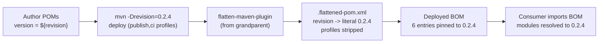

# microsphere-resilience4j-dependencies — Developer Guide

> Version line `0.2.x` (`release` branch) · `${revision}` = `0.2.5-SNAPSHOT` · latest release `0.2.4` · manages **6** artifacts · JDK **17+** · [← guide index](README.md)

This page documents how the BOM `microsphere-resilience4j-dependencies` is authored, what it manages, and how the `${revision}` placeholder is resolved (flattened) when the BOM is published.

## Coordinates and position

```
microsphere-resilience4j (reactor root, ${revision})
  └── microsphere-resilience4j-parent (${revision})   <-- BOM's parent
          └── microsphere-resilience4j-dependencies (${revision}, packaging pom)  <-- the BOM
```

The BOM declares `<parent>` = `microsphere-resilience4j-parent` (`relativePath ../microsphere-resilience4j-parent/pom.xml`). Because it inherits that parent, the BOM also inherits every imported framework BOM (`microsphere-spring-cloud-dependencies:0.2.26`, `-alibaba-druid-dependencies:0.2.20`, `-mybatis-dependencies:0.2.16`, `-hibernate-dependencies:0.2.10`, `-redis-dependencies:0.2.14`) and the Resilience4j version profiles. Its **own** `<dependencyManagement>`, however, only adds the six first-party artifacts below.

## Managed artifacts (complete, verified list)

All six entries use `<version>${revision}</version>` — i.e. they are pinned to the release version of the reactor itself. Exact content of `microsphere-resilience4j-dependencies/pom.xml`:

| # | groupId | artifactId | version |
|---|---------|-----------|---------|
| 1 | `io.github.microsphere-projects` | `microsphere-resilience4j-commons` | `${revision}` |
| 2 | `io.github.microsphere-projects` | `microsphere-resilience4j-alibaba-druid` | `${revision}` |
| 3 | `io.github.microsphere-projects` | `microsphere-resilience4j-openfeign` | `${revision}` |
| 4 | `io.github.microsphere-projects` | `microsphere-resilience4j-mybatis` | `${revision}` |
| 5 | `io.github.microsphere-projects` | `microsphere-resilience4j-spring-web` | `${revision}` |
| 6 | `io.github.microsphere-projects` | `microsphere-resilience4j-spring` | `${revision}` |

### Artifacts deliberately absent from the BOM

| Artifact | In reactor? | In BOM? | Note |
|----------|-------------|---------|------|
| `microsphere-resilience4j-hibernate-core` | yes (under `plugins`) | **no** | third-party Hibernate is managed by `microsphere-hibernate-dependencies:0.2.10`, but the *plugin* coordinate is not managed here — consumers must set its version |
| `microsphere-resilience4j-plugins` | yes (aggregator) | **no** | a `pom` aggregator, not a consumable dependency |
| `microsphere-resilience4j-spring-boot` | yes | **no** | placeholder — see [its dev page](microsphere-resilience4j-spring-boot.md) |
| `microsphere-resilience4j-spring-cloud` | yes | **no** | placeholder — see [its dev page](microsphere-resilience4j-spring-cloud.md) |

If you add a new first-party module, remember to add its `${revision}` entry here or its version will not be managed.

## How `${revision}` is resolved (CI-friendly version + flatten)

The project uses the Maven "CI-friendly version" pattern: every module version is `${revision}`, defined once in the reactor root (`<revision>0.2.5-SNAPSHOT</revision>`), and overridden at release time with `-Drevision=…` (see the publish workflow: `./mvnw -Drevision=${{ inputs.revision }} … deploy`). The problem this creates is that a raw POM published with a literal `${revision}` would be unusable by consumers — Maven cannot resolve a property from the *importing* project. The fix is the **flatten-maven-plugin**, inherited from the `microsphere-spring-cloud-parent:0.2.26` grandparent, which rewrites each POM (substituting `${revision}`, dropping profiles, resolving `${project.scm.url}` etc.) into a `.flattened-pom.xml` that is what actually gets deployed.

Evidence (repo root `.flattened-pom.xml`, generated by the flatten run): `<version>` and `<properties><revision>` appear as **literal** values (`0.2.4-SNAPSHOT` in that captured run) rather than `${revision}`, and `<profiles>` are stripped — exactly the flatten output shape.



For the BOM specifically, flattening turns each `${revision}` entry into the concrete release version, so a consumer importing `microsphere-resilience4j-dependencies:0.2.4` receives six artifacts all pinned to `0.2.4` — with no `${revision}` left dangling.

### Why the reactor version is `0.2.5-SNAPSHOT` after `0.2.4`

The publish workflow bumps the root `<revision>` to `<major>.<minor>.<patch+1>-SNAPSHOT` immediately after a release (`sed` on the `<revision>` element in `pom.xml`). Released artifacts on this line are `0.2.0`–`0.2.4`; the working tree / `release` snapshot therefore carries `0.2.5-SNAPSHOT`.

## Consumer override mechanics (dev reminder)

A consumer can override any single managed coordinate by declaring their own `<dependencyManagement>` entry **before** the BOM `<scope>import</scope>`, or by putting an explicit `<version>` on the dependency. Only artifacts actually listed in this BOM are overridable "for free"; `microsphere-resilience4j-hibernate-core` must always be version-stated because it is not managed here. See the [user guide page](../user-guide/microsphere-resilience4j-dependencies.md) for snippets.

## Verifying the managed list yourself

The list above was read directly from the source. To re-derive it (or check a newer release), grep the `<artifactId>` lines inside the BOM's `<dependencyManagement>`:

```bash
# from the repository root
sed -n '/<dependencyManagement>/,/<\/dependencyManagement>/p' \
    microsphere-resilience4j-dependencies/pom.xml \
  | grep '<artifactId>'
```

You should see exactly the six first-party artifactIds and nothing else — the count is a quick regression check when adding a module. If a new module is added to the reactor but not to this block, it will silently fall out of BOM management (the same situation as the Hibernate plugin today).

## Version facts verified from source

| Fact | Value | Where read |
|------|-------|-----------|
| BOM packaging | `pom` | `microsphere-resilience4j-dependencies/pom.xml` |
| Managed first-party artifacts | 6 (all `${revision}`) | same file |
| `revision` property | `0.2.5-SNAPSHOT` | reactor root `pom.xml` |
| Latest release | `0.2.4` | reactor / `.flattened-pom.xml` |
| Flatten plugin owner | `microsphere-spring-cloud-parent:0.2.26` | inherited grandparent |
| JDK | `17` (`java.version`) | reactor root `pom.xml` |
