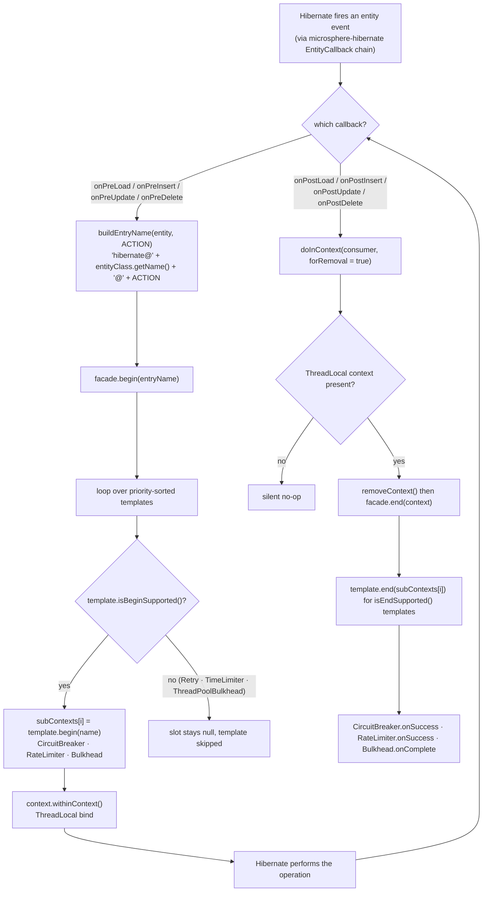
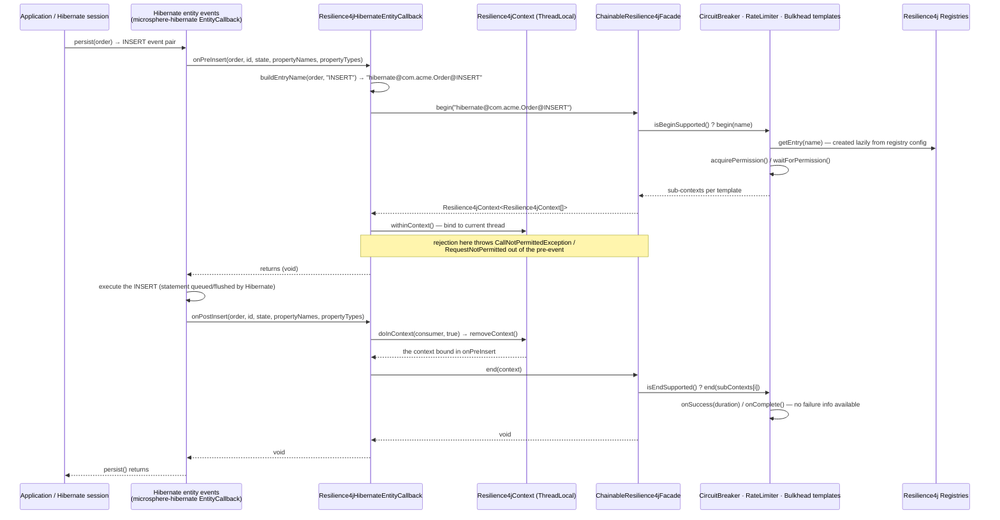
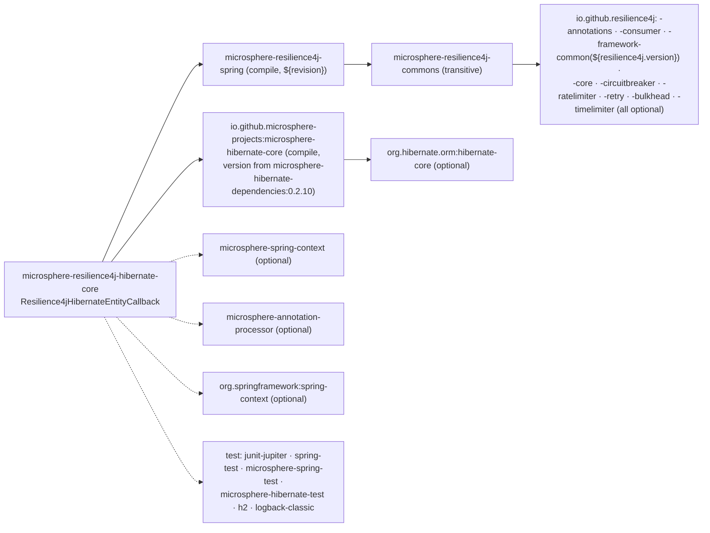

# microsphere-resilience4j-hibernate-core — Developer Guide

> Version line `0.2.x` (`release` branch) · latest release `0.2.4` · current `${revision}` = `0.2.5-SNAPSHOT` · Resilience4j **2.0.0 – 2.4.0** (default `2.4.0`) · Spring Cloud 2022.0.x – 2025.0.x · JDK **17+** · [← developer guide index](README.md)

Module path: `microsphere-resilience4j-plugins/microsphere-resilience4j-hibernate-core`.

## Class inventory

The complete file list of the module (verified by listing the directory — there is nothing else):

| Type / file | Role |
|-------------|------|
| `src/main/java/io/microsphere/resilience4j/hibernate/Resilience4jHibernateEntityCallback.java` | The only production class: `implements io.microsphere.hibernate.entity.EntityCallback`; eight `@Override` lifecycle callbacks + `buildEntryName`; constants `DEFAULT_ENTRY_NAME_PREFIX = "hibernate@"` |
| `src/test/java/io/microsphere/resilience4j/hibernate/Resilience4jHibernateEntityCallbackTest.java` | `class Resilience4jHibernateEntityCallbackTest extends AbstractHibernateH2Test` — **declares no test methods** (empty body) |
| `pom.xml` | parent `microsphere-resilience4j-parent` (`relativePath ../../microsphere-resilience4j-parent/pom.xml`), packaging `jar`, version `${revision}`, name `Microsphere :: Resilience4j :: Plugins :: Hibernate Core` |

**Absent, deliberately:** no `src/main/resources` directory at all, hence **no `META-INF/spring.factories`**, and **no `Resilience4jPlugin` implementation**. This is the structural difference from the sibling plugins (`alibaba-druid`, `mybatis`, `spring-web` each ship `META-INF/spring.factories` and a `*Resilience4jPlugin` class).

## How the Hibernate entity-callback extension point is used

The extension point belongs to `io.github.microsphere-projects:microsphere-hibernate-core`, not to this repository. From this module's source we can verify the contract it exposes with certainty, because every implemented method carries `@Override` — so `EntityCallback` declares at least these eight methods, with these exact signatures:

```java
void onPreLoad (Object entity, Object id, Object[] state, String[] propertyNames, Type[] types);
void onPostLoad(Object entity, Object id,                String[] propertyNames, Type[] types);
void onPreInsert (Object entity, Object id, Object[] state, String[] propertyNames, Type[] propertyTypes);
void onPostInsert(Object entity, Object id, Object[] state, String[] propertyNames, Type[] propertyTypes);
void onPreUpdate (Object entity, Object id, Object[] state, String[] propertyNames, Type[] propertyTypes);
void onPostUpdate(Object entity, Object id, Object[] state, String[] propertyNames, Type[] propertyTypes);
void onPreDelete (Object entity, Object id, Object[] state, String[] propertyNames, Type[] types);
void onPostDelete(Object entity, Object id, Object[] state, String[] propertyNames, Type[] types);
```

Observations that matter when you extend or reuse the class:

- The callback argument tuple (`entity`, `id`, `state`, `propertyNames`, `types`) is Hibernate's per-entity event data, with `Type` imported from `org.hibernate.type` — the only Hibernate type this module compiles against, which is why `org.hibernate.orm:hibernate-core` is a compile-time but `optional` dependency.
- The extension point gives **no return value and no thrown-exception channel** on the post events, and `onPostLoad` is missing the `state` array. That single fact dictates the whole design: the plugin cannot learn whether the operation succeeded, so it cannot report failures (see “Failure reporting is structurally impossible” below).
- The class implements the interface *directly* (no adapter, no anonymous listener, no Hibernate `Integrator`/`EventListener` registration code in this module). Dispatching the callback is entirely the host stack's job.

### Two-phase mapping

`Resilience4jFacade` extends `Resilience4jOperations<Resilience4jContext[]>`, whose two-phase operations are `begin(name)` / `end(context)`. The plugin splits them across the event pair and uses `Resilience4jContext`'s `ThreadLocal` as the carrier:

```java
// pre-event (LOAD / INSERT / UPDATE / DELETE)
String entryName = buildEntryName(entity, "INSERT");                       // "hibernate@<class>@INSERT"
Resilience4jContext<Resilience4jContext[]> begin = this.facade.begin(entryName);
begin.withinContext();                                                     // Resilience4jContext.setContext(this)

// post-event
doInContext(contextt -> this.facade.end(contextt), true);                  // static import of Resilience4jContext.doInContext
```

`withinContext()` is `Resilience4jContext.setContext(this)`; `doInContext(consumer, true)` resolves to:

```java
public static void doInContext(Consumer<Resilience4jContext> contextConsumer, boolean forRemoval) {
    Resilience4jContext context = forRemoval ? removeContext() : getContext();   // remove = get + ThreadLocal.remove()
    if (context != null) {
        contextConsumer.accept(context);
    }
}
```

Hence three properties of the implementation, all readable without running it:

| Property | Mechanism |
|----------|-----------|
| Post-event without a preceding pre-event on the same thread is a **no-op**, not an error | `doInContext` skips the consumer when `removeContext()` returns `null` |
| `end()` always runs against the **most recently begun** context | the `ThreadLocal` holds a single value; the pre-event overwrote whatever was there |
| A skipped post-event **leaks** the bound context | nothing else calls `removeContext()` on that thread |

The local variable is named `begin` and the lambda parameter `contextt` (double `t`) in the source; both are cosmetic, but reproduce them if you diff against upstream.

### What actually executes inside `begin`/`end`

`ChainableResilience4jFacade.begin(name)` builds `Resilience4jContext<Resilience4jContext[]>` whose entry is a `size`-long array of sub-contexts, and only fills slots whose template answers `isBeginSupported()`. `end(context)` mirrors it with `isEndSupported()`. Combined with the templates' own answers:

| Template | `isBeginSupported` / `isEndSupported` | Effect on this plugin |
|----------|--------------------------------------|------------------------|
| `CircuitBreakerTemplate` | `true` (overrides `doBegin`/`doEnd`) | `acquirePermission()` in pre-event; `getCurrentTimestamp()` recorded as `startTime`; `onSuccess/onResult/onError` in post-event |
| `RateLimiterTemplate` | `true` (`doBegin` → `waitForPermission(rateLimiter)`, `doEnd` → `onSuccess`/`onResult`/`onError`) | permission wait before the event, result recorded after |
| `BulkheadTemplate` | `true` (`doBegin` → `acquirePermission()`, `doEnd` → `onComplete()`) | concurrency slot held between the events |
| `RetryTemplate`, `TimeLimiterTemplate`, `ThreadPoolBulkheadTemplate` | `false` / `false` | **never invoked** — retry and timeout decoration are unavailable on this path, by design |

### Failure reporting is structurally impossible

`CircuitBreakerTemplate.doEnd` and `RateLimiterTemplate.doEnd` branch on `context.getFailure()` / `context.getResult()`. This plugin never sets either field — contrast the sibling two-phase plugin:

```java
// Resilience4jHandlerMethodInterceptor.afterExecute (spring-web)
context.setResult(returnValue).setFailure(error);
this.resilience4jFacade.end(context);
```

```java
// Resilience4jHibernateEntityCallback.onPostInsert (this module)
doInContext(contextt -> this.facade.end(contextt), true);
```

Consequences to weigh before adding failure support:

1. every event pair that reaches the post-callback is recorded as a **success** (`failure == null && result == null` → `onSuccess(...)`);
2. the only failure signal the breaker ever sees on this path is the exception thrown *by* `doBegin` (a rejection), which propagates out of the pre-event;
3. the Hibernate callback gives the post-event no `error` parameter, so the fix is not “call `setFailure`” — it needs an extension point that carries the outcome (or wrapping the DAO call instead of the entity event).

## Event flow



Sequence view of one protected insert:



## Design patterns (with evidence)

| Pattern | Evidence |
|---------|----------|
| **Observer (push-based event consumer)** | The class is a pure observer of the `EntityCallback` subject: eight `void` methods, no return channel, no filtering — it reacts to what the extension point pushes. Registration/deregistration is owned by `microsphere-hibernate-core`. |
| **Facade** | The only collaborators are `io.microsphere.resilience4j.common.Resilience4jFacade` and `Resilience4jContext`. No `io.github.resilience4j.*` type is imported in main source, even though nine Resilience4j artifacts are declared (optional) in the POM. |
| **Chain of Responsibility** | Delegated, not implemented: `facade.begin/end` walks the priority-sorted `List<Resilience4jTemplate>` inside `ChainableResilience4jFacade`, each template guarding its own slot. |
| **Template Method (consuming side)** | The plugin calls the `final` `Resilience4jTemplate.begin(...)/end(...)` entry points, which invoke the `protected doBegin/doEnd` hooks of each concrete template. |
| **Explicit ThreadLocal / implicit scoped context** | `begin.withinContext()` binds, `doInContext(…, true)` unbinds — the pair is a hand-rolled “implicit invocation context”, the same idiom `Resilience4jContext` provides to the Spring AOP path. |
| **Configuration by setter (JavaBean) rather than constructor injection** | No declared constructor; `setFacade` / `setEntryNamePrefix` with `assertNotNull` guards. Chosen so the callback can be a plain Spring bean definition; the cost is a mutable, temporarily-invalid instance. |
| **Strategy (via `entryNamePrefix`)** | The prefix is a pluggable naming strategy, matching the other plugins (`mybatis@`, `spring-web@`, `hibernate@`). |
| **Decorator / Proxy — NOT used** | There is no wrapped Hibernate object here: unlike `Resilience4jExecutor` (MyBatis) or `Resilience4jClient` (Feign), nothing is wrapped and no interface instance is returned. |
| **SPI — NOT used by this module** | `Resilience4jPlugin` (`plugin(beanFactory, registry, environment)` + `getName()`) is **not** implemented, and the module has no `META-INF/spring.factories`. Therefore `EnableResilience4jRegistrar.registerPlugins(...)` — which loads `Resilience4jPlugin` entries and matches them against the `plugins` attribute of the `@Enable*` annotations — never sees this plugin. |

If you want `@EnableBulkhead(plugins = "hibernate")` to work, you would have to add a `Resilience4jPlugin` implementation plus a `META-INF/spring.factories` entry registering the callback as a bean; today the plugin is not registered by the library in any way.

## Dependency map



| Aspect | Fact (from `pom.xml`) |
|--------|------------------------|
| Non-optional dependencies | `microsphere-resilience4j-spring` (explicit `${revision}`) and `microsphere-hibernate-core` (no version — resolved through the parent's imported `microsphere-hibernate-dependencies:0.2.10`) |
| Hibernate itself | `optional`, so the application chooses the Hibernate 6.x version; only `org.hibernate.type.Type` is referenced |
| Resilience4j | nine optional artifacts; `-framework-common` is the only one carrying `<version>${resilience4j.version}</version>` explicitly, the rest resolve via the `resilience4j-bom` import in `microsphere-resilience4j-parent` |
| Reactor position | listed in `microsphere-resilience4j-plugins/pom.xml` `<modules>` between `mybatis` and `openfeign`; the aggregator sets `maven-deploy-plugin <skip>true</skip>`, which affects only the aggregator POM itself |
| BOM position | **not** declared in `microsphere-resilience4j-dependencies`. It is the only module that ships compiled code yet is left out of the BOM — the other absentees (the `plugins` aggregator, `spring-boot`, `spring-cloud`) have no `src/main/java` at all, so consumers must state this plugin's version explicitly |

## Notes for contributors

- **Test coverage is zero assertions.** `Resilience4jHibernateEntityCallbackTest` has an empty body; CI (`.github/workflows/maven-build.yml`) runs `test` over JDKs 17/21/25 × `spring-cloud-2022…2025` × `resilience4j-2.0…2.4`, so this module is only compiled and instantiated-through-inheritance, never behaviourally checked. Useful first tests, all reachable without a database: assert `DEFAULT_ENTRY_NAME_PREFIX`, assert that `setFacade(null)` and `setEntryNamePrefix(null)` are rejected by the `io.microsphere.util.Assert.assertNotNull` guards (that helper is supplied by `microsphere-java-core`, so check its exception type when you write the assertion), assert `buildEntryName` output through a subclass, and assert that `onPostInsert` on a fresh thread is a silent no-op.
- **Entry-name collisions.** `buildEntryName` uses `entity.getClass().getName()`, so a Hibernate proxy or bytecode-enhanced subclass changes the resource name. A test with a proxied entity is the way to pin down the intended behaviour before changing it.
- **Do not add `@Intercepts`-style state.** The class is stateless except for its two configuration fields and is expected to be shared across sessions and threads; the only per-invocation state lives in `Resilience4jContext`'s `ThreadLocal`.
- **Adding failure reporting** requires an extension point that exposes the outcome; within the current `EntityCallback` signatures the best you can do is `setFailure` on the *pre*-event exception path, which would double-count rejections.
- **If you add Spring auto-registration**, remember the plugin-name matching: `EnableResilience4jRegistrar` compares the `plugins` attribute against `Resilience4jPlugin#getName()`, not against bean names.

## Related pages

- [User guide — microsphere-resilience4j-hibernate-core](../user-guide/microsphere-resilience4j-hibernate-core.md)
- [Developer guide — microsphere-resilience4j-spring-web (two-phase comparison)](microsphere-resilience4j-spring-web.md)
- [Developer guide — microsphere-resilience4j-commons](microsphere-resilience4j-commons.md)
- [Developer guide — microsphere-resilience4j-dependencies](microsphere-resilience4j-dependencies.md)
