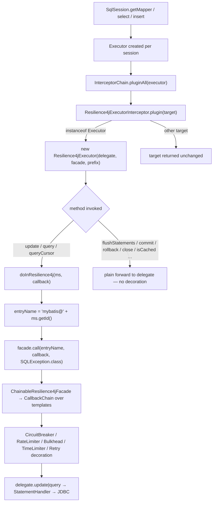
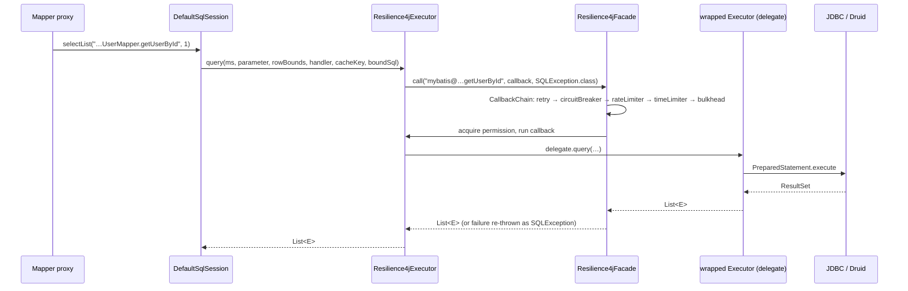
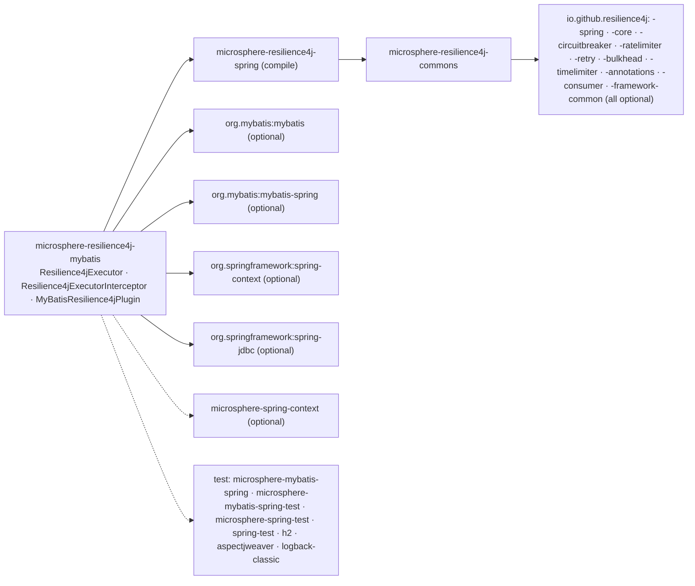

# microsphere-resilience4j-mybatis — Developer Guide

> Version line `0.2.x` (`release` branch) · latest release `0.2.4` · current `${revision}` = `0.2.5-SNAPSHOT` · Resilience4j **2.0.0 – 2.4.0** (default `2.4.0`) · Spring Cloud 2022.0.x – 2025.0.x · JDK **17+** · [← developer guide index](README.md)

Module path: `microsphere-resilience4j-plugins/microsphere-resilience4j-mybatis`.

## Class inventory

| Type | File | Role |
|------|------|------|
| `Resilience4jExecutor` | `src/main/java/io/microsphere/resilience4j/mybatis/executor/Resilience4jExecutor.java` | Implements `org.apache.ibatis.executor.Executor`; holds `delegate` + `facade` + `entryNamePrefix`; decorates 4 statement methods, forwards 10, wraps in `setExecutorWrapper` |
| `Resilience4jExecutorInterceptor` | `src/main/java/io/microsphere/resilience4j/mybatis/plugin/Resilience4jExecutorInterceptor.java` | Implements `org.apache.ibatis.plugin.Interceptor`; `plugin(target)` is the weaving point; `intercept()` is a pass-through |
| `MyBatisResilience4jPlugin` | `src/main/java/io/microsphere/resilience4j/mybatis/MyBatisResilience4jPlugin.java` | `Resilience4jPlugin` (`PLUGIN_NAME = "mybatis"`) that registers the interceptor bean with a constructor-arg reference to the facade bean |
| resource | `src/main/resources/META-INF/spring.factories` | `io.microsphere.resilience4j.spring.common.Resilience4jPlugin=io.microsphere.resilience4j.mybatis.MyBatisResilience4jPlugin` |
| `Resilience4jExecutorInterceptorTest` | `src/test/java/io/microsphere/resilience4j/mybatis/plugin/...` | 5 tests: `testMapper`, `testSqlSession`, `testConstants`, `testGetter`, `testInvoke`; extends `io.microsphere.mybatis.test.AbstractMyBatisTest` |
| `MyBatisResilience4jPluginTest` | `src/test/java/io/microsphere/resilience4j/mybatis/...` | 1 test: registers the plugin in a Spring context (`@EnableBulkhead(plugins = "mybatis")`, `@EnableCircuitBreaker`, `@EnableMyBatis`) and asserts the `SqlSessionFactory`/mapper round-trip |

## Weaving mechanism: the MyBatis `Interceptor` SPI — without `@Intercepts`

The most important structural fact, verified by searching the module: **there is no `@Intercepts`/`@Signature` annotation anywhere in this plugin.** MyBatis' usual recipe is

```java
@Intercepts({@Signature(type = Executor.class, method = "update", args = {MappedStatement.class, Object.class})})
```

combined with the default `Interceptor.plugin(target)` implementation, which returns `Plugin.wrap(target, this)` — a JDK dynamic proxy whose `InvocationHandler` calls `intercept(Invocation)`.

This plugin takes the other branch of the SPI. `Resilience4jExecutorInterceptor` overrides `plugin(Object target)` and returns a **hand-written implementing object**:

```java
@Override
public Object plugin(Object target) {
    if (target instanceof Executor) {
        return new Resilience4jExecutor((Executor) target, facade, entryNamePrefix);
    }
    return target;
}
```

MyBatis calls `Configuration#newExecutor` → `InterceptorChain#pluginAll(executor)` → `interceptor.plugin(target)` for each registered interceptor. Because `plugin()` returns a typed wrapper instead of a proxy, no `Invocation` is ever constructed for this interceptor, and `intercept(Invocation)` is never called from the framework — hence its body (`return invocation.proceed();`) and its comment *“Current method will be not executed”*. The test `testInvoke` proves the reachability of that method only by constructing the `Invocation` manually.

Design consequences visible in the source:

| Property | Typed-decorator approach (this plugin) | `@Intercepts` + `Plugin.wrap` |
|----------|----------------------------------------|-------------------------------|
| Non-`Executor` targets | returned untouched (`return target;`) | filtered out by signature matching |
| Method selection | explicit: only `update`, both `query` overloads and `queryCursor` are decorated; everything else is a plain forwarding call | any signature list you declare |
| Cost per call | direct method call on the wrapper | reflective `Method.invoke` through the proxy |
| Granularity | whole `Executor` interface | per declared method signature |

### What is (and is not) decorated

`Resilience4jExecutor` implements every method of `Executor`. Four go through the resilience boundary:

```java
@Override
public <E> List<E> query(MappedStatement ms, Object parameter, RowBounds rowBounds, ResultHandler resultHandler,
                         CacheKey cacheKey, BoundSql boundSql) throws SQLException {
    return doInResilience4j(ms, () -> delegate.query(ms, parameter, rowBounds, resultHandler, cacheKey, boundSql));
}
```

`flushStatements`, `commit(boolean)`, `rollback(boolean)`, `createCacheKey`, `isCached`, `clearLocalCache`, `deferLoad`, `getTransaction`, `close(boolean)`, `isClosed` are one-line forwards. `setExecutorWrapper(Executor)` is the exception: it wraps its argument (`new Resilience4jExecutor(executor, facade, entryNamePrefix)`) before handing it to the delegate, which is how MyBatis' internal wrapper assignment stays decorated — and also the only place where nested wrappers can appear.

Naming and failure adaptation both live in one protected method:

```java
protected <T> T doInResilience4j(MappedStatement ms, ThrowableSupplier<T> callback) throws SQLException {
    String entryName = buildEntryName(ms);          // entryNamePrefix + ms.getId()
    return this.facade.call(entryName, callback, SQLException.class);
}
```

`Resilience4jOperations.call(name, supplier, throwableClass)` (commons) executes the whole template chain and adapts any failure to the declared type, so `CallNotPermittedException` / `RequestNotPermittedException` reach callers as `SQLException`.

### Intercepted call path



Sequence view of one mapped statement:



## Spring registration path

`MyBatisResilience4jPlugin` is the only class in the module that touches Spring:

```java
BeanDefinitionBuilder beanDefinitionBuilder = genericBeanDefinition(Resilience4jExecutorInterceptor.class);
beanDefinitionBuilder.addConstructorArgReference(BEAN_NAME);   // LazyResilience4jFacade.BEAN_NAME = "lazyResilience4jFacade"
AbstractBeanDefinition beanDefinition = beanDefinitionBuilder.getBeanDefinition();
String beanName = generateBeanName(beanDefinition, registry);
registerBeanDefinition(registry, beanName, beanDefinition);
```

| Detail | Consequence |
|--------|-------------|
| Bean name comes from `BeanDefinitionReaderUtils.generateBeanName(...)` | it is a *generated*, class-derived name — not a public constant; look the bean up **by type** |
| Constructor arg is a **reference** to `lazyResilience4jFacade` | the facade is the lazy delegating facade of `microsphere-resilience4j-spring`, whose real delegate is assembled on `ContextRefreshedEvent` from the registered `Registry` beans |
| Only one bean definition per `plugin()` invocation | `plugin()` is called by `EnableResilience4jRegistrar.registerPlugins(...)` for every `@Enable*` annotation listing `plugins = "mybatis"`; multiple `@Enable*` annotations on different configuration classes can register more than one interceptor bean (one per distinct registry pass), which would multiply decoration |
| `getName()` returns `PLUGIN_NAME` (`"mybatis"`) | the value matched against the annotation's `plugins` attribute |

## Design patterns (with evidence)

| Pattern | Evidence |
|---------|----------|
| **Decorator** | `Resilience4jExecutor implements Executor` and holds `private final Executor delegate`; 4 methods add behaviour (resilience), 10 forward unchanged. |
| **Proxy (protection proxy)** | The decorator is the authority that decides whether the underlying `Executor` is allowed to run (breaker/rate-limiter/bulkhead permission). |
| **Factory Method / plug-in point** | `Interceptor.plugin(Object)` acts as the factory that decides whether and how a target is wrapped; the plugin returns `target` untouched for non-`Executor` arguments. |
| **Facade** | Both `Resilience4jExecutorInterceptor` and `Resilience4jExecutor` only know `io.microsphere.resilience4j.common.Resilience4jFacade`; no `io.github.resilience4j.*` type appears in main source. |
| **Chain of Responsibility** | Inside the facade: `ChainableResilience4jFacade` → `CallbackChain` walks the priority-sorted template list, each template wrapping the rest of the chain. |
| **Observer** | Available but unused here: event consumers are registered on the templates (`CircuitBreakerTemplate.onCallNotPermittedEvent(...)` etc.), reachable through the injected facade. |
| **SPI** | Two layers: MyBatis' own `org.apache.ibatis.plugin.Interceptor` and this library's `Resilience4jPlugin` loaded from `META-INF/spring.factories`. |
| **Dependency injection (by bean reference)** | the generated bean definition injects the facade via `addConstructorArgReference`. |

## Dependency map



| Aspect | Fact |
|--------|------|
| Spring vs commons | Depends on **`microsphere-resilience4j-spring`** (compile) — unlike `microsphere-resilience4j-openfeign`, which stops at `commons`. The Spring dependency is required by the `Resilience4jPlugin` implementation, not by the executor decorator. |
| Resilience4j modules used | Compile time: none (facade only). Runtime, as exercised by the tests: `Retry`, `CircuitBreaker`, `RateLimiter`, `TimeLimiter`, `Bulkhead` registries (`*Registry.ofDefaults()`) — all five participate because this plugin uses the one-time `call(...)` path. |
| MyBatis API surface | `Executor`, `MappedStatement`, `BoundSql`, `CacheKey`, `RowBounds`, `ResultHandler`, `Cursor`, `BatchResult`, `MetaObject`, `Transaction`, `Interceptor`, `Invocation`, `SimpleExecutor` (test). |

## Notes for contributors

- Adding `@Intercepts` would **not** combine well with the current `plugin()` override: a proxy-based path expects `intercept(Invocation)` to perform the decoration, whereas here decoration happens inside `Resilience4jExecutor`. Keep one mechanism or the other.
- If a new decorated method is added to the `Executor` interface (MyBatis upgrades), the class will fail to compile until you decide explicitly whether it is decorated or forwarded — that is a deliberate, compile-time-visible contract of the typed-decorator design.
- `MyBatisResilience4jPluginTest` relies on `microsphere-mybatis-spring` / `microsphere-mybatis-spring-test` helper configurations for the `DataSource`, DDL and mapper registration; the assertions themselves (`assertConfiguration`, `assertUserMapper`) come from `microsphere-mybatis-test`.

## Related pages

- [User guide — microsphere-resilience4j-mybatis](../user-guide/microsphere-resilience4j-mybatis.md)
- [Developer guide — microsphere-resilience4j-alibaba-druid](microsphere-resilience4j-alibaba-druid.md)
