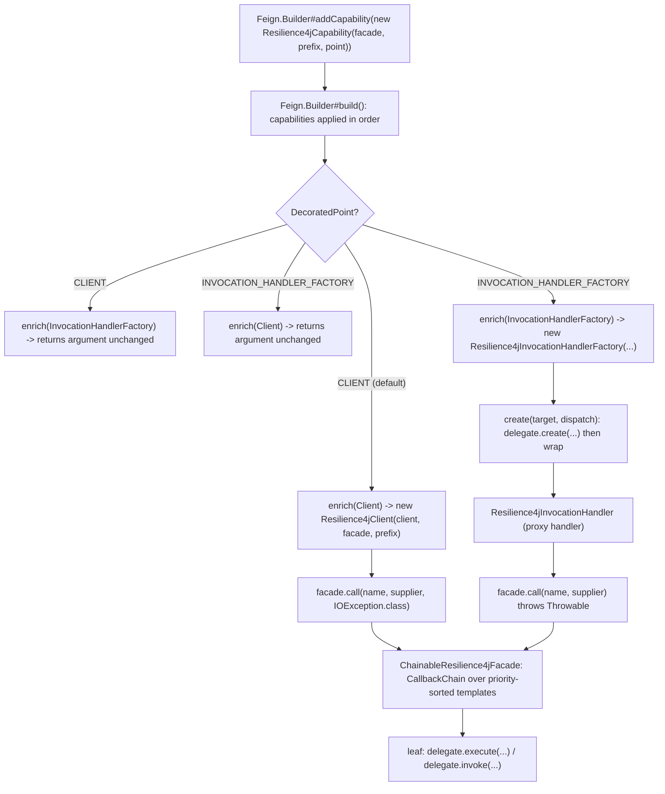
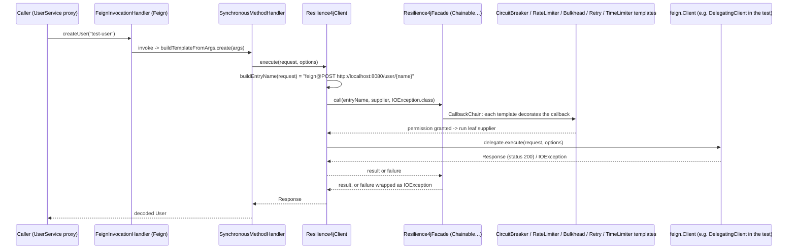
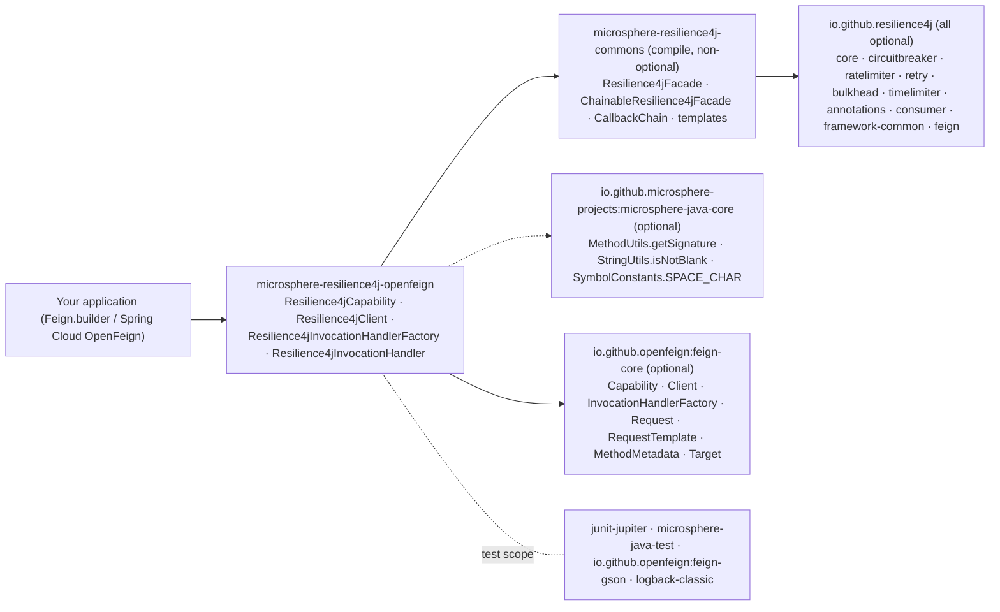

# microsphere-resilience4j-openfeign — Developer Guide

> Version line `0.2.x` (`release` branch) · latest release `0.2.4` · current `${revision}` = `0.2.5-SNAPSHOT` · Resilience4j **2.0.0 – 2.4.0** (default `2.4.0`) · Spring Cloud 2022.0.x – 2025.0.x · JDK **17+** · [← developer guide index](README.md)

Module path: `microsphere-resilience4j-plugins/microsphere-resilience4j-openfeign`. All production classes live in one package, `io.microsphere.resilience4j.feign`.

## Class inventory

| Type | File | Role |
|------|------|------|
| `Resilience4jCapability` | `src/main/java/io/microsphere/resilience4j/feign/Resilience4jCapability.java` | The only object the user constructs; implements `feign.Capability`, holds `facade` + `entryNamePrefix` + `decoratedPoint`, and routes `enrich(...)` to one of the two decorators |
| `Resilience4jCapability.DecoratedPoint` | nested `enum` in the same file | `CLIENT`, `INVOCATION_HANDLER_FACTORY` — a single-valued choice of weaving point |
| `Resilience4jClient` | `.../Resilience4jClient.java` | `feign.Client` decorator; transport-boundary decoration, failures typed as `IOException` |
| `Resilience4jInvocationHandlerFactory` | `.../Resilience4jInvocationHandlerFactory.java` | `feign.InvocationHandlerFactory` decorator; delegates `create(...)` then wraps the produced handler |
| `Resilience4jInvocationHandler` | `.../Resilience4jInvocationHandler.java` | `java.lang.reflect.InvocationHandler` decorator; method-boundary decoration, failures rethrown as `Throwable` |
| resource | — | **none**: this module has no `src/main/resources` at all — no `META-INF/spring.factories`, no `Resilience4jPlugin` implementation |

### Test inventory

| Test / fixture | File | What it exercises |
|----------------|------|-------------------|
| `AbstractResilience4jFeignTest` | `src/test/java/.../feign/AbstractResilience4jFeignTest.java` | Shared `@BeforeEach` that builds a `ChainableResilience4jFacade` from five `*Registry.ofDefaults()`, a `GsonEncoder`/`GsonDecoder`, and a `Feign` instance with `DelegatingCapability` **then** the subclass' `Resilience4jCapability`; declares `abstract Resilience4jCapability createResilience4jCapability(Resilience4jFacade)`. Own tests: `testProxy()` (walks the `InvocationHandler` chain), `testUserService()` (create + get round trip) |
| `Resilience4jCapabilityTest` | `.../Resilience4jCapabilityTest.java` | `new Resilience4jCapability(facade)` + `testConstants()` asserting `DEFAULT_ENTRY_NAME_PREFIX == "feign@"` and `DEFAULT_DECORATED_POINT == CLIENT` |
| `Resilience4jClientTest` | `.../Resilience4jClientTest.java` | `new Resilience4jCapability(facade, this.getClass().getSimpleName())` — i.e. prefix `"Resilience4jClientTest"`, still the `CLIENT` point |
| `Resilience4jInvocationHandlerFactoryTest` | `.../Resilience4jInvocationHandlerFactoryTest.java` | `new Resilience4jCapability(facade, INVOCATION_HANDLER_FACTORY)` |
| `DelegatingClient`, `DelegatingCapability`, `DelegatingInvocationHandler`, `DelegatingInvocationHandlerFactory` | `.../feign/*.java` | Test fixtures: `DelegatingClient` answers requests by invoking the local `SimpleUserService` reflectively (it reads the arguments back from `DelegatingInvocationHandler#getArguments()`, a `ThreadLocal`), and the `Delegating*` capability chain gives the tests observable wrapper layers |
| `api.UserService`, `api.User`, `server.SimpleUserService` | `.../feign/api/*`, `.../feign/server/*` | Feign interface with `@RequestLine("POST /user/{name}")` / `@RequestLine("GET /user")` and an in-memory `Map<String, User>` implementation |

Coverage note: the tests assert the **wiring** (which wrapper appears where, which facade instance is held) and one functional round trip. `buildEntryName(...)` in both decorators is `private` and is not asserted directly; `Resilience4jInvocationHandler`'s three `requireNonNull` messages are likewise untested.

## Weaving mechanism

### 1. `feign.Capability` as the only integration surface

Feign exposes `Capability` with default methods for `enrich(Logger)`, `enrich(Contract)`, `enrich(Client)`, `enrich(Encoder)`, `enrich(Decoder)`, `enrich(Retryer)`, `enrich(InvocationHandlerFactory)` … `Resilience4jCapability` overrides exactly two of them, and each override is a one-line conditional decorator:

```java
@Override
public Client enrich(Client client) {
    return isDecoratedClient() ? new Resilience4jClient(client, facade, entryNamePrefix) : client;
}

@Override
public InvocationHandlerFactory enrich(InvocationHandlerFactory invocationHandlerFactory) {
    return isDecoratedInvocationHandlerFactory() ? new Resilience4jInvocationHandlerFactory(invocationHandlerFactory, facade, entryNamePrefix) : invocationHandlerFactory;
}
```

`isDecoratedClient()` and `isDecoratedInvocationHandlerFactory()` are `equals` tests against the single `decoratedPoint` field, so **the two points are mutually exclusive per capability**. Nothing else in Feign's object graph (`Contract`, `Encoder`, `Decoder`, `Retryer`, `Logger`) is touched.

`Feign.Builder#build()` applies capabilities in registration order, each `enrich` receiving the output of the previous one; that makes the last-added capability the outermost wrapper. `AbstractResilience4jFeignTest` relies on this ordering: it registers `DelegatingCapability` first and `Resilience4jCapability` second, and then `testProxy()` asserts the handler chain `Resilience4jInvocationHandler → DelegatingInvocationHandler → feign.ReflectiveFeign$FeignInvocationHandler`. With `DecoratedPoint.CLIENT` the same test takes the other branch (`delegate = handler`) and still ends at `feign.ReflectiveFeign$FeignInvocationHandler` — proof that the `CLIENT` point leaves the proxy untouched.

### 2. Both decorators funnel into the same facade operation, with different throwable typing

```java
// Resilience4jClient — the transport boundary
public Response execute(Request request, Request.Options options) throws IOException {
    String entryName = buildEntryName(request);
    return this.facade.call(entryName, () -> this.delegate.execute(request, options), IOException.class);
}

// Resilience4jInvocationHandler — the method boundary
public Object invoke(Object proxy, Method method, Object[] args) throws Throwable {
    String entryName = buildEntryName(method);
    return this.facade.call(entryName, () -> delegate.invoke(proxy, method, args));
}
```

These resolve to two different `Resilience4jOperations` default methods:

- `<T, TR extends Throwable> T call(String, ThrowableSupplier<T>, Class<TR>) throws TR` → `try { call(name, callback); } catch (Throwable t) { throw wrap(t, throwableClass); }`, where `wrap` is `io.microsphere.util.ExceptionUtils.wrap`. Every failure, including `CallNotPermittedException`, leaves the client as an `IOException`.
- `<T> T call(String, ThrowableSupplier<T>) throws Throwable` → no conversion; the `InvocationHandler` propagates the original `Throwable` (Feign's `SynchronousMethodHandler` exceptions, decoder failures, or Resilience4j's own exceptions).

The `Resilience4jInvocationHandlerFactory` contributes no decoration of its own — it is a factory that keeps the delegate's product and wraps it:

```java
public InvocationHandler create(Target target, Map<Method, MethodHandler> dispatch) {
    InvocationHandler delegate = this.delegate.create(target, dispatch);
    return new Resilience4jInvocationHandler(delegate, facade, entryNamePrefix);
}
```

Consequence: with the `INVOCATION_HANDLER_FACTORY` point, decoration happens **once per proxy method call** and covers `BuildTemplateByResolvingArgs` (argument → request template), encoding, the transport, `ErrorDecoder` and decoding. With the `CLIENT` point it covers only `Client#execute`, i.e. the transport, and one call per HTTP attempt — a Feign-level `Retryer` therefore triggers several decorated calls.

### 3. Entry naming is derived per call, without caching

`Resilience4jClient` builds a `StringBuilder`-based name from the request:

```
prefix + request.httpMethod().name() + SPACE_CHAR
       + request.requestTemplate().feignTarget().url()
       + request.requestTemplate().methodMetadata().template().path()
       + (isNotBlank(queryLine) ? requestTemplate.queryLine() : "")
```

Note the split source of truth: the path comes from the **method metadata's** (contract-parsed, unresolved) `RequestTemplate`, while `queryLine()` comes from the **per-request** template. `Resilience4jInvocationHandler` instead uses `entryNamePrefix + getSignature(method)` with `io.microsphere.reflect.MethodUtils.getSignature(Method)` — a purely method-derived, bounded name. Neither class caches names; the registries hold the instances (`AdvancedResilience4jOperations#getEntry(name)` → `registry.find(name)` else `createEntry(name)` → `registry.<module>(name, getConfiguration(name))`).

### Flowchart: how a capability call is routed



### Sequence diagram: the `CLIENT` decoration path



(For the `INVOCATION_HANDLER_FACTORY` point the same diagram starts one step earlier: `App → Resilience4jInvocationHandler → Delegating/FeignInvocationHandler → SynchronousMethodHandler → real Client`, and the failure path skips the `IOException` conversion.)

## Design patterns (with evidence)

| Pattern | Evidence in this module |
|---------|--------------------------|
| **Strategy / Configuration** | `DecoratedPoint` is a strategy selector read by both `enrich` overloads; `getDecoratedPoint()` is the single decision input. Choosing `CLIENT` vs `INVOCATION_HANDLER_FACTORY` changes the protected boundary, not the decoration logic. |
| **Decorator (GoF)** | `Resilience4jClient` and `Resilience4jInvocationHandler` each hold a same-typed `delegate` and add behaviour around it; `Resilience4jInvocationHandlerFactory` decorates the *product* of the factory, which is the classic way to decorate a `java.lang.reflect.Proxy` handler. |
| **Abstract Factory / Factory Method** | `InvocationHandlerFactory#create(Target, Map<Method, MethodHandler>)` is Feign's factory; the plugin's implementation returns a wrapped handler instead of the raw one. |
| **Facade** | All four classes depend only on `io.microsphere.resilience4j.common.Resilience4jFacade`; no `io.github.resilience4j.*` type is imported by any production class in this module. `resilience4j-feign` is an *optional* dependency referenced only by the Javadoc `@see io.github.resilience4j.feign.DecoratorInvocationHandler` of `Resilience4jInvocationHandler` — the plugin deliberately does not use Resilience4j's own Feign decorator. |
| **Chain of Responsibility** | Inside commons: `ChainableResilience4jFacade.call` builds a `CallbackChain<T>` over the `COMPARATOR`-sorted template list; this plugin only supplies the name and the leaf callable. |
| **Template Method** | `Resilience4jCapability` implements two Feign template hooks (`enrich(Client)`, `enrich(InvocationHandlerFactory)`) whose default behaviour is "return the argument", and overrides the pair it cares about. |
| **Guarded / Fail-fast construction** | `Resilience4jInvocationHandler` uses `Objects.requireNonNull` with explicit messages on all three arguments; `Resilience4jClient` and `Resilience4jCapability` do not — an inconsistency worth noting for contributors. |

## Dependency map



| Aspect | Fact |
|--------|------|
| Upstream layer | **commons**, not spring. `microsphere-resilience4j-commons` is the only non-optional dependency; `microsphere-resilience4j-spring` is absent from the POM. This is why the module has no `Resilience4jPlugin`, no `@Enable*` support and no `META-INF/spring.factories`, and why it can be used in a plain Java process. |
| Resilience4j components used | None at compile time (facade indirection). At runtime the facade carries whatever registries you give it; the tests use `BulkheadRegistry`, `RateLimiterRegistry`, `RetryRegistry`, `TimeLimiterRegistry`, `CircuitBreakerRegistry` (all `ofDefaults()`), and because both decorators take the one-time `call(...)` path, `RetryTemplate`, `TimeLimiterTemplate` and `ThreadPoolBulkheadTemplate` all apply — the modules excluded from the two-phase `begin()/end()` path used by the Spring Web and Hibernate plugins. |
| Feign API surface used | `Capability` (2 `enrich` overloads), `Client#execute(Request, Request.Options)`, `InvocationHandlerFactory#create(Target, Map)`, `Request#httpMethod()/requestTemplate()`, `RequestTemplate#methodMetadata()/feignTarget()/queryLine()`, `MethodMetadata#template()`, `Request.HttpMethod#name()`. |
| Reflection surface | `java.lang.reflect.InvocationHandler` and `io.microsphere.reflect.MethodUtils#getSignature(Method)`. |

## Extension points for contributors

- `Resilience4jClient#buildEntryName` and `Resilience4jInvocationHandler#buildEntryName` are `private`. Exposing them (or the whole class) as `protected` would let users derive entry names from `configKey` instead of URL + path; any change to the produced string is a **breaking change** for existing per-entry Resilience4j configuration.
- Adding a third weaving point means a new `DecoratedPoint` constant plus an `enrich` override — e.g. `enrich(Decoder)` to protect only the decoding step, or `enrich(Retryer)` to observe retry pressure. The enum-based single-selection design would then need review (a `Set<DecoratedPoint>` or per-point booleans would compose better).
- The `IOException.class` argument in `Resilience4jClient#execute` is what makes the transport path Feign-idiomatic; a future option to disable the wrapping would have to be constructor-driven, since `Resilience4jOperations` offers both `call(name, supplier)` and `call(name, supplier, throwableClass)`.
- Neither decorator caches the facade or the prefix beyond plain field assignment, and no `null` facade check exists in `Resilience4jClient`, so a `NullPointerException` would surface per call rather than at build time — the `Resilience4jInvocationHandler` constructor contract is the model to copy if this is tightened.
- Test fixture reuse: `DelegatingClient` answers requests by calling a local implementation and reading its arguments from a `ThreadLocal` set by `DelegatingInvocationHandler`. That trick only works because the test drives one thread; a `TimeLimiter` or `ThreadPoolBulkhead` in the facade chain would move the request off that thread and break it. Keep that in mind when extending the tests.

## Related pages

- [User guide — microsphere-resilience4j-openfeign](../user-guide/microsphere-resilience4j-openfeign.md)
- [User guide — commons](../user-guide/microsphere-resilience4j-commons.md)
- [Developer guide — microsphere-resilience4j-spring](microsphere-resilience4j-spring.md)
- [Developer guide — microsphere-resilience4j-spring-web](microsphere-resilience4j-spring-web.md)
