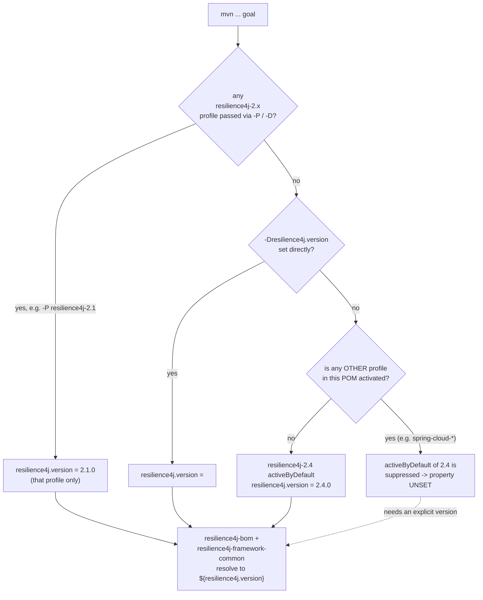

# microsphere-resilience4j-parent — Developer Guide

> Version line `0.2.x` (`release` branch) · `${revision}` = `0.2.5-SNAPSHOT` · latest release `0.2.4` · Resilience4j **2.0.0 – 2.4.0** (default `2.4.0`) · JDK **17+** · [← guide index](README.md)

`microsphere-resilience4j-parent` is the shared **build parent** for the whole codebase. This page covers how it is structured, how its version profiles resolve at build time, and how the GitHub Actions matrix drives them.

## Role in the reactor

Two distinct POMs are easy to confuse:

| POM | artifactId | packaging | Role |
|-----|-----------|-----------|------|
| Reactor root | `microsphere-resilience4j` | `pom` | The **aggregator** (has `<modules>`); inherits `microsphere-spring-cloud-parent:0.2.26` |
| Build parent | `microsphere-resilience4j-parent` | `pom` | The **inherited parent** of every other module; is *also* listed as a `<module>` of the reactor |

`microsphere-resilience4j-parent/pom.xml` declares `<parent>` = `microsphere-resilience4j` (`${revision}`, `relativePath ../pom.xml`). That root POM in turn inherits the external grandparent `io.github.microsphere-projects:microsphere-spring-cloud-parent:0.2.26`, which supplies all the build/plugin configuration (compiler, flatten, deploy profiles). Verified: the parent module itself sets `java.version`? **No** — `java.version=17` lives in the *reactor root* POM, not the parent module.

## What the parent module actually declares

The file contains **only** `<properties>`, `<dependencyManagement>` and `<profiles>` (confirmed by reading `microsphere-resilience4j-parent/pom.xml`). It has **no** `<build>`, **no** `<pluginManagement>`, and **no** plain `<dependencies>` block. Everything plugin-related is inherited from the grandparent. This matters when extending the build: put shared *version* policy here, shared *plugin* policy in the grandparent line.

### Managed microsphere dependency versions

| Property | Value | BOM imported from it |
|----------|-------|----------------------|
| `microsphere-spring-cloud.version` | `0.2.26` | `microsphere-spring-cloud-dependencies` (import) |
| `microsphere-alibaba-druid.version` | `0.2.20` | `microsphere-alibaba-druid-dependencies` (import) |
| `microsphere-mybatis.version` | `0.2.16` | `microsphere-mybatis-dependencies` (import) |
| `microsphere-hibernate.version` | `0.2.10` | `microsphere-hibernate-dependencies` (import) |
| `microsphere-redis.version` | `0.2.14` | `microsphere-redis-dependencies` (import) |

Plus `io.github.resilience4j:resilience4j-bom:${resilience4j.version}` (import) and `io.github.resilience4j:resilience4j-framework-common:${resilience4j.version}` (managed version). `${resilience4j.version}` is not set as a property outside the profiles — it exists **only** through the profiles below.

## Resilience4j version profiles

| Profile | `resilience4j.version` | Activation |
|---------|------------------------|------------|
| `resilience4j-2.0` | `2.0.0` | manual |
| `resilience4j-2.1` | `2.1.0` | manual |
| `resilience4j-2.2` | `2.2.0` | manual |
| `resilience4j-2.3` | `2.3.0` | manual |
| `resilience4j-2.4` | `2.4.0` | `activeByDefault` |

### Profile-resolution flowchart



The last branch is the Maven rule to remember: an `activeByDefault` profile is deactivated the moment any *other* profile of the same effective model is activated. Because Spring Cloud profiles are inherited into every module's model, a build that activates `spring-cloud-2023` **without** a `resilience4j-2.x` profile could leave `resilience4j.version` unset. The CI therefore always passes an explicit `resilience4j-2.x` profile (see below).

## How the CI matrix uses the profiles

`.github/workflows/maven-build.yml` builds on `push` to `main`/`dev` and `pull_request` to `main`/`dev`/`release`, over a 3-dimensional matrix:

| Matrix dimension | Values |
|------------------|--------|
| `java` | `17`, `21`, `25` |
| `maven-profile-spring-cloud` | `spring-cloud-2022`, `spring-cloud-2023`, `spring-cloud-2024`, `spring-cloud-2025` |
| `maven-profile-resilience4j` | `resilience4j-2.0` … `resilience4j-2.4` |

The build step (paraphrased from the workflow) is:

```bash
mvn --batch-mode --update-snapshots --file pom.xml \
    -Drevision=0.0.1-SNAPSHOT \
    test \
    --activate-profiles test,coverage,<maven-profile-spring-cloud>,<maven-profile-resilience4j>
```

Key observations for maintainers:

- The **`resilience4j-2.x`** leg of the matrix comes from **this parent module** and exercises the whole `2.0.0 → 2.4.0` API surface on every PR.
- The **`spring-cloud-20xx`** profiles are **not** defined in this parent — they come from the `microsphere-spring-cloud-parent:0.2.26` grandparent line. A new Spring Cloud release train is picked up by bumping that grandparent version, not by editing the resilience4j parent.
- CI builds with a throwaway `-Drevision=0.0.1-SNAPSHOT`; the `${revision}` property is only made meaningful at publish time.
- Coverage is uploaded to Codecov (`codecov/codecov-action`).

If you add a new Resilience4j minor line, add a `resilience4j-2.5` profile here **and** a new value to the `maven-profile-resilience4j` matrix dimension, otherwise the profile stays untested.

## Publish-time `${revision}` handling

`.github/workflows/maven-publish.yml` (triggered on `push` to `release` or `workflow_dispatch`) deploys with `./mvnw -Drevision=${{ inputs.revision }} ... deploy --activate-profiles publish,ci`, where `inputs.revision` must match `^[0-9]+\.[0-9]+\.[0-9]+$`. After a successful release the workflow edits the reactor root `pom.xml`, bumping `<revision>` to the next patch snapshot (`sed` on the `<revision>` element) — which is exactly why the `release` snapshot currently reads `0.2.5-SNAPSHOT` after the `0.2.4` release. The flatten plugin (inherited from the grandparent) resolves `${revision}` in the published POMs; see the [dependencies developer page](microsphere-resilience4j-dependencies.md).

## Version facts verified from source

| Fact | Value | Where read |
|------|-------|-----------|
| Reactor `${revision}` | `0.2.5-SNAPSHOT` | root `pom.xml` |
| Reactor `java.version` | `17` | root `pom.xml` |
| Grandparent | `microsphere-spring-cloud-parent:0.2.26` | root `pom.xml` |
| Resilience4j default profile | `resilience4j-2.4` = `2.4.0` | parent `pom.xml` |
| CI JDK matrix | 17 / 21 / 25 | `maven-build.yml` |
