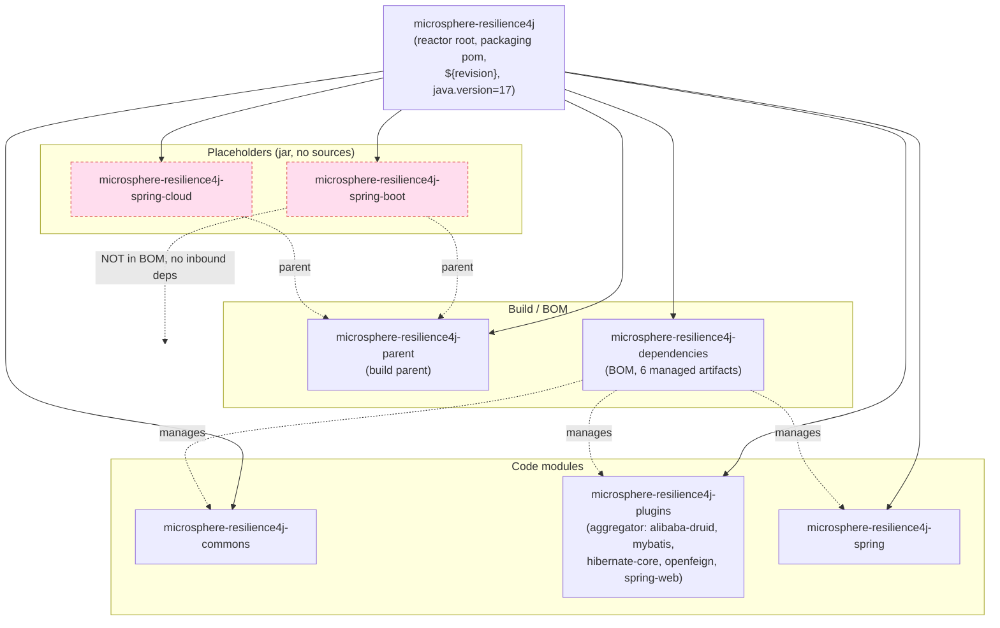

# microsphere-resilience4j-spring-boot — Developer Guide

> Version line `0.2.x` (`release` branch) · `${revision}` = `0.2.5-SNAPSHOT` · latest release `0.2.4` · **status: empty placeholder (pom only, no `src/`)** · JDK **17+** · [← guide index](README.md)

## Verified status

`microsphere-resilience4j-spring-boot` is an **empty placeholder**. A directory listing of `microsphere-resilience4j-spring-boot/` shows a single file — `pom.xml` — and **no `src/main/java`, no `src/main/resources`, no `src/test`** tree. Because packaging is `jar`, `mvn package` yields a jar with no classes and no resources.

Reactor POM content (`microsphere-resilience4j-spring-boot/pom.xml`):

| Element | Value |
|---------|-------|
| `<parent>` | `microsphere-resilience4j-parent` `${revision}` (`relativePath ../microsphere-resilience4j-parent/pom.xml`) |
| `<artifactId>` | `microsphere-resilience4j-spring-boot` |
| `<version>` | `${revision}` |
| `<packaging>` | `jar` |
| `<name>` | `Microsphere :: Resilience4j :: Spring Boot` |
| `<properties>` | empty block |
| `<dependencies>` / `<build>` | **not present** |

## Where it sits in the reactor

The root `microsphere-resilience4j/pom.xml` lists `<modules>` in this order; the placeholder is one of them, inheriting the build parent but depending on nothing and depended-upon by nothing.

Reading the graph: every module (including the two placeholders) is a `<module>` of the reactor root; `SB`/`SC` inherit from `microsphere-resilience4j-parent`; the BOM (`DEPS`) manages the six real artifacts but **not** `SB`. Nothing in the reactor declares a `<dependency>` on `SB`, and a repo-wide search of the artifactId returns only the root `<modules>` line and `SB`'s own `pom.xml`.

## Why it exists (inference, not documented)

The `README.md` module table lists only parent/dependencies/commons/plugins/spring — this placeholder is **not** mentioned in the README, and there is **no** entry for it in `release-notes.md`. So the reservation is undocumented. Based purely on the coordinates (`io.github.microsphere-projects:microsphere-resilience4j-spring-boot`), the `jar` packaging, and inheritance from the build parent, the evident purpose is to **reserve the Maven coordinate** for a future Spring Boot auto-configuration companion to `microsphere-resilience4j-spring`. Treat it as reserved, not promised.

## What it would take to implement it

To turn the placeholder into a real Spring Boot module:

1. **Add sources.** Create `src/main/java/io/microsphere/resilience4j/spring/boot/autoconfigure/...` with `@AutoConfiguration` classes that wire the existing `microsphere-resilience4j-spring` registrars, and a `src/main/resources/META-INF/spring/org.springframework.boot.autoconfigure.AutoConfiguration.imports` file listing them.
2. **Add dependencies to the module POM.** At minimum `org.springframework.boot:spring-boot-autoconfigure` (version supplied by the inherited `microsphere-spring-cloud-dependencies:0.2.26` / Spring Boot line) and `io.github.microsphere-projects:microsphere-resilience4j-spring` (already version-managed by the BOM via the parent).
3. **Configuration properties.** Provide `@ConfigurationProperties` binding and `additional-spring-configuration-metadata.json` if offering property-driven setup.
4. **Register in the BOM.** Add `microsphere-resilience4j-spring-boot` with `${revision}` to `microsphere-resilience4j-dependencies/pom.xml` so consumers can omit the version (today it is absent).
5. **Use the version profiles as-is.** No change needed to the `resilience4j-2.0`…`2.4` profiles in the parent; the new code just compiles against `${resilience4j.version}` like every other module and is exercised by the CI matrix (JDK 17/21/25 × spring-cloud-2022…2025 × resilience4j-2.0…2.4).

Until those steps land in an actual release, the module remains an empty jar and consumers should keep using `microsphere-resilience4j-spring` directly.

## Version facts verified from source

| Fact | Value | Where read |
|------|-------|-----------|
| Packaging | `jar` | module `pom.xml` |
| Sources present | none (`pom.xml` only) | directory listing |
| `${revision}` | `0.2.5-SNAPSHOT` | reactor root `pom.xml` |
| Managed by BOM | no | `microsphere-resilience4j-dependencies/pom.xml` |
| Referenced elsewhere | no | repo-wide artifactId search |
