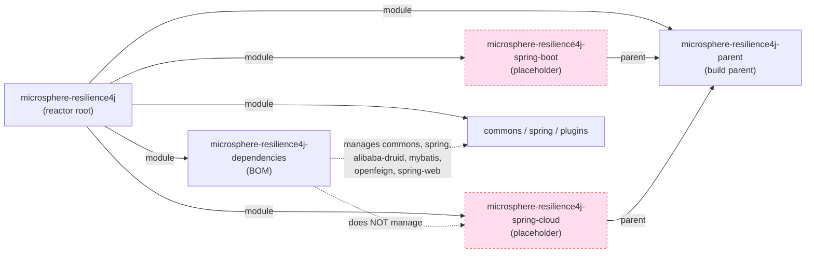

# microsphere-resilience4j-spring-cloud — Developer Guide

> Version line `0.2.x` (`release` branch) · `${revision}` = `0.2.5-SNAPSHOT` · latest release `0.2.4` · **status: empty placeholder (pom only, no `src/`)** · JDK **17+** · [← guide index](README.md)

## Verified status

`microsphere-resilience4j-spring-cloud` is an **empty placeholder**. A directory listing of `microsphere-resilience4j-spring-cloud/` shows a single file — `pom.xml` — and **no `src/` tree** at all. Packaging is `jar`, so building the module produces a jar containing no classes and no resources.

Reactor POM content (`microsphere-resilience4j-spring-cloud/pom.xml`):

| Element | Value |
|---------|-------|
| `<parent>` | `microsphere-resilience4j-parent` `${revision}` (`relativePath ../microsphere-resilience4j-parent/pom.xml`) |
| `<artifactId>` | `microsphere-resilience4j-spring-cloud` |
| `<version>` | `${revision}` |
| `<packaging>` | `jar` |
| `<name>` | `Microsphere :: Resilience4j :: Spring Cloud` |
| `<properties>` | empty block |
| `<dependencies>` / `<build>` | **not present** |

## Where it sits in the reactor

The root `microsphere-resilience4j/pom.xml` `<modules>` list contains both placeholders; `microsphere-resilience4j-spring-cloud` inherits the build parent, depends on nothing, and is depended on by nothing (see the sibling [spring-boot dev page](microsphere-resilience4j-spring-boot.md) for the full reactor graph).

A repo-wide search for the artifactId `microsphere-resilience4j-spring-cloud` returns hits only in the root `pom.xml` `<modules>` entry and in the module's own `pom.xml`, confirming there are no inbound dependencies and no BOM registration.

## Why it exists (inference, not documented)

`README.md` and `release-notes.md` never mention this module, so the reservation is undocumented. Judging from the coordinate, the `jar` packaging, and the inheritance from the build parent, the intended role is to **reserve `io.github.microsphere-projects:microsphere-resilience4j-spring-cloud`** for a future Spring Cloud layer that would sit on top of `microsphere-resilience4j-spring`. Because the parent already imports `microsphere-spring-cloud-dependencies:0.2.26`, the groundwork (Spring Cloud version management, and the `spring-cloud-2022…2025` profiles the CI exercises) is inherited even though this module uses none of it today. Read the placeholder as *reserved, not promised*.

## What it would take to implement it

1. **Add sources.** `src/main/java/.../spring/cloud/...` configuration classes that bind Spring Cloud constructs (externalised config, actuator/health contributors, `Resilience4jRegistry` customisers) to the existing templates.
2. **Add dependencies.** `org.springframework.cloud:spring-cloud-commons` / `spring-cloud-context` (version supplied by the inherited `microsphere-spring-cloud-dependencies:0.2.26`) and `io.github.microsphere-projects:microsphere-resilience4j-spring`.
3. **Register in the BOM.** Add `microsphere-resilience4j-spring-cloud` with `${revision}` to `microsphere-resilience4j-dependencies/pom.xml`; today it is absent, so consumers would have to specify the version.
4. **Stay profile-compatible.** No new Resilience4j or Spring Cloud profiles are needed — the module would simply compile against `${resilience4j.version}` and the inherited `spring-cloud-20xx` profiles, and be covered by the CI matrix (JDK 17/21/25 × `spring-cloud-2022…2025` × `resilience4j-2.0…2.4`).
5. **Auto-config vs. manual enable.** Decide whether to follow the `microsphere-resilience4j-spring` `@Enable*` model or Boot-style auto-configuration; the latter likely belongs in the sibling `spring-boot` module rather than here.

Until those land in a real release, the module is an empty jar.

## Build order and isolation

In the reactor, `microsphere-resilience4j-spring-cloud` has no first-party dependencies, so Maven builds it essentially in parallel with the other leaf modules once `microsphere-resilience4j-parent` is resolved. Its empty state cannot break the rest of the build (nothing depends on it), but it is not invisible either: `mvn install` publishes a versioned empty jar to the local repository. If you are auditing build output, expect a `microsphere-resilience4j-spring-cloud-${revision}.jar` that is ~1 KB (just the manifest).

## Reviving this module: PR checklist

When a Spring Cloud integration is actually implemented, keep the surrounding build consistent:

1. Add `src/main/java` / `src/main/resources` and the Spring Cloud + `microsphere-resilience4j-spring` dependencies.
2. Register the coordinate in `microsphere-resilience4j-dependencies/pom.xml` (`${revision}`) — it is missing today.
3. Add unit tests; the CI matrix (JDK 17/21/25 × `spring-cloud-2022…2025` × `resilience4j-2.0…2.4` from `maven-build.yml`) will then compile and run them across every combination, so no new profile is required.
4. List the module in `README.md`'s module table and add a `release-notes.md` entry, since neither mentions it now.

## Version facts verified from source

| Fact | Value | Where read |
|------|-------|-----------|
| Packaging | `jar` | module `pom.xml` |
| Sources present | none (`pom.xml` only) | directory listing |
| `${revision}` | `0.2.5-SNAPSHOT` | reactor root `pom.xml` |
| Managed by BOM | no | `microsphere-resilience4j-dependencies/pom.xml` |
| Referenced elsewhere | no | repo-wide artifactId search |
| Spring Cloud baseline (via parent) | `microsphere-spring-cloud-dependencies:0.2.26` | parent `pom.xml` |
