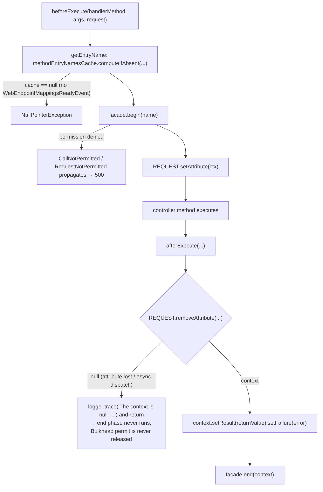
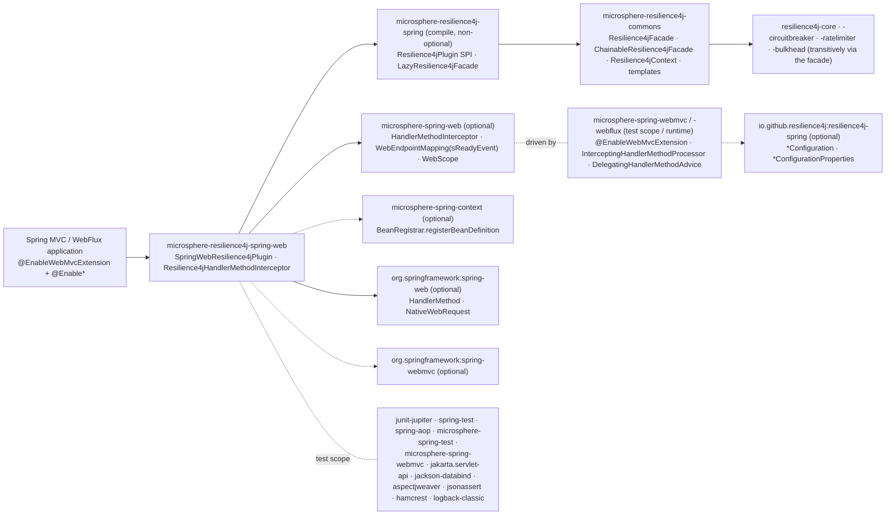

# microsphere-resilience4j-spring-web — Developer Guide

> Version line `0.2.x` (`release` branch) · latest release `0.2.4` · current `${revision}` = `0.2.5-SNAPSHOT` · Resilience4j **2.0.0 – 2.4.0** (default `2.4.0`) · Spring Cloud 2022.0.x – 2025.0.x · JDK **17+** · [← developer guide index](README.md)

Module path: `microsphere-resilience4j-plugins/microsphere-resilience4j-spring-web`.

## Class inventory

| Type | File | Role |
|------|------|------|
| `SpringWebResilience4jPlugin` | `src/main/java/io/microsphere/resilience4j/spring/web/SpringWebResilience4jPlugin.java` | `Resilience4jPlugin` descriptor, `getName() = "spring-web"`; registers the interceptor bean definition |
| `Resilience4jHandlerMethodInterceptor` | `src/main/java/io/microsphere/resilience4j/spring/web/Resilience4jHandlerMethodInterceptor.java` | The decoration itself: two-phase `begin`/`end` around a handler method, plus startup-time entry-name pre-computation |
| resource | `src/main/resources/META-INF/spring.factories` | `io.microsphere.resilience4j.spring.common.Resilience4jPlugin=io.microsphere.resilience4j.spring.web.SpringWebResilience4jPlugin` |
| `SpringWebResilience4jPluginTest` | `src/test/java/.../SpringWebResilience4jPluginTest.java` | The **only** test class; a single `test()` method driving `MockMvc` |

Note on the Javadoc: `Resilience4jHandlerMethodInterceptor` is documented as “the abstract template class for Resilience4j's `HandlerMethodInterceptor`”, but the class is **concrete** (no `abstract` modifier) and is instantiated directly by the plugin — a leftover of an earlier design; `protected initEntryCache(...)` is the one deliberate override point.

## Weaving mechanism

### 1. Registration: a plugin descriptor that only registers a bean definition

```java
@Override
public void plugin(ConfigurableListableBeanFactory beanFactory, BeanDefinitionRegistry registry, ConfigurableEnvironment environment) {
    registerResilience4jHandlerMethodInterceptor(registry);
}

private void registerResilience4jHandlerMethodInterceptor(BeanDefinitionRegistry registry) {
    registerBeanDefinition(registry, BEAN_NAME, Resilience4jHandlerMethodInterceptor.class);
}
```

`registerBeanDefinition(BeanDefinitionRegistry, String, Class)` (from `io.microsphere.spring.beans.factory.support.BeanRegistrar`) ends in `BeanDefinitionUtils.genericBeanDefinition(clazz, EMPTY_OBJECT_ARRAY)`, i.e. a plain `BeanDefinitionBuilder.genericBeanDefinition(...)` with role `0` and **no constructor arguments and no autowire mode**. The interceptor's mandatory `Resilience4jFacade` argument is therefore satisfied by Spring's single-public-constructor resolution, and it wins deterministically because `EnableResilience4jRegistrar#registerResilience4jFacade` registers the `lazyResilience4jFacade` definition with `setPrimary(true)`.

Order inside the registrar is visible in `EnableResilience4jRegistrar#registerBeanDefinitions`: `registerEntryConfiguration` → `registerEventComponentBeans` → **`registerPlugins`** → `registerResilience4jFacade`. Plugin registration happens before the facade definition exists, which is harmless because only a *bean definition* (name + type) is created here, not an instance.

### 2. Invocation: the `microsphere-spring-web` handler-method extension chain

The plugin never touches Spring MVC's `HandlerInterceptor`. The path (inspected from the published `microsphere-spring-web` / `microsphere-spring-webmvc` bytecode, since those interfaces are external to this repository) is:

1. `@EnableWebMvcExtension` (a `@Import({WebMvcExtensionBeanDefinitionRegistrar.class, WebMvcExtensionConfiguration.class})` meta-annotation of `@EnableWebExtension`, with `registerWebEndpointMappings`, `interceptHandlerMethods` and `publishEvents` defaulting to `true`) registers `InterceptingHandlerMethodProcessor`, which implements **three** Spring roles at once: `HandlerMethodArgumentResolver`, `HandlerMethodReturnValueHandler`, `HandlerInterceptor`.
2. Inside `resolveArgument(...)`, once the *last* parameter has been resolved (the bytecode compares `MethodParameter#getParameterIndex()` with the cached `parameterCount - 1`), the processor loops over its `List<HandlerMethodAdvice> handlerMethodAdvices` (collected with `BeanUtils.getSortedBeans`) and calls `HandlerMethodAdvice#beforeExecuteMethod(handlerMethod, args, request)`.
3. `handleReturnValue(...)` and `afterCompletion(...)` both funnel into a private `afterExecute(...)` that calls `HandlerMethodAdvice#afterExecuteMethod(handlerMethod, args, returnValue, throwable, request)`.
4. `io.microsphere.spring.web.method.support.DelegatingHandlerMethodAdvice` is the `HandlerMethodAdvice` bean that adapts the *other* SPI: on `ContextRefreshedEvent` it collects all sorted `HandlerMethodInterceptor` beans and forwards `beforeExecuteMethod` → `HandlerMethodInterceptor#beforeExecute` and `afterExecuteMethod` → `#afterExecute`.
5. `Resilience4jHandlerMethodInterceptor` is one of those `HandlerMethodInterceptor` beans.

So the decoration boundary is “all arguments resolved → controller method → return value handled”, which is wider than a `HandlerInterceptor#preHandle/postHandle` pair and narrower than a servlet filter.

### 3. The two-phase decoration and the request-scoped hand-off

`beforeExecute` and `afterExecute` are two different framework callbacks, so the plugin cannot use the one-time `call(...)` operation. It carries the state across them in request scope:

```java
@Override
public void beforeExecute(HandlerMethod handlerMethod, Object[] args, NativeWebRequest request) {
    Resilience4jContext<Resilience4jContext[]> context = resilience4jFacade.begin(getEntryName(handlerMethod));
    REQUEST.setAttribute(request, RESILIENCE4J_CONTEXT_ATTRIBUTE_NAME, context);
}

@Override
public void afterExecute(HandlerMethod handlerMethod, Object[] args, Object returnValue, Throwable error, NativeWebRequest request) {
    Resilience4jContext<Resilience4jContext[]> context = (Resilience4jContext<Resilience4jContext[]>)
            REQUEST.removeAttribute(request, RESILIENCE4J_CONTEXT_ATTRIBUTE_NAME);
    if (context == null) {
        logger.trace("The 'context' is null , please check whether the 'resilience4jFacade' is a 'ChainableResilience4jFacade'", error);
        return;
    }
    context.setResult(returnValue).setFailure(error);
    this.resilience4jFacade.end(context);
}
```

`RESILIENCE4J_CONTEXT_ATTRIBUTE_NAME` is `Resilience4jContext.class.getName()`; `REQUEST` is `io.microsphere.spring.web.util.WebScope.REQUEST` (its `setAttribute`/`removeAttribute` take a `RequestAttributes`, which `NativeWebRequest` is). `removeAttribute` returns the removed value, which is the natural “claim once” semantic for the end phase.

Commons side of the pair — `ChainableResilience4jFacade`:

```java
public Resilience4jContext<Resilience4jContext[]> begin(String name) {
    Resilience4jContext[] subContexts = new Resilience4jContext[size];
    Resilience4jContext<Resilience4jContext[]> context = new Resilience4jContext<>(name, subContexts);
    for (int i = 0; i < size; i++) {
        Resilience4jTemplate template = templates.get(i);
        if (template.isBeginSupported()) { subContexts[i] = template.begin(name); }
    }
    return context;
}
```

`end(...)` mirrors it with `isEndSupported()`. The guards are not cosmetic: `Resilience4jTemplate.begin/end` are `final` and delegate to `protected doBegin/doEnd`, whose **default implementation throws `UnsupportedOperationException("%s does not support begin operation")`**. `RetryTemplate`, `TimeLimiterTemplate` and `ThreadPoolBulkheadTemplate` are exactly the three templates that override `isBeginSupported()/isEndSupported()` to `false`, so on this plugin only three modules participate, and their pairs are:

| Template | `doBegin` | `doEnd` |
|----------|-----------|---------|
| `CircuitBreakerTemplate` | `circuitBreaker.acquirePermission()` (→ `CallNotPermittedException`) then `context.setStartTime(circuitBreaker.getCurrentTimestamp())` | duration computed with the entry's own `getTimestampUnit()`, then `onSuccess` / `onResult(result)` / `onError(failure)` |
| `BulkheadTemplate` | `bulkhead.acquirePermission()` (→ `RequestNotPermitted`) | `bulkhead.onComplete()` — **the only release path for the permit** |
| `RateLimiterTemplate` | static helper `RateLimiter.waitForPermission(rateLimiter)`, which internally calls `acquirePermission(1)`, throws `AcquirePermissionCancelledException` if the thread was interrupted and `RequestNotPermitted` if no permit was granted within `timeoutDuration` | `rateLimiter.onSuccess()` / `onResult(result)` / `onError(failure)` |

That is the structural difference from the other four plugins, all of which use the one-time `call(...)` path where every template — including retry, time limiter and thread-pool bulkhead — decorates the call.

### 4. Startup-time naming and local entry pre-warming

```java
public String getEntryName(HandlerMethod handlerMethod) {
    Method method = handlerMethod.getMethod();
    return this.methodEntryNamesCache.computeIfAbsent(method, m -> PLUGIN_NAME + "@" + handlerMethod);
}

protected void initEntryCache(WebEndpointMappingsReadyEvent event) {
    Collection<WebEndpointMapping> webEndpointMappings = event.getMappings();
    Map<Method, String> methodEntryNamesCache = newFixedHashMap(webEndpointMappings.size());
    this.methodEntryNamesCache = methodEntryNamesCache;
    for (WebEndpointMapping mapping : webEndpointMappings) {           // (source uses an explicit Iterator loop)
        Object endpoint = mapping.getEndpoint();
        if (endpoint instanceof HandlerMethod) {
            String entryName = getEntryName((HandlerMethod) endpoint); // side effect: fills the cache
            logger.trace("Create the entryName : '{}' for HandlerMethod : {}", entryName, handlerMethod);
        }
    }
    ChainableResilience4jFacade facade = tryUnwrap(this.resilience4jFacade, ChainableResilience4jFacade.class);
    if (facade != null) {
        facade.getTemplates().forEach(template -> template.initLocalEntriesCache(methodEntryNamesCache.values()));
    }
}
```

Three observations that matter for maintenance:

- The `while (iterator.hasNext())` loop has no other purpose than to populate `methodEntryNamesCache` through `getEntryName`; the trace log references the loop-local `handlerMethod`, not the computed name.
- `methodEntryNamesCache` is **only** assigned here. A request that reaches `beforeExecute` before `WebEndpointMappingsReadyEvent` is published produces a `NullPointerException` from `computeIfAbsent` on a `null` map — there is no lazy fallback. This is the intended “fail fast if the Web extension is missing” behaviour but it is not documented in the code.
- `tryUnwrap(...)` (from `io.microsphere.lang.Wrapper`) is what makes the pre-warming work with the Spring layer's `LazyResilience4jFacade`, which is a `DelegatingWrapper` whose delegate `ChainableResilience4jFacade` only exists after `ContextRefreshedEvent`. If the interceptor is initialized before that event, `facade` is `null` and pre-warming is silently skipped. `initLocalEntriesCache` itself is a no-op unless the template overrides `createLocalEntriesCache()`; when `localEntriesCached` is off it logs a `warn`.

### Sequence diagram: one decorated HTTP request

```mermaid
sequenceDiagram
    participant C as Client
    participant DS as DispatcherServlet
    participant P as InterceptingHandlerMethodProcessor<br/>(microsphere-spring-webmvc)
    participant A as DelegatingHandlerMethodAdvice
    participant I as Resilience4jHandlerMethodInterceptor
    participant F as LazyResilience4jFacade → ChainableResilience4jFacade
    participant Ctl as Controller method
    participant RV as ReturnValueHandler

    C->>DS: POST /test/user
    DS->>P: resolveArgument(param 0..n-1) via the real resolver
    Note over P: parameterIndex == parameterCount - 1
    P->>A: beforeExecuteMethod(handlerMethod, args, request)
    A->>I: beforeExecute(handlerMethod, args, request)
    I->>F: begin("spring-web@" + handlerMethod)
    F->>F: CircuitBreakerTemplate.doBegin (acquirePermission)<br/>RateLimiter / Bulkhead doBegin<br/>Retry, TimeLimiter, ThreadPoolBulkhead skipped
    F-->>I: Resilience4jContext<Resilience4jContext[]>
    I->>I: WebScope.REQUEST.setAttribute(context)
    DS->>Ctl: invokeHandlerMethod → controller runs
    Ctl-->>RV: return value
    RV->>P: handleReturnValue(...) (or afterCompletion on error)
    P->>A: afterExecuteMethod(handlerMethod, args, returnValue, throwable, request)
    A->>I: afterExecute(...)
    I->>I: context = REQUEST.removeAttribute(...)
    I->>F: context.setResult(returnValue).setFailure(error); end(context)
    F->>F: onSuccess/onResult/onError + release permissions
    DS-->>C: 200 OK (or 500 when begin() threw)
```

### Flowchart: context hand-off and its failure modes



## Design patterns (with evidence)

| Pattern | Evidence in this module |
|---------|--------------------------|
| **Observer** | `Resilience4jHandlerMethodInterceptor implements ApplicationListener<WebEndpointMappingsReadyEvent>`; the event both seeds the name cache and triggers pre-warming. |
| **Adapter** | The interceptor adapts `HandlerMethodInterceptor#beforeExecute/afterExecute` (a start/stop pair with no nesting of the protected call) onto the `Resilience4jFacade#begin/end` pair. The plugin class adapts `Resilience4jPlugin#plugin(...)` onto `BeanRegistrar.registerBeanDefinition(...)`. |
| **Facade** | Main sources import **no** `io.github.resilience4j.*` type; only `io.microsphere.resilience4j.common.Resilience4jFacade`/`Resilience4jContext`/`Resilience4jTemplate` and `io.microsphere.resilience4j.spring.common.Resilience4jPlugin`. |
| **Chain of Responsibility** | Two nested chains: the container-sorted `HandlerMethodInterceptor` list, and the priority-sorted `Resilience4jTemplate` list inside `ChainableResilience4jFacade`. `getOrder()/setOrder(int)` position this interceptor in the first chain. |
| **Lazy Proxy / Delegating Wrapper** | The bean holds `lazyResilience4jFacade` (`LazyResilience4jFacade implements DelegatingWrapper`), whose delegate is built on `ContextRefreshedEvent`; `Wrapper.tryUnwrap` sees through it at pre-warm time. |
| **Template Method** | `initEntryCache(WebEndpointMappingsReadyEvent)` is `protected` — the documented way for a sub-class to change naming/pre-warming while `beforeExecute`/`afterExecute` stay final-ish in behaviour (`getResilience4jFacade()` is `final`). |
| **Flyweight / caching** | `Map<Method, String> methodEntryNamesCache` (`newFixedHashMap`) plus `Resilience4jTemplate.localEntriesCache` avoid per-request name building and registry lookups. |
| **SPI + Service Loader** | `META-INF/spring.factories` keyed by `Resilience4jPlugin`; consumed by `EnableResilience4jRegistrar#registerPlugins` through `loadFactories(beanFactory, Resilience4jPlugin.class)` and filtered by `contains(plugins, plugin.getName())`. |

## Dependency map



| Aspect | Fact |
|--------|------|
| Upstream layer | **spring** (not commons). `microsphere-resilience4j-spring` is compile/non-optional, which is what makes `Resilience4jPlugin` implementable and `META-INF/spring.factories` meaningful — contrast with `microsphere-resilience4j-openfeign`, which stops at commons. |
| Resilience4j components actually used | `CircuitBreaker`, `RateLimiter`, `Bulkhead` (their templates implement `doBegin`/`doEnd`). `Retry`, `TimeLimiter` and `ThreadPoolBulkhead` are present in the facade but skipped by the `isBeginSupported()/isEndSupported()` guards. The registry beans come from `resilience4j-spring`'s own `*Configuration`, registered by `registerEntryConfiguration(...)` in `EnableResilience4jRegistrar` (e.g. `EnableBulkheadRegistrar` registers `io.github.resilience4j.bulkhead.configure.BulkheadConfiguration`). |
| Framework API surface used | `HandlerMethodInterceptor` (2 default methods, both `throws Exception`), `WebEndpointMappingsReadyEvent#getMappings()`, `WebEndpointMapping#getEndpoint()`, `WebScope.REQUEST#setAttribute/removeAttribute`, `HandlerMethod`, `NativeWebRequest`, `ApplicationListener`, `Ordered`. |
| Does the plugin itself create the interception? | No. `SpringWebResilience4jPlugin` only registers the bean; all invocation machinery belongs to `microsphere-spring-web(-mvc/-webflux)` and requires `@EnableWebMvcExtension` / `@EnableWebFluxExtension`. |

## Test coverage as shipped

`SpringWebResilience4jPluginTest` is the module's only test. It is a `@SpringJUnitConfig` + `@WebAppConfiguration` + `@EnableWebMvc` + `@EnableWebMvcExtension` + `@EnableBulkhead(plugins = PLUGIN_NAME)` context that imports `TestController` (a bean from `microsphere-spring-test`), and its single `test()` method performs one `MockMvc` `POST /test/user` with a Jackson-serialized `io.microsphere.spring.test.domain.User` (`name = "Mercy"`, `age = 18`), asserting `status().isOk()` and that the response body equals the request JSON.

Consequences worth knowing when you extend this module:

- There is **no unit test** asserting `getEntryName(...)` output, the request attribute round trip, the `context == null` branch, `getOrder()/setOrder(...)`, or the `initEntryCache` pre-warming.
- The happy path proves that begin+end *together* do not break a normal request (with `BulkheadRegistry`-style defaults from `BulkheadConfiguration`), not that any Resilience4j instance recorded a call.
- The error path (`afterExecute` with a non-null `Throwable`) is untested — that is the branch that decides whether the circuit breaker sees `onError` or `onSuccess`.
- Only the servlet (WebMVC) flavour is exercised; the WebFlux flavour is asserted by the Javadoc reference `@see io.microsphere.spring.webflux.annotation.EnableWebFluxExtension` only.

## Extension points for contributors

- Override `initEntryCache(...)` to change the naming scheme (for example to `spring-web@<beanName>#<method>` or to include the request path) — remember that `getEntryName` is public and used at request time too, so both call sites must stay consistent.
- `getOrder()/setOrder(int)` exist so that the decoration can be moved relative to other `HandlerMethodInterceptor` beans (idempotency, rate-limit-by-header, etc.); the container's `BeanUtils.getSortedBeans` is what applies it.
- If the plugin ever needs its own configuration, the shape used by the MyBatis plugin (constructor-arg **reference** to `LazyResilience4jFacade.BEAN_NAME`) is more explicit than the current “no constructor arguments + primary bean” approach and would remove the dependency on single-constructor resolution: see the [MyBatis developer page](microsphere-resilience4j-mybatis.md).
- Any behaviour that depends on `Resilience4jContext` being a request attribute must also survive async requests (`DeferredResult`, `Callable`), where `afterExecute` may arrive on a different thread and, in some configurations, with the attribute already gone.

## Related pages

- [User guide — microsphere-resilience4j-spring-web](../user-guide/microsphere-resilience4j-spring-web.md)
- [Developer guide — microsphere-resilience4j-spring](microsphere-resilience4j-spring.md)
- [Developer guide — microsphere-resilience4j-openfeign](microsphere-resilience4j-openfeign.md)
