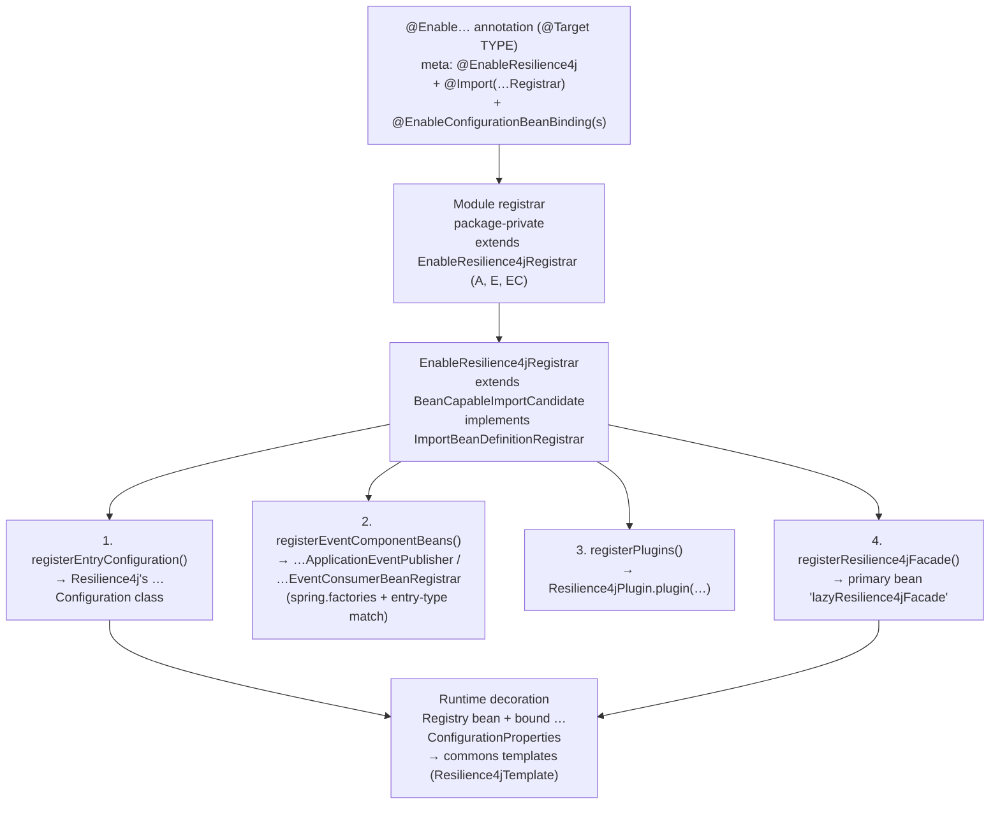
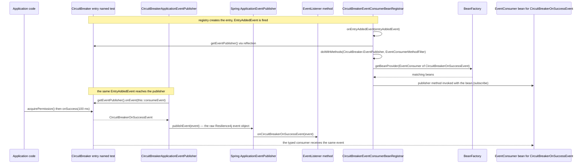
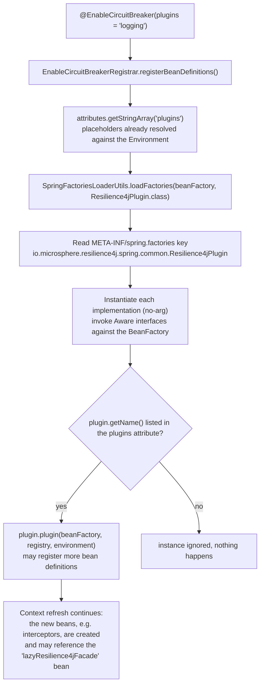
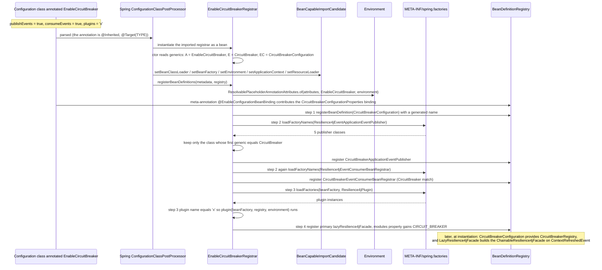

# microsphere-resilience4j-spring — Developer Guide

> Source branch: `release` · Version line: `0.2.x` (latest release `0.2.4`) · Target: **Resilience4j 2.0.0 – 2.4.0** (default `2.4.0`)
> Back to [guide index](README.md) · End-user view: [user guide](../user-guide/microsphere-resilience4j-spring.md)

This page analyses the internals of the `microsphere-resilience4j-spring` module: the annotation →
registrar → bean-definition pipeline, the Resilience4j ⇄ Spring event bridge, the `Resilience4jPlugin`
SPI, and the lazy facade. Every statement below is taken from the module sources under
`microsphere-resilience4j-spring/src/{main,test}` on the `release` branch.

---

## 1. Architecture of the Spring integration

The module is thin by design: it never re-implements Resilience4j behaviour. It does four things.



| Stage | Who | What exists afterwards |
|-------|-----|------------------------|
| annotation | `EnableCircuitBreaker`, … | nothing yet; only metadata (`publishEvents`, `consumeEvents`, `plugins`) |
| registrar | `EnableResilience4jRegistrar` subclasses | bean *definitions* in the `BeanDefinitionRegistry`: Resilience4j's `*Configuration`, event bridge beans (opt-in), the lazy facade |
| binding | `@EnableConfigurationBeanBinding` (microsphere-spring-context) | a `*ConfigurationProperties` bean populated from `microsphere.resilience4j.<module>.*` |
| runtime | Resilience4j + commons | the module's `Registry` bean is created by the registered `*Configuration`; `LazyResilience4jFacade` turns the registries into `Resilience4jTemplate`s on `ContextRefreshedEvent` |

### 1.1 Source map

| Package | Classes | Role |
|---------|---------|------|
| `…spring` | `LazyResilience4jFacade` | Spring facade bean, lazily delegates to `ChainableResilience4jFacade` |
| `…spring.common.annotation` | `EnableResilience4j`, `EnableResilience4jRegistrar<A,E,EC>` | meta-annotation + the only non-trivial registrar code in the module |
| `…spring.<module>.annotation` | `Enable*` (6) + `Enable*Registrar` (6, package-private) | per-module entry points |
| `…spring.common.event` | `Resilience4jEventApplicationEventPublisher<E,ET>`, `Resilience4jEventConsumerBeanRegistrar<E>`, `EventConsumerMethodFilter` | the generic halves of the event bridge |
| `…spring.<module>.event` | `*ApplicationEventPublisher`, `*EventConsumerBeanRegistrar` (5 each) | module-specific subclasses, empty bodies |
| `…spring.common` | `Resilience4jPlugin` | plugin SPI |
| `src/main/resources/META-INF/spring.factories` | two keys | the registry of event bridge implementations |
| `src/test/java` | 12 classes (10 `*Test` classes + the two test-scope `Resilience4jPlugin` implementations) | the executable specification used for the examples in this guide |

---

## 2. `EnableResilience4jRegistrar` — source analysis

```java
public abstract class EnableResilience4jRegistrar<A extends Annotation, E, EC> extends BeanCapableImportCandidate
        implements ImportBeanDefinitionRegistrar {

    private static final Map<String, Class<?>> attributedEventComponentClassesMap = ofMap(
            "publishEvents", Resilience4jEventApplicationEventPublisher.class,
            "consumeEvents", Resilience4jEventConsumerBeanRegistrar.class);

    private final ResolvableType superType;
    private final Class<A> annotationType;
    private final Class<E> entryType;
    private final Class<EC> entryConfigurationType;

    protected EnableResilience4jRegistrar() {
        this.superType = resolveSuperType();          // ResolvableType.forType(getClass()).as(EnableResilience4jRegistrar.class)
        this.annotationType = resolveGeneric(0);      // e.g. EnableCircuitBreaker
        this.entryType = resolveGeneric(1);           // e.g. CircuitBreaker
        this.entryConfigurationType = resolveGeneric(2); // e.g. CircuitBreakerConfiguration
    }
```

Three facts follow from that constructor:

1. **The subclass carries all configuration in its generic signature.** The concrete registrars contain
   no code at all:
   ```java
   class EnableCircuitBreakerRegistrar extends EnableResilience4jRegistrar<EnableCircuitBreaker, CircuitBreaker,
           CircuitBreakerConfiguration> {
   }
   ```
   (identically: `EnableRateLimiterRegistrar<EnableRateLimiter, RateLimiter, RateLimiterConfiguration>`,
   `EnableRetryRegistrar<EnableRetry, Retry, RetryConfiguration>`,
   `EnableTimeLimiterRegistrar<EnableTimeLimiter, TimeLimiter, TimeLimiterConfiguration>`,
   `EnableBulkheadRegistrar<EnableBulkhead, Bulkhead, BulkheadConfiguration>`,
   `EnableThreadPoolBulkheadRegistrar<EnableThreadPoolBulkhead, ThreadPoolBulkhead, BulkheadConfiguration>`).
2. Generics are read once at instantiation time via `ResolvableType.as(...).resolveGeneric(i)` — no
   reflection metadata, no `@Conditional`.
3. All six registrar classes are **package-private**, so `@Import` from the annotation is the only way to
   reach them.

`registerBeanDefinitions` is declared `final` (subclasses cannot change the order):

```java
public final void registerBeanDefinitions(AnnotationMetadata metadata, BeanDefinitionRegistry registry) {
    String annotationClassName = annotationType.getName();
    Map<String, Object> annotationAttributes = metadata.getAnnotationAttributes(annotationClassName);
    ResolvablePlaceholderAnnotationAttributes attributes = of(annotationAttributes, annotationType, getEnvironment());

    registerEntryConfiguration(registry);      // (1)
    registerEventComponentBeans(attributes, registry); // (2)
    registerPlugins(attributes, registry);     // (3)
    registerResilience4jFacade(registry);      // (4)
}
```

### 2.1 Why the base class is `BeanCapableImportCandidate`

Spring instantiates an `@Import`ed `ImportBeanDefinitionRegistrar` as a bean, so the awareness callbacks
declared by `io.microsphere.spring.context.annotation.BeanCapableImportCandidate`
(`BeanClassLoaderAware`, `BeanFactoryAware`, `EnvironmentAware`, `ApplicationContextAware`,
`ResourceLoaderAware`, all `final` in the base class) have already fired when `registerBeanDefinitions`
runs. The registrar therefore uses the inherited `final` accessors:

- `getEnvironment()` → placeholder resolution of the annotation attributes, which happens before step (1);
- `getClassLoader()` → `SpringFactoriesLoader.loadFactoryNames(...)` in step (2);
- `this.beanFactory` (a `ConfigurableListableBeanFactory`) → `loadFactories(...)` in step (3) and the
  `plugin(...)` callback.

This is what makes the annotations usable before any application bean exists, while still allowing
`Environment`-driven behaviour.

### 2.2 Step (1): `registerEntryConfiguration`

```java
private void registerEntryConfiguration(BeanDefinitionRegistry registry) {
    registerBeanDefinition(registry, getEntryConfigurationType());
}
```

`registerBeanDefinition` is the static import of
`io.microsphere.spring.beans.factory.support.BeanRegistrar.registerBeanDefinition(BeanDefinitionRegistry, Class)`
(`microsphere-spring-context` — a sibling project, not part of this repository). Two overloads are used by
this registrar, and the contrast between them is what matters here:

| Call site | Overload | Bean name |
|-----------|----------|-----------|
| step (1), step (2) | `registerBeanDefinition(registry, beanType)` → `(registry, null, beanType)` | `null` is passed down, so the library generates it with `BeanDefinitionReaderUtils.generateBeanName(beanDefinition, registry)`, i.e. derived from the bean class |
| step (4) | `registerBeanDefinition(registry, "lazyResilience4jFacade", beanDefinition)` | the fixed constant, explicitly passed |

Details verified in `BeanRegistrar` (same call chain, with `allowBeanDefinitionOverriding = false`):
`genericBeanDefinition(beanType)` is created, the name is generated when `null`, and if that name is already
taken the definition is **not** replaced — a `warn` log (`"The bean[name : '{}'] definition [{}] was
registered!"`) is emitted and `false` is returned. `EnableResilience4jRegistrar` ignores that return value,
and no code in it looks for an existing definition *of the same type* before registering; the only
`containsBeanDefinition` guard in the class is the one for `lazyResilience4jFacade` (§2.5).

Practical consequences: only the facade has a stable, documented bean name, so **inject by type and never
hardcode the generated names**. Spring's `generateBeanName` is specified to produce a name that is unique
*within the given registry*, and this registrar never deduplicates by type — so registering the same class
from two annotations simply yields more than one definition, and the generated names are an implementation
detail you should not rely on.

What gets registered is **Resilience4j's own** configuration class
(`io.github.resilience4j.<module>.configure.<Module>Configuration`), which is what eventually provides
the module's `Registry` bean. The tests prove this: `CircuitBreakerApplicationEventPublisherTest` lists
only `CircuitBreakerConfigurationProperties.class, CircuitBreakerConfiguration.class, …` and still
autowires a `CircuitBreakerRegistry`.

`@EnableThreadPoolBulkhead` passes `BulkheadConfiguration` (not
`io.github.resilience4j.bulkhead.configure.threadpool.ThreadPoolBulkheadConfiguration`, which it only
references in Javadoc) as `EC`, and `@EnableBulkhead` passes the same class — so applying both annotations
(e.g. `EnableThreadPoolBulkheadTest`) registers two definitions for the same configuration class, since the
registrar has no same-type check (§2.2 above).

### 2.3 Step (2): `registerEventComponentBeans` — the spring.factories + generics filter

```java
private void registerEventComponentBeans(ResolvablePlaceholderAnnotationAttributes attributes, BeanDefinitionRegistry registry) {
    for (Map.Entry<String, Class<?>> entry : attributedEventComponentClassesMap.entrySet()) {
        String attributeName = entry.getKey();               // "publishEvents" / "consumeEvents"
        boolean supported = attributes.getBoolean(attributeName);
        if (supported) {
            registerComponentBean(entry.getValue(), registry);
        }
    }
}

private void registerComponentBean(Class<?> componentClass, BeanDefinitionRegistry registry) {
    ClassLoader classLoader = this.getClassLoader();
    List<String> actualComponentClassNames = loadFactoryNames(componentClass, classLoader);
    for (String actualComponentClassName : actualComponentClassNames) {
        Class<?> actualComponentClass = resolveClassName(actualComponentClassName, classLoader);
        Class<E> entryTypeFromComponent = resolveEntryType(actualComponentClass, componentClass);
        if (Objects.equals(entryTypeFromComponent, this.entryType)) {
            registerBeanDefinition(registry, actualComponentClass);
        }
    }
}
```

- Two attribute names drive two **factory keys** (`Resilience4jEventApplicationEventPublisher`,
  `Resilience4jEventConsumerBeanRegistrar`), both declared in
  `src/main/resources/META-INF/spring.factories` with five implementations each (`Bulkhead`,
  `CircuitBreaker`, `RateLimiter`, `Retry`, `TimeLimiter`).
- `resolveEntryType(target, super)` = `ResolvableType.forType(target).as(super).resolveGeneric(0)` — the
  first generic of the abstract bridge class. For `CircuitBreakerApplicationEventPublisher` that is
  `CircuitBreaker`; for `CircuitBreakerEventConsumerBeanRegistrar` (which extends
  `Resilience4jEventConsumerBeanRegistrar<CircuitBreaker>`) also `CircuitBreaker`.
- The comparison is **exact class equality** (`Objects.equals`), not assignability. Hence
  `@EnableThreadPoolBulkhead` (`entryType = ThreadPoolBulkhead`) matches **no** factory entry, and its
  `publishEvents`/`consumeEvents` flags are inert. This is the single most surprising behaviour of the
  module and explains why `EnableThreadPoolBulkheadTest` also puts `@EnableBulkhead` on the class.
- Registered beans again use generated names, and their module-specific classes are empty subclasses —
  the whole implementation lives in the two abstract classes (§3).

### 2.4 Step (3): `registerPlugins`

```java
private void registerPlugins(ResolvablePlaceholderAnnotationAttributes attributes, BeanDefinitionRegistry registry) {
    String[] plugins = attributes.getStringArray("plugins");
    List<Resilience4jPlugin> resilience4jPlugins = loadFactories(this.getBeanFactory(), Resilience4jPlugin.class);
    for (Resilience4jPlugin resilience4jPlugin : resilience4jPlugins) {
        String pluginName = resilience4jPlugin.getName();
        if (contains(plugins, pluginName)) {
            resilience4jPlugin.plugin(this.beanFactory, registry, this.environment);
        }
    }
}
```

`loadFactories(BeanFactory, Class)` (`io.microsphere.spring.core.io.support.SpringFactoriesLoaderUtils`)
reads `META-INF/spring.factories` under the key `io.microsphere.resilience4j.spring.common.Resilience4jPlugin`,
instantiates each implementation reflectively (falling back to `SpringFactoriesLoader.loadFactories` when
the bean factory is not an `ApplicationContext`) and invokes its `Aware` interfaces against the bean
factory. Plugins are therefore **not** container-managed beans; only the ones whose `getName()` appears in
the annotation's `plugins` array are activated. `contains` is `io.microsphere.util.ArrayUtils.contains`.

### 2.5 Step (4): `registerResilience4jFacade` — one facade, accumulating modules

```java
private void registerResilience4jFacade(BeanDefinitionRegistry registry) {
    Resilience4jModule module = valueOf(this.entryType);          // Resilience4jModule.valueOf(Class)
    String beanName = BEAN_NAME;                                  // "lazyResilience4jFacade"
    String propertyName = "modules";

    Set<Resilience4jModule> modules;
    AbstractBeanDefinition beanDefinition;
    PropertyValue modulesPropertyValue;
    if (registry.containsBeanDefinition(beanName)) {
        beanDefinition = (AbstractBeanDefinition) registry.getBeanDefinition(beanName);
        modulesPropertyValue = beanDefinition.getPropertyValues().getPropertyValue(propertyName);
        modules = (Set<Resilience4jModule>) modulesPropertyValue.getValue();
    } else {
        modules = newHashSet(Resilience4jModule.values().length);
        beanDefinition = genericBeanDefinition(LazyResilience4jFacade.class);
        beanDefinition.setPrimary(true);
        MutablePropertyValues propertyValues = beanDefinition.getPropertyValues();
        propertyValues.add(propertyName, modules);
        registerBeanDefinition(registry, beanName, beanDefinition);
    }
    modules.add(module);
}
```

Design points visible here:

- **Fixed bean name + primary**: `LazyResilience4jFacade.BEAN_NAME == "lazyResilience4jFacade"`, and
  `setPrimary(true)` makes `@Autowired Resilience4jFacade` resolve to it even if other facades exist
  (e.g. a hand-made `ChainableResilience4jFacade`).
- **Idempotent accumulation**: the second `@Enable*` annotation finds the existing definition, reads the
  *same* `HashSet` instance out of its `PropertyValue` and adds its module. N annotations ⇒ one facade
  bean with N modules. The set is deliberately kept mutable and shared with the bean definition.
- **Module resolution by type**: `Resilience4jModule.valueOf(Class)` (commons) scans the enum against
  `entryClass`, `configClass`, `configurationPropertiesClass`, `eventClass`, `registryClass`, so
  `CircuitBreaker` ⇒ `CIRCUIT_BREAKER`, `Bulkhead` ⇒ `BULKHEAD`, `ThreadPoolBulkhead` ⇒
  `THREAD_POOL_BULKHEAD`; unknown types throw `IllegalArgumentException`.

### 2.6 "Conditions" in this module

There is **no** `@Conditional`, `@ConditionalOnMissingBean`, `@Profile` or `@Order` annotation anywhere in
`microsphere-resilience4j-spring/src/main` (verified by source scan). Activation is decided by three
runtime predicates instead:

| Gate | Implemented as | Failure mode |
|------|----------------|--------------|
| `publishEvents` / `consumeEvents` | `attributes.getBoolean(name)` in the loop over `attributedEventComponentClassesMap` | bean simply not registered (default `false`) |
| module match | `Objects.equals(resolveEntryType(component), this.entryType)` | silently no bean (this is the `ThreadPoolBulkhead` gap) |
| plugin selection | `ArrayUtils.contains(plugins, plugin.getName())` | plugin instantiated but not activated |

---

## 3. The event bridge design

Two independent, one-directional mechanisms share the same registration code path (§2.3).

### 3.1 Publishing: `Resilience4jEventApplicationEventPublisher<E, ET>`

Abridged from the source (the `logger` / `applicationEventPublisher` fields, `@Override` annotations and
`setApplicationEventPublisher` are omitted; bodies are verbatim):

```java
public abstract class Resilience4jEventApplicationEventPublisher<E, ET> implements EventConsumer<ET>,
        RegistryEventConsumer<E>, ApplicationEventPublisherAware {

    public void consumeEvent(ET event) {
        applicationEventPublisher.publishEvent(event);
        logger.trace("The Resilience4j Event : {} was published on the Spring ApplicationListener(s)", event);
    }

    public void onEntryAddedEvent(EntryAddedEvent<E> entryAddedEvent) {
        register(entryAddedEvent::getAddedEntry);
    }

    public void onEntryReplacedEvent(EntryReplacedEvent<E> entryReplacedEvent) {
        register(entryReplacedEvent::getNewEntry);
    }

    public void onEntryRemovedEvent(EntryRemovedEvent<E> entryRemoveEvent) {
        // no-op
    }

    private void register(Supplier<E> entrySupplier) {
        E entry = entrySupplier.get();
        Method eventPublisherMethod = findMethod(entry.getClass(), "getEventPublisher");
        EventPublisher<ET> eventPublisher = (EventPublisher) invokeMethod(eventPublisherMethod, entry);
        eventPublisher.onEvent(this::consumeEvent);
    }
}
```

- **Subscription trigger**: the class is a `RegistryEventConsumer<E>`; Resilience4j's registry machinery
  hands registry lifecycle events to such beans, which is why the bridge needs no explicit
  `registry.getEventPublisher().onEntryAdded(...)` call in this module. The observable proof is
  `EnableCircuitBreakerTest`: creating an entry with `registry.circuitBreaker("test")` and calling
  `onSuccess(...)` makes the `@EventListener(CircuitBreakerOnSuccessEvent.class)` fire.
- **Universal subscription**: `EventPublisher#onEvent(consumer)` receives *every* event of the entry, so
  the publisher does not need per-event-type methods; filtering is done by `@EventListener(X.class)`
  on the Spring side.
- **Payload identity**: the Resilience4j event object is published *as is*
  (`publishEvent(event)`), not wrapped in a custom `ApplicationEvent` subclass. Spring's
  `PayloadApplicationEvent` wrapping is why `@EventListener(SomeResilience4jEvent.class)` matches.
- Reflection (`findMethod(entryClass, "getEventPublisher")`) is required because `getEventPublisher()` is
  declared on each concrete entry interface (`CircuitBreaker.EventPublisher`, `Retry.EventPublisher`, …),
  not on a shared supertype of `E`/`ET`.
- Removal is a no-op, so a removed entry keeps a (harmless) subscription; replacement re-subscribes the
  new entry.

### 3.2 Consuming: `Resilience4jEventConsumerBeanRegistrar<E>`

Abridged: only the class declaration and the private `register(E)` method are shown verbatim; the
`logger` / `beanFactory` fields, `setBeanFactory` and the three `RegistryEventConsumer` callbacks are
described in the paragraph below the listing.

```java
public abstract class Resilience4jEventConsumerBeanRegistrar<E> implements RegistryEventConsumer<E>, BeanFactoryAware {

    private void register(E entry) {
        Class<?> entryClass = entry.getClass();
        Method eventPublisherMethod = findMethod(entryClass, "getEventPublisher");
        Class<?> eventPublisherClass = eventPublisherMethod.getReturnType();
        Object eventPublisher = invokeMethod(eventPublisherMethod, entry);
        doWithMethods(eventPublisherClass, method -> {
            ResolvableType type = forMethodParameter(method, 0);
            ObjectProvider objectProvider = beanFactory.getBeanProvider(type);
            objectProvider.forEach(eventConsumerBean -> invokeMethod(method, eventPublisher, eventConsumerBean));
        }, INSTANCE);   // EventConsumerMethodFilter.INSTANCE
    }
}
```

All three `RegistryEventConsumer` callbacks emit a `trace` log; `onEntryAddedEvent` and
`onEntryReplacedEvent` additionally call `register(...)` (for the added entry and for the *new* entry,
respectively), while `onEntryRemovedEvent` only logs — removed entries keep their consumer subscriptions
until the context goes away.

The discovery algorithm is: *entry → its `EventPublisher` type → all publisher methods that take a single
`EventConsumer` → for each method, all Spring beans of that exact generic consumer type → subscribe.*
Because `ResolvableType.forMethodParameter(method, 0)` preserves the parameter's generic argument,
`getBeanProvider` resolves `EventConsumer<CircuitBreakerOnSuccessEvent>` — not raw `EventConsumer` — so a
bean of a different event type is never wired by accident. `CircuitBreakerEventConsumerBeanRegistrarTest`
exercises exactly this: one `@Bean EventConsumer<CircuitBreakerOnSuccessEvent>` receives the success
event created by `circuitBreaker.onSuccess(100, MILLISECONDS)`.

### 3.3 `EventConsumerMethodFilter`

```java
public class EventConsumerMethodFilter implements MethodFilter {

    public static EventConsumerMethodFilter INSTANCE = new EventConsumerMethodFilter();

    @Override
    public boolean matches(Method method) {
        return method.getParameterCount() == 1 && EventConsumer.class.equals(method.getParameterTypes()[0]);
    }
}
```

It is Spring's `ReflectionUtils.MethodFilter`, implemented as a stateless filter exposed through a public
static `INSTANCE` field. The predicate looks at the **erased declared** parameter type, so a method matches
only when it declares exactly one parameter typed `io.github.resilience4j.core.EventConsumer`; a different
parameter type (`EventProcessor`, `RegistryEventConsumer`, …), no parameter, or more than one parameter
never matches. Because `EventConsumer<SomeEvent>` is the declared type on the Resilience4j publisher
methods, the filter selects precisely the "subscribe a consumer" methods.
`EventConsumerMethodFilterTest` asserts this positively for `EventPublisher`, `Retry.EventPublisher`,
`CircuitBreaker.EventPublisher`, `RateLimiter.EventPublisher`, `TimeLimiter.EventPublisher`,
`Bulkhead.EventPublisher` (every *locally declared* method must match) and negatively for an arbitrary
test class.

### 3.4 Bridge coverage per module

| Module entry type | Publisher class | Consumer registrar class | Selected by `@EnableThreadPoolBulkhead` (`entryType = ThreadPoolBulkhead`)? |
|-------------------|-----------------|--------------------------|-----------------------------------------------------------------------------|
| `CircuitBreaker` | `CircuitBreakerApplicationEventPublisher` | `CircuitBreakerEventConsumerBeanRegistrar` | no |
| `RateLimiter` | `RateLimiterApplicationEventPublisher` | `RateLimiterEventConsumerBeanRegistrar` | no |
| `Retry` | `RetryApplicationEventPublisher` | `RetryEventConsumerBeanRegistrar` | no |
| `TimeLimiter` | `TimeLimiterApplicationEventPublisher` | `TimeLimiterEventConsumerBeanRegistrar` | no |
| `Bulkhead` | `BulkheadApplicationEventPublisher` | `BulkheadEventConsumerBeanRegistrar` | no (`Bulkhead` is not equal to `ThreadPoolBulkhead`) |
| `ThreadPoolBulkhead` | *(no class exists)* | *(no class exists)* | nothing to select |

All ten concrete classes are empty subclasses that only fix the generics, e.g.
`public class CircuitBreakerApplicationEventPublisher extends Resilience4jEventApplicationEventPublisher<CircuitBreaker, CircuitBreakerEvent> {}`.
Adding `ThreadPoolBulkhead` support means adding both classes **and** the two `spring.factories` lines — no
registrar change is needed, because step (2) is driven entirely by `spring.factories` + generics.

### 3.5 Diagram (b): one CircuitBreaker event, both directions



---

## 4. `LazyResilience4jFacade`: lazy initialization analysis

```java
public class LazyResilience4jFacade implements Resilience4jFacade,
        ApplicationListener<ContextRefreshedEvent>, DelegatingWrapper {

    public static final String BEAN_NAME = "lazyResilience4jFacade";
    private Resilience4jFacade delegate;
    private Set<Resilience4jModule> modules;

    public void onApplicationEvent(ContextRefreshedEvent event) {
        initDelegate(event.getApplicationContext());
    }

    private void initDelegate(ApplicationContext context) {
        Set<Resilience4jModule> modules = getModules();
        List<Registry> registries = newArrayList(modules.size());
        for (Resilience4jModule module : modules) {
            Class<? extends Registry> registryClass = module.getRegistryClass();
            Registry registry = context.getBean(registryClass);
            registries.add(registry);
        }
        this.delegate = new ChainableResilience4jFacade(registries);
    }
}
```

- Every `Resilience4jFacade` operation (`execute`, `call`, `begin`, `end`, `isBeginSupported`,
  `isEndSupported`) is a one-line delegation to `delegate`; before the first `ContextRefreshedEvent` the
  field is `null`, so the facade is **not** usable during bean creation of other singletons.
- The `modules` set is injected as a bean property by the registrar (§2.5), not resolved from the context,
  which keeps the facade decoupled from the annotations.
- `ChainableResilience4jFacade(Collection<Registry>)` (commons) calls
  `io.microsphere.resilience4j.util.Resilience4jUtils.createTemplates(registries)`: each registry is mapped
  to its default template class (`CircuitBreakerTemplate`, `BulkheadTemplate`, …) via
  `Resilience4jModule.valueOf(registry.getClass())` + `ConstructorUtils.newInstance(templateClass, registry)`,
  duplicates are dropped and the list is sorted with `Prioritized.COMPARATOR` (template priority is
  seeded from `Resilience4jModule.getDefaultAspectOrder`). Note the module itself defines **no**
  `Resilience4jUtils` class on this branch — the registry→template/entry/event helpers all live in commons
  (`Resilience4jUtils.getEntry`, `getEventProcessor`, `createTemplate(s)`).
- Because the facade only looks up `module.getRegistryClass()` beans, it requires the registries created in
  §2.2; enabling a module whose registry is absent fails at context refresh with a `NoSuchBeanDefinitionException`.
- `getDelegate()` / inherited `unwrap(Class)` expose the produced `ChainableResilience4jFacade`;
  `LazyResilience4jFacadeTest.testGetDelegate()` asserts `unwrap(Resilience4jFacade.class) == getDelegate()`.

---

## 5. Plugin SPI lifecycle



Lifecycle contract implied by the code (and used by the shipped plugins):

1. **Discovery** is class-path based (`spring.factories`), so plugins activate in any Spring flavour
   (plain `@Enable*`, Spring Boot, …) without extra auto-configuration.
2. **Activation** is opt-in by name; the array element must equal `getName()` exactly. In the test
   fixture, `LoggingResilience4jPlugin.NAME = "logging"` and `NoOpResilience4jPlugin.NAME = "no-operation"`;
   `EnableBulkheadTest` lists `plugins = NAME` ("logging"), so `NoOpResilience4jPlugin` is loaded but never
   invoked.
3. **Timing**: `plugin(...)` is called from the registrar, i.e. during configuration-class parsing, before
   ordinary beans exist. A well-behaved plugin therefore registers *definitions*. The real-world example is
   `MyBatisResilience4jPlugin` (in `microsphere-resilience4j-mybatis`):
   ```java
   @Override
   public void plugin(ConfigurableListableBeanFactory beanFactory, BeanDefinitionRegistry registry,
                      ConfigurableEnvironment environment) {
       registerResilience4jExecutorInterceptor(registry);
   }

   private void registerResilience4jExecutorInterceptor(BeanDefinitionRegistry registry) {
       BeanDefinitionBuilder beanDefinitionBuilder = genericBeanDefinition(Resilience4jExecutorInterceptor.class);
       beanDefinitionBuilder.addConstructorArgReference(BEAN_NAME);   // LazyResilience4jFacade.BEAN_NAME
       AbstractBeanDefinition beanDefinition = beanDefinitionBuilder.getBeanDefinition();
       String beanName = generateBeanName(beanDefinition, registry);
       registerBeanDefinition(registry, beanName, beanDefinition);
   }
   ```
   Referencing `LazyResilience4jFacade.BEAN_NAME` (a static import) is the sanctioned way for a plugin to
   hand the facade to a runtime component. `DruidResilience4jPlugin` (name `"alibaba-druid"`) shows the
   opposite end of the spectrum: an empty `plugin(...)` body.
4. Plugins are **singletons per registrar invocation**, not container beans: each `@Enable*` annotation
   re-runs `loadFactories(...)`, so a plugin may be invoked once per annotation that lists it.

---

## 6. Diagram (a): `@EnableCircuitBreaker` bootstrap flow



The `@EnableConfigurationBeanBinding` step is contributed by the annotation itself
(`@EnableCircuitBreaker` carries it) and is processed by microsphere-spring-context, independently of the
registrar — which is why the module never touches property binding in its own code.

---

## 7. Design patterns — evidence in this module

| Pattern | Evidence (source) | Why it matters |
|---------|-------------------|----------------|
| **Template Method** (in commons, driven from here) | `Resilience4jTemplate.begin/end` are `final`, delegating to the `protected doBegin(context)` / `doEnd(context)` hooks that default to `UnsupportedOperationException`; `@Enable*` supplies the registries that `Resilience4jUtils.createTemplate` wraps | the Spring layer never re-implements decoration; it only feeds registries into the commons skeleton |
| **Registry** | `LazyResilience4jFacade.initDelegate` → `context.getBean(module.getRegistryClass())`; `Resilience4jModule` as the enum-indexed table of `entryClass/configClass/eventClass/registryClass`; `spring.factories` as the bridge registry | named instances are resolved lazily by the module enum, not hardcoded |
| **Observer / Event bridge** | `Resilience4jEventApplicationEventPublisher.consumeEvent` (`EventConsumer<ET>` + `ApplicationEventPublisher`), `eventPublisher.onEvent(this::consumeEvent)`; `Resilience4jEventConsumerBeanRegistrar` subscribing `EventConsumer` beans | two independent observer registrations on the same subject (the entry's `EventPublisher`) |
| **Adapter** | the bridge classes adapt the Resilience4j `EventPublisher`/`EventConsumer` API to Spring's `ApplicationEventPublisher`/`ObjectProvider`; `attributedEventComponentClassesMap` adapts annotation attributes to factory keys | no code in either upstream library is aware of the other |
| **Strategy** | `EventConsumerMethodFilter` (a `MethodFilter` injected into `ReflectionUtils.doWithMethods`) | method-selection policy is swappable and unit-tested in isolation |
| **SPI / Plug-in** | `Resilience4jPlugin` + `loadFactories(beanFactory, Resilience4jPlugin.class)` + `plugins` attribute | framework integrations self-register without touching the core |
| **Lazy Initialization** | `LazyResilience4jFacade`: `delegate` is `null` until `ContextRefreshedEvent`; the bean definition itself is registered eagerly by the registrar | breaks the ordering dependency between `@Enable*` (definition time) and registry beans (instantiation time) |
| **Facade** | `LazyResilience4jFacade implements Resilience4jFacade` and `DelegatingWrapper` (`getDelegate()`, `unwrap(Class)`) | one entry point hides registries + template chain |
| **Chain of Responsibility** | `new ChainableResilience4jFacade(registries)` in `initDelegate` (commons `CallbackChain` + `Prioritized.COMPARATOR`) | several enabled modules wrap one call in priority order |
| **Generics-as-metadata** (subclass-driven configuration) | the six registrars are empty classes whose *only* content is the `<A, E, EC>` type arguments, read back with `ResolvableType.resolveGeneric(i)` | adding a module = one annotation + one empty class + `spring.factories` entries |

---

## 8. Bean inventory: `@EnableCircuitBreaker(publishEvents = true, consumeEvents = true, plugins = "logging")`

| Bean (definition) | Registered by | Name |
|-------------------|---------------|------|
| `CircuitBreakerConfiguration` (Resilience4j) | registrar step (1) | generated from the class name |
| `CircuitBreakerConfigurationProperties` | `@EnableConfigurationBeanBinding(prefix = CIRCUIT_BREAKER_PREFIX, …)` | generated by the microsphere binding mechanism — inject by type, do not hardcode the name |
| `CircuitBreakerApplicationEventPublisher` | registrar step (2), `publishEvents` | generated |
| `CircuitBreakerEventConsumerBeanRegistrar` | registrar step (2), `consumeEvents` | generated |
| `lazyResilience4jFacade` (`primary`, property `modules = {CIRCUIT_BREAKER}`) | registrar step (4) | fixed constant `LazyResilience4jFacade.BEAN_NAME` |
| whatever the selected plugins register | registrar step (3) | plugin-defined |
| `CircuitBreakerRegistry` | created *by* `CircuitBreakerConfiguration` at instantiation time (not by this module) | Resilience4j's own |

`Registry` beans are produced by Resilience4j's configuration, which this module only registers — the
test `CircuitBreakerApplicationEventPublisherTest` proves that `CircuitBreakerConfiguration` alone is
enough to obtain a `CircuitBreakerRegistry`.

---

## 9. Module dependencies (from `microsphere-resilience4j-spring/pom.xml`)

```mermaid
flowchart TD
    SPRING["microsphere-resilience4j-spring<br/>io.github.microsphere-projects<br/>version revision = 0.2.5-SNAPSHOT on the release branch"]
    COMMONS["microsphere-resilience4j-commons<br/>compile, non-optional"]
    MSC["microsphere-spring-context<br/>compile, non-optional"]
    WEBMVC["org.springframework:spring-webmvc<br/>optional"]
    R4JSPRING["io.github.resilience4j:resilience4j-spring<br/>optional"]
    R4JFC["resilience4j-framework-common / -core / -circuitbreaker / …<br/>declared optional in commons"]
    TESTS["test scope: junit-jupiter, spring-test,<br/>microsphere-spring-test, aspectjweaver, logback-classic"]
    PARENT["microsphere-resilience4j-parent<br/>→ microsphere-spring-cloud-parent 0.2.26"]
    PROFILES["profiles resilience4j-2.0 … resilience4j-2.4<br/>default profile 2.4 → 2.4.0;<br/>this module's POM re-declares it as 2.3.0"]

    SPRING --> COMMONS
    SPRING --> MSC
    SPRING -.optional.-> WEBMVC
    SPRING -.optional.-> R4JSPRING
    COMMONS -.optional.-> R4JFC
    SPRING -.test scope.-> TESTS
    PARENT -.version management.-> SPRING
    PROFILES -.resilience4j.version.-> PARENT
```

| Dependency | Scope in the module POM | Used for |
|-----------|-------------------------|----------|
| `microsphere-resilience4j-commons` | compile | `Resilience4jFacade`, `ChainableResilience4jFacade`, `Resilience4jModule`, `Resilience4jConstants`, `Resilience4jContext`, templates |
| `microsphere-spring-context` | compile | `BeanCapableImportCandidate`, `BeanRegistrar`, `BeanDefinitionUtils.genericBeanDefinition`, `ResolvablePlaceholderAnnotationAttributes`, `@EnableConfigurationBeanBinding(s)`, `SpringFactoriesLoaderUtils` |
| `io.github.resilience4j:resilience4j-spring` | **optional** | the `…<module>.configure.<Module>Configuration` classes the registrars register |
| `org.springframework:spring-webmvc` | **optional** | not referenced by any class in `src/main` of this module |
| Resilience4j core/module/framework-common artifacts | inherited from commons (all optional) | `Registry`, `EventPublisher`, `EventConsumer`, `RegistryEventConsumer`, `*ConfigurationProperties` |
| `junit-jupiter`, `spring-test`, `microsphere-spring-test`, `aspectjweaver`, `logback-classic` | test | the `@Enable*` tests double as the documentation examples |

Downstream consumers of this module on the branch (for context): `microsphere-resilience4j-mybatis`,
`microsphere-resilience4j-spring-web`, `microsphere-resilience4j-alibaba-druid`,
`microsphere-resilience4j-hibernate-core` — they implement `Resilience4jPlugin` and publish their
implementations through `META-INF/spring.factories` under the same key.

---

## 10. Testing conventions (and how to add a module)

- Configuration-per-test-class: `@SpringJUnitConfig(classes = EnableCircuitBreakerTest.class)` puts the
  `@Enable*` annotation on the test class itself, so the test class is both the configuration and the
  `@EventListener` host.
- `@TestPropertySource(properties = "microsphere.resilience4j.<module>.instances[test].…")` feeds the
  binding contributed by `@EnableConfigurationBeanBinding`; `@EnableSpringConverterAdapter` is added
  whenever `Duration`/percentage values are bound.
- Lower-level bridge tests (`CircuitBreakerApplicationEventPublisherTest`,
  `CircuitBreakerEventConsumerBeanRegistrarTest`) skip the annotations and list the plain classes in
  `@ContextConfiguration`, which is the fastest way to iterate on the bridge.
- Assertions on registry lifecycle (`registry.replace(...)`, `registry.remove(...)`) mirror the
  `RegistryEventConsumer` methods (`onEntryReplacedEvent`, `onEntryRemovedEvent`).

Checklist to support a **new** Resilience4j module (or to close the `ThreadPoolBulkhead` gap):

1. add the module to `Resilience4jModule` and `Resilience4jConstants` (commons);
2. `@Enable<Module>` with `@Import(<Module>Registrar)`, `@EnableResilience4j`, and the
   `@EnableConfigurationBeanBinding(prefix = <MODULE>_PREFIX, type = <Module>ConfigurationProperties.class)`,
   re-declaring `publishEvents`/`consumeEvents`/`plugins` with `@AliasFor`;
3. package-private `class <Module>Registrar extends EnableResilience4jRegistrar<<Module>, <Entry>, <Entry>Configuration>`;
4. `public class <Module>ApplicationEventPublisher extends Resilience4jEventApplicationEventPublisher<<Entry>, <Entry>Event>`
   and
   `public class <Module>EventConsumerBeanRegistrar extends Resilience4jEventConsumerBeanRegistrar<<Entry>>`;
5. append both class names to the two keys in `src/main/resources/META-INF/spring.factories`;
6. a test that creates an entry from the registry, fires one event, and asserts both an `@EventListener`
   and an `EventConsumer<X>` bean.

Steps 4–5 are exactly what is missing for `ThreadPoolBulkhead`: its annotation exists and registers a
facade module (`THREAD_POOL_BULKHEAD`, registry class `ThreadPoolBulkheadRegistry`), but no
`ThreadPoolBulkhead`-typed bridge classes are declared, so `Objects.equals` in §2.3 filters everything out.

---

## 11. Known sharp edges

| Topic | Detail |
|-------|--------|
| Javadoc vs code | `publishEvents`/`consumeEvents` are documented as "default `true`" but compile to `default false`; `plugins()` of the per-module annotations says "Spring Bean names" while the registrar matches `Resilience4jPlugin#getName()`. |
| `ThreadPoolBulkhead` events | inert (§2.3, §3.4); combine with `@EnableBulkhead`. |
| Duplicate entry configuration | `@EnableBulkhead` and `@EnableThreadPoolBulkhead` both register `BulkheadConfiguration`; registration by class does not deduplicate by type. |
| Facade timing | `LazyResilience4jFacade` delegating to `null` before `ContextRefreshedEvent`; do not use it in `@PostConstruct` of other beans. |
| Module property mutation | the `modules` `HashSet` is mutated after the bean definition is registered — safe only because registrars run before instantiation. |
| Profile override | the module POM re-declares `resilience4j-2.4` with `2.3.0`; see the user guide §2.3. |

---

## 12. See also

- [Developer guide index](README.md) · [commons module internals](microsphere-resilience4j-commons.md)
- [User guide for this module](../user-guide/microsphere-resilience4j-spring.md)
- Upstream: [Resilience4j events](https://resilience4j.readme.io/docs/circuitbreaker), [Spring `@EventListener`](https://docs.spring.io/spring-framework/reference/core/beans/context-introduction.html)
