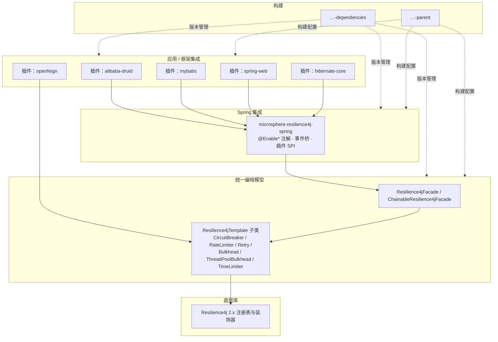

# 开发者指南 —— 当前（release 分支，v0.2.x）

> 源分支：`release` · 版本线：`0.2.x` · 目标：**Resilience4j 2.0.0 – 2.4.0**
> English 版本见 [../README.md](../README.md)

本指南面向贡献者，以及想要理解——或扩展——microsphere-resilience4j 内部机制的团队。它涵盖架构、逐模块源码分析、所用设计模式，以及非平凡的控制路径与事件路径流程图。

## 系统架构

该项目是一个分层的 Maven 多模块 reactor：



### 各层职责

| 层 | 模块 | 职责 | 不得依赖 |
|-------|-----------|----------------|--------------------|
| 编程模型 | commons | 对六个 Resilience4j 装饰器做模板抽象；门面与责任链组合 | Spring |
| Spring 集成 | spring | 通过 `@Enable*` 注册 Bean、`Resilience4jPlugin` SPI、事件 → `ApplicationEvent` 桥 | Web 框架 |
| 集成插件 | plugins/* | 将模板织入特定框架的执行路径（过滤器、拦截器、回调） | 应用代码 |
| 构建 | parent、dependencies | Resilience4j 版本 profile、依赖管理、BOM（JDK 基线 17+） | 代码 |

## 所用设计模式

| 模式 | 位置 | 原因 |
|---------|-------|-----|
| **模板方法（Template Method）** | `Resilience4jTemplate` 及其六个子类 | 单一骨架（`begin` → 装饰 → `end`），各模块实现相应钩子 |
| **门面（Facade）** | `Resilience4jFacade`、`LazyResilience4jFacade` | 隐藏注册表/模板装配的单一入口 |
| **责任链（Chain of Responsibility）** | `ChainableResilience4jFacade`、`CallbackChain` | 按优先级在单次调用外层组合多个弹性模块 |
| **注册表（Registry，源自 Resilience4j）** | 所有模板构造函数 | 模板包装一个 `Registry`，惰性解析/创建具名实例 |
| **策略（Strategy）** | `EventConsumerMethodFilter`、插件选择 | 可替换的消费者方法/插件行为解析 |
| **观察者 / 事件桥（Observer / Event Bridge）** | `*ApplicationEventPublisher` 类 | 将 Resilience4j 事件发布者适配到 Spring 的 `ApplicationEventPublisher` |
| **SPI / 插件（SPI / Plug-in）** | `Resilience4jPlugin` + `microsphere-resilience4j-plugins/*` | 框架集成无需改动核心即可自行注册 |
| **代理 / 装饰器（Proxy / Decorator）** | openfeign `Resilience4jClient`、mybatis `Resilience4jExecutor`、druid 过滤器、hibernate 回调 | 用弹性装饰包裹框架调用 |

## 复杂流程（在模块页面中以图示呈现）

1. **模板执行** — 单个模板内部的 `execute/call/begin/end`。→ [commons 页面](microsphere-resilience4j-commons.md)
2. **可链式门面执行** — N 个模板如何包裹一个回调，以及上下文如何嵌套。→ [commons 页面](microsphere-resilience4j-commons.md)
3. **`@EnableResilience4j` 引导** — 注册器层次结构、Bean 注册、插件发现。→ [spring 页面](microsphere-resilience4j-spring.md)
4. **Resilience4j 事件 → Spring 事件** — 消费者 Bean 的注册与发布路径。→ [spring 页面](microsphere-resilience4j-spring.md)
5. **各插件的框架织入** — druid 过滤器链、mybatis 拦截器、feign capability、mvc 拦截器、hibernate 回调。→ 各插件对应页面

## 开发者指南页面

| 页面 | 模块 |
|------|--------|
| [microsphere-resilience4j-commons.md](microsphere-resilience4j-commons.md) | commons — 模板、门面、责任链、上下文 |
| [microsphere-resilience4j-spring.md](microsphere-resilience4j-spring.md) | spring — 注解、注册器、事件、插件 SPI |
| [microsphere-resilience4j-alibaba-druid.md](microsphere-resilience4j-alibaba-druid.md) | 插件 |
| [microsphere-resilience4j-mybatis.md](microsphere-resilience4j-mybatis.md) | 插件 |
| [microsphere-resilience4j-openfeign.md](microsphere-resilience4j-openfeign.md) | 插件 |
| [microsphere-resilience4j-spring-web.md](microsphere-resilience4j-spring-web.md) | 插件 |
| [microsphere-resilience4j-hibernate-core.md](microsphere-resilience4j-hibernate-core.md) | 插件 |
| [microsphere-resilience4j-dependencies.md](microsphere-resilience4j-dependencies.md) | BOM |
| [microsphere-resilience4j-parent.md](microsphere-resilience4j-parent.md) | 构建父工程 |
| [microsphere-resilience4j-spring-boot.md](microsphere-resilience4j-spring-boot.md) | 占位模块 |
| [microsphere-resilience4j-spring-cloud.md](microsphere-resilience4j-spring-cloud.md) | 占位模块 |

每个页面的中文译文存放于 `zh/`，文件名完全一致。

## 构建项目

```bash
# 默认构建（Resilience4j 2.4.0 —— profile 'resilience4j-2.4' 默认激活）
./mvnw clean install

# 针对其他 Resilience4j 版本线构建
./mvnw clean install -P resilience4j-2.0   # 或 -2.1 / -2.2 / -2.3
```

- `${revision}`（当前为 `0.2.5-SNAPSHOT`）由父工程 `microsphere-spring-cloud-parent` 展平；该版本线上的已发布产物为 `0.2.0` – `0.2.4`。
- Maven profile `resilience4j-2.0` … `resilience4j-2.4` 仅切换 `resilience4j.version`；源码是针对稳定的 2.x API 表面编写的，因此在每个 profile 下都能编译。
- 测试使用 JUnit 5，外加 `microsphere-java-test` / `microsphere-spring-test`；许多模板和插件都有专门的单元测试，同时充当使用示例（见用户指南）。

## 版本管理与兼容性策略

- **较小版本线跟随 Resilience4j 主版本**：`0.2.x` ⇔ Resilience4j **2.x**，`0.1.x` ⇔ Resilience4j **1.x**（参见 [1.x 开发者指南](../../../1.x/developer-guide/zh/README.md)）。
- Spring 兼容性跟随父工程版本线：`microsphere-spring-cloud-parent` 0.2.26 ⇒ Spring Cloud 2022.0.x – 2025.0.x。
- 对 `Resilience4jOperations`/`Resilience4jTemplate` 契约的破坏性变更需要一条新的发布版本线，而非补丁号递增。
