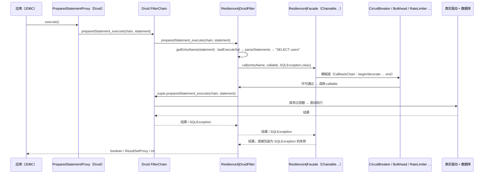
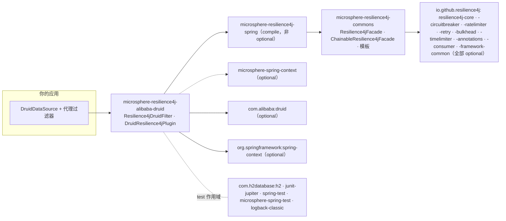

# microsphere-resilience4j-alibaba-druid — 开发者指南

> 简体中文 | [English](../microsphere-resilience4j-alibaba-druid.md)

> 版本线 `0.2.x`（`release` 分支）· 最新发布版本 `0.2.4` · 当前 `${revision}` = `0.2.5-SNAPSHOT` · Resilience4j **2.0.0 – 2.4.0**（默认 `2.4.0`）· Spring Cloud 2022.0.x – 2025.0.x · JDK **17+** · [← 开发者指南索引](README.md)

模块路径：`microsphere-resilience4j-plugins/microsphere-resilience4j-alibaba-druid`。

## 类清单

| 类型 | 文件 | 角色 |
|------|------|------|
| `Resilience4jDruidFilter` | `src/main/java/io/microsphere/resilience4j/alibaba/druid/filter/Resilience4jDruidFilter.java` | 唯一的生产钩挂点：一个 Druid `Filter`，用 `Resilience4jFacade.call(...)` 装饰语句执行 |
| `DruidResilience4jPlugin` | `src/main/java/io/microsphere/resilience4j/alibaba/druid/DruidResilience4jPlugin.java` | `Resilience4jPlugin` 描述符，`getName() = "alibaba-druid"`；`plugin(...)` 方法体是**空的** |
| 资源文件 | `src/main/resources/META-INF/spring.factories` | key `io.microsphere.resilience4j.spring.common.Resilience4jPlugin` → `io.microsphere.resilience4j.alibaba.druid.DruidResilience4jPlugin` |
| `Resilience4jDruidFilterTest` | `src/test/java/.../filter/Resilience4jDruidFilterTest.java` | 4 个测试方法：`testConstants`、`testExecuteStatement`、`testExecutePreparedStatement`、`testGetter` |

`DruidResilience4jPlugin` **没有测试**；它的行为就是一个空方法加一个名字，并且有意被排除在装配链路之外（见下文）。

## 织入机制：Druid 的过滤器链，而不是 `FilterEventAdapter`

`Resilience4jDruidFilter extends com.alibaba.druid.filter.FilterAdapter` —— 这是实现 `Filter` 接口并提供透传默认实现的*基础*适配器。它**不是**基于 `FilterEventAdapter`（更高层的事件适配器，带有 `statementExecute`/`statementUpdate` 钩子）。直接来自源码的影响如下：

1. Druid 的 `Filter` SPI 为每一种 JDBC 执行形态暴露一个方法，每个方法接收 `FilterChain`、代理对象和 SQL。该插件恰好重写了它关心的 12 个执行方法（`preparedStatement_execute`、`preparedStatement_executeQuery`、`preparedStatement_executeUpdate`、`statement_execute` ×4、`statement_executeQuery`、`statement_executeBatch`、`statement_executeUpdate` ×4），并且每个重写的形态都相同：

```java
@Override
public boolean preparedStatement_execute(FilterChain chain, PreparedStatementProxy statement) throws SQLException {
    return doInResilience4j(statement, () -> super.preparedStatement_execute(chain, statement));
}
```

Druid 链的后续部分（`super.<method>(chain, …)`）就是**被守护的可调用体**——因此这个边界覆盖了所有下游过滤器和真正的驱动调用，而插件自身没有添加任何代理。

2. 单一装饰汇聚点：

```java
protected final <T> T doInResilience4j(StatementProxy statement, Callable<T> callable) throws SQLException {
    String entryName = getEntryName(statement);
    return this.facade.call(entryName, callable::call, SQLException.class);
}
```

`facade.call(name, ThrowableSupplier, Class)` 是 `Resilience4jOperations`（commons）的一个默认方法，它执行整条模板链，并通过 `io.microsphere.util.ExceptionUtils.wrap` 把任何失败转换为所声明的 throwable 类型（`SQLException`）。这就是熔断器打开时表现为 `SQLException` 的原因。

3. 过滤器生命周期。`init(DataSourceProxy)` 是 Druid 自身的 `Filter.init` 回调，在 `DruidDataSource` 注册其代理过滤器期间被调用。插件会捕获该数据源，并且——仅当它是 `DruidDataSource` 时——捕获 `getValidationQuery()` 的值，该值随后会为连接池校验流量短路 SQL 解析。

4. 资源命名通过 Druid 的解析器解析 SQL 得到（`com.alibaba.druid.sql.SQLUtils.parseStatements(sql, dbType)`），随后按 AST 节点类型分派（`SQLSelectStatement`、`SQLUpdateStatement`、`SQLInsertStatement`、`SQLDeleteStatement`），并通过 `SQLTableSource.computeAlias()` 读取表源别名。无法识别或解析失败会降级为常量 `"UNRECOGNIZED"`；私有的 `getEntryName(SQLStatement)` 在 `debug` 级别吞掉 `Throwable`，因此命名逻辑永远不可能打断调用路径。

### 被拦截的调用路径



### 入口名决策流程

```mermaid
flowchart TD
    A["getEntryName(StatementProxy)"] --> B["sql = statement.getLastExecuteSql()"]
    B --> C{sql == validationSQL ?}
    C -- 是 --> R1["entry = sql（原始）"]
    C -- 否 --> D["parseStatements(sql, dataSource.getDbType())"]
    D --> E{首个语句类型}
    E -- SQLSelectStatement --> F1["SELECT " + queryBlock.from.computeAlias()"]
    E -- SQLUpdateStatement --> F2["UPDATE " + from.computeAlias()"]
    E -- SQLInsertStatement --> F3["INSERT " + tableSource.computeAlias()"]
    E -- SQLDeleteStatement --> F4["DELETE " + tableSource.computeAlias()"]
    E -- 无 / 解析错误 --> F5["UNRECOGNIZED"]
    F1 --> G["facade.call(entry, callable, SQLException.class)"]
    F2 --> G
    F3 --> G
    F4 --> G
    F5 --> G
    R1 --> G
```

## 设计模式（附证据）

| 模式 | 在本模块中的证据 |
|---------|--------------------------|
| **装饰器（Decorator）** | 每个重写都是在 `super.<method>(chain, …)` 周围增加行为，而不是替换它；被装饰的执行单元以 `Callable<T>` lambda 形式传入。 |
| **适配器（Adapter）** | 该类把 Druid 的 `Filter` SPI（12 个形态各异的执行回调）适配到单一的 `Resilience4jFacade.call(name, supplier, throwableClass)` 契约上。 |
| **门面（Facade）** | `Resilience4jDruidFilter` 只依赖 `io.microsphere.resilience4j.common.Resilience4jFacade`。主源码**没有**导入任何 `io.github.resilience4j.*` 类——注册表、装饰器和模板都被隐藏在门面之后（测试装配的是具体的 `ChainableResilience4jFacade`）。 |
| **模板方法 / 职责链** | 更深层在 commons 中：`ChainableResilience4jFacade.call` 在按优先级排序的 `Resilience4jTemplate` 列表上构建 `CallbackChain`；本插件只提供名字和叶子可调用体。 |
| **观察者（Observer）** | 仅间接存在：`Resilience4jTemplate` 的事件注册（`onCallNotPermittedEvent` …）可以通过过滤器所持有的门面触达；过滤器自身不注册任何监听器。 |
| **SPI（Spring factories）** | `META-INF/spring.factories` 在 `Resilience4jPlugin` 下声明了 `DruidResilience4jPlugin`；`EnableResilience4jRegistrar.registerPlugins(...)` 用 `loadFactories(...)` 加载它，并在注解的 `plugins` 列表包含 `getName()` 时调用 `plugin(...)`。在本模块中该调用是一个**空操作**——插件只是一个名字桩，过滤器注册交由用户完成。 |

## 依赖关系图



| 方面 | 事实 |
|--------|------|
| Spring 还是 commons | 本插件依赖 **`microsphere-resilience4j-spring`**（compile），后者又带入 `microsphere-resilience4j-commons`。对比：`microsphere-resilience4j-openfeign` 只依赖 `commons`。 |
| 使用到的 Resilience4j 组件 | 编译期：无直接使用。运行期：注入的门面里有什么就用什么——测试中用的是 `BulkheadRegistry`、`RateLimiterRegistry`、`RetryRegistry`、`TimeLimiterRegistry`、`CircuitBreakerRegistry`（全部 `ofDefaults()`）。 |
| 使用到的 Druid API 面 | `Filter`、`FilterAdapter`、`FilterChain`、`DruidDataSource`、`DataSourceProxy`、`StatementProxy`、`PreparedStatementProxy`、`ResultSetProxy`、`SQLUtils.parseStatements`，以及 `com.alibaba.druid.sql.ast.*` 中的语句/表源类型。 |
| 是否框架无关？ | 否——它需要 classpath 上有 Druid，但运行过滤器本身不需要任何 Spring 相关的东西（`DruidResilience4jPlugin` 是唯一面向 Spring 的类）。 |

## 面向贡献者的扩展点

- `doInResilience4j(StatementProxy, Callable<T>)` 是 `protected final`——可重写点是各个 `statement_*` / `preparedStatement_*` 方法，或者入口名算法（`getEntryName(StatementProxy)` 是 `public final`，因此子类无法放宽它；如果你需要不同的命名，请新增一个 `Filter`）。
- 支持 `CallableStatement` 意味着重写 `FilterAdapter`/`FilterEventAdapter` 的 `callableStatement_*` 方法，并配合 `CallableProxy` 复用 `doInResilience4j`。
- 如果将来真的实现 `DruidResilience4jPlugin`，预期的形态就是 MyBatis 插件已经做的事：注册一个 `Resilience4jDruidFilter` 的 bean definition，并把 `LazyResilience4jFacade.BEAN_NAME` 作为它的构造参数引用（见 [MyBatis 开发者页面](microsphere-resilience4j-mybatis.md)）。
- 需要警惕的命名遗留问题：`entryNamePrefix` 目前从未被拼进入口名。此处的改动会改变每一个 Resilience4j 实例名，对用户配置而言是一个**破坏性变更**。

## 相关页面

- [用户指南 — microsphere-resilience4j-alibaba-druid](../../user-guide/zh/microsphere-resilience4j-alibaba-druid.md)
- [用户指南 — commons](../../user-guide/zh/microsphere-resilience4j-commons.md)
