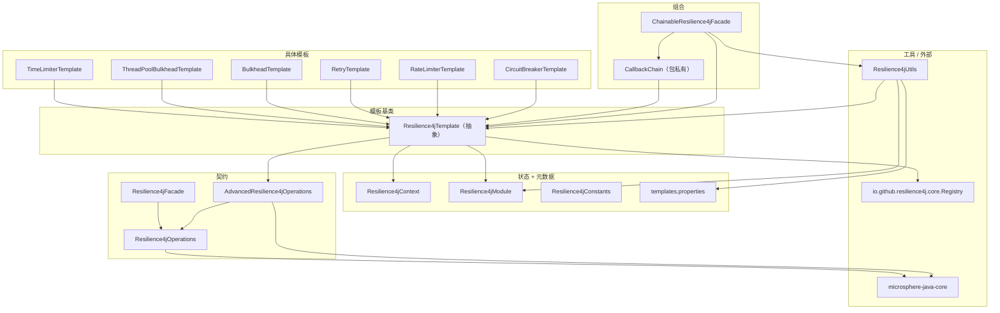
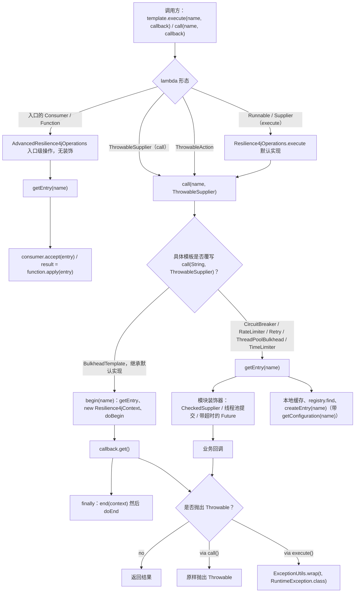
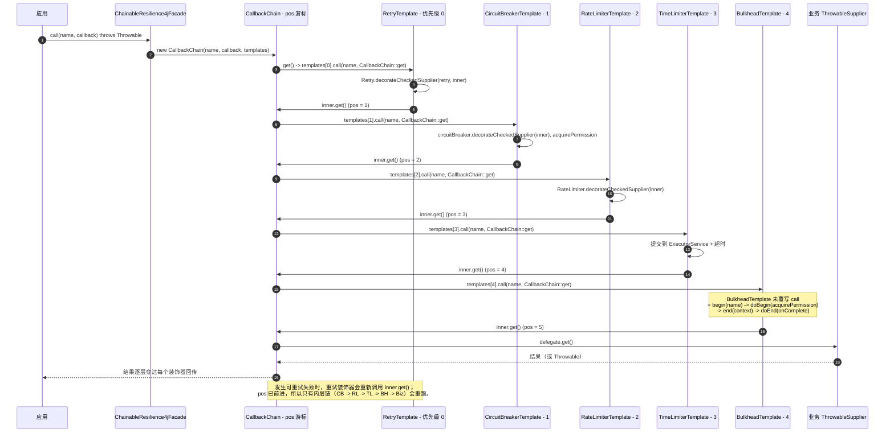
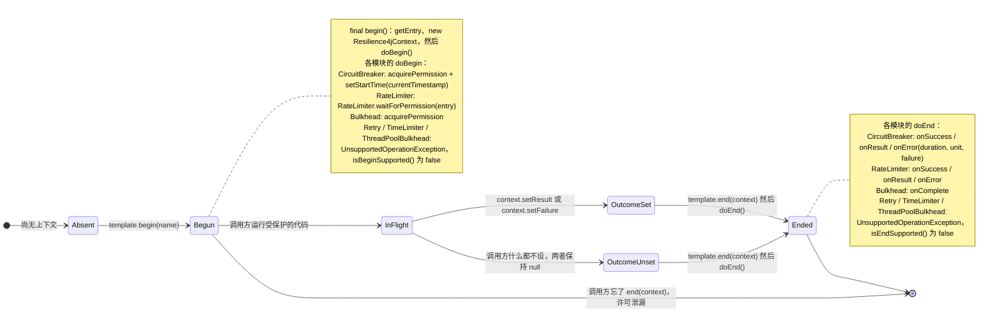
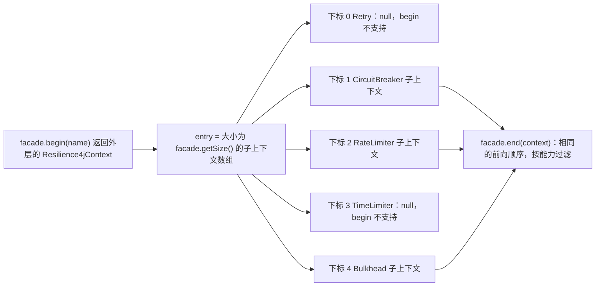
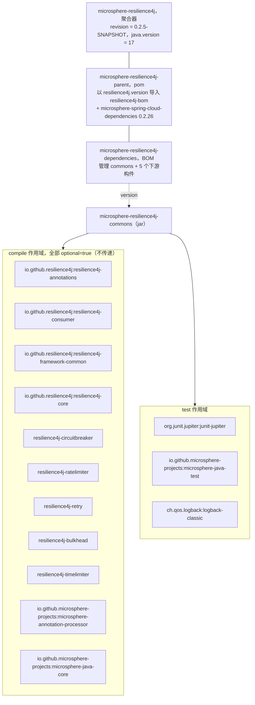

# microsphere-resilience4j-commons — 开发者指南

> 版本线：`0.2.x`（源分支 `release`）· 最新发行版 `0.2.4` · 分支修订号 `0.2.5-SNAPSHOT`
> Resilience4j `2.0.0` – `2.4.0`（Maven profile，默认 `2.4.0`）· 面向 JDK 17 构建（CI 中为 `17`/`21`/`25`）
> 本模块**不依赖 Spring**；它只依赖 Resilience4j 2.x 和 `microsphere-java-core`。
> ← [开发者指南索引](README.md) · [用户指南页面](../../user-guide/zh/microsphere-resilience4j-commons.md)

下文所有文件路径都相对于模块根目录 `microsphere-resilience4j-commons/`，例如
`src/main/java/io/microsphere/resilience4j/common/Resilience4jTemplate.java`。行号以 `release` 分支为准。

---

## 1. 职责

`microsphere-resilience4j-commons` 是本项目的最底层。它把六个相互独立的
Resilience4j 模块统一成一套一致、可扩展的编程模型：

- 一份契约（`Resilience4jOperations` → `AdvancedResilience4jOperations`），用于*在某个模块的装饰下
  执行一个回调*；
- 一个抽象模板（`Resilience4jTemplate`），它拥有一个 `Registry`、解析具名入口并缓存它们、
  暴露两阶段的 `begin`/`end` 生命周期，并适配 Resilience4j 事件；
- 六个具体模板，每个模块一个；
- 一个可组合的门面（`ChainableResilience4jFacade` + 包私有的 `CallbackChain`），按优先级把 N 个模块
  包裹在同一个回调之外；
- 一个每次执行专属的上下文对象（`Resilience4jContext`），带有 `ThreadLocal` 绑定；
- 一层元数据 + 反射机制（`Resilience4jModule`、`Resilience4jConstants`、
  `META-INF/default/templates.properties`、`Resilience4jUtils`）。

它之上的所有内容 —— `microsphere-resilience4j-spring`、各插件 —— 都只消费这些类型。本模块中没有任何东西
知道 Spring。

---

## 2. 包布局与类清单

```
src/main/java/io/microsphere/resilience4j/
├── common/            contract + abstraction + composition + state + metadata
├── circuitbreaker/    CircuitBreakerTemplate
├── ratelimiter/       RateLimiterTemplate
├── retry/             RetryTemplate
├── bulkhead/          BulkheadTemplate, ThreadPoolBulkheadTemplate
├── timelimiter/       TimeLimiterTemplate
└── util/              Resilience4jUtils
src/main/resources/META-INF/default/templates.properties
```

### 2.1 `io.microsphere.resilience4j.common`

| 类型 | 类别 | 可见性 | 一句话职责 |
|------|------|------------|---------------|
| `Resilience4jOperations<E>` | 接口 | public | 最小契约：一次性 `execute`/`call` 重载 + 两阶段 `begin`/`end`。 |
| `AdvancedResilience4jOperations<E, C, R>` | 接口 | public | 新增注册表/配置/入口管理、原始入口的 `Consumer`/`Function` 操作、`Prioritized`、`Logger`。 |
| `Resilience4jTemplate<E, C, R>` | 抽象类 | public | 持有注册表的基模板：入口解析 + 本地缓存、带 `doBegin/doEnd` 钩子的 `final begin/end`、事件注册、优先级。 |
| `Resilience4jContext<E>` | 类 | public（构造器 `protected`） | 可变的每次执行状态：入口名、入口、开始时间、结果、失败、属性、`ThreadLocal` 绑定。 |
| `Resilience4jFacade` | 接口 | public | 标记接口：`Resilience4jOperations<Resilience4jContext[]>` —— 一个"入口"为子上下文数组的门面。 |
| `ChainableResilience4jFacade` | 类 | public | 门面实现，委托给一个有序、去重的 `Resilience4jTemplate` 列表。 |
| `CallbackChain<T>` | 类 | **包私有** | 迭代器风格的 `ThrowableSupplier`，遍历模板列表，把每个模板的装饰层层嵌套在剩余链之外。 |
| `Resilience4jModule` | 枚举 | public | 六个模块的元数据表（entry/config/properties/event/registry 类 + 默认切面顺序）以及 `valueOf(Class)` 查找。 |
| `Resilience4jConstants` | 接口 | public | `String` 类型的配置命名空间常量（`microsphere.resilience4j.<module>.`）。 |

### 2.2 模板包

| 类型 | 入口 / 配置 / 注册表三元组 | 说明 |
|------|----------------------------------|-------|
| `circuitbreaker.CircuitBreakerTemplate` | `CircuitBreaker` / `CircuitBreakerConfig` / `CircuitBreakerRegistry` | 用 `decorateCheckedSupplier` 覆写 `call`；实现带 duration 跟踪的 `doBegin`/`doEnd`；8 个入口事件注册方法。 |
| `ratelimiter.RateLimiterTemplate` | `RateLimiter` / `RateLimiterConfig` / `RateLimiterRegistry` | 用 `RateLimiter.decorateCheckedSupplier` 覆写 `call`；`public doBegin` 使用 `RateLimiter.waitForPermission`；3 个事件方法。 |
| `retry.RetryTemplate` | `Retry` / `RetryConfig` / `RetryRegistry` | 用 `Retry.decorateCheckedSupplier` 覆写 `call`；禁用两阶段；4 个事件方法。 |
| `bulkhead.BulkheadTemplate` | `Bulkhead` / `BulkheadConfig` / `BulkheadRegistry` | **不**覆写 `call` → 一次性操作通过 `begin`/`end` 运行；3 个事件方法。 |
| `bulkhead.ThreadPoolBulkheadTemplate` | `ThreadPoolBulkhead` / `ThreadPoolBulkheadConfig` / `ThreadPoolBulkheadRegistry` | 覆写 `call`，把任务提交到舱壁线程池并阻塞在 `future.get()` 上，重抛根因；禁用两阶段；3 个事件方法；包私有的 `getRootCause`。 |
| `timelimiter.TimeLimiterTemplate` | `TimeLimiter` / `TimeLimiterConfig` / `TimeLimiterRegistry` | 用基于 `ExecutorService` 的 `decorateFutureSupplier` 覆写 `call`（默认 `ForkJoinPool.commonPool()`）；禁用两阶段；3 个事件方法；4 个构造器。 |

### 2.3 `io.microsphere.resilience4j.util`

| 类型 | 职责 |
|------|------|
| `Resilience4jUtils` | 带私有构造器的 `abstract class ... implements Utils`：反射式的 registry→template 工厂、通过反射查找入口、`EventProcessor` 适配器、从 `templates.properties` 加载默认模板、模板列表的创建 + 排序。 |

### 2.4 资源

`src/main/resources/META-INF/default/templates.properties` —— 由
`Resilience4jUtils.loadDefaultTemplates()` 消费的"模块名 → 模板类"表：

```properties
bulkhead = io.microsphere.resilience4j.bulkhead.BulkheadTemplate
thread-pool-bulkhead = io.microsphere.resilience4j.bulkhead.ThreadPoolBulkheadTemplate
circuit-breaker = io.microsphere.resilience4j.circuitbreaker.CircuitBreakerTemplate
rate-limiter = io.microsphere.resilience4j.ratelimiter.RateLimiterTemplate
retry = io.microsphere.resilience4j.retry.RetryTemplate
time-limiter = io.microsphere.resilience4j.timelimiter.TimeLimiterTemplate
```

键正好是 `Resilience4jModule.getName()` 的取值 —— 这就是枚举与该资源之间的连接键。

---

## 3. 分层



模块内部的依赖方向严格向下：契约对模板一无所知，
模板对门面一无所知，而 `Resilience4jContext` 被两者知晓却不依赖任何一方。
唯一的向上边是 `Resilience4jUtils → 具体模板类`，而且它是*反射式*的（通过
`templates.properties` + `ConstructorUtils.newInstance`），所以包图在编译期保持无环。

---

## 4. 核心流程：`execute` / `call` 如何委托给 `begin` / `end`

### 4.1 唯一的汇流点

`Resilience4jOperations` 定义了六个一次性重载，但每一个最终都落到同一个方法上。
接口默认方法构成一个严格的漏斗：

```java
// Resilience4jOperations (source, abbreviated)
default void execute(String name, Runnable callback) {
    execute(name, () -> { callback.run(); return null; });          // -> Supplier
}

default <T> T execute(String name, Supplier<T> callback) {
    try {
        return call(name, callback::get);                           // -> ThrowableSupplier
    } catch (Throwable t) {
        throw wrap(t, RuntimeException.class);                      // unchecked façade
    }
}

default void call(String name, ThrowableAction callback) throws Throwable {
    call(name, () -> { callback.execute(); return null; });          // -> ThrowableSupplier
}

default <T> T call(String name, ThrowableSupplier<T> callback) throws Throwable {
    Resilience4jContext context = begin(name);                       // FIRST PHASE
    try {
        return callback.get();
    } finally {
        end(context);                                                // SECOND PHASE
    }
}
```

驱动整个设计的四个推论：

1. **`call(String, ThrowableSupplier)` 就是扩展点。** 覆写它的子类会替换掉装饰逻辑，
   *并且*让一次性路径跳过 `begin`/`end`。六个模板里有五个正是这么做的。
2. **`BulkheadTemplate` 是唯一一个一次性路径真正走 `begin` → 方法体 → `end` 的模板**，
   因为它没有覆写 `call`。
3. **`execute` 是 `call` 的 `RuntimeException` 门面。** 两个 `execute` 重载都会重新进入 `call`，并用
   `ExceptionUtils.wrap(t, RuntimeException.class)` 转换失败，当它本身已是 `RuntimeException` 时返回*同一个*
   实例，否则构造目标类型。所以
   `CallNotPermittedException` / `BulkFullException` 不会被二次包装，而受检的
   `TimeoutException` 会以 `RuntimeException`（若匹配则为目标类型）的形式冒出来。
4. `call` 的 `Class<TR>` 变体又多一跳：它们调用基础的 `call` 并重新 `wrap` 成
   `throwableClass`，这就是测试断言 `assertThrows(NULL_POINTER_EXCEPTION_CLASS, ...)` 背后的机制。

默认的 `call` 从不写入它自己创建的上下文 —— `begin()` … `end()` 除非调用方设置，否则不携带
result/failure。这之所以自洽，是因为唯一走默认路径的模板
（`BulkheadTemplate.doEnd`）只是调用 `bulkhead.onComplete()` 并忽略这两个字段。

### 4.2 `Resilience4jTemplate`：`final` 生命周期 + 可覆写的钩子

`begin`/`end` 是 `final`（第 271–292 行），以免子类遗漏横切步骤：

```java
@Override
public final Resilience4jContext<E> begin(String name) {
    E entry = getEntry(name);
    Resilience4jContext<E> context = new Resilience4jContext(name, entry);
    doBegin(context);
    logger.trace("begin() operation was executed -> ", context);
    return context;
}

protected void doBegin(Resilience4jContext<E> context) {
    throw create(UnsupportedOperationException.class, format("{} does not support begin operation", this.getClass()));
}

@Override
public final void end(Resilience4jContext<E> context) {
    doEnd(context);
    logger.trace("end() operation was executed -> {}", context);
}

protected void doEnd(Resilience4jContext<E> context) {
    throw create(UnsupportedOperationException.class, format("{} does not support end operation", this.getClass()));
}
```

设计要点：

- **快速失败的默认实现。** 基础钩子抛 `UnsupportedOperationException`，所以"不具备两阶段能力"
  是默认状态。`RetryTemplate`、`TimeLimiterTemplate` 和 `ThreadPoolBulkheadTemplate` 随后只是翻转
  *能力标志*（`isBeginSupported()`/`isEndSupported()` → `false`）而不去动钩子；
  `ChainableResilience4jFacade` 在调用 `begin`/`end` 之前会先读取这些标志。
  `AbstractResilience4jTemplateTest#testBegin` 对这一契约的两侧都做了断言。
- **每个入口的上下文由 `begin()` 创建**，这正是 `Resilience4jContext` 的构造器为
  `protected` 的原因：类型参数 `E` 绑定到入口，而模板保证名称 + 入口非空。另外两处会直接构造一个：
  `ChainableResilience4jFacade.begin()` 构建*外层*上下文（entry = `Resilience4jContext[]` 数组），而
  `AbstractResilience4jTemplateTest#testEnd` 伪造一个，因为该测试位于同一个包。
- `getEntry(name)` 也是 `final`，所以子类无法绕过本地缓存。

### 4.3 入口解析与本地缓存

```
getEntry(name)
  └─ getEntryFromCache(name)            // HashMap.get, when isLocalEntriesCached()
       └─ hit -> return
  └─ AdvancedResilience4jOperations.super.getEntry(name)
       ├─ registry.find(name) -> hit -> return
       └─ createEntry(name)
            └─ template-specific, always: registry.<entry>(name, getConfiguration(name))
                                             (bulkheads also pass registry.getTags())
```

`getConfiguration(name)` 会从注册表解析一个**具名配置**，并在缺失时静默回退到
`getDefaultConfig()`。因为 `createEntry` 把*入口名*当作配置名传入，"给一个入口配好参数"就意味着
"以该入口的名字注册一份配置"。这一约定正是每个测试在触碰入口之前都会在 `setUp()` 里调用
`template.addConfiguration(entryName, entryConfig)` 的原因。

`initLocalEntriesCache(name)` 是有意走 `getEntry(name)` 的 —— 也就是说它*作为副作用创建并注册*了该
入口，这正是让后续 `HashMap` 读取在并发下安全的原因（类 Javadoc 中有记载：`HashMap` 并非线程安全，
只有在初始化时预填充后才变得实际安全）。`destroy()` → `clearLocalEntriesCache()`。

### 4.4 各子类如何做装饰

| 模板 | 覆写所执行的装饰 | 一次性操作是否走 `begin`/`end`？ |
|----------|-------------------------------------|--------------------------------------|
| `CircuitBreakerTemplate` | `circuitBreaker.decorateCheckedSupplier(callback::get).get()` | 否（覆写了 `call`）；`doBegin` = `acquirePermission()` + `setStartTime(getCurrentTimestamp())`；`doEnd` = `onSuccess/onResult/onError(duration, timestampUnit, …)` |
| `RateLimiterTemplate` | `RateLimiter.decorateCheckedSupplier(rateLimiter, callback::get).get()` | 否；`doBegin` = `RateLimiter.waitForPermission(rateLimiter)`；`doEnd` = `onSuccess/onResult/onError`（无 duration） |
| `RetryTemplate` | `Retry.decorateCheckedSupplier(retry, callback::get).get()` | 否；两阶段明确不支持 |
| `BulkheadTemplate` | *继承接口默认实现* | **是** —— `doBegin` = `acquirePermission()`，`doEnd` = `onComplete()` |
| `ThreadPoolBulkheadTemplate` | `executeCallable(() -> ThrowableSupplier.execute(callback))` → `toCompletableFuture().get()` → 重抛 `getRootCause(e)` | 否；两阶段不支持 |
| `TimeLimiterTemplate` | `timeLimiter.decorateFutureSupplier(() -> executorService.submit(...)).call()`；任务内用 `wrap(t, Exception.class)` 转换 `Throwable`，因为 `Callable` 只能抛 `Exception` | 否；两阶段不支持 |

> `RateLimiterTemplate` 和 `RetryTemplate` 通过静态导入访问装饰器
> （`decorateCheckedSupplier(rateLimiter, callback::get)`、`waitForPermission(rateLimiter)`）；表中出于可读性
> 采用了类限定的形式。`CircuitBreakerTemplate` 真正使用的是*实例*装饰器
> （`circuitBreaker.decorateCheckedSupplier(...)`），这就是它解析到的是入口而非静态辅助方法的原因。

如果你要改动这些类，有两处微妙行为值得复核：

- `ThreadPoolBulkheadTemplate` 依赖 `ThrowableSupplier.execute(callback)`（一个
  `microsphere-java-core` 的默认方法）在池线程*内部*把任意 `Throwable` 变成 `RuntimeException`，因为
  `Callable` 不能抛受检异常。外层的 `getRootCause` 遍历随后会剥掉
  `ExecutionException` *以及*那个包装，于是调用方看到的是原始 throwable。副作用：一个本身带 cause 的 throwable
  会被削减成它最深的 cause。
- `CircuitBreakerTemplate.doEnd` 会读取 `long startTime = context.getStartTime();` —— 一次拆箱读取。由
  `begin()` 产生的上下文是安全的（`doBegin` 已经设置了它），但一个未调用 `setStartTime(...)` 的、
  由调用方构造的上下文会抛 `NullPointerException`。本项目自己的测试（`testEnd`）总是先设置开始时间。

### 4.5 事件接线

`Resilience4jTemplate` 保留两个接线对象：

- `registryEventProcessor` —— 在构造器里通过 `Resilience4jUtils.getEventProcessor(registry)` 解析一次
  （它必须是一个 `EventProcessor`，否则抛 `IllegalArgumentException`）；
- 每入口的处理器 —— 在 `registerEntryEventConsumer(entryName, eventType, consumer)` 内部
  通过 `getEventProcessor(entry)` 按需解析。

两者都汇入同一个私有方法：

```java
private <T> Resilience4jTemplate<E, C, R> registerEventConsumer(EventProcessor eventProcessor,
                                                                Class<? super T> eventType, EventConsumer<T> eventConsumer) {
    String name = eventType.getName();
    eventProcessor.registerConsumer(name, eventConsumer);
    ...
}
```

也就是说，消费者是以**全限定事件类名**为键注册的 —— 这正是 Resilience4j 的
`EventProcessor` 所期望的键格式。注意 `registerEntryEventConsumer(...)` 里的副作用：它以
`E entry = getEntry(entryName)` 开头，所以注册一个入口级消费者会**创建并注册该入口**
（通过 `createEntry`，即带着 `getConfiguration(entryName)`），从而在消费者挂载之前就触发了注册表的
`EntryAddedEvent`。注册监听器并不是一次被动操作。注册表生命周期事件以 `final` 方法暴露
（`onEntryAddedEvent` / `onEntryRemovedEvent` / `onEntryReplacedEvent`），而模块特定事件则由
每个具体模板通过 `protected final registerEntryEventConsumer(...)` 暴露，得到这样一份目录：
8（CircuitBreaker）+ 3（RateLimiter）+ 4（Retry）+ 3（Bulkhead）+ 3（ThreadPoolBulkhead）+
3（TimeLimiter）= 24 个注册方法，全部是链式的（`return this`）。

`Resilience4jUtils.getEventProcessor(E)` 是针对六种入口类型的一条 `instanceof` 分派链，
对其他任何类型都抛 `UnsupportedOperationException` —— 这就是该工具在运行时要求全部六个模块构件的原因
（见 §11）。

---

## 5. `ChainableResilience4jFacade`

### 5.1 构造流水线

三个构造器汇聚到一个规范形式：

```
(Registry... registries) -> (Collection<Registry>) -> Resilience4jUtils.createTemplates(registries)
                                                            ├─ map keyed on the Registry instance (dedup)
                                                            ├─ Resilience4jUtils.createTemplate(registry)
                                                            └─ sort(Prioritized.COMPARATOR)  -> unmodifiable List
(List<Resilience4jTemplate>) -> manual loop, `effectiveTemplates.contains(template)` (identity dedup,
                                because Resilience4jTemplate does not override equals)
                                then sort(Prioritized.COMPARATOR)
```

`io.microsphere.lang.Prioritized.COMPARATOR` 是一个 `Comparator<Object>`：它对两个操作数都检查
`instanceof Prioritized`（非 `Prioritized` 的一侧排在*前面* / 视为相等，从不抛异常），否则委托给
`Prioritized.compareTo`，即 `Integer.compare(this.getPriority(), that.getPriority())` —— **升序**，所以
最小的优先级值落到下标 0，也就是成为*外层*包装。`size` 字段是去重后的计数，`getSize()` 和
`begin()`（数组分配）用的就是它。

当你手动设置优先级时，当心那些反转的常量：`Prioritized.MAX_PRIORITY == Integer.MIN_VALUE`，
`MIN_PRIORITY == Integer.MAX_VALUE`（`NORMAL_PRIORITY == 0`）。因此"最高优先级"排在**最前面**，
也就是链中最外层的模板。

因为 `createTemplates` 构建的是以注册表为键的 `HashMap`，优先级并列的情况
（`BULKHEAD` = 4 与 `THREAD_POOL_BULKHEAD` = 4）由哈希迭代顺序决定；`List.sort` 是稳定的，
所以并列不是 bug，但也不具有确定性。在意的调用方必须自己 `setPriority(...)`。

### 5.2 `call` —— 组合引擎

```java
@Override
public <T> T call(String name, ThrowableSupplier<T> callback) throws Throwable {
    CallbackChain<T> supplier = new CallbackChain<>(name, callback, this.templates);
    T result = supplier.get();
    ...
    return result;
}
```

门面上的其他一切都被继承而来：`execute(name, Runnable)`、`execute(name, Supplier)`、
`call(name, ThrowableAction)` 以及 `Class<TR>` 变体都通过接口默认实现重新进入这个方法（§4.1）。门面只实现
`Resilience4jOperations<Resilience4jContext[]>`，所以
`getRegistry()`/`getEntry()`/原始入口重载*不*属于它的表面。

### 5.3 `begin` / `end` —— 扇出引擎

```java
@Override
public Resilience4jContext<Resilience4jContext[]> begin(String name) {
    Resilience4jContext[] subContexts = new Resilience4jContext[size];
    Resilience4jContext<Resilience4jContext[]> context = new Resilience4jContext<>(name, subContexts);
    for (int i = 0; i < size; i++) {
        Resilience4jTemplate template = templates.get(i);
        if (template.isBeginSupported()) {
            subContexts[i] = template.begin(name);
        }
    }
    ...
}

@Override
public void end(Resilience4jContext<Resilience4jContext[]> context) {
    Resilience4jContext[] subContexts = context.getEntry();
    for (int i = 0; i < size; i++) {
        Resilience4jTemplate template = templates.get(i);
        if (template.isEndSupported()) {
            template.end(subContexts[i]);
        }
    }
}
```

嵌套的技巧在于：`Resilience4jFacade extends Resilience4jOperations<Resilience4jContext[]>`，所以门面
上下文的"entry"字面上就是子上下文的数组。这是唯一一处类型参数承载组合状态的地方；它也解释了那个没有
`@SuppressWarnings` 却未经检查的 `Resilience4jContext[]` 裸数组。

评审说明（对当前实现成立，扩展前值得知晓）：

- `end()` 以与 `begin()` **相同的前向顺序**运行，而非 LIFO。为了对称地收尾，你本会期望
  `for (i = size - 1; i >= 0; i--)`。
- `begin()` 没有 `try/catch`。如果模板 *i* 抛异常（例如来自断路器的 `CallNotPermittedException`、
  来自舱壁的 `BulkFullException`），已经 begin 过的子上下文 `0..i-1` 就永远不会返回给调用方，因而永远无法
  被 end —— 更早的模板获取到的许可会泄漏。使用默认优先级时，危险模块恰好被排在使这个问题很少发生的顺序上
  （Retry 被跳过，接着是 CircuitBreaker、RateLimiter、TimeLimiter、Bulkhead），但自定义的
  `setPriority(...)` 会重排扇出顺序并暴露这个泄漏。
- 不支持的模板在 `subContexts` 里留下 `null`；`end()` 通过同一个能力标志跳过它们，所以只要两次调用之间
  `begin`/`end` 标志不变，`null` 槽位就永远不会被解引用。

---

## 6. `CallbackChain<T>`

包私有，20 行有效代码，全部组合语义都落在 `get()` 里：

```java
@Override
public T get() throws Throwable {
    if (pos < size) {
        Resilience4jTemplate template = templates.get(pos++);
        return (T) template.call(this.entryName, CallbackChain.this::get);
    }
    return delegate.get();
}
```

评审者应留意的性质：

- **是游标，而非构造上的递归。** `pos++` 每个模板前进一次。因为游标是实例状态，一个*内层*
  模板若重新执行续延（`RetryTemplate` 在每次重试尝试时都会这么做），只会重跑*剩下的*内层链 —— 重试装饰器
  重试的是断路器 + 限流器 + 超时限制 + 舱壁 + 业务逻辑，而不是它自己。这正是 Resilience4j 文档所描述的切面
  顺序语义。
- **单次使用。** 从外层位置第二次穿过同一个 `CallbackChain` 会从 `pos == size` 开始，直接跳到
  `delegate`；因此这条链是每次 `call` 一个，这也正是门面使用它的方式。
- **未经检查的强制转换。** 之所以需要 `(T)`，是因为在
  `List<Resilience4jTemplate>` 里 `Resilience4jTemplate` 被当作裸类型使用；这套组合的类型安全依赖于
  `pos` 的顺序，而非泛型。
- **设计上就不是线程安全的**（`pos` 是一个普通 `int`），但每次门面的 `call` 都会创建一个全新实例，所以
  不存在共享 —— 除非你自己复用一条链。
- 链在 `delegate.get()`（用户回调）处终止，因此每一种异常类型都会原封不动地穿过整条装饰器栈，
  这正是门面上的 `call(...)` 是一个 `throws Throwable` 操作的原因。

---

## 7. `Resilience4jContext`

| 方面 | 实现 | 后果 |
|--------|----------------|-------------|
| 身份 | `final String entryName`、`final E entry` | 入口在 `begin()` 时固定；对于门面，"entry"就是 `Resilience4jContext[]` 数组 |
| 计时 | `Long startTime`（装箱、可空） | 只有 `CircuitBreakerTemplate.doBegin` 会设置它；`doEnd` 会对它拆箱 —— 若你伪造上下文会 NPE |
| 结果 | `Object result`、`Throwable failure` | 只在两阶段用法中由应用代码写入；`doEnd` 依据它们分派 `onSuccess` / `onResult` / `onError` |
| 扩展 | `Map<String, Object> attributes`，由 `getOrCreateAttributes()` 惰性创建 | 在第一次写入之前 `getAttributes()` 返回 `Collections.emptyMap()`，之后返回一个*实时*的 `unmodifiableMap` 视图；`removeAttributes()` 清空但保留 map |
| 线程绑定 | `static ThreadLocal<Resilience4jContext> contextHolder` + `withinContext()`、`getContext()`、`setContext()`、`removeContext()`、`doInContext(...)` | 单个槽位，不是栈：嵌套作用域会覆盖。未绑定时 `doInContext` 静默什么都不做（由 `Resilience4jContextTest#testContext` 的最后一条语句证明） |
| 构造 | `protected Resilience4jContext(String, E)`，对两个参数都做 `Assert.assertNotNull` | 生产代码从 `begin()` 获取一个；同一个包和子类可以直接构造 —— `AbstractResilience4jTemplateTest#testEnd` 正是这么注入一个伪造 `startTime` 的 |

这个类被有意设计成"哑"状态：它的签名里不出现任何 Resilience4j 类型（`E` 无界），
从而让 `common` 独立于各模块包，并避免依赖环
（`context` ← `template` 但 `context` 不 → `module`）。

---

## 8. 元数据层：`Resilience4jModule` + `Resilience4jUtils`

`Resilience4jModule` 是该模块关于 Resilience4j 类型图的唯一事实来源。每个常量携带
`name`、`entryClass`、`configClass`、`configurationPropertiesClass`（一个
`resilience4j-framework-common` 的 `CommonProperties` 子类型，供 Spring 层使用）、`eventClass`、
`registryClass`、`defaultAspectOrder`：

| 常量 | name | 入口 / 配置 / 注册表 | 事件 | 顺序 |
|----------|------|---------------------------|-------|-------|
| `RETRY` | `retry` | `Retry` / `RetryConfig` / `RetryRegistry` | `RetryEvent` | 0 |
| `CIRCUIT_BREAKER` | `circuit-breaker` | `CircuitBreaker` / `CircuitBreakerConfig` / `CircuitBreakerRegistry` | `CircuitBreakerEvent` | 1 |
| `RATE_LIMITER` | `rate-limiter` | `RateLimiter` / `RateLimiterConfig` / `RateLimiterRegistry` | `RateLimiterEvent` | 2 |
| `TIME_LIMITER` | `time-limiter` | `TimeLimiter` / `TimeLimiterConfig` / `TimeLimiterRegistry` | `TimeLimiterEvent` | 3 |
| `BULKHEAD` | `bulkhead` | `Bulkhead` / `BulkheadConfig` / `BulkheadRegistry` | `BulkheadEvent` | 4 |
| `THREAD_POOL_BULKHEAD` | `thread-pool-bulkhead` | `ThreadPoolBulkhead` / `ThreadPoolBulkheadConfig` / `ThreadPoolBulkheadRegistry` | `BulkheadEvent` | 4 |

`valueOf(Class)` 是按声明顺序进行的一次线性扫描，做五项可赋值检查；第一个匹配胜出，否则
`IllegalArgumentException`。注意 `THREAD_POOL_BULKHEAD` 复用 `BulkheadEvent`（Resilience4j 把线程池
舱壁事件建模为 `BulkheadEvent`），所以 `valueOf(BulkheadEvent.class)` 返回 `BULKHEAD`。

`Resilience4jUtils` 增加了两个反射式缓存，两者都是 `private static final`，并在类初始化期间填充。
它们之中只有一个真正不可变：`getEntryMethodsCache` 在静态块里被
`Collections.unmodifiableMap(...)` 包装，而 `defaultTemplates` 是 `loadDefaultTemplates()` 返回的
普通 `newFixedHashMap(...)` —— 引用不能变，但 map 可以变（它是私有的，所以类外没有任何东西会改它）。

1. `defaultTemplates : Map<Resilience4jModule, Class<? extends Resilience4jTemplate>>`，通过
   `ClassLoaderUtils.getClassLoader(Resilience4jTemplate.class)` 和 `loadClass(...)`
   从 `META-INF/default/templates.properties` 加载。每个枚举常量一项，以 `module.getName()` 为键。资源缺失 →
   `RuntimeException`；类缺失/改名 → 类加载失败。
2. `getEntryMethodsCache : Map<Resilience4jModule, Method>`，用
   `decapitalize(entryClass.getSimpleName())` + `findMethod(registryClass, methodName, String.class, configClass)`
   构建 —— 即 `circuitBreaker(String, CircuitBreakerConfig)`、`retry(String, RetryConfig)`、
   `bulkhead(String, BulkheadConfig)`、`threadPoolBulkhead(String, ThreadPoolBulkheadConfig)`、……
   `Resilience4jUtils.getEntry(registry, name[, config])` 随后会调用那个缓存下来的 `Method`；反射失败
   会被重抛为 `IllegalArgumentException`。

`createTemplate(R)` 是 `createTemplates(Collection<Registry>)` 所使用的工厂：
`newInstance(defaultTemplates.get(module), registry)` —— 这就是每个具体模板都必须保留一个公开的
单参数 `(registry)` 构造器的原因。`createTemplates` 返回排序后模板的
`Collections.unmodifiableList(...)`。

**需要留意的初始化耦合：** 因为两个 map 都为*全部六个*枚举常量构建，触碰
`Resilience4jUtils`（直接或间接，通过 `new ChainableResilience4jFacade(Registry...)`）会把每一个
Resilience4j 模块构件和 `resilience4j-framework-common` 都拉进来。手动实例化 `CircuitBreakerTemplate`
则不会。

---

## 9. 本模块中体现的设计模式

| 模式 | 源码中的证据 | 为何在此使用 |
|---------|--------------------|---------------------|
| **模板方法（Template Method）** | `Resilience4jTemplate`，带 `final begin()/end()` + `protected doBegin()/doEnd()`；`AdvancedResilience4jOperations.getEntry()`（骨架）调用抽象的 `createEntry()` | 生命周期顺序（解析入口 → 包进上下文 → 模块专属钩子）是固定的；只有模块特定的那一步会变。把 `begin`/`end` 设为 final，正是防止子类遗漏缓存/上下文步骤的手段。 |
| **策略（Strategy，按模块装饰）** | `call(String, ThrowableSupplier)` 被 5 个模板覆写，对 `BulkheadTemplate` 保留默认实现 | 每个模块在同一个契约背后需要不同的装饰原语（`decorateCheckedSupplier`、`waitForPermission`+`onComplete`、线程池提交、`Future` 超时）。 |
| **门面（Facade）** | `Resilience4jFacade`（标记）+ `ChainableResilience4jFacade` | 应用代码应该请求"一次有弹性的调用"，而不是六个注册表。门面把去重、排序和子上下文数组都藏了起来。 |
| **责任链（Chain of Responsibility）** | `CallbackChain.get()` 前进 `pos`，并把 `CallbackChain.this::get` 作为续延传给每个处理器 | 无需手写 lambda 就能嵌套 N 个装饰器；"下一个"链接就是剩余的链，这也正是让可重入处理器（Retry）得以工作的关键。 |
| **组合 / 透明组件（Composite）** | `ChainableResilience4jFacade implements Resilience4jFacade extends Resilience4jOperations<Resilience4jContext[]>` | 门面*本身*就是一种操作，所以 `execute`/`call`/`begin`/`end` 可递归地组合；一个门面可以包装另一个门面的模板列表。 |
| **注册表适配器 / 委托** | `Resilience4jTemplate.registry` 字段 + `AdvancedResilience4jOperations` 的默认方法（`find`、`remove`、`replace`、`addConfiguration`） | 该模块把 Resilience4j 的 `Registry` 适配成一个带类型、感知具名配置、带缓存的 API，而不是重新实现存储。 |
| **观察者（两级）** | `registryEventProcessor`、`registerEntryEventConsumer(...)`、那 24 个 `onXxxEvent(...)` 方法 | Resilience4j 通过 `EventPublisher`/`EventProcessor` 发布事件；模板把它们暴露成链式、强类型的注册方法。 |
| **类享元的本地缓存 + 惰性初始化** | `localEntriesCache`（`HashMap`）、`createLocalEntriesCache()`、`initLocalEntriesCache(...)`、`clearLocalEntriesCache()` | 在热点路径上避免重复的注册表查找，同时保持一个有文档记载的线程安全契约。 |
| **元数据枚举 / 表驱动设计** | `Resilience4jModule` + `templates.properties` + `getEntryMethodsCache` | 在一个地方声明"某个模块是什么"；基于反射的查找（`valueOf`、缓存的 `Method`）取代了工具层里的 `switch`/`if` 长链。 |
| **类空对象的能力标志** | `isBeginSupported()` / `isEndSupported()` 的默认值 + `UnsupportedOperationException` 钩子 | 让 `ChainableResilience4jFacade.begin/end` 能够通用地跳过模块，而不必对其中三个特殊处理。 |
| **工厂方法 / 反射工厂** | `createEntry(String)`（每个模板各一）和 `Resilience4jUtils.createTemplate(R)` | 入口创建需要该模块自己的 registry 调用；模板创建需要由 properties 驱动的类表。 |
| **适配器（Adapter）** | `Resilience4jUtils.getEventProcessor(...)`、`asEventProcessor(EventPublisher)`；`ExceptionUtils.wrap`/`create` 的使用 | 把 Resilience4j 的 `EventPublisher` 和 throwable 形态转换成模板所消费的形式。 |
| **线程绑定的上下文** | `Resilience4jContext.contextHolder` + `withinContext()`/`doInContext()` | 给下游层（Spring AOP、插件）一个隐式的当前执行句柄。 |

注意*没有*用到什么：没有 DI 框架，运行时没有注解处理，模板也没有 `ServiceLoader`
（`templates.properties` 才是真正的扩展注册表）。

---

## 10. 流程图

### 10.1 (a) 单模板执行路径



### 10.2 (b) 可链接门面执行路径

`ChainableResilience4jFacadeTest` / `Resilience4jTestUtils.createChainableResilience4jFacade()` 会构建五个
互异的注册表（舱壁、限流器、超时限制、重试、断路器），去重 +
优先级排序后产生下面这条链。



### 10.3 (c) `begin` / `end` 上下文生命周期



以及门面级的嵌套（一个外层上下文，其"entry"是子上下文的数组，在不支持该阶段的模块处为 `null`）：



---

## 11. 模块依赖（取自 `microsphere-resilience4j-commons/pom.xml`）



值得向使用者反复强调的事实：

- 父工程（`microsphere-resilience4j-parent`）以
  `${resilience4j.version}` 导入 `io.github.resilience4j:resilience4j-bom`；五个 profile
  `resilience4j-2.0` … `resilience4j-2.4` 只设置该属性，
  而 `resilience4j-2.4`（2.4.0）为 `activeByDefault`。
- commons 的 `pom.xml` 里没有任何依赖带显式的 `<version>` —— 版本完全来自
  父工程导入的那些 BOM。
- 每个编译期依赖都是 `optional`，所以下游应用必须自行声明它们的 Resilience4j 和
  `microsphere-java-core` 依赖（见用户指南 §2）。
- `microsphere-annotation-processor` 是本模块中 `@Nonnull` / `@Nullable`
  契约所使用的构建期注解处理器；它是可选的，运行时并不需要。
- 代码使用 `io.microsphere.logging.Logger` / `LoggerFactory`（一个 microsphere 日志门面）而不是
  具体的 SLF4J/Logback 绑定；`logback-classic` 只出现在 test 作用域。

---

## 12. 构建说明

```bash
# from the repository root (aggregator pom, revision = 0.2.5-SNAPSHOT)
./mvnw clean install                        # Resilience4j 2.4.0 (profile resilience4j-2.4 is activeByDefault)
./mvnw clean install -P resilience4j-2.0    # or -2.1 / -2.2 / -2.3

# this module only
./mvnw -pl microsphere-resilience4j-commons -am clean test

# what CI runs (matrix, .github/workflows/maven-build.yml)
mvn --batch-mode --update-snapshots --file pom.xml -Drevision=0.0.1-SNAPSHOT test \
    --activate-profiles test,coverage,spring-cloud-2025,resilience4j-2.4
# java: 17 | 21 | 25   ×   spring-cloud-2022..2025   ×   resilience4j-2.0..2.4
```

- **版本处理：** reactor 使用在聚合
  `pom.xml` 里声明的 `${revision}`（`0.2.5-SNAPSHOT`）；本版本线上的已发布版本是 `0.2.0` – `0.2.4`
  （git 标签 `0.2.0`…`0.2.4`；`release-notes.md` 只记述 `v0.2.1` 和 `v0.2.2`）。已发布的 POM 预期会被
  上游父工程（`microsphere-spring-cloud-parent` `0.2.26`）扁平化，所以 `${revision}` 绝不会泄漏
  进部署出去的 POM。
- **Java 级别：** 聚合 `pom.xml` 里的 `<java.version>17</java.version>`。除去泛型签名外，
  本模块的主源码是 Java-8 风格的，但测试源码使用了 Java 14+ 的构造（在
  `AbstractResilience4jTemplateTest` 中的多标签
  `case RETRY, TIME_LIMITER, THREAD_POOL_BULKHEAD:`），且 reactor 针对 17/21/25 编译和运行。
- **跨版本纪律：** 源码必须在每个 `resilience4j-2.x`
  profile 下都能编译通过且测试通过。任何破坏这条规则的东西（例如仅在 2.3 引入的 API）都需要基于反射或
  能力守卫的实现，正如 `Resilience4jUtils` 对注册表 `getXxx(String, Config)`
  查找已经做的那样。
- **资源：** 唯一的主资源是 `META-INF/default/templates.properties`；本模块没有
  `src/test/resources` 文件（测试期间的日志来自 `logback-classic` 的默认配置）。
- **发布** 使用 `publish,ci` profile（`.github/workflows/maven-publish.yml`，JDK 17）。

---

## 13. 测试架构（契约测试）

`src/test/java/io/microsphere/resilience4j/common/AbstractResilience4jTemplateTest<E, C, R, RT>` 是所有
六个模板测试所继承的模板契约。读它是理解预期语义最快的方式：

- 它从具体子类的
  `getGenericSuperclass()` 反射地解析出自己的四个类型参数，然后通过 `invokeStaticMethod(registryClass, "ofDefaults")`
  构建注册表、通过 `ConstructorUtils`
  风格的反射构建模板 —— 随机挑选 `(registry)` 或
  `(registry, false)`（`new Random().nextBoolean()`），于是两种缓存模式在多次运行中都会被覆盖。
- `setUp()` 调用 `template.addConfiguration(entryName, entryConfig)`，这是把
  一份配置绑定到一个入口名的规范方式（§4.3）。
- 通用测试覆盖每一对重载（`execute` × `Runnable`/`Supplier`/`Consumer`/`Function`、
  `call` × `ThrowableAction`/`ThrowableSupplier`/`ThrowableConsumer`/`ThrowableFunction`，每个都带
  `Class<TR>` 变体）、能力矩阵（`testIsBeginSupported`、`testIsEndSupported` 按模块 `switch`）、
  `testBegin`/`testEnd`（含 `UnsupportedOperationException` 分支）、缓存
  （`testLocalEntriesCache`）、注册表生命周期事件（`testEntriesAndEvents` 覆盖 ADDED / REPLACED / REMOVED），
  以及优先级（`testPriority`：`getPriority() == module.getDefaultAspectOrder()`，然后 `setPriority(1)`）。
- `tearDown()` 在 `preDestroy()` 钩子之后调用 `template.destroy()` —— `TimeLimiterTemplateTest`
  用它来关闭自己的 `ExecutorService`，而 `TimeLimiterTemplateTest` 还覆写了 `createTemplate(...)` 以注入
  自定义的 `ExecutorService`。
- `io.microsphere.resilience4j.test.Resilience4jTestUtils`（仅 test 作用域，因此**不**发布）
  构建一个含九个注册表的 `ChainableResilience4jFacade`，它会折叠成五个模板；指南里每一个提到
  五模板门面的示例都由它派生而来。

---

## 14. 如何扩展

**新增一项弹性能力（第七个模块）：**

1. 在 `Resilience4jModule` 里增加枚举常量，带上 `name`、入口、配置、`CommonProperties`
   子类、事件类、注册表类和一个切面顺序。记住 `valueOf(Class)` 是第一个匹配胜出，所以如果它与别的模块
   共用一种事件类型，就相应地安排该常量的位置。
2. 在 `META-INF/default/templates.properties` 里增加 `name = fully.qualified.TemplateClass` —— 键必须等于
   `Resilience4jModule#getName()`。
3. 实现模板：`extends Resilience4jTemplate<Entry, Config, Registry>`，带公开的
   `(registry)` 和 `(registry, boolean)` 构造器（后者对无缓存构造以及
   `AbstractResilience4jTemplateTest` 都是必需的），通过
   `registry.<entry>(name, getConfiguration(name))` 实现 `createEntry(name)`，可选地覆写
   `call(String, ThrowableSupplier)` 和
   `doBegin`/`doEnd`（若该模块无法拆分，还要翻转 `isBeginSupported`/`isEndSupported`）。
4. 在 `Resilience4jUtils.getEventProcessor(E)` 里增加一个 `getEventProcessor(Entry)` 重载
   和一个 `instanceof` 分支 —— 没有它，`registerEntryEventConsumer(...)`（以及因此每一个
   `onXxxEvent(...)` 方法）对新入口类型都会抛 `UnsupportedOperationException`。模板构造本身并**不**
   依赖这条链：构造器用的是 `getEventProcessor(Registry)` 重载，
   它只是把 `registry.getEventPublisher()` 强转成 `EventProcessor`。
5. 把该构件作为可选依赖加到
   `microsphere-resilience4j-commons/pom.xml`，如果尚未被管理，还要加到父工程/`resilience4j-bom` 导入里。
6. 扩展 `Resilience4jModuleTest` 和 `AbstractResilience4jTemplateTest` 的一个子类。

**在没有 Spring 的情况下消费本模块：** 构建一个（或多个）注册表，实例化模板或
`Resilience4jUtils.createTemplates(...)`，在第一次 `getEntry` 之前注册具名配置，然后使用
`ChainableResilience4jFacade`。除你实际触碰的那些 Resilience4j 模块外，运行时不需要别的东西 ——
如果你会触碰 `Resilience4jUtils`，那六个全都要（§8）。

---

## 15. 阅读源码时发现的实现怪异之处

之所以记录在此，是因为它们会影响未来的改动（都已针对 `release` 核实）：

1. `Resilience4jTemplate.begin()` 会记录 `logger.trace("begin() operation was executed -> ", context)` ——
   格式串里没有 `{}` 占位符，所以上下文被从消息中丢掉了。`end()` 记录正确。
2. `ChainableResilience4jFacade.end()` 以单个参数记录 `"end() operations of {} templates were executed -> {}"`，
   所以占位符数量和参数数量对不上。
3. `ChainableResilience4jFacade.begin()` 分配 `new Resilience4jContext[size]`（裸数组），而 `end()`
   以相同的前向顺序而非 LIFO 展开（§5.3）。
4. `Resilience4jModule.THREAD_POOL_BULKHEAD` 的 `defaultAspectOrder == 4`，与 `BULKHEAD` 完全相同，而
   Resilience4j 的切面顺序文档暗示线程池舱壁应有独立的名次。并列由（稳定的）排序顺序解决。
5. `RateLimiterTemplate.doBegin` 声明为 `public`，放宽了基类的 `protected` 钩子 —— 是本模块中
   唯一一处这样的放宽。
6. `Resilience4jTemplate` 把一个裸的 `new Resilience4jContext(name, entry)` 赋给 `Resilience4jContext<E>`，
   而 `CallbackChain` 做了 `(T)` 强转 —— 这套组合的泛型安全依赖于运行时的顺序。
7. `AdvancedResilience4jOperations` 用入口级的 `Consumer`/`Function` 变体重载了
   `execute`/`call`，它们**不**做任何装饰；一个误写的 `entry -> ...` lambda 会静默地绕过该模块。如果
   API 未来被修订，值得加一个守卫或更清晰的命名（破坏性变更需要新的发行线）。
8. 默认的 `call(String, ThrowableSupplier)` 从不在它创建的上下文里记录 `result`/`failure`
   （§4.1），所以任何未来依赖*默认*一次性路径下由 `doEnd` 读取这些字段的模板，都会静默地上报成功。
   `CircuitBreakerTemplate` 和 `RateLimiterTemplate` 通过覆写
   `call` 避开了这一点。

---

## 16. 参考

- 本模块的用户指南：[../user-guide/zh/microsphere-resilience4j-commons.md](../../user-guide/zh/microsphere-resilience4j-commons.md)
- 开发者指南索引：[README.md](README.md) · English：[../README.md](../README.md)
- Resilience4j 切面顺序：<https://resilience4j.readme.io/docs/getting-started-3#aspect-order>
- 源码：`microsphere-resilience4j-commons/src/{main,test}/java/io/microsphere/resilience4j/**`、
  `microsphere-resilience4j-commons/pom.xml`、`microsphere-resilience4j-parent/pom.xml`、
  `.github/workflows/maven-build.yml`
