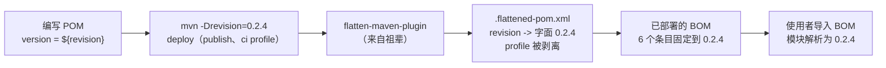

# microsphere-resilience4j-dependencies — 开发者指南

> 版本线 `0.2.x`（`release` 分支） · `${revision}` = `0.2.5-SNAPSHOT` · 最新发布版本 `0.2.4` · 管理 **6** 个构件 · JDK **17+** · [← 指南索引](README.md)
> [English](../microsphere-resilience4j-dependencies.md)

本页记录依赖管理清单（BOM）`microsphere-resilience4j-dependencies` 如何编写、它管理什么，以及 `${revision}` 占位符在 BOM 发布时如何被解析（flatten，摊平）。

## 坐标与位置

```
microsphere-resilience4j (reactor root, ${revision})
  └── microsphere-resilience4j-parent (${revision})   <-- BOM's parent
          └── microsphere-resilience4j-dependencies (${revision}, packaging pom)  <-- the BOM
```

该 BOM 声明 `<parent>` = `microsphere-resilience4j-parent`（`relativePath ../microsphere-resilience4j-parent/pom.xml`）。由于它继承那个父 POM，BOM 也继承了每一个被导入的框架 BOM（`microsphere-spring-cloud-dependencies:0.2.26`、`-alibaba-druid-dependencies:0.2.20`、`-mybatis-dependencies:0.2.16`、`-hibernate-dependencies:0.2.10`、`-redis-dependencies:0.2.14`）以及 Resilience4j 版本 profile。然而它**自身**的 `<dependencyManagement>` 只添加下面的六个第一方构件。

## 受管理的构件（完整、已核实的列表）

六个条目全部使用 `<version>${revision}</version>` —— 也就是说它们被固定到聚合反应堆自身的发布版本。`microsphere-resilience4j-dependencies/pom.xml` 的确切内容：

| # | groupId | artifactId | version |
|---|---------|-----------|---------|
| 1 | `io.github.microsphere-projects` | `microsphere-resilience4j-commons` | `${revision}` |
| 2 | `io.github.microsphere-projects` | `microsphere-resilience4j-alibaba-druid` | `${revision}` |
| 3 | `io.github.microsphere-projects` | `microsphere-resilience4j-openfeign` | `${revision}` |
| 4 | `io.github.microsphere-projects` | `microsphere-resilience4j-mybatis` | `${revision}` |
| 5 | `io.github.microsphere-projects` | `microsphere-resilience4j-spring-web` | `${revision}` |
| 6 | `io.github.microsphere-projects` | `microsphere-resilience4j-spring` | `${revision}` |

### 刻意缺席于 BOM 的构件

| 构件 | 在聚合反应堆中？ | 在 BOM 中？ | 说明 |
|----------|-------------|---------|------|
| `microsphere-resilience4j-hibernate-core` | 是（在 `plugins` 下） | **否** | 第三方 Hibernate 由 `microsphere-hibernate-dependencies:0.2.10` 管理，但*插件*坐标在此处不受管理 —— 使用者必须设置其版本 |
| `microsphere-resilience4j-plugins` | 是（聚合器） | **否** | 一个 `pom` 聚合器，而非可消费的依赖 |
| `microsphere-resilience4j-spring-boot` | 是 | **否** | 占位模块 —— 见[其开发页面](microsphere-resilience4j-spring-boot.md) |
| `microsphere-resilience4j-spring-cloud` | 是 | **否** | 占位模块 —— 见[其开发页面](microsphere-resilience4j-spring-cloud.md) |

如果你新增一个第一方模块，记得在此处添加它的 `${revision}` 条目，否则其版本不会受管理。

## `${revision}` 如何被解析（CI 友好版本 + flatten）

本项目采用 Maven 的“CI 友好版本”模式：每个模块的版本都是 `${revision}`，在聚合反应堆根定义一次（`<revision>0.2.5-SNAPSHOT</revision>`），并在发布时用 `-Drevision=…` 覆盖（见发布 workflow：`./mvnw -Drevision=${{ inputs.revision }} … deploy`）。这带来的问题是：一个字面带着 `${revision}` 发布的原始 POM 对使用者而言将不可用 —— Maven 无法从*导入方*项目解析一个属性。解决办法是 **flatten-maven-plugin**，它从 `microsphere-spring-cloud-parent:0.2.26` 祖辈继承而来，会把每个 POM 重写（替换 `${revision}`、去掉 profile、解析 `${project.scm.url}` 等）为一个 `.flattened-pom.xml`，那才是实际被部署的东西。

证据（仓库根的 `.flattened-pom.xml`，由 flatten 运行生成）：`<version>` 与 `<properties><revision>` 呈现为**字面**值（在该次捕获的运行中为 `0.2.4-SNAPSHOT`）而非 `${revision}`，且 `<profiles>` 被剥离 —— 正是 flatten 的输出形态。



具体到 BOM，flatten 会把每个 `${revision}` 条目转成具体的发布版本，因此导入 `microsphere-resilience4j-dependencies:0.2.4` 的使用者会收到六个都固定到 `0.2.4` 的构件 —— 没有留下任何悬空的 `${revision}`。

### 为什么聚合反应堆版本在 `0.2.4` 之后是 `0.2.5-SNAPSHOT`

发布 workflow 会在一次发布之后立即把根 `<revision>` 递增到 `<major>.<minor>.<patch+1>-SNAPSHOT`（对 `pom.xml` 中的 `<revision>` 元素执行 `sed`）。本线上已发布的构件是 `0.2.0`–`0.2.4`；因此工作树 / `release` 快照携带着 `0.2.5-SNAPSHOT`。

## 使用者覆盖机制（开发者提醒）

使用者可以通过在 BOM `<scope>import</scope>` **之前**声明自己的 `<dependencyManagement>` 条目，或在依赖上放置一个显式的 `<version>`，来覆盖任意单个受管理的坐标。只有真正列在本 BOM 中的构件才能“免费”被覆盖；`microsphere-resilience4j-hibernate-core` 必须始终给出版本，因为它在此不受管理。代码片段见[用户指南页面](../../user-guide/zh/microsphere-resilience4j-dependencies.md)。

## 自行核实受管理列表

上面的列表是直接读自源码的。要重新推导它（或检查一个更新的发布版本），grep BOM 的 `<dependencyManagement>` 内的 `<artifactId>` 行：

```bash
# from the repository root
sed -n '/<dependencyManagement>/,/<\/dependencyManagement>/p' \
    microsphere-resilience4j-dependencies/pom.xml \
  | grep '<artifactId>'
```

你应当只看到那六个第一方 artifactId 而已 —— 这个数字是在新增模块时的一个快速回归检查。如果一个新模块被加入聚合反应堆却没有加入这个块，它将悄无声息地脱离 BOM 管理（与今天 Hibernate 插件的处境相同）。

## 从源码核实的版本事实

| 事实 | 值 | 读取位置 |
|------|-------|-----------|
| BOM packaging | `pom` | `microsphere-resilience4j-dependencies/pom.xml` |
| 受管理的第一方构件 | 6（全部 `${revision}`） | 同一文件 |
| `revision` 属性 | `0.2.5-SNAPSHOT` | 聚合反应堆根 `pom.xml` |
| 最新发布版本 | `0.2.4` | 聚合反应堆 / `.flattened-pom.xml` |
| flatten 插件归属 | `microsphere-spring-cloud-parent:0.2.26` | 被继承的祖辈 |
| JDK | `17`（`java.version`） | 聚合反应堆根 `pom.xml` |
