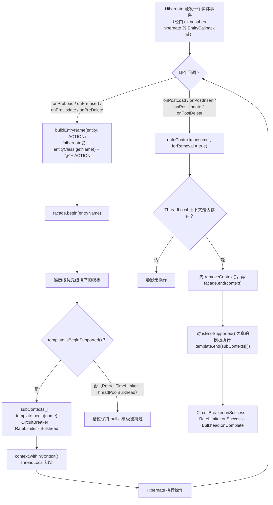
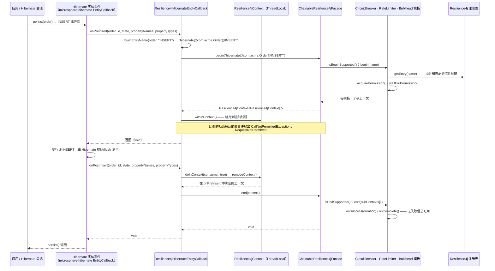
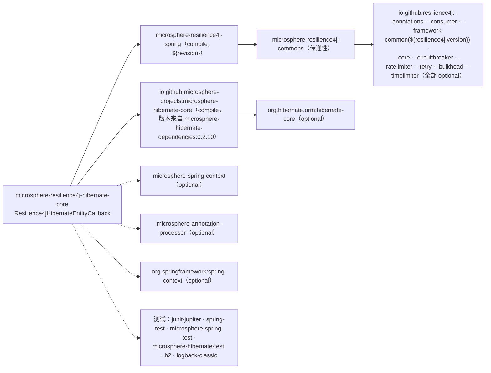

# microsphere-resilience4j-hibernate-core — 开发者指南

> 版本线 `0.2.x`（`release` 分支） · 最新发布版本 `0.2.4` · 当前 `${revision}` = `0.2.5-SNAPSHOT` · Resilience4j **2.0.0 – 2.4.0**（默认 `2.4.0`） · Spring Cloud 2022.0.x – 2025.0.x · JDK **17+** · [← 开发者指南索引](README.md)
> [English](../microsphere-resilience4j-hibernate-core.md)

模块路径：`microsphere-resilience4j-plugins/microsphere-resilience4j-hibernate-core`。

## 类清单

该模块的完整文件列表（通过列举目录已核实 —— 没有别的东西）：

| 类型 / 文件 | 角色 |
|-------------|------|
| `src/main/java/io/microsphere/resilience4j/hibernate/Resilience4jHibernateEntityCallback.java` | 唯一的生产类：`implements io.microsphere.hibernate.entity.EntityCallback`；八个 `@Override` 生命周期回调 + `buildEntryName`；常量 `DEFAULT_ENTRY_NAME_PREFIX = "hibernate@"` |
| `src/test/java/io/microsphere/resilience4j/hibernate/Resilience4jHibernateEntityCallbackTest.java` | `class Resilience4jHibernateEntityCallbackTest extends AbstractHibernateH2Test` —— **不声明测试方法**（空主体） |
| `pom.xml` | parent `microsphere-resilience4j-parent`（`relativePath ../../microsphere-resilience4j-parent/pom.xml`），packaging `jar`，version `${revision}`，name `Microsphere :: Resilience4j :: Plugins :: Hibernate Core` |

**刻意缺席：** 完全没有 `src/main/resources` 目录，因此**没有 `META-INF/spring.factories`**，也**没有 `Resilience4jPlugin` 实现**。这是与同级的 `alibaba-druid`、`mybatis`、`spring-web` 插件（它们各自都带有 `META-INF/spring.factories` 和一个 `*Resilience4jPlugin` 类）在结构上的区别。

## 如何使用 Hibernate 实体回调扩展点

该扩展点属于 `io.github.microsphere-projects:microsphere-hibernate-core`，而非本仓库。从本模块的源码出发，我们可以确切地核实它暴露的契约，因为每个被实现的方法都带有 `@Override` —— 所以 `EntityCallback` 至少声明了这八个方法，且签名完全如下：

```java
void onPreLoad (Object entity, Object id, Object[] state, String[] propertyNames, Type[] types);
void onPostLoad(Object entity, Object id,                String[] propertyNames, Type[] types);
void onPreInsert (Object entity, Object id, Object[] state, String[] propertyNames, Type[] propertyTypes);
void onPostInsert(Object entity, Object id, Object[] state, String[] propertyNames, Type[] propertyTypes);
void onPreUpdate (Object entity, Object id, Object[] state, String[] propertyNames, Type[] propertyTypes);
void onPostUpdate(Object entity, Object id, Object[] state, String[] propertyNames, Type[] propertyTypes);
void onPreDelete (Object entity, Object id, Object[] state, String[] propertyNames, Type[] types);
void onPostDelete(Object entity, Object id, Object[] state, String[] propertyNames, Type[] types);
```

当你扩展或复用该类时需要留意的观察：

- 回调的参数元组（`entity`、`id`、`state`、`propertyNames`、`types`）是 Hibernate 的按实体事件数据，其中 `Type` 从 `org.hibernate.type` 导入 —— 这是本模块编译所针对的唯一 Hibernate 类型，也正是 `org.hibernate.orm:hibernate-core` 作为编译期但 `optional` 依赖的原因。
- 该扩展点在事件的后置上没有**返回值也没有抛出异常通道**，并且 `onPostLoad` 缺少 `state` 数组。这一个事实就决定了整个设计：插件无法得知操作是否成功，因而无法上报失败（见下面“失败上报在结构上不可能”）。
- 该类*直接*实现接口（本模块中没有适配器、没有匿名监听器、没有 Hibernate 的 `Integrator`/`EventListener` 注册代码）。分发该回调完全是宿主技术栈的职责。

### 两阶段映射

`Resilience4jFacade` 继承 `Resilience4jOperations<Resilience4jContext[]>`，其后者的两阶段操作是 `begin(name)` / `end(context)`。插件将它们拆分到事件对上，并使用 `Resilience4jContext` 的 `ThreadLocal` 作为载体：

```java
// pre-event (LOAD / INSERT / UPDATE / DELETE)
String entryName = buildEntryName(entity, "INSERT");                       // "hibernate@<class>@INSERT"
Resilience4jContext<Resilience4jContext[]> begin = this.facade.begin(entryName);
begin.withinContext();                                                     // Resilience4jContext.setContext(this)

// post-event
doInContext(contextt -> this.facade.end(contextt), true);                  // static import of Resilience4jContext.doInContext
```

`withinContext()` 即 `Resilience4jContext.setContext(this)`；`doInContext(consumer, true)` 解析为：

```java
public static void doInContext(Consumer<Resilience4jContext> contextConsumer, boolean forRemoval) {
    Resilience4jContext context = forRemoval ? removeContext() : getContext();   // remove = get + ThreadLocal.remove()
    if (context != null) {
        contextConsumer.accept(context);
    }
}
```

因此，无需运行即可读出该实现的三个性质：

| 性质 | 机制 |
|----------|-----------|
| 同一线程上后置事件若无前置事件，是一个**无操作**，而非错误 | 当 `removeContext()` 返回 `null` 时，`doInContext` 会跳过该 consumer |
| `end()` 总是针对**最近一次 begin** 的上下文运行 | `ThreadLocal` 只持有单值；前置事件已覆盖了那里的任何内容 |
| 被跳过的后置事件会**泄漏**已绑定的上下文 | 该线程上没有别的东西调用 `removeContext()` |

源文件中局部变量命名为 `begin`，lambda 参数命名为 `contextt`（双 `t`）；两者都只是表面差异，但如果你要与上游做 diff，请照原样复现它们。

### `begin`/`end` 内部实际执行了什么

`ChainableResilience4jFacade.begin(name)` 构建一个 `Resilience4jContext<Resilience4jContext[]>`，其入口是一个长度为 `size` 的子上下文数组，且只填充那些模板回答 `isBeginSupported()` 为真的槽位。`end(context)` 以 `isEndSupported()` 与之镜像对应。结合各模板自身的回答：

| 模板 | `isBeginSupported` / `isEndSupported` | 对本插件的影响 |
|----------|--------------------------------------|------------------------|
| `CircuitBreakerTemplate` | `true`（重写 `doBegin`/`doEnd`） | 在前置事件中 `acquirePermission()`；以 `getCurrentTimestamp()` 记录为 `startTime`；在后置事件中 `onSuccess/onResult/onError` |
| `RateLimiterTemplate` | `true`（`doBegin` → `waitForPermission(rateLimiter)`，`doEnd` → `onSuccess`/`onResult`/`onError`） | 事件前等待许可，事件后记录结果 |
| `BulkheadTemplate` | `true`（`doBegin` → `acquirePermission()`，`doEnd` → `onComplete()`） | 两个事件之间持有并发槽位 |
| `RetryTemplate`、`TimeLimiterTemplate`、`ThreadPoolBulkheadTemplate` | `false` / `false` | **从不被调用** —— 重试与超时装饰在此路径上不可用，属设计使然 |

### 失败上报在结构上不可能

`CircuitBreakerTemplate.doEnd` 和 `RateLimiterTemplate.doEnd` 会依据 `context.getFailure()` / `context.getResult()` 分支。本插件从不设置这两个字段中的任何一个 —— 对比同为两阶段的兄弟插件：

```java
// Resilience4jHandlerMethodInterceptor.afterExecute (spring-web)
context.setResult(returnValue).setFailure(error);
this.resilience4jFacade.end(context);
```

```java
// Resilience4jHibernateEntityCallback.onPostInsert (this module)
doInContext(contextt -> this.facade.end(contextt), true);
```

在添加失败支持之前需要权衡的推论：

1. 每个到达后置回调的事件对都被记录为一次**成功**（`failure == null && result == null` → `onSuccess(...)`）；
2. 在此路径上熔断器所能看到的唯一失败信号，是由 `doBegin` *抛出*的异常（一次拒绝），它从前置事件中传播出来；
3. Hibernate 回调没有为后置事件提供 `error` 参数，因此修复办法不是“调用 `setFailure`” —— 它需要一个携带结果的扩展点（或者去包装 DAO 调用而非实体事件）。

## 事件流



一次受保护的 insert 的时序视图：



## 设计模式（附证据）

| 模式 | 证据 |
|---------|----------|
| **观察者（基于推送的事件消费者）** | 该类是 `EntityCallback` 被观察者的纯粹观察者：八个 `void` 方法，无返回通道，无过滤 —— 它响应扩展点所推送的内容。注册/注销归 `microsphere-hibernate-core` 所有。 |
| **门面** | 仅有的协作对象是 `io.microsphere.resilience4j.common.Resilience4jFacade` 与 `Resilience4jContext`。主源码中没有导入任何 `io.github.resilience4j.*` 类型，尽管 POM 中声明了九个 Resilience4j 构件（optional）。 |
| **责任链** | 委托实现，而非自行实现：`facade.begin/end` 遍历 `ChainableResilience4jFacade` 内部按优先级排序的 `List<Resilience4jTemplate>`，每个模板守护自己的槽位。 |
| **模板方法（消费侧）** | 插件调用 `final` 的 `Resilience4jTemplate.begin(...)/end(...)` 入口点，后者再调用每个具体模板的 `protected doBegin/doEnd` 钩子。 |
| **显式 ThreadLocal / 隐式作用域上下文** | `begin.withinContext()` 绑定，`doInContext(…, true)` 解绑 —— 这一对是手写的“隐式调用上下文”，与 `Resilience4jContext` 提供给 Spring AOP 路径的是同一惯用法。 |
| **基于 setter（JavaBean）的配置而非构造函数注入** | 没有声明构造函数；带 `assertNotNull` 守卫的 `setFacade` / `setEntryNamePrefix`。如此选择是为了让回调可作为普通的 Spring bean 定义；代价是一个可变、暂时处于无效状态的实例。 |
| **策略（经由 `entryNamePrefix`）** | 该前缀是一种可插拔的命名策略，与其他插件（`mybatis@`、`spring-web@`、`hibernate@`）一致。 |
| **装饰器 / 代理 —— 未使用** | 这里没有被包装的 Hibernate 对象：不同于 `Resilience4jExecutor`（MyBatis）或 `Resilience4jClient`（Feign），没有包装任何东西，也不返回任何接口实例。 |
| **SPI —— 本模块未使用** | `Resilience4jPlugin`（`plugin(beanFactory, registry, environment)` + `getName()`）**未**被实现，且该模块没有 `META-INF/spring.factories`。因此 `EnableResilience4jRegistrar.registerPlugins(...)` —— 它会加载 `Resilience4jPlugin` 条目并将其与 `@Enable*` 注解的 `plugins` 属性做匹配 —— 永远看不到这个插件。 |

如果你希望 `@EnableBulkhead(plugins = "hibernate")` 生效，就得添加一个 `Resilience4jPlugin` 实现，外加一个把回调注册为 bean 的 `META-INF/spring.factories` 条目；如今该插件完全不由库以任何方式注册。

## 依赖关系图



| 方面 | 事实（来自 `pom.xml`） |
|--------|------------------------|
| 非可选依赖 | `microsphere-resilience4j-spring`（显式 `${revision}`）与 `microsphere-hibernate-core`（无版本 —— 通过父 POM 导入的 `microsphere-hibernate-dependencies:0.2.10` 解析） |
| Hibernate 自身 | `optional`，因此应用自行选择 Hibernate 6.x 版本；只引用了 `org.hibernate.type.Type` |
| Resilience4j | 九个可选构件；`-framework-common` 是唯一显式带有 `<version>${resilience4j.version}</version>` 的，其余通过 `microsphere-resilience4j-parent` 中的 `resilience4j-bom` 导入解析 |
| 聚合反应堆位置 | 在 `microsphere-resilience4j-plugins/pom.xml` `<modules>` 中列于 `mybatis` 与 `openfeign` 之间；聚合器设置了 `maven-deploy-plugin <skip>true</skip>`，这仅影响聚合器 POM 本身 |
| BOM 位置 | **没有**在 `microsphere-resilience4j-dependencies` 中声明。它是唯一一个交付了编译代码却被 BOM 排除在外的模块 —— 其余缺席者（`plugins` 聚合器、`spring-boot`、`spring-cloud`）根本没有 `src/main/java`，因此使用者必须显式声明本插件的版本 |

## 面向贡献者的注意事项

- **测试覆盖为零断言。** `Resilience4jHibernateEntityCallbackTest` 的主体为空；CI（`.github/workflows/maven-build.yml`）在 JDK 17/21/25 × `spring-cloud-2022…2025` × `resilience4j-2.0…2.4` 上运行 `test`，因此本模块只是被编译、并经由继承被实例化，从未做行为检查。有用的首批测试全都无需数据库即可触达：断言 `DEFAULT_ENTRY_NAME_PREFIX`，断言 `setFacade(null)` 与 `setEntryNamePrefix(null)` 会被 `io.microsphere.util.Assert.assertNotNull` 守卫拒绝（该辅助方法由 `microsphere-java-core` 提供，因此写断言时要核对它的异常类型），通过一个子类断言 `buildEntryName` 的输出，以及断言在一个全新线程上 `onPostInsert` 是一次静默无操作。
- **入口名冲突。** `buildEntryName` 使用 `entity.getClass().getName()`，因此一个 Hibernate 代理或被字节码增强的子类会改变资源名。用一个带代理实体的测试来钉住预期行为，然后再改动它。
- **不要添加 `@Intercepts` 式的状态。** 除两个配置字段外该类是无状态的，并预期跨会话、跨线程共享；唯一的每次调用状态存在于 `Resilience4jContext` 的 `ThreadLocal` 中。
- **添加失败上报**需要一个暴露结果的扩展点；在当前 `EntityCallback` 签名内，你能做的最好是*在*前置事件的异常路径上调用 `setFailure`，而这会把拒绝重复计数。
- **如果你添加 Spring 自动注册**，请记住插件名的匹配方式：`EnableResilience4jRegistrar` 是将 `plugins` 属性与 `Resilience4jPlugin#getName()` 比对，而非与 bean 名比对。

## 相关页面

- [用户指南 — microsphere-resilience4j-hibernate-core](../../user-guide/zh/microsphere-resilience4j-hibernate-core.md)
- [开发者指南 — microsphere-resilience4j-spring-web（两阶段对比）](microsphere-resilience4j-spring-web.md)
- [开发者指南 — microsphere-resilience4j-commons](microsphere-resilience4j-commons.md)
- [开发者指南 — microsphere-resilience4j-dependencies](microsphere-resilience4j-dependencies.md)
