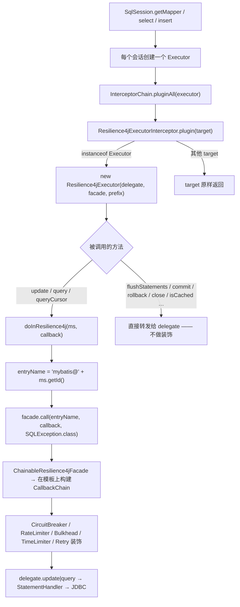
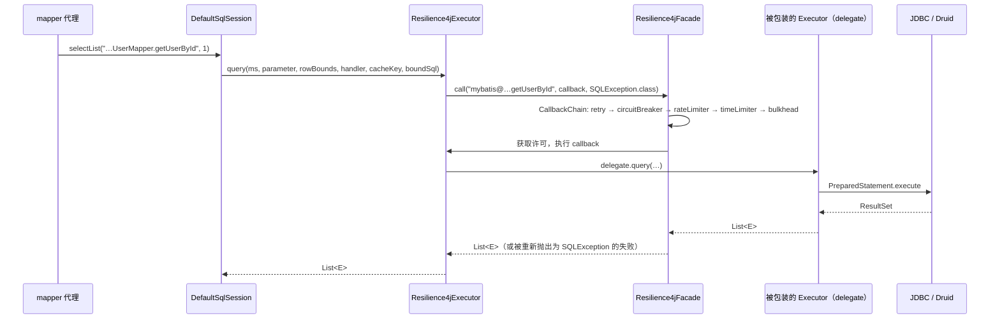
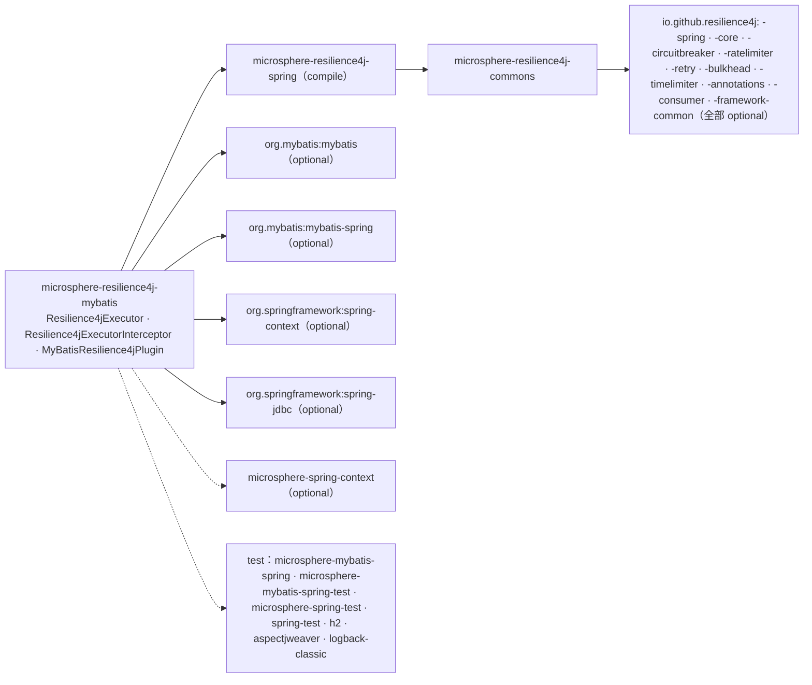

# microsphere-resilience4j-mybatis — 开发者指南

> 简体中文 | [English](../microsphere-resilience4j-mybatis.md)

> 版本线 `0.2.x`（`release` 分支）· 最新发布版本 `0.2.4` · 当前 `${revision}` = `0.2.5-SNAPSHOT` · Resilience4j **2.0.0 – 2.4.0**（默认 `2.4.0`）· Spring Cloud 2022.0.x – 2025.0.x · JDK **17+** · [← 开发者指南索引](README.md)

模块路径：`microsphere-resilience4j-plugins/microsphere-resilience4j-mybatis`。

## 类清单

| 类型 | 文件 | 角色 |
|------|------|------|
| `Resilience4jExecutor` | `src/main/java/io/microsphere/resilience4j/mybatis/executor/Resilience4jExecutor.java` | 实现 `org.apache.ibatis.executor.Executor`；持有 `delegate` + `facade` + `entryNamePrefix`；装饰 4 个语句方法，转发 10 个，并在 `setExecutorWrapper` 中做包装 |
| `Resilience4jExecutorInterceptor` | `src/main/java/io/microsphere/resilience4j/mybatis/plugin/Resilience4jExecutorInterceptor.java` | 实现 `org.apache.ibatis.plugin.Interceptor`；`plugin(target)` 是织入点；`intercept()` 是透传 |
| `MyBatisResilience4jPlugin` | `src/main/java/io/microsphere/resilience4j/mybatis/MyBatisResilience4jPlugin.java` | `Resilience4jPlugin`（`PLUGIN_NAME = "mybatis"`），注册拦截器 bean，并以构造参数引用接到门面 bean |
| 资源文件 | `src/main/resources/META-INF/spring.factories` | `io.microsphere.resilience4j.spring.common.Resilience4jPlugin=io.microsphere.resilience4j.mybatis.MyBatisResilience4jPlugin` |
| `Resilience4jExecutorInterceptorTest` | `src/test/java/io/microsphere/resilience4j/mybatis/plugin/...` | 5 个测试：`testMapper`、`testSqlSession`、`testConstants`、`testGetter`、`testInvoke`；继承 `io.microsphere.mybatis.test.AbstractMyBatisTest` |
| `MyBatisResilience4jPluginTest` | `src/test/java/io/microsphere/resilience4j/mybatis/...` | 1 个测试：在 Spring 上下文中注册该插件（`@EnableBulkhead(plugins = "mybatis")`、`@EnableCircuitBreaker`、`@EnableMyBatis`）并断言 `SqlSessionFactory`/mapper 的往返调用 |

## 织入机制：MyBatis 的 `Interceptor` SPI —— 且不用 `@Intercepts`

最重要的结构性事实（在整个模块中搜索验证过）：**本插件里没有任何 `@Intercepts`/`@Signature` 注解。** MyBatis 惯常的做法是

```java
@Intercepts({@Signature(type = Executor.class, method = "update", args = {MappedStatement.class, Object.class})})
```

再配合 `Interceptor.plugin(target)` 的默认实现，后者返回 `Plugin.wrap(target, this)`——一个 JDK 动态代理，其 `InvocationHandler` 调用 `intercept(Invocation)`。

本插件走的是该 SPI 的另一条分支。`Resilience4jExecutorInterceptor` 重写了 `plugin(Object target)`，返回一个**手写的实现对象**：

```java
@Override
public Object plugin(Object target) {
    if (target instanceof Executor) {
        return new Resilience4jExecutor((Executor) target, facade, entryNamePrefix);
    }
    return target;
}
```

MyBatis 的调用顺序是 `Configuration#newExecutor` → `InterceptorChain#pluginAll(executor)` → 对每个已注册拦截器调用 `interceptor.plugin(target)`。由于 `plugin()` 返回的是强类型包装器而不是代理，框架永远不会为该拦截器构造 `Invocation`，`intercept(Invocation)` 也永远不会被框架调用——这正是它的方法体（`return invocation.proceed();`）和注释 *“Current method will be not executed”*（当前方法不会被执行）的由来。测试 `testInvoke` 只能通过手工构造 `Invocation` 来证明该方法是可达的。

源码中可见的设计取舍：

| 属性 | 强类型装饰器方案（本插件） | `@Intercepts` + `Plugin.wrap` |
|----------|----------------------------------------|-------------------------------|
| 非 `Executor` 目标 | 原样返回（`return target;`） | 由签名匹配过滤掉 |
| 方法选择 | 显式：只有 `update`、两个 `query` 重载和 `queryCursor` 被装饰；其余都是普通转发调用 | 你声明的任意签名列表 |
| 单次调用开销 | 直接调用包装器上的方法 | 经由代理反射式 `Method.invoke` |
| 粒度 | 整个 `Executor` 接口 | 按声明的方法签名 |

### 装饰了什么（以及没装饰什么）

`Resilience4jExecutor` 实现了 `Executor` 的每个方法。其中四个穿过弹性边界：

```java
@Override
public <E> List<E> query(MappedStatement ms, Object parameter, RowBounds rowBounds, ResultHandler resultHandler,
                         CacheKey cacheKey, BoundSql boundSql) throws SQLException {
    return doInResilience4j(ms, () -> delegate.query(ms, parameter, rowBounds, resultHandler, cacheKey, boundSql));
}
```

`flushStatements`、`commit(boolean)`、`rollback(boolean)`、`createCacheKey`、`isCached`、`clearLocalCache`、`deferLoad`、`getTransaction`、`close(boolean)`、`isClosed` 都是单行转发。`setExecutorWrapper(Executor)` 是例外：它在将参数交给 delegate 之前先包装参数（`new Resilience4jExecutor(executor, facade, entryNamePrefix)`），这正是 MyBatis 内部的 wrapper 赋值也能保持被装饰的原因——同时也是唯一可能出现嵌套包装器的地方。

命名与失败适配都集中在一个 protected 方法里：

```java
protected <T> T doInResilience4j(MappedStatement ms, ThrowableSupplier<T> callback) throws SQLException {
    String entryName = buildEntryName(ms);          // entryNamePrefix + ms.getId()
    return this.facade.call(entryName, callback, SQLException.class);
}
```

`Resilience4jOperations.call(name, supplier, throwableClass)`（commons）执行整条模板链，并把任何失败适配为所声明的类型，因此 `CallNotPermittedException` / `RequestNotPermittedException` 会以 `SQLException` 的形式到达调用方。

### 被拦截的调用路径



单条映射语句的时序视图：



## Spring 注册路径

`MyBatisResilience4jPlugin` 是本模块中唯一触碰 Spring 的类：

```java
BeanDefinitionBuilder beanDefinitionBuilder = genericBeanDefinition(Resilience4jExecutorInterceptor.class);
beanDefinitionBuilder.addConstructorArgReference(BEAN_NAME);   // LazyResilience4jFacade.BEAN_NAME = "lazyResilience4jFacade"
AbstractBeanDefinition beanDefinition = beanDefinitionBuilder.getBeanDefinition();
String beanName = generateBeanName(beanDefinition, registry);
registerBeanDefinition(registry, beanName, beanDefinition);
```

| 细节 | 后果 |
|--------|-------------|
| bean 名来自 `BeanDefinitionReaderUtils.generateBeanName(...)` | 它是一个*生成的*、由类名推导的名字——不是公开常量；请按**类型**查找该 bean |
| 构造参数是对 `lazyResilience4jFacade` 的**引用** | 门面是 `microsphere-resilience4j-spring` 的懒代理门面，其真正的被委托对象在 `ContextRefreshedEvent` 时由上下文中已注册的 `Registry` bean 装配而成 |
| 每次 `plugin()` 调用只产生一个 bean definition | `plugin()` 由 `EnableResilience4jRegistrar.registerPlugins(...)` 为每个列出 `plugins = "mybatis"` 的 `@Enable*` 注解调用；不同配置类上的多个 `@Enable*` 注解可能注册出多个拦截器 bean（每次不同的 registry 处理各一个），这会成倍放大装饰次数 |
| `getName()` 返回 `PLUGIN_NAME`（`"mybatis"`） | 该值用于与注解的 `plugins` 属性比对 |

## 设计模式（附证据）

| 模式 | 证据 |
|---------|----------|
| **装饰器（Decorator）** | `Resilience4jExecutor implements Executor` 并持有 `private final Executor delegate`；4 个方法增加行为（弹性），10 个原样转发。 |
| **代理（保护代理）** | 装饰器就是决定底层 `Executor` 是否被允许执行的那个权威（熔断器/限流器/隔离舱的许可）。 |
| **工厂方法 / 插拔点** | `Interceptor.plugin(Object)` 充当工厂，决定目标是否包装以及如何包装；对非 `Executor` 参数该插件原样返回 `target`。 |
| **门面（Facade）** | `Resilience4jExecutorInterceptor` 和 `Resilience4jExecutor` 都只认识 `io.microsphere.resilience4j.common.Resilience4jFacade`；主源码中没有出现任何 `io.github.resilience4j.*` 类型。 |
| **职责链** | 门面内部：`ChainableResilience4jFacade` → `CallbackChain` 依次遍历按优先级排序的模板列表，每个模板包裹其余的链。 |
| **观察者（Observer）** | 可用但此处未用：事件消费者注册在模板上（`CircuitBreakerTemplate.onCallNotPermittedEvent(...)` 等），可通过注入的门面触达。 |
| **SPI** | 两层：MyBatis 自身的 `org.apache.ibatis.plugin.Interceptor`，以及本库从 `META-INF/spring.factories` 加载的 `Resilience4jPlugin`。 |
| **依赖注入（通过 bean 引用）** | 生成的 bean definition 通过 `addConstructorArgReference` 注入门面。 |

## 依赖关系图



| 方面 | 事实 |
|--------|------|
| Spring 还是 commons | 依赖 **`microsphere-resilience4j-spring`**（compile）——不同于止步于 `commons` 的 `microsphere-resilience4j-openfeign`。Spring 依赖是 `Resilience4jPlugin` 实现所需的，而不是执行器装饰器所需的。 |
| 使用到的 Resilience4j 模块 | 编译期：无（只有门面）。运行期（如测试所验证）：`Retry`、`CircuitBreaker`、`RateLimiter`、`TimeLimiter`、`Bulkhead` 注册表（`*Registry.ofDefaults()`）——五个都会参与，因为本插件使用一次性的 `call(...)` 路径。 |
| 使用到的 MyBatis API 面 | `Executor`、`MappedStatement`、`BoundSql`、`CacheKey`、`RowBounds`、`ResultHandler`、`Cursor`、`BatchResult`、`MetaObject`、`Transaction`、`Interceptor`、`Invocation`、`SimpleExecutor`（test）。 |

## 贡献者须知

- 添加 `@Intercepts` 与当前的 `plugin()` 重写**并不能**良好共存：基于代理的路径期望由 `intercept(Invocation)` 来完成装饰，而这里的装饰发生在 `Resilience4jExecutor` 内部。请二选一。
- 如果 `Executor` 接口新增了需要装饰的方法（MyBatis 升级），该类会编译失败，直到你显式决定它是被装饰还是被转发——这是强类型装饰器设计中有意为之、编译期可见的契约。
- `MyBatisResilience4jPluginTest` 依赖 `microsphere-mybatis-spring` / `microsphere-mybatis-spring-test` 的辅助配置来提供 `DataSource`、DDL 和 mapper 注册；断言本身（`assertConfiguration`、`assertUserMapper`）来自 `microsphere-mybatis-test`。

## 相关页面

- [用户指南 — microsphere-resilience4j-mybatis](../../user-guide/zh/microsphere-resilience4j-mybatis.md)
- [开发者指南 — microsphere-resilience4j-alibaba-druid](microsphere-resilience4j-alibaba-druid.md)
