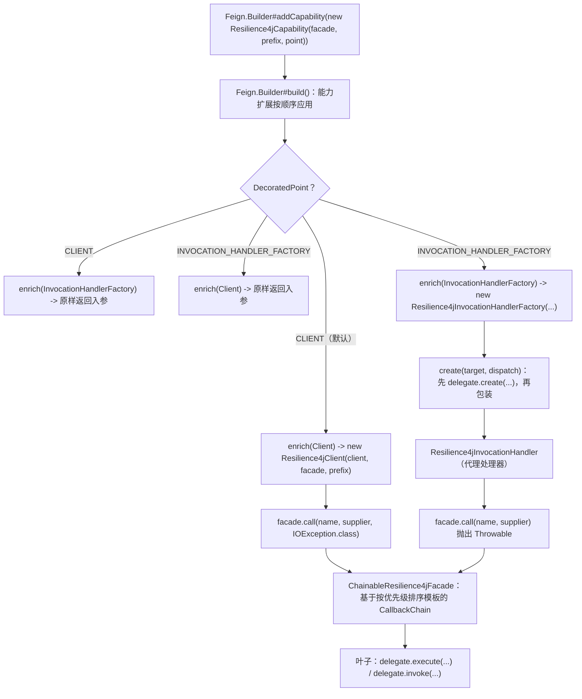
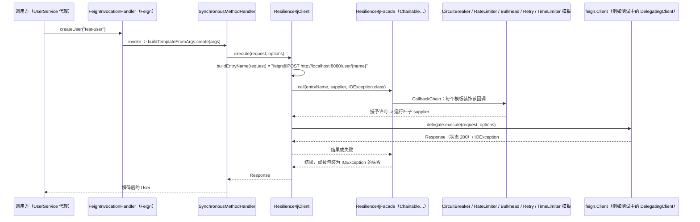
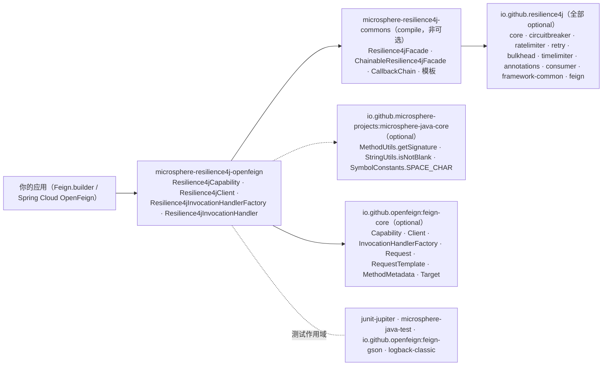

# microsphere-resilience4j-openfeign — 开发者指南

> 版本线 `0.2.x`（`release` 分支） · 最新发布版本 `0.2.4` · 当前 `${revision}` = `0.2.5-SNAPSHOT` · Resilience4j **2.0.0 – 2.4.0**（默认 `2.4.0`） · Spring Cloud 2022.0.x – 2025.0.x · JDK **17+** · [← 开发者指南索引](README.md)
> [English](../microsphere-resilience4j-openfeign.md)

模块路径：`microsphere-resilience4j-plugins/microsphere-resilience4j-openfeign`。所有生产类都位于同一个包 `io.microsphere.resilience4j.feign` 中。

## 类清单

| 类型 | 文件 | 角色 |
|------|------|------|
| `Resilience4jCapability` | `src/main/java/io/microsphere/resilience4j/feign/Resilience4jCapability.java` | 用户唯一构造的对象；实现 `feign.Capability`，持有 `facade` + `entryNamePrefix` + `decoratedPoint`，并将 `enrich(...)` 路由到两个装饰器之一 |
| `Resilience4jCapability.DecoratedPoint` | 同文件中的嵌套 `enum` | `CLIENT`、`INVOCATION_HANDLER_FACTORY` —— 织入点的单值选择 |
| `Resilience4jClient` | `.../Resilience4jClient.java` | `feign.Client` 装饰器；传输边界装饰，失败被定型为 `IOException` |
| `Resilience4jInvocationHandlerFactory` | `.../Resilience4jInvocationHandlerFactory.java` | `feign.InvocationHandlerFactory` 装饰器；先委托 `create(...)`，再包装所产出的处理器 |
| `Resilience4jInvocationHandler` | `.../Resilience4jInvocationHandler.java` | `java.lang.reflect.InvocationHandler` 装饰器；方法边界装饰，失败以 `Throwable` 重新抛出 |
| 资源 | — | **无**：本模块根本没有 `src/main/resources` —— 没有 `META-INF/spring.factories`，没有 `Resilience4jPlugin` 实现 |

### 测试清单

| 测试 / 夹具 | 文件 | 它演练的内容 |
|----------------|------|-------------------|
| `AbstractResilience4jFeignTest` | `src/test/java/.../feign/AbstractResilience4jFeignTest.java` | 共享的 `@BeforeEach`：从五个 `*Registry.ofDefaults()` 构建一个 `ChainableResilience4jFacade`、一个 `GsonEncoder`/`GsonDecoder`，以及一个先带 `DelegatingCapability`、**再**带子类 `Resilience4jCapability` 的 `Feign` 实例；声明 `abstract Resilience4jCapability createResilience4jCapability(Resilience4jFacade)`。自身测试：`testProxy()`（走查 `InvocationHandler` 链）、`testUserService()`（create + get 往返） |
| `Resilience4jCapabilityTest` | `.../Resilience4jCapabilityTest.java` | `new Resilience4jCapability(facade)` + `testConstants()` 断言 `DEFAULT_ENTRY_NAME_PREFIX == "feign@"` 且 `DEFAULT_DECORATED_POINT == CLIENT` |
| `Resilience4jClientTest` | `.../Resilience4jClientTest.java` | `new Resilience4jCapability(facade, this.getClass().getSimpleName())` —— 即前缀 `"Resilience4jClientTest"`，仍是 `CLIENT` 点 |
| `Resilience4jInvocationHandlerFactoryTest` | `.../Resilience4jInvocationHandlerFactoryTest.java` | `new Resilience4jCapability(facade, INVOCATION_HANDLER_FACTORY)` |
| `DelegatingClient`、`DelegatingCapability`、`DelegatingInvocationHandler`、`DelegatingInvocationHandlerFactory` | `.../feign/*.java` | 测试夹具：`DelegatingClient` 通过反射调用本地 `SimpleUserService` 来应答请求（它从 `DelegatingInvocationHandler#getArguments()` —— 一个 `ThreadLocal` —— 读回参数），而 `Delegating*` 能力扩展链为测试提供可观测的包装层 |
| `api.UserService`、`api.User`、`server.SimpleUserService` | `.../feign/api/*`、`.../feign/server/*` | 带 `@RequestLine("POST /user/{name}")` / `@RequestLine("GET /user")` 的 Feign 接口，以及一个基于内存 `Map<String, User>` 的实现 |

覆盖率说明：这些测试断言的是**装配**（哪个包装器出现在何处、持有一个怎样的门面实例）以及一次功能性往返。两个装饰器中的 `buildEntryName(...)` 都是 `private`，没有被直接断言；`Resilience4jInvocationHandler` 的三条 `requireNonNull` 消息同样未被测试。

## 织入机制

### 1. `feign.Capability` 作为唯一的集成表面

Feign 通过默认方法暴露 `Capability`，用于 `enrich(Logger)`、`enrich(Contract)`、`enrich(Client)`、`enrich(Encoder)`、`enrich(Decoder)`、`enrich(Retryer)`、`enrich(InvocationHandlerFactory)` …… `Resilience4jCapability` 恰好重写了其中两个，且每个重写都是单行的条件式装饰器：

```java
@Override
public Client enrich(Client client) {
    return isDecoratedClient() ? new Resilience4jClient(client, facade, entryNamePrefix) : client;
}

@Override
public InvocationHandlerFactory enrich(InvocationHandlerFactory invocationHandlerFactory) {
    return isDecoratedInvocationHandlerFactory() ? new Resilience4jInvocationHandlerFactory(invocationHandlerFactory, facade, entryNamePrefix) : invocationHandlerFactory;
}
```

`isDecoratedClient()` 和 `isDecoratedInvocationHandlerFactory()` 是针对单一 `decoratedPoint` 字段的 `equals` 测试，因此**这两个装饰点在每个能力扩展内互斥**。Feign 对象图中其余的东西（`Contract`、`Encoder`、`Decoder`、`Retryer`、`Logger`）都不被触碰。

`Feign.Builder#build()` 按注册顺序应用能力扩展，每个 `enrich` 接收前一个的输出；这使得最后添加的能力扩展成为最外层的包装。`AbstractResilience4jFeignTest` 依赖这一顺序：它先注册 `DelegatingCapability`、再注册 `Resilience4jCapability`，然后 `testProxy()` 断言处理器链 `Resilience4jInvocationHandler → DelegatingInvocationHandler → feign.ReflectiveFeign$FeignInvocationHandler`。在 `DecoratedPoint.CLIENT` 下，同一测试走另一分支（`delegate = handler`），最终仍止于 `feign.ReflectiveFeign$FeignInvocationHandler` —— 这证明 `CLIENT` 点不会改动代理。

### 2. 两个装饰器都汇入同一个门面操作，但异常类型化不同

```java
// Resilience4jClient — the transport boundary
public Response execute(Request request, Request.Options options) throws IOException {
    String entryName = buildEntryName(request);
    return this.facade.call(entryName, () -> this.delegate.execute(request, options), IOException.class);
}

// Resilience4jInvocationHandler — the method boundary
public Object invoke(Object proxy, Method method, Object[] args) throws Throwable {
    String entryName = buildEntryName(method);
    return this.facade.call(entryName, () -> delegate.invoke(proxy, method, args));
}
```

它们解析到两个不同的 `Resilience4jOperations` 默认方法：

- `<T, TR extends Throwable> T call(String, ThrowableSupplier<T>, Class<TR>) throws TR` → `try { call(name, callback); } catch (Throwable t) { throw wrap(t, throwableClass); }`，其中 `wrap` 是 `io.microsphere.util.ExceptionUtils.wrap`。每个失败 —— 包括 `CallNotPermittedException` —— 都作为 `IOException` 离开客户端。
- `<T> T call(String, ThrowableSupplier<T>) throws Throwable` → 无转换；`InvocationHandler` 传播原始的 `Throwable`（Feign 的 `SynchronousMethodHandler` 异常、解码器失败，或 Resilience4j 自身的异常）。

`Resilience4jInvocationHandlerFactory` 不贡献任何自身的装饰 —— 它是一个工厂，保留委托的产物并对其进行包装：

```java
public InvocationHandler create(Target target, Map<Method, MethodHandler> dispatch) {
    InvocationHandler delegate = this.delegate.create(target, dispatch);
    return new Resilience4jInvocationHandler(delegate, facade, entryNamePrefix);
}
```

结果是：在 `INVOCATION_HANDLER_FACTORY` 点上，装饰**每次代理方法调用发生一次**，覆盖 `BuildTemplateByResolvingArgs`（参数 → 请求模板）、编码、传输、`ErrorDecoder` 与解码。在 `CLIENT` 点上，它只覆盖 `Client#execute`，即传输，并且每次 HTTP 尝试调用一次 —— 因此 Feign 级的 `Retryer` 会触发多次被装饰的调用。

### 3. 入口名按每次调用派生，不做缓存

`Resilience4jClient` 基于 `StringBuilder` 从请求构造一个名称：

```
prefix + request.httpMethod().name() + SPACE_CHAR
       + request.requestTemplate().feignTarget().url()
       + request.requestTemplate().methodMetadata().template().path()
       + (isNotBlank(queryLine) ? requestTemplate.queryLine() : "")
```

请注意权威来源的割裂：路径来自**方法元数据**的（契约解析后、未展开的）`RequestTemplate`，而 `queryLine()` 来自**按请求**的模板。`Resilience4jInvocationHandler` 则使用 `entryNamePrefix + getSignature(method)`，配合 `io.microsphere.reflect.MethodUtils.getSignature(Method)` —— 一个纯按方法派生、基数有界的名字。两个类都不缓存名称；实例由注册表持有（`AdvancedResilience4jOperations#getEntry(name)` → `registry.find(name)`，否则 `createEntry(name)` → `registry.<module>(name, getConfiguration(name))`）。

### 流程图：一次能力扩展调用如何被路由



### 时序图：`CLIENT` 装饰路径



（对于 `INVOCATION_HANDLER_FACTORY` 点，同一时序图从早一步开始：`App → Resilience4jInvocationHandler → Delegating/FeignInvocationHandler → SynchronousMethodHandler → real Client`，并且失败路径会跳过 `IOException` 转换。）

## 设计模式（附证据）

| 模式 | 本模块中的证据 |
|---------|--------------------------|
| **策略 / 配置** | `DecoratedPoint` 是一个被两个 `enrich` 重载读取的策略选择器；`getDecoratedPoint()` 是唯一的决策输入。选择 `CLIENT` 还是 `INVOCATION_HANDLER_FACTORY` 改变的是受保护的边界，而非装饰逻辑。 |
| **装饰器（GoF）** | `Resilience4jClient` 与 `Resilience4jInvocationHandler` 各自持有一个同类型的 `delegate` 并在其周围添加行为；`Resilience4jInvocationHandlerFactory` 装饰工厂的*产物*，这正是装饰 `java.lang.reflect.Proxy` 处理器的经典做法。 |
| **抽象工厂 / 工厂方法** | `InvocationHandlerFactory#create(Target, Map<Method, MethodHandler>)` 是 Feign 的工厂；插件的实现返回一个被包装的处理器而非原始的处理器。 |
| **门面** | 所有四个类都只依赖 `io.microsphere.resilience4j.common.Resilience4jFacade`；本模块中没有任何生产类导入任何 `io.github.resilience4j.*` 类型。`resilience4j-feign` 是一个*可选*依赖，仅被 `Resilience4jInvocationHandler` 的 Javadoc `@see io.github.resilience4j.feign.DecoratorInvocationHandler` 引用 —— 插件有意不使用 Resilience4j 自身的 Feign 装饰器。 |
| **责任链** | 在 commons 内部：`ChainableResilience4jFacade.call` 在由 `COMPARATOR` 排序的模板列表之上构建一条 `CallbackChain<T>`；本插件只提供名称和叶子 callable。 |
| **模板方法** | `Resilience4jCapability` 实现了两个 Feign 模板钩子（`enrich(Client)`、`enrich(InvocationHandlerFactory)`），它们的默认行为是“返回入参”，而它重写了自己关心的那一对。 |
| **受守卫 / 快速失败式构造** | `Resilience4jInvocationHandler` 对三个参数全部使用带显式消息的 `Objects.requireNonNull`；`Resilience4jClient` 和 `Resilience4jCapability` 则没有 —— 这一不一致值得贡献者留意。 |

## 依赖关系图



| 方面 | 事实 |
|--------|------|
| 上游层 | **commons**，而非 spring。`microsphere-resilience4j-commons` 是唯一非可选的依赖；POM 中没有 `microsphere-resilience4j-spring`。这就是为什么本模块没有 `Resilience4jPlugin`、没有 `@Enable*` 支持、没有 `META-INF/spring.factories`，以及为什么它可以在纯 Java 进程中使用。 |
| 所使用的 Resilience4j 组件 | 编译期：无（通过门面间接）。运行时：门面携带你交给它的任何注册表；测试使用 `BulkheadRegistry`、`RateLimiterRegistry`、`RetryRegistry`、`TimeLimiterRegistry`、`CircuitBreakerRegistry`（全部 `ofDefaults()`），并且因为两个装饰器都走一次性的 `call(...)` 路径，`RetryTemplate`、`TimeLimiterTemplate` 和 `ThreadPoolBulkheadTemplate` 都会生效 —— 这些模块被 Spring Web 与 Hibernate 插件所用的两阶段 `begin()/end()` 路径排除在外。 |
| 所使用的 Feign API 表面 | `Capability`（2 个 `enrich` 重载）、`Client#execute(Request, Request.Options)`、`InvocationHandlerFactory#create(Target, Map)`、`Request#httpMethod()/requestTemplate()`、`RequestTemplate#methodMetadata()/feignTarget()/queryLine()`、`MethodMetadata#template()`、`Request.HttpMethod#name()`。 |
| 反射表面 | `java.lang.reflect.InvocationHandler` 和 `io.microsphere.reflect.MethodUtils#getSignature(Method)`。 |

## 面向贡献者的扩展点

- `Resilience4jClient#buildEntryName` 和 `Resilience4jInvocationHandler#buildEntryName` 都是 `private`。将它们（或整个类）暴露为 `protected`，可让用户从 `configKey` 派生入口名，而非从 URL + path；对所产生字符串的任何改动对于既有的按入口 Resilience4j 配置而言都是**破坏性变更**。
- 添加第三个织入点意味着一个新的 `DecoratedPoint` 常量加一个 `enrich` 重载 —— 例如 `enrich(Decoder)` 只保护解码步骤，或 `enrich(Retryer)` 观察重试压力。届时基于枚举的单选设计就需要重新审视（一个 `Set<DecoratedPoint>` 或按点的布尔值会更好地组合）。
- `Resilience4jClient#execute` 中的 `IOException.class` 参数正是让传输路径符合 Feign 习惯用法的关键；未来若要提供禁用包装的选项，必须由构造函数来驱动，因为 `Resilience4jOperations` 同时提供 `call(name, supplier)` 和 `call(name, supplier, throwableClass)`。
- 两个装饰器除普通的字段赋值外都不缓存门面或前缀，而 `Resilience4jClient` 中也不存在任何 `null` 门面检查，因此 `NullPointerException` 会在每次调用时浮现，而非在构建时浮现 —— 若要将此收紧，`Resilience4jInvocationHandler` 的构造函数契约是值得照搬的范本。
- 测试夹具的复用：`DelegatingClient` 通过调用一个本地实现并从 `DelegatingInvocationHandler` 设置的 `ThreadLocal` 中读取其参数来应答请求。这个技巧之所以有效，只是因为测试驱动的是单个线程；门面链中若有一个 `TimeLimiter` 或 `ThreadPoolBulkhead`，就会把请求移出该线程从而破坏它。在扩展测试时要记住这一点。

## 相关页面

- [用户指南 — microsphere-resilience4j-openfeign](../../user-guide/zh/microsphere-resilience4j-openfeign.md)
- [用户指南 — commons](../../user-guide/zh/microsphere-resilience4j-commons.md)
- [开发者指南 — microsphere-resilience4j-spring](microsphere-resilience4j-spring.md)
- [开发者指南 — microsphere-resilience4j-spring-web](microsphere-resilience4j-spring-web.md)
