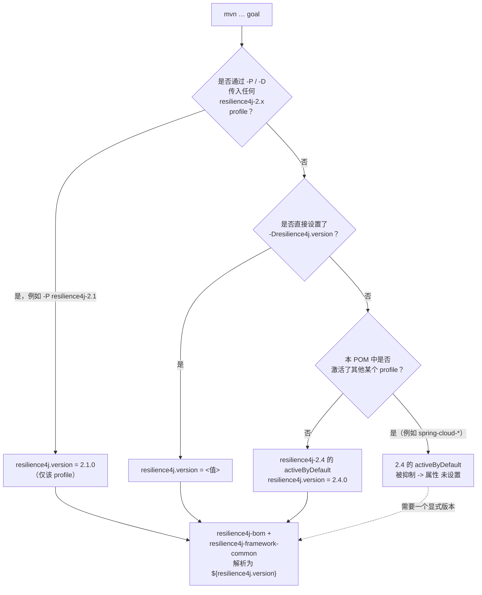

# microsphere-resilience4j-parent — 开发者指南

> 版本线 `0.2.x`（`release` 分支） · `${revision}` = `0.2.5-SNAPSHOT` · 最新发布版本 `0.2.4` · Resilience4j **2.0.0 – 2.4.0**（默认 `2.4.0`） · JDK **17+** · [← 指南索引](README.md)
> [English](../microsphere-resilience4j-parent.md)

`microsphere-resilience4j-parent` 是整个代码库共享的**构建父 POM**。本页讲述它如何组织、其版本 profile 如何在构建时解析，以及 GitHub Actions 矩阵如何驱动它们。

## 在聚合反应堆中的角色

有两个容易被混淆的 POM：

| POM | artifactId | packaging | 角色 |
|-----|-----------|-----------|------|
| 聚合反应堆根 | `microsphere-resilience4j` | `pom` | **聚合器**（拥有 `<modules>`）；继承 `microsphere-spring-cloud-parent:0.2.26` |
| 构建父 POM | `microsphere-resilience4j-parent` | `pom` | 每一个其他模块的**被继承父 POM**；同时*也*被列为聚合反应堆的一个 `<module>` |

`microsphere-resilience4j-parent/pom.xml` 声明 `<parent>` = `microsphere-resilience4j`（`${revision}`，`relativePath ../pom.xml`）。那个根 POM 又继承外部祖辈 `io.github.microsphere-projects:microsphere-spring-cloud-parent:0.2.26`，后者提供全部构建/插件配置（编译器、flatten、deploy profile）。已核实：父模块自身设置 `java.version` 吗？**否** —— `java.version=17` 位于*聚合反应堆根* POM，而非父模块。

## 父模块实际声明了什么

该文件**仅**包含 `<properties>`、`<dependencyManagement>` 与 `<profiles>`（通过阅读 `microsphere-resilience4j-parent/pom.xml` 已确认）。它**没有** `<build>`、**没有** `<pluginManagement>`，也**没有**普通的 `<dependencies>` 块。所有与插件相关的东西都从祖辈继承而来。这在扩展构建时很重要：把共享的*版本*策略放在这里，把共享的*插件*策略放在祖辈线上。

### 受管理的 microsphere 依赖版本

| 属性 | 值 | 由此导入的 BOM |
|----------|-------|----------------------|
| `microsphere-spring-cloud.version` | `0.2.26` | `microsphere-spring-cloud-dependencies`（import） |
| `microsphere-alibaba-druid.version` | `0.2.20` | `microsphere-alibaba-druid-dependencies`（import） |
| `microsphere-mybatis.version` | `0.2.16` | `microsphere-mybatis-dependencies`（import） |
| `microsphere-hibernate.version` | `0.2.10` | `microsphere-hibernate-dependencies`（import） |
| `microsphere-redis.version` | `0.2.14` | `microsphere-redis-dependencies`（import） |

另外还有 `io.github.resilience4j:resilience4j-bom:${resilience4j.version}`（import）和 `io.github.resilience4j:resilience4j-framework-common:${resilience4j.version}`（受管理版本）。`${resilience4j.version}` 并非在 profile 之外作为一个属性设置 —— 它**仅**通过下面的 profile 而存在。

## Resilience4j 版本 profile

| profile | `resilience4j.version` | 激活方式 |
|---------|------------------------|------------|
| `resilience4j-2.0` | `2.0.0` | 手动 |
| `resilience4j-2.1` | `2.1.0` | 手动 |
| `resilience4j-2.2` | `2.2.0` | 手动 |
| `resilience4j-2.3` | `2.3.0` | 手动 |
| `resilience4j-2.4` | `2.4.0` | `activeByDefault` |

### profile 解析流程图



最后那个分支是要记住的 Maven 规则：一旦同一有效模型中*其他*某个 profile 被激活，一个 `activeByDefault` profile 就会立即失效。由于 Spring Cloud profile 被继承进每个模块的模型，一次激活 `spring-cloud-2023` 却**不**带 `resilience4j-2.x` profile 的构建，可能会让 `resilience4j.version` 处于未设置状态。因此 CI 总会传入一个显式的 `resilience4j-2.x` profile（见下）。

## CI 矩阵如何使用这些 profile

`.github/workflows/maven-build.yml` 在 `push` 到 `main`/`dev` 和 `pull_request` 到 `main`/`dev`/`release` 时构建，覆盖一个三维矩阵：

| 矩阵维度 | 值 |
|------------------|--------|
| `java` | `17`、`21`、`25` |
| `maven-profile-spring-cloud` | `spring-cloud-2022`、`spring-cloud-2023`、`spring-cloud-2024`、`spring-cloud-2025` |
| `maven-profile-resilience4j` | `resilience4j-2.0` … `resilience4j-2.4` |

构建步骤（依 workflow 改写）为：

```bash
mvn --batch-mode --update-snapshots --file pom.xml \
    -Drevision=0.0.1-SNAPSHOT \
    test \
    --activate-profiles test,coverage,<maven-profile-spring-cloud>,<maven-profile-resilience4j>
```

供维护者参考的关键观察：

- 矩阵的 **`resilience4j-2.x`** 分支来自**本父模块**，并在每个 PR 上演练整个 `2.0.0 → 2.4.0` API 表面。
- **`spring-cloud-20xx`** profile **不**在本父模块中定义 —— 它们来自 `microsphere-spring-cloud-parent:0.2.26` 祖辈线。一个新的 Spring Cloud 发布列车通过提升那个祖辈版本来接纳，而非通过编辑 resilience4j 父 POM。
- CI 以一个一次性的 `-Drevision=0.0.1-SNAPSHOT` 构建；`${revision}` 属性只有在发布时才被赋予实际意义。
- 覆盖率上传到 Codecov（`codecov/codecov-action`）。

如果你新增一个新的 Resilience4j 次版本线，请在这里添加一个 `resilience4j-2.5` profile **并且**给 `maven-profile-resilience4j` 矩阵维度添加一个新值，否则该 profile 将一直处于未测试状态。

## 发布期 `${revision}` 的处理

`.github/workflows/maven-publish.yml`（在 `push` 到 `release` 或 `workflow_dispatch` 时触发）以 `./mvnw -Drevision=${{ inputs.revision }} ... deploy --activate-profiles publish,ci` 部署，其中 `inputs.revision` 必须匹配 `^[0-9]+\.[0-9]+\.[0-9]+$`。一次成功发布之后，该 workflow 会编辑聚合反应堆根 `pom.xml`，把 `<revision>` 递增到下一个补丁快照（对 `<revision>` 元素执行 `sed`）—— 这正是为什么 `0.2.4` 发布之后 `release` 快照当前读取为 `0.2.5-SNAPSHOT`。flatten 插件（从祖辈继承）会解析已发布 POM 中的 `${revision}`；参见 [dependencies 开发者页面](microsphere-resilience4j-dependencies.md)。

## 从源码核实的版本事实

| 事实 | 值 | 读取位置 |
|------|-------|-----------|
| 聚合反应堆 `${revision}` | `0.2.5-SNAPSHOT` | 根 `pom.xml` |
| 聚合反应堆 `java.version` | `17` | 根 `pom.xml` |
| 祖辈 | `microsphere-spring-cloud-parent:0.2.26` | 根 `pom.xml` |
| Resilience4j 默认 profile | `resilience4j-2.4` = `2.4.0` | 父 `pom.xml` |
| CI JDK 矩阵 | 17 / 21 / 25 | `maven-build.yml` |
