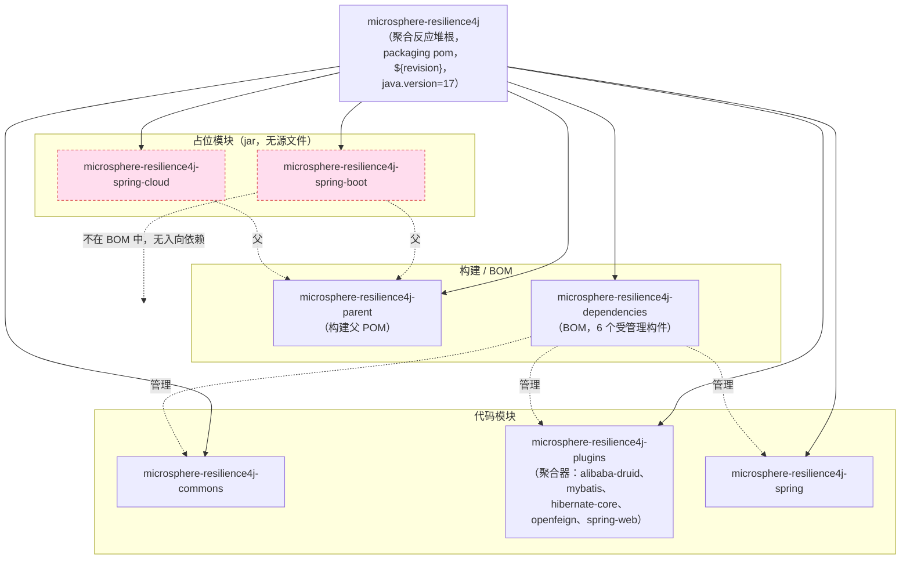

# microsphere-resilience4j-spring-boot — 开发者指南

> 版本线 `0.2.x`（`release` 分支） · `${revision}` = `0.2.5-SNAPSHOT` · 最新发布版本 `0.2.4` · **状态：空占位模块（仅有 pom，无 `src/`）** · JDK **17+** · [← 指南索引](README.md)
> [English](../microsphere-resilience4j-spring-boot.md)

## 已核实状态

`microsphere-resilience4j-spring-boot` 是一个**空占位模块**。对 `microsphere-resilience4j-spring-boot/` 的目录列举只显示一个文件 —— `pom.xml` —— 并且**没有 `src/main/java`、没有 `src/main/resources`、没有 `src/test`** 目录树。由于打包方式是 `jar`，`mvn package` 会产出一个不含任何类和资源的 jar。

聚合反应堆 POM 内容（`microsphere-resilience4j-spring-boot/pom.xml`）：

| 元素 | 值 |
|---------|-------|
| `<parent>` | `microsphere-resilience4j-parent` `${revision}`（`relativePath ../microsphere-resilience4j-parent/pom.xml`） |
| `<artifactId>` | `microsphere-resilience4j-spring-boot` |
| `<version>` | `${revision}` |
| `<packaging>` | `jar` |
| `<name>` | `Microsphere :: Resilience4j :: Spring Boot` |
| `<properties>` | 空块 |
| `<dependencies>` / `<build>` | **不存在** |

## 它在聚合反应堆中的位置

根 `microsphere-resilience4j/pom.xml` 按此顺序列出 `<modules>`；该占位模块是其中之一，继承构建父 POM，却不依赖任何东西，也不被任何东西依赖。

读图：每个模块（包括两个占位模块）都是聚合反应堆根的一个 `<module>`；`SB`/`SC` 从 `microsphere-resilience4j-parent` 继承；BOM（`DEPS`）管理六个真实构件但**不**管理 `SB`。聚合反应堆中没有任何东西声明对 `SB` 的 `<dependency>`，而对整个仓库检索该 artifactId 也只返回根 `<modules>` 行和 `SB` 自身的 `pom.xml`。

## 它为何存在（推断，未见于文档）

`README.md` 的模块表只列出 parent/dependencies/commons/plugins/spring —— 这个占位模块在 README 中**没有**被提及，且 `release-notes.md` 中也**没有**关于它的条目。因此这一保留未被记录。仅依据坐标（`io.github.microsphere-projects:microsphere-resilience4j-spring-boot`）、`jar` 打包以及对构建父 POM 的继承，其明显的用途是**保留该 Maven 坐标**，留待未来作为 `microsphere-resilience4j-spring` 的 Spring Boot 自动配置配套件。请把它当作“已保留，而非已承诺”。

## 实现它需要什么

要把这个占位模块变成一个真实的 Spring Boot 模块：

1. **添加源文件。** 在 `src/main/java/io/microsphere/resilience4j/spring/boot/autoconfigure/...` 下创建 `@AutoConfiguration` 类，装配现有的 `microsphere-resilience4j-spring` 注册器，并创建一个列出它们的 `src/main/resources/META-INF/spring/org.springframework.boot.autoconfigure.AutoConfiguration.imports` 文件。
2. **在模块 POM 中添加依赖。** 至少包含 `org.springframework.boot:spring-boot-autoconfigure`（版本由所继承的 `microsphere-spring-cloud-dependencies:0.2.26` / Spring Boot 线提供）和 `io.github.microsphere-projects:microsphere-resilience4j-spring`（已由父 POM 经 BOM 版本管理）。
3. **配置属性。** 若提供基于属性的配置，则给出 `@ConfigurationProperties` 绑定以及 `additional-spring-configuration-metadata.json`。
4. **在 BOM 中注册。** 将 `microsphere-resilience4j-spring-boot` 以 `${revision}` 添加到 `microsphere-resilience4j-dependencies/pom.xml`，以便使用者可省略版本（如今它缺席）。
5. **原样使用版本 profile。** 无需改动父 POM 中的 `resilience4j-2.0`…`2.4` profile；新代码只需像其他所有模块一样针对 `${resilience4j.version}` 编译，并由 CI 矩阵（JDK 17/21/25 × spring-cloud-2022…2025 × resilience4j-2.0…2.4）演练。

在这些步骤进入某个真实发布版本之前，该模块仍是一个空 jar，使用者应继续直接使用 `microsphere-resilience4j-spring`。

## 从源码核实的版本事实

| 事实 | 值 | 读取位置 |
|------|-------|-----------|
| Packaging | `jar` | 模块 `pom.xml` |
| 源文件是否存在 | 无（仅有 `pom.xml`） | 目录列举 |
| `${revision}` | `0.2.5-SNAPSHOT` | 聚合反应堆根 `pom.xml` |
| 是否由 BOM 管理 | 否 | `microsphere-resilience4j-dependencies/pom.xml` |
| 是否在别处被引用 | 否 | 全仓库 artifactId 检索 |
