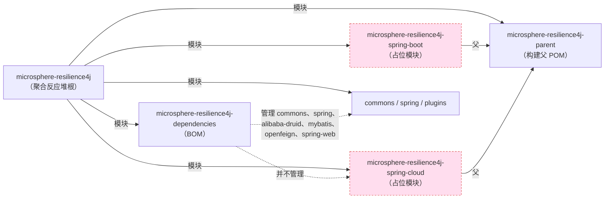

# microsphere-resilience4j-spring-cloud — 开发者指南

> 版本线 `0.2.x`（`release` 分支） · `${revision}` = `0.2.5-SNAPSHOT` · 最新发布版本 `0.2.4` · **状态：空占位模块（仅有 pom，无 `src/`）** · JDK **17+** · [← 指南索引](README.md)
> [English](../microsphere-resilience4j-spring-cloud.md)

## 已核实状态

`microsphere-resilience4j-spring-cloud` 是一个**空占位模块**。对 `microsphere-resilience4j-spring-cloud/` 的目录列举只显示一个文件 —— `pom.xml` —— 并且**根本没有 `src/` 目录树**。打包方式是 `jar`，因此构建该模块会产出一个不含任何类和资源的 jar。

聚合反应堆 POM 内容（`microsphere-resilience4j-spring-cloud/pom.xml`）：

| 元素 | 值 |
|---------|-------|
| `<parent>` | `microsphere-resilience4j-parent` `${revision}`（`relativePath ../microsphere-resilience4j-parent/pom.xml`） |
| `<artifactId>` | `microsphere-resilience4j-spring-cloud` |
| `<version>` | `${revision}` |
| `<packaging>` | `jar` |
| `<name>` | `Microsphere :: Resilience4j :: Spring Cloud` |
| `<properties>` | 空块 |
| `<dependencies>` / `<build>` | **不存在** |

## 它在聚合反应堆中的位置

根 `microsphere-resilience4j/pom.xml` 的 `<modules>` 列表同时包含两个占位模块；`microsphere-resilience4j-spring-cloud` 继承构建父 POM，不依赖任何东西，也不被任何东西依赖（完整聚合反应堆图见同级 [spring-boot 开发页面](microsphere-resilience4j-spring-boot.md)）。

对整个仓库检索该 artifactId `microsphere-resilience4j-spring-cloud`，返回的命中仅出现在根 `pom.xml` 的 `<modules>` 条目以及该模块自身的 `pom.xml` 中，这印证了没有入向依赖、也没有 BOM 注册。

## 它为何存在（推断，未见于文档）

`README.md` 和 `release-notes.md` 都从未提及本模块，因此这一保留未被记录。依据坐标、`jar` 打包以及对构建父 POM 的继承来判断，其预期用途是**保留 `io.github.microsphere-projects:microsphere-resilience4j-spring-cloud`**，留待未来一个位于 `microsphere-resilience4j-spring` 之上的 Spring Cloud 层。由于父 POM 已经导入了 `microsphere-spring-cloud-dependencies:0.2.26`，其 groundwork（Spring Cloud 版本管理，以及 CI 所演练的 `spring-cloud-2022…2025` profile）都是继承来的，尽管本模块如今并未使用其中任何部分。请把该占位模块读作*已保留，而非已承诺*。

## 实现它需要什么

1. **添加源文件。** 在 `src/main/java/.../spring/cloud/...` 下编写配置类，把 Spring Cloud 构件（外部化配置、actuator/health 贡献者、`Resilience4jRegistry` 定制器）绑定到现有模板。
2. **添加依赖。** `org.springframework.cloud:spring-cloud-commons` / `spring-cloud-context`（版本由所继承的 `microsphere-spring-cloud-dependencies:0.2.26` 提供）以及 `io.github.microsphere-projects:microsphere-resilience4j-spring`。
3. **在 BOM 中注册。** 将 `microsphere-resilience4j-spring-cloud` 以 `${revision}` 添加到 `microsphere-resilience4j-dependencies/pom.xml`；如今它缺席，因此使用者不得不指定版本。
4. **保持 profile 兼容。** 不需要新的 Resilience4j 或 Spring Cloud profile —— 该模块只需针对 `${resilience4j.version}` 和所继承的 `spring-cloud-20xx` profile 编译，并由 CI 矩阵（JDK 17/21/25 × `spring-cloud-2022…2025` × `resilience4j-2.0…2.4`）覆盖。
5. **自动配置 vs. 手动启用。** 决定是沿用 `microsphere-resilience4j-spring` 的 `@Enable*` 模式，还是 Boot 式的自动配置；后者更可能属于同级的 `spring-boot` 模块而非此处。

在这些进入某个真实发布版本之前，该模块是一个空 jar。

## 构建顺序与隔离

在聚合反应堆中，`microsphere-resilience4j-spring-cloud` 没有任何第一方依赖，因此一旦 `microsphere-resilience4j-parent` 被解析，Maven 基本上会把它与其他叶子模块并行构建。它的空状态不会破坏构建的其他部分（没有东西依赖它），但它也不是隐形的：`mvn install` 会向本地仓库发布一个带版本号的空 jar。如果你在审计构建产物，请预期得到一个 `microsphere-resilience4j-spring-cloud-${revision}.jar`，大小约 1 KB（仅含清单）。

## 让本模块重见天日：PR 清单

当 Spring Cloud 集成真正实现时，请保持周边构建的一致：

1. 添加 `src/main/java` / `src/main/resources` 以及 Spring Cloud + `microsphere-resilience4j-spring` 依赖。
2. 在 `microsphere-resilience4j-dependencies/pom.xml` 中注册该坐标（`${revision}`）—— 它如今缺失。
3. 添加单元测试；CI 矩阵（来自 `maven-build.yml` 的 JDK 17/21/25 × `spring-cloud-2022…2025` × `resilience4j-2.0…2.4`）随后会在每一种组合下编译并运行它们，因此无需新的 profile。
4. 在 `README.md` 的模块表中列出本模块，并在 `release-notes.md` 中添加条目，因为二者如今都没有提及它。

## 从源码核实的版本事实

| 事实 | 值 | 读取位置 |
|------|-------|-----------|
| Packaging | `jar` | 模块 `pom.xml` |
| 源文件是否存在 | 无（仅有 `pom.xml`） | 目录列举 |
| `${revision}` | `0.2.5-SNAPSHOT` | 聚合反应堆根 `pom.xml` |
| 是否由 BOM 管理 | 否 | `microsphere-resilience4j-dependencies/pom.xml` |
| 是否在别处被引用 | 否 | 全仓库 artifactId 检索 |
| Spring Cloud 基线（经由父 POM） | `microsphere-spring-cloud-dependencies:0.2.26` | 父 `pom.xml` |
