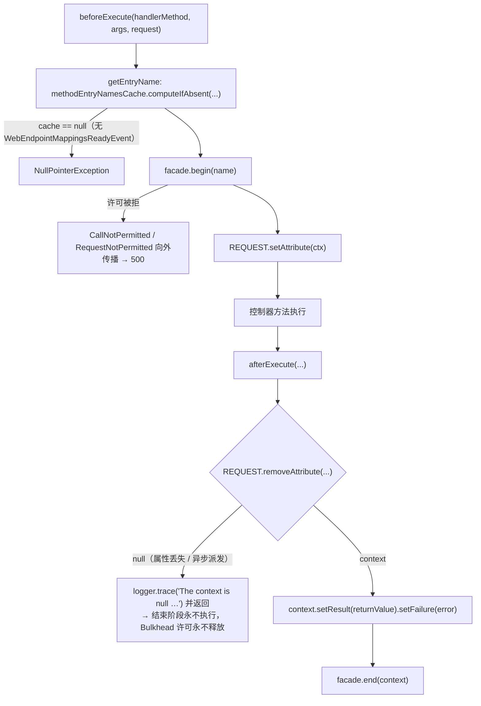
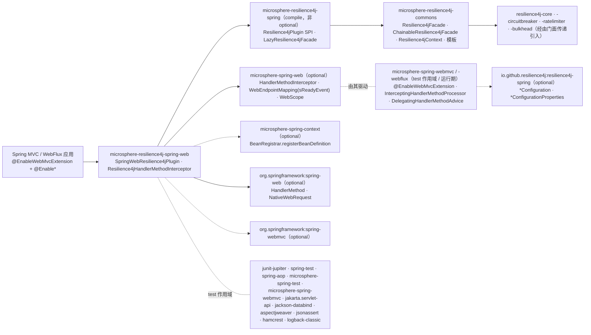

# microsphere-resilience4j-spring-web — 开发者指南

> 简体中文 | [English](../microsphere-resilience4j-spring-web.md)

> 版本线 `0.2.x`（`release` 分支）· 最新发布版本 `0.2.4` · 当前 `${revision}` = `0.2.5-SNAPSHOT` · Resilience4j **2.0.0 – 2.4.0**（默认 `2.4.0`）· Spring Cloud 2022.0.x – 2025.0.x · JDK **17+** · [← 开发者指南索引](README.md)

模块路径：`microsphere-resilience4j-plugins/microsphere-resilience4j-spring-web`。

## 类清单

| 类型 | 文件 | 角色 |
|------|------|------|
| `SpringWebResilience4jPlugin` | `src/main/java/io/microsphere/resilience4j/spring/web/SpringWebResilience4jPlugin.java` | `Resilience4jPlugin` 描述符，`getName() = "spring-web"`；注册拦截器的 bean definition |
| `Resilience4jHandlerMethodInterceptor` | `src/main/java/io/microsphere/resilience4j/spring/web/Resilience4jHandlerMethodInterceptor.java` | 装饰本身：在一个处理器方法外围做两阶段 `begin`/`end`，外加启动期的入口名预计算 |
| 资源文件 | `src/main/resources/META-INF/spring.factories` | `io.microsphere.resilience4j.spring.common.Resilience4jPlugin=io.microsphere.resilience4j.spring.web.SpringWebResilience4jPlugin` |
| `SpringWebResilience4jPluginTest` | `src/test/java/.../SpringWebResilience4jPluginTest.java` | **唯一**的测试类；单个 `test()` 方法驱动 `MockMvc` |

关于 Javadoc 的说明：`Resilience4jHandlerMethodInterceptor` 被描述为“the abstract template class for Resilience4j's `HandlerMethodInterceptor`”（Resilience4j `HandlerMethodInterceptor` 的抽象模板类），但该类是**具体类**（没有 `abstract` 修饰符），并由插件直接实例化——这是早期设计的遗留；`protected initEntryCache(...)` 是唯一有意保留的重写点。

## 织入机制

### 1. 注册：一个只注册 bean definition 的插件描述符

```java
@Override
public void plugin(ConfigurableListableBeanFactory beanFactory, BeanDefinitionRegistry registry, ConfigurableEnvironment environment) {
    registerResilience4jHandlerMethodInterceptor(registry);
}

private void registerResilience4jHandlerMethodInterceptor(BeanDefinitionRegistry registry) {
    registerBeanDefinition(registry, BEAN_NAME, Resilience4jHandlerMethodInterceptor.class);
}
```

`registerBeanDefinition(BeanDefinitionRegistry, String, Class)`（来自 `io.microsphere.spring.beans.factory.support.BeanRegistrar`）最终走到 `BeanDefinitionUtils.genericBeanDefinition(clazz, EMPTY_OBJECT_ARRAY)`，也就是一个 role 为 `0`、**既无构造参数也无 autowire 模式**的普通 `BeanDefinitionBuilder.genericBeanDefinition(...)`。因此拦截器必需的 `Resilience4jFacade` 参数由 Spring 的“单一 public 构造器”解析来满足；而它能确定性地胜出，是因为 `EnableResilience4jRegistrar#registerResilience4jFacade` 在注册 `lazyResilience4jFacade` 定义时调用了 `setPrimary(true)`。

registrar 内部的顺序在 `EnableResilience4jRegistrar#registerBeanDefinitions` 中可见：`registerEntryConfiguration` → `registerEventComponentBeans` → **`registerPlugins`** → `registerResilience4jFacade`。插件注册发生在门面定义存在之前，这是无害的，因为此处只创建了一个 *bean definition*（名字 + 类型），而不是实例。

### 2. 调用：`microsphere-spring-web` 的处理器方法扩展链

该插件从不触碰 Spring MVC 的 `HandlerInterceptor`。这条路径（由于这些接口在本仓库之外，是从已发布的 `microsphere-spring-web` / `microsphere-spring-webmvc` 字节码中检视得到的）是：

1. `@EnableWebMvcExtension`（它是 `@EnableWebExtension` 的一个 `@Import({WebMvcExtensionBeanDefinitionRegistrar.class, WebMvcExtensionConfiguration.class})` 元注解，其中 `registerWebEndpointMappings`、`interceptHandlerMethods` 和 `publishEvents` 默认为 `true`）注册 `InterceptingHandlerMethodProcessor`，该类同时实现**三个** Spring 角色：`HandlerMethodArgumentResolver`、`HandlerMethodReturnValueHandler`、`HandlerInterceptor`。
2. 在 `resolveArgument(...)` 内部，一旦*最后一个*参数解析完成（字节码把 `MethodParameter#getParameterIndex()` 与缓存的 `parameterCount - 1` 相比较），处理器就遍历它的 `List<HandlerMethodAdvice> handlerMethodAdvices`（用 `BeanUtils.getSortedBeans` 收集）并调用 `HandlerMethodAdvice#beforeExecuteMethod(handlerMethod, args, request)`。
3. `handleReturnValue(...)` 和 `afterCompletion(...)` 都汇聚到一个私有的 `afterExecute(...)`，它调用 `HandlerMethodAdvice#afterExecuteMethod(handlerMethod, args, returnValue, throwable, request)`。
4. `io.microsphere.spring.web.method.support.DelegatingHandlerMethodAdvice` 是那个适配*另一个* SPI 的 `HandlerMethodAdvice` bean：它在 `ContextRefreshedEvent` 时收集所有排序后的 `HandlerMethodInterceptor` bean，并把 `beforeExecuteMethod` 转发为 `HandlerMethodInterceptor#beforeExecute`、把 `afterExecuteMethod` 转发为 `#afterExecute`。
5. `Resilience4jHandlerMethodInterceptor` 就是这些 `HandlerMethodInterceptor` bean 中的一个。

所以装饰边界是“全部参数解析完成 → 控制器方法 → 返回值处理完毕”，它比一对 `HandlerInterceptor#preHandle/postHandle` 更宽，比 servlet 过滤器更窄。

### 3. 两阶段装饰与跨回调的请求作用域交接

`beforeExecute` 和 `afterExecute` 是两个不同的框架回调，所以插件无法使用一次性的 `call(...)` 操作。它把状态放在请求作用域里跨越这两者传递：

```java
@Override
public void beforeExecute(HandlerMethod handlerMethod, Object[] args, NativeWebRequest request) {
    Resilience4jContext<Resilience4jContext[]> context = resilience4jFacade.begin(getEntryName(handlerMethod));
    REQUEST.setAttribute(request, RESILIENCE4J_CONTEXT_ATTRIBUTE_NAME, context);
}

@Override
public void afterExecute(HandlerMethod handlerMethod, Object[] args, Object returnValue, Throwable error, NativeWebRequest request) {
    Resilience4jContext<Resilience4jContext[]> context = (Resilience4jContext<Resilience4jContext[]>)
            REQUEST.removeAttribute(request, RESILIENCE4J_CONTEXT_ATTRIBUTE_NAME);
    if (context == null) {
        logger.trace("The 'context' is null , please check whether the 'resilience4jFacade' is a 'ChainableResilience4jFacade'", error);
        return;
    }
    context.setResult(returnValue).setFailure(error);
    this.resilience4jFacade.end(context);
}
```

`RESILIENCE4J_CONTEXT_ATTRIBUTE_NAME` 就是 `Resilience4jContext.class.getName()`；`REQUEST` 是 `io.microsphere.spring.web.util.WebScope.REQUEST`（它的 `setAttribute`/`removeAttribute` 接收一个 `RequestAttributes`，而 `NativeWebRequest` 正是）。`removeAttribute` 返回被移除的值，这天然就是结束阶段所需的“只认领一次”语义。

这一对操作在 commons 侧的实现——`ChainableResilience4jFacade`：

```java
public Resilience4jContext<Resilience4jContext[]> begin(String name) {
    Resilience4jContext[] subContexts = new Resilience4jContext[size];
    Resilience4jContext<Resilience4jContext[]> context = new Resilience4jContext<>(name, subContexts);
    for (int i = 0; i < size; i++) {
        Resilience4jTemplate template = templates.get(i);
        if (template.isBeginSupported()) { subContexts[i] = template.begin(name); }
    }
    return context;
}
```

`end(...)` 用 `isEndSupported()` 做了镜像处理。这些判断并非装饰性的：`Resilience4jTemplate.begin/end` 是 `final` 的，并委托给 `protected doBegin/doEnd`，后者的**默认实现会抛出 `UnsupportedOperationException("%s does not support begin operation")`**。`RetryTemplate`、`TimeLimiterTemplate` 和 `ThreadPoolBulkheadTemplate` 正是把 `isBeginSupported()/isEndSupported()` 重写为 `false` 的那三个模板，所以本插件只有三个模块参与，它们的配对是：

| 模板 | `doBegin` | `doEnd` |
|----------|-----------|---------|
| `CircuitBreakerTemplate` | `circuitBreaker.acquirePermission()`（→ `CallNotPermittedException`），随后 `context.setStartTime(circuitBreaker.getCurrentTimestamp())` | 用该入口自己的 `getTimestampUnit()` 计算耗时，然后 `onSuccess` / `onResult(result)` / `onError(failure)` |
| `BulkheadTemplate` | `bulkhead.acquirePermission()`（→ `RequestNotPermitted`） | `bulkhead.onComplete()` —— **释放该许可的唯一路径** |
| `RateLimiterTemplate` | 静态辅助方法 `RateLimiter.waitForPermission(rateLimiter)`，其内部调用 `acquirePermission(1)`，线程被中断时抛 `AcquirePermissionCancelledException`，在 `timeoutDuration` 内未获得许可时抛 `RequestNotPermitted` | `rateLimiter.onSuccess()` / `onResult(result)` / `onError(failure)` |

这就是与其他四个插件的结构性差异——其余四个都使用一次性的 `call(...)` 路径，在那条路径上每个模板（包括重试、超时限制和线程池隔离舱）都会装饰该调用。

### 4. 启动期命名与本地入口预热

```java
public String getEntryName(HandlerMethod handlerMethod) {
    Method method = handlerMethod.getMethod();
    return this.methodEntryNamesCache.computeIfAbsent(method, m -> PLUGIN_NAME + "@" + handlerMethod);
}

protected void initEntryCache(WebEndpointMappingsReadyEvent event) {
    Collection<WebEndpointMapping> webEndpointMappings = event.getMappings();
    Map<Method, String> methodEntryNamesCache = newFixedHashMap(webEndpointMappings.size());
    this.methodEntryNamesCache = methodEntryNamesCache;
    for (WebEndpointMapping mapping : webEndpointMappings) {           // (source uses an explicit Iterator loop)
        Object endpoint = mapping.getEndpoint();
        if (endpoint instanceof HandlerMethod) {
            String entryName = getEntryName((HandlerMethod) endpoint); // side effect: fills the cache
            logger.trace("Create the entryName : '{}' for HandlerMethod : {}", entryName, handlerMethod);
        }
    }
    ChainableResilience4jFacade facade = tryUnwrap(this.resilience4jFacade, ChainableResilience4jFacade.class);
    if (facade != null) {
        facade.getTemplates().forEach(template -> template.initLocalEntriesCache(methodEntryNamesCache.values()));
    }
}
```

对维护工作有三个重要观察：

- 那个 `while (iterator.hasNext())` 循环除了通过 `getEntryName` 填充 `methodEntryNamesCache` 之外别无用途；trace 日志引用的是循环局部的 `handlerMethod`，而不是计算出的名字。
- `methodEntryNamesCache` **只**在这里被赋值。在 `WebEndpointMappingsReadyEvent` 发布之前就到达 `beforeExecute` 的请求，会在一个 `null` map 上调用 `computeIfAbsent` 而产生 `NullPointerException`——没有懒加载兜底。这是有意为之的“缺少 Web 扩展就快速失败”的行为，但代码中并未写下这一说明。
- `tryUnwrap(...)`（来自 `io.microsphere.lang.Wrapper`）是预热能够配合 Spring 层的 `LazyResilience4jFacade` 工作的原因：后者是一个 `DelegatingWrapper`，其被委托对象 `ChainableResilience4jFacade` 只在 `ContextRefreshedEvent` 之后才存在。如果拦截器在该事件之前被初始化，`facade` 为 `null`，预热会被静默跳过。`initLocalEntriesCache` 本身除非模板重写了 `createLocalEntriesCache()`，否则是空操作；当 `localEntriesCached` 未开启时它会记录一条 `warn`。

### 时序图：一个被装饰的 HTTP 请求

```mermaid
sequenceDiagram
    participant C as 客户端
    participant DS as DispatcherServlet
    participant P as InterceptingHandlerMethodProcessor<br/>（microsphere-spring-webmvc）
    participant A as DelegatingHandlerMethodAdvice
    participant I as Resilience4jHandlerMethodInterceptor
    participant F as LazyResilience4jFacade → ChainableResilience4jFacade
    participant Ctl as 控制器方法
    participant RV as ReturnValueHandler

    C->>DS: POST /test/user
    DS->>P: 经真实解析器执行 resolveArgument(param 0..n-1)
    Note over P: parameterIndex == parameterCount - 1
    P->>A: beforeExecuteMethod(handlerMethod, args, request)
    A->>I: beforeExecute(handlerMethod, args, request)
    I->>F: begin("spring-web@" + handlerMethod)
    F->>F: CircuitBreakerTemplate.doBegin（acquirePermission）<br/>RateLimiter / Bulkhead doBegin<br/>Retry、TimeLimiter、ThreadPoolBulkhead 被跳过
    F-->>I: Resilience4jContext<Resilience4jContext[]>
    I->>I: WebScope.REQUEST.setAttribute(context)
    DS->>Ctl: invokeHandlerMethod → 控制器执行
    Ctl-->>RV: 返回值
    RV->>P: handleReturnValue(...)（出错时走 afterCompletion）
    P->>A: afterExecuteMethod(handlerMethod, args, returnValue, throwable, request)
    A->>I: afterExecute(...)
    I->>I: context = REQUEST.removeAttribute(...)
    I->>F: context.setResult(returnValue).setFailure(error); end(context)
    F->>F: onSuccess/onResult/onError + 释放许可
    DS-->>C: 200 OK（begin() 抛出时为 500）
```

### 流程图：context 交接及其失败模式



## 设计模式（附证据）

| 模式 | 在本模块中的证据 |
|---------|--------------------------|
| **观察者（Observer）** | `Resilience4jHandlerMethodInterceptor implements ApplicationListener<WebEndpointMappingsReadyEvent>`；该事件既填充名字缓存又触发预热。 |
| **适配器（Adapter）** | 拦截器把 `HandlerMethodInterceptor#beforeExecute/afterExecute`（一对被保护调用无法嵌套的开始/结束回调）适配到 `Resilience4jFacade#begin/end` 这一对上。插件类则把 `Resilience4jPlugin#plugin(...)` 适配到 `BeanRegistrar.registerBeanDefinition(...)`。 |
| **门面（Facade）** | 主源码**没有**导入任何 `io.github.resilience4j.*` 类型；只使用 `io.microsphere.resilience4j.common.Resilience4jFacade`/`Resilience4jContext`/`Resilience4jTemplate` 和 `io.microsphere.resilience4j.spring.common.Resilience4jPlugin`。 |
| **职责链** | 两条嵌套的链：容器排序后的 `HandlerMethodInterceptor` 列表，以及 `ChainableResilience4jFacade` 内部按优先级排序的 `Resilience4jTemplate` 列表。`getOrder()/setOrder(int)` 决定本拦截器在第一条链中的位置。 |
| **懒代理 / 委托包装器** | bean 持有 `lazyResilience4jFacade`（`LazyResilience4jFacade implements DelegatingWrapper`），其被委托对象在 `ContextRefreshedEvent` 时构建；`Wrapper.tryUnwrap` 在预热时看穿它。 |
| **模板方法** | `initEntryCache(WebEndpointMappingsReadyEvent)` 是 `protected` —— 这是文档化的子类改命名/预热的方式，而 `beforeExecute`/`afterExecute` 的行为保持稳定（`getResilience4jFacade()` 是 `final`）。 |
| **享元 / 缓存** | `Map<Method, String> methodEntryNamesCache`（`newFixedHashMap`）加上 `Resilience4jTemplate.localEntriesCache`，避免了每次请求构建名字和查注册表。 |
| **SPI + Service Loader** | 以 `Resilience4jPlugin` 为 key 的 `META-INF/spring.factories`；由 `EnableResilience4jRegistrar#registerPlugins` 通过 `loadFactories(beanFactory, Resilience4jPlugin.class)` 消费，并用 `contains(plugins, plugin.getName())` 过滤。 |

## 依赖关系图



| 方面 | 事实 |
|--------|------|
| 上游层次 | **spring**（而不是 commons）。`microsphere-resilience4j-spring` 是 compile/非 optional，这正是 `Resilience4jPlugin` 得以实现、`META-INF/spring.factories` 才有意义的原因——与之对比，止步于 commons 的是 `microsphere-resilience4j-openfeign`。 |
| 真正使用到的 Resilience4j 组件 | `CircuitBreaker`、`RateLimiter`、`Bulkhead`（它们的模板实现了 `doBegin`/`doEnd`）。`Retry`、`TimeLimiter` 和 `ThreadPoolBulkhead` 存在于门面中，但被 `isBeginSupported()/isEndSupported()` 判断跳过。注册表 bean 来自 `resilience4j-spring` 自身的 `*Configuration`，由 `EnableResilience4jRegistrar` 中的 `registerEntryConfiguration(...)` 注册（例如 `EnableBulkheadRegistrar` 注册 `io.github.resilience4j.bulkhead.configure.BulkheadConfiguration`）。 |
| 使用到的框架 API 面 | `HandlerMethodInterceptor`（2 个默认方法，都 `throws Exception`）、`WebEndpointMappingsReadyEvent#getMappings()`、`WebEndpointMapping#getEndpoint()`、`WebScope.REQUEST#setAttribute/removeAttribute`、`HandlerMethod`、`NativeWebRequest`、`ApplicationListener`、`Ordered`。 |
| 插件自己创建拦截了吗？ | 没有。`SpringWebResilience4jPlugin` 只注册 bean；全部调用机制都属于 `microsphere-spring-web(-mvc/-webflux)`，需要 `@EnableWebMvcExtension` / `@EnableWebFluxExtension`。 |

## 现状测试覆盖

`SpringWebResilience4jPluginTest` 是本模块唯一的测试。它是一个 `@SpringJUnitConfig` + `@WebAppConfiguration` + `@EnableWebMvc` + `@EnableWebMvcExtension` + `@EnableBulkhead(plugins = PLUGIN_NAME)` 的上下文，导入了 `TestController`（来自 `microsphere-spring-test` 的一个 bean），其单个 `test()` 方法用 Jackson 序列化的 `io.microsphere.spring.test.domain.User`（`name = "Mercy"`、`age = 18`）执行一次 `MockMvc` 的 `POST /test/user`，断言 `status().isOk()` 且响应体等于请求 JSON。

在你扩展本模块时值得了解的后果：

- **没有单元测试**断言 `getEntryName(...)` 的输出、请求属性的往返、`context == null` 分支、`getOrder()/setOrder(...)`，或 `initEntryCache` 的预热。
- 这条正常路径只证明了 begin+end *一起*不会弄坏一个普通请求（`BulkheadConfiguration` 提供的 `BulkheadRegistry` 风格默认值），而不是证明任何 Resilience4j 实例记录过一次调用。
- 错误路径（`afterExecute` 携带非 `null` 的 `Throwable`）未被测试——而那正是决定熔断器看到的是 `onError` 还是 `onSuccess` 的分支。
- 只验证了 servlet（WebMVC）形态；WebFlux 形态仅由 Javadoc 引用 `@see io.microsphere.spring.webflux.annotation.EnableWebFluxExtension` 佐证。

## 面向贡献者的扩展点

- 重写 `initEntryCache(...)` 以改变命名方案（例如改为 `spring-web@<beanName>#<method>`，或把请求路径包含进来）——请记住 `getEntryName` 是 public 的，并且在请求期也会被使用，因此两处调用点必须保持一致。
- `getOrder()/setOrder(int)` 的存在是为了让装饰能够相对于其他 `HandlerMethodInterceptor` bean（幂等、按请求头限流等）前后移动；真正应用它的是容器的 `BeanUtils.getSortedBeans`。
- 如果该插件将来需要自己的配置，MyBatis 插件使用的形态（构造参数**引用** `LazyResilience4jFacade.BEAN_NAME`）比当前“无构造参数 + primary bean”的做法更明确，并且能消除对单构造器解析的依赖：见 [MyBatis 开发者页面](microsphere-resilience4j-mybatis.md)。
- 任何依赖 `Resilience4jContext` 作为请求属性的行为，还必须能在异步请求（`DeferredResult`、`Callable`）下成立——在这些场景里 `afterExecute` 可能在另一个线程上到达，并且在某些配置下属性已经消失。

## 相关页面

- [用户指南 — microsphere-resilience4j-spring-web](../../user-guide/zh/microsphere-resilience4j-spring-web.md)
- [开发者指南 — microsphere-resilience4j-spring](microsphere-resilience4j-spring.md)
- [开发者指南 — microsphere-resilience4j-openfeign](microsphere-resilience4j-openfeign.md)
