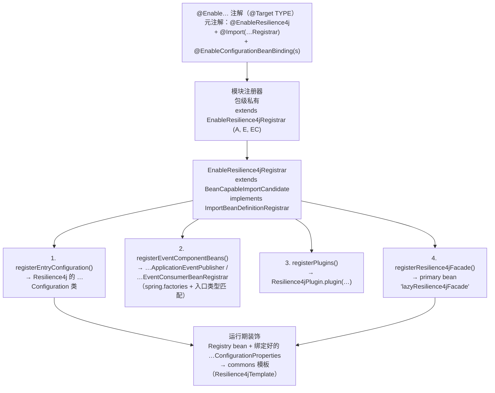
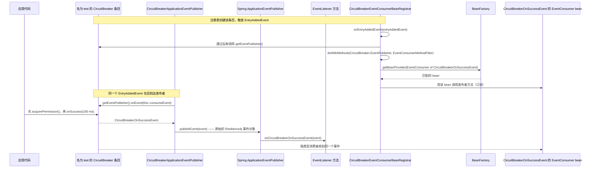
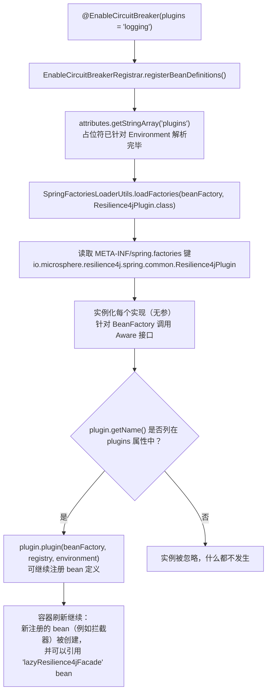
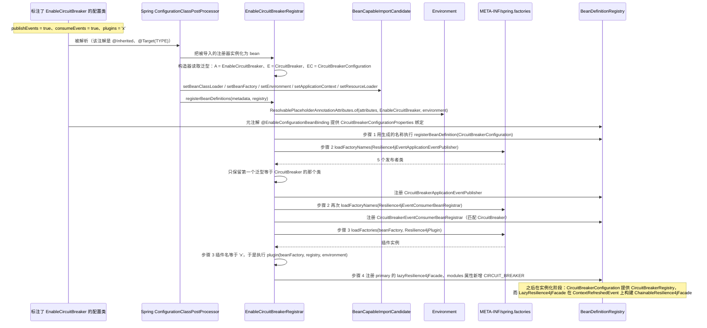

# microsphere-resilience4j-spring — 开发者指南

> 源分支：`release` · 版本线：`0.2.x`（最新发布 `0.2.4`）· 目标：**Resilience4j 2.0.0 – 2.4.0**（默认 `2.4.0`）
> 返回 [指南索引](README.md) · 终端用户视角：[用户指南](../../user-guide/zh/microsphere-resilience4j-spring.md) · 英文原文：[microsphere-resilience4j-spring — Developer Guide](../microsphere-resilience4j-spring.md)

本页面剖析 `microsphere-resilience4j-spring` 模块的内部实现：注解 → 注册器 → bean
定义这条流水线、Resilience4j ⇄ Spring 事件桥、`Resilience4jPlugin`
SPI，以及延迟 facade。下面每一条陈述都取自 `release` 分支上
`microsphere-resilience4j-spring/src/{main,test}` 下的模块源码。

---

## 1. Spring 集成的架构

本模块在设计上很薄：它从不重新实现 Resilience4j 的行为。它只做四件事。



| 阶段 | 由谁 | 此后存在什么 |
|-------|-----|------------------------|
| 注解 | `EnableCircuitBreaker`，…… | 还没有任何东西；只有元数据（`publishEvents`、`consumeEvents`、`plugins`） |
| 注册器 | `EnableResilience4jRegistrar` 的子类 | `BeanDefinitionRegistry` 中的 bean *定义*：Resilience4j 的 `*Configuration`、事件桥 bean（需显式开启）、延迟 facade |
| 绑定 | `@EnableConfigurationBeanBinding`（microsphere-spring-context） | 一个由 `microsphere.resilience4j.<module>.*` 填充的 `*ConfigurationProperties` bean |
| 运行期 | Resilience4j + commons | 该模块的 `Registry` bean 由所注册的 `*Configuration` 创建；`LazyResilience4jFacade` 在 `ContextRefreshedEvent` 时把各个注册表变成 `Resilience4jTemplate` |

### 1.1 源码地图

| 包 | 类 | 职责 |
|---------|---------|------|
| `…spring` | `LazyResilience4jFacade` | Spring facade bean，延迟委托给 `ChainableResilience4jFacade` |
| `…spring.common.annotation` | `EnableResilience4j`、`EnableResilience4jRegistrar<A,E,EC>` | 元注解 + 本模块中唯一一段非平凡的注册器代码 |
| `…spring.<module>.annotation` | `Enable*`（6 个）+ `Enable*Registrar`（6 个，包级私有） | 按模块划分的入口 |
| `…spring.common.event` | `Resilience4jEventApplicationEventPublisher<E,ET>`、`Resilience4jEventConsumerBeanRegistrar<E>`、`EventConsumerMethodFilter` | 事件桥的泛型（通用）部分 |
| `…spring.<module>.event` | `*ApplicationEventPublisher`、`*EventConsumerBeanRegistrar`（各 5 个） | 模块专属子类，方法体为空 |
| `…spring.common` | `Resilience4jPlugin` | 插件 SPI |
| `src/main/resources/META-INF/spring.factories` | 两个键 | 事件桥实现的登记表 |
| `src/test/java` | 12 个类（10 个 `*Test` 类 + 两个测试范围内的 `Resilience4jPlugin` 实现） | 本指南示例所依据的可执行规约 |

---

## 2. `EnableResilience4jRegistrar` —— 源码分析

```java
public abstract class EnableResilience4jRegistrar<A extends Annotation, E, EC> extends BeanCapableImportCandidate
        implements ImportBeanDefinitionRegistrar {

    private static final Map<String, Class<?>> attributedEventComponentClassesMap = ofMap(
            "publishEvents", Resilience4jEventApplicationEventPublisher.class,
            "consumeEvents", Resilience4jEventConsumerBeanRegistrar.class);

    private final ResolvableType superType;
    private final Class<A> annotationType;
    private final Class<E> entryType;
    private final Class<EC> entryConfigurationType;

    protected EnableResilience4jRegistrar() {
        this.superType = resolveSuperType();          // ResolvableType.forType(getClass()).as(EnableResilience4jRegistrar.class)
        this.annotationType = resolveGeneric(0);      // e.g. EnableCircuitBreaker
        this.entryType = resolveGeneric(1);           // e.g. CircuitBreaker
        this.entryConfigurationType = resolveGeneric(2); // e.g. CircuitBreakerConfiguration
    }
```

由该构造器可得出三个事实：

1. **子类把全部配置承载在自己的泛型签名里。** 具体注册器完全不含任何代码：
   ```java
   class EnableCircuitBreakerRegistrar extends EnableResilience4jRegistrar<EnableCircuitBreaker, CircuitBreaker,
           CircuitBreakerConfiguration> {
   }
   ```
   （形式完全相同的还有：`EnableRateLimiterRegistrar<EnableRateLimiter, RateLimiter, RateLimiterConfiguration>`、
   `EnableRetryRegistrar<EnableRetry, Retry, RetryConfiguration>`、
   `EnableTimeLimiterRegistrar<EnableTimeLimiter, TimeLimiter, TimeLimiterConfiguration>`、
   `EnableBulkheadRegistrar<EnableBulkhead, Bulkhead, BulkheadConfiguration>`、
   `EnableThreadPoolBulkheadRegistrar<EnableThreadPoolBulkhead, ThreadPoolBulkhead, BulkheadConfiguration>`）。
2. 泛型在实例化时通过 `ResolvableType.as(...).resolveGeneric(i)` 读取一次——没有
   反射元数据，也没有 `@Conditional`。
3. 全部六个注册器类都是**包级私有**，因此来自注解的 `@Import`
   是唯一能够触达它们的途径。

`registerBeanDefinitions` 被声明为 `final`（子类无法改变执行顺序）：

```java
public final void registerBeanDefinitions(AnnotationMetadata metadata, BeanDefinitionRegistry registry) {
    String annotationClassName = annotationType.getName();
    Map<String, Object> annotationAttributes = metadata.getAnnotationAttributes(annotationClassName);
    ResolvablePlaceholderAnnotationAttributes attributes = of(annotationAttributes, annotationType, getEnvironment());

    registerEntryConfiguration(registry);      // (1)
    registerEventComponentBeans(attributes, registry); // (2)
    registerPlugins(attributes, registry);     // (3)
    registerResilience4jFacade(registry);      // (4)
}
```

### 2.1 为什么基类是 `BeanCapableImportCandidate`

Spring 会把被 `@Import` 的 `ImportBeanDefinitionRegistrar` 作为 bean
来实例化，因此 `io.microsphere.spring.context.annotation.BeanCapableImportCandidate`
中所声明的那些 awareness 回调（`BeanClassLoaderAware`、`BeanFactoryAware`、`EnvironmentAware`、
`ApplicationContextAware`、`ResourceLoaderAware`，在基类中全部为 `final`）在 `registerBeanDefinitions`
运行时就已经触发过了。因此注册器使用继承来的 `final` 访问器：

- `getEnvironment()` → 注解属性的占位符解析，这发生在步骤 (1) 之前；
- `getClassLoader()` → 步骤 (2) 中的 `SpringFactoriesLoader.loadFactoryNames(...)`；
- `this.beanFactory`（一个 `ConfigurableListableBeanFactory`）→ 步骤 (3) 中的
  `loadFactories(...)` 以及 `plugin(...)` 回调。

这正是这些注解可以在任何应用 bean 存在之前使用、同时又能支持由 `Environment`
驱动的行为的原因。

### 2.2 步骤 (1)：`registerEntryConfiguration`

```java
private void registerEntryConfiguration(BeanDefinitionRegistry registry) {
    registerBeanDefinition(registry, getEntryConfigurationType());
}
```

`registerBeanDefinition` 是
`io.microsphere.spring.beans.factory.support.BeanRegistrar.registerBeanDefinition(BeanDefinitionRegistry, Class)`
的静态导入（`microsphere-spring-context` —— 一个兄弟项目，不属于本仓库）。本注册器用到了两个重载，
此处的关键正是二者之间的对比：

| 调用位置 | 重载 | bean 名称 |
|-----------|----------|-----------|
| 步骤 (1)、步骤 (2) | `registerBeanDefinition(registry, beanType)` → `(registry, null, beanType)` | 向下传入 `null`，因此该库会用 `BeanDefinitionReaderUtils.generateBeanName(beanDefinition, registry)` 生成名称，即由 bean 类推导而来 |
| 步骤 (4) | `registerBeanDefinition(registry, "lazyResilience4jFacade", beanDefinition)` | 显式传入的固定常量 |

在 `BeanRegistrar` 中核实过的细节（同一条调用链，且 `allowBeanDefinitionOverriding = false`）：
先用 `genericBeanDefinition(beanType)` 创建定义，名称在传入 `null` 时生成，而如果该名称已被占用，
定义**不会**被替换——会输出一条 `warn` 日志（`"The bean[name : '{}'] definition [{}] was
registered!"`）并返回 `false`。`EnableResilience4jRegistrar` 忽略了这个返回值，
并且其中没有任何代码会在注册之前去查找*同类型*的既有定义；该类中唯一的
`containsBeanDefinition` 守卫是针对 `lazyResilience4jFacade` 的（§2.5）。

实际后果：只有 facade 拥有稳定且有文档记载的 bean 名称，因此**请按类型注入，绝不硬编码那些生成的名称**。
Spring 的 `generateBeanName` 按规约会生成一个在*给定注册表*内唯一的名称，而本注册器从不按类型去重——
所以用两个注解注册同一个类只会得到多于一份定义，而生成的名称属于实现细节，你不应依赖它们。

被注册的是 **Resilience4j 自己的**配置类
（`io.github.resilience4j.<module>.configure.<Module>Configuration`），它才是最终提供该模块
`Registry` bean 的东西。测试证明了这一点：`CircuitBreakerApplicationEventPublisherTest` 只列出了
`CircuitBreakerConfigurationProperties.class, CircuitBreakerConfiguration.class, …`，却依然能
自动装配出一个 `CircuitBreakerRegistry`。

`@EnableThreadPoolBulkhead` 传给 `EC` 的是 `BulkheadConfiguration`（而不是它仅在 Javadoc
中引用的 `io.github.resilience4j.bulkhead.configure.threadpool.ThreadPoolBulkheadConfiguration`），
而 `@EnableBulkhead` 传的是同一个类——因此同时使用这两个注解（例如
`EnableThreadPoolBulkheadTest`）会为同一个配置类注册两份定义，因为注册器没有同类型检查（上文 §2.2）。

### 2.3 步骤 (2)：`registerEventComponentBeans` —— spring.factories + 泛型过滤器

```java
private void registerEventComponentBeans(ResolvablePlaceholderAnnotationAttributes attributes, BeanDefinitionRegistry registry) {
    for (Map.Entry<String, Class<?>> entry : attributedEventComponentClassesMap.entrySet()) {
        String attributeName = entry.getKey();               // "publishEvents" / "consumeEvents"
        boolean supported = attributes.getBoolean(attributeName);
        if (supported) {
            registerComponentBean(entry.getValue(), registry);
        }
    }
}

private void registerComponentBean(Class<?> componentClass, BeanDefinitionRegistry registry) {
    ClassLoader classLoader = this.getClassLoader();
    List<String> actualComponentClassNames = loadFactoryNames(componentClass, classLoader);
    for (String actualComponentClassName : actualComponentClassNames) {
        Class<?> actualComponentClass = resolveClassName(actualComponentClassName, classLoader);
        Class<E> entryTypeFromComponent = resolveEntryType(actualComponentClass, componentClass);
        if (Objects.equals(entryTypeFromComponent, this.entryType)) {
            registerBeanDefinition(registry, actualComponentClass);
        }
    }
}
```

- 两个属性名驱动着两个**工厂键**（`Resilience4jEventApplicationEventPublisher`、
  `Resilience4jEventConsumerBeanRegistrar`），二者都在
  `src/main/resources/META-INF/spring.factories` 中声明，各有五个实现（`Bulkhead`、
  `CircuitBreaker`、`RateLimiter`、`Retry`、`TimeLimiter`）。
- `resolveEntryType(target, super)` = `ResolvableType.forType(target).as(super).resolveGeneric(0)` ——
  抽象桥类的第一个泛型。对 `CircuitBreakerApplicationEventPublisher` 而言是
  `CircuitBreaker`；对 `CircuitBreakerEventConsumerBeanRegistrar`（它 extends
  `Resilience4jEventConsumerBeanRegistrar<CircuitBreaker>`）而言同样是 `CircuitBreaker`。
- 比较用的是**精确的类相等**（`Objects.equals`），而非可赋值性。因此
  `@EnableThreadPoolBulkhead`（`entryType = ThreadPoolBulkhead`）匹配**不到**任何工厂条目，
  它的 `publishEvents`/`consumeEvents` 开关是不生效的。这是本模块最出人意料的行为，
  也解释了为什么 `EnableThreadPoolBulkheadTest` 同时还在类上加了 `@EnableBulkhead`。
- 被注册的 bean 同样使用生成的名称，而它们的模块专属子类都是空子类——
  整个实现都在这两个抽象类里（§3）。

### 2.4 步骤 (3)：`registerPlugins`

```java
private void registerPlugins(ResolvablePlaceholderAnnotationAttributes attributes, BeanDefinitionRegistry registry) {
    String[] plugins = attributes.getStringArray("plugins");
    List<Resilience4jPlugin> resilience4jPlugins = loadFactories(this.getBeanFactory(), Resilience4jPlugin.class);
    for (Resilience4jPlugin resilience4jPlugin : resilience4jPlugins) {
        String pluginName = resilience4jPlugin.getName();
        if (contains(plugins, pluginName)) {
            resilience4jPlugin.plugin(this.beanFactory, registry, this.environment);
        }
    }
}
```

`loadFactories(BeanFactory, Class)`（`io.microsphere.spring.core.io.support.SpringFactoriesLoaderUtils`）
在键 `io.microsphere.resilience4j.spring.common.Resilience4jPlugin` 之下读取
`META-INF/spring.factories`，用反射实例化每个实现（当 bean factory 不是 `ApplicationContext`
时退回到 `SpringFactoriesLoader.loadFactories`），并针对 bean factory 调用其 `Aware` 接口。
因此插件**不是**容器管理的 bean；只有那些 `getName()` 出现在注解 `plugins` 数组中的插件才会被激活。
`contains` 是 `io.microsphere.util.ArrayUtils.contains`。

### 2.5 步骤 (4)：`registerResilience4jFacade` —— 一个 facade，累积模块

```java
private void registerResilience4jFacade(BeanDefinitionRegistry registry) {
    Resilience4jModule module = valueOf(this.entryType);          // Resilience4jModule.valueOf(Class)
    String beanName = BEAN_NAME;                                  // "lazyResilience4jFacade"
    String propertyName = "modules";

    Set<Resilience4jModule> modules;
    AbstractBeanDefinition beanDefinition;
    PropertyValue modulesPropertyValue;
    if (registry.containsBeanDefinition(beanName)) {
        beanDefinition = (AbstractBeanDefinition) registry.getBeanDefinition(beanName);
        modulesPropertyValue = beanDefinition.getPropertyValues().getPropertyValue(propertyName);
        modules = (Set<Resilience4jModule>) modulesPropertyValue.getValue();
    } else {
        modules = newHashSet(Resilience4jModule.values().length);
        beanDefinition = genericBeanDefinition(LazyResilience4jFacade.class);
        beanDefinition.setPrimary(true);
        MutablePropertyValues propertyValues = beanDefinition.getPropertyValues();
        propertyValues.add(propertyName, modules);
        registerBeanDefinition(registry, beanName, beanDefinition);
    }
    modules.add(module);
}
```

这里可见的设计要点：

- **固定 bean 名称 + primary**：`LazyResilience4jFacade.BEAN_NAME == "lazyResilience4jFacade"`，而
  `setPrimary(true)` 使 `@Autowired Resilience4jFacade` 即使存在其他 facade
  （例如手工创建的 `ChainableResilience4jFacade`）也会解析到它。
- **幂等累积**：第二个 `@Enable*` 注解会找到既有定义，从其 `PropertyValue`
  中读出*同一个* `HashSet` 实例并加入自己的模块。N 个注解 ⇒ 一个带 N 个模块的 facade
  bean。这个集合被刻意保持可变，并与 bean 定义共享。
- **按类型解析模块**：`Resilience4jModule.valueOf(Class)`（commons）拿 `entryClass`、
  `configClass`、`configurationPropertiesClass`、`eventClass`、`registryClass` 去扫描该枚举，于是
  `CircuitBreaker` ⇒ `CIRCUIT_BREAKER`、`Bulkhead` ⇒ `BULKHEAD`、`ThreadPoolBulkhead` ⇒
  `THREAD_POOL_BULKHEAD`；未知类型抛出 `IllegalArgumentException`。

### 2.6 本模块中的“条件”

在 `microsphere-resilience4j-spring/src/main` 中**没有任何** `@Conditional`、
`@ConditionalOnMissingBean`、`@Profile` 或 `@Order` 注解（经源码扫描核实）。激活改由三个
运行期判定来决定：

| 关卡 | 实现方式 | 失败表现 |
|------|----------------|--------------|
| `publishEvents` / `consumeEvents` | 遍历 `attributedEventComponentClassesMap` 时的 `attributes.getBoolean(name)` | bean 不会被注册（默认 `false`） |
| 模块匹配 | `Objects.equals(resolveEntryType(component), this.entryType)` | 静默地没有 bean（这就是 `ThreadPoolBulkhead` 的缺口） |
| 插件选择 | `ArrayUtils.contains(plugins, plugin.getName())` | 插件被实例化但未激活 |

---

## 3. 事件桥设计

两个相互独立、单向的机制共用同一条注册代码路径（§2.3）。

### 3.1 发布：`Resilience4jEventApplicationEventPublisher<E, ET>`

摘自源码（`logger` / `applicationEventPublisher` 字段、`@Override` 注解和
`setApplicationEventPublisher` 已省略；方法体逐字保留）：

```java
public abstract class Resilience4jEventApplicationEventPublisher<E, ET> implements EventConsumer<ET>,
        RegistryEventConsumer<E>, ApplicationEventPublisherAware {

    public void consumeEvent(ET event) {
        applicationEventPublisher.publishEvent(event);
        logger.trace("The Resilience4j Event : {} was published on the Spring ApplicationListener(s)", event);
    }

    public void onEntryAddedEvent(EntryAddedEvent<E> entryAddedEvent) {
        register(entryAddedEvent::getAddedEntry);
    }

    public void onEntryReplacedEvent(EntryReplacedEvent<E> entryReplacedEvent) {
        register(entryReplacedEvent::getNewEntry);
    }

    public void onEntryRemovedEvent(EntryRemovedEvent<E> entryRemoveEvent) {
        // no-op
    }

    private void register(Supplier<E> entrySupplier) {
        E entry = entrySupplier.get();
        Method eventPublisherMethod = findMethod(entry.getClass(), "getEventPublisher");
        EventPublisher<ET> eventPublisher = (EventPublisher) invokeMethod(eventPublisherMethod, entry);
        eventPublisher.onEvent(this::consumeEvent);
    }
}
```

- **订阅触发点**：该类是一个 `RegistryEventConsumer<E>`；Resilience4j
  的注册表机制会把注册表生命周期事件交给这类 bean，这就是本模块中的事件桥无需显式调用
  `registry.getEventPublisher().onEntryAdded(...)` 的原因。可验证的证据是
  `EnableCircuitBreakerTest`：用 `registry.circuitBreaker("test")` 创建条目并调用
  `onSuccess(...)`，就会让 `@EventListener(CircuitBreakerOnSuccessEvent.class)` 被触发。
- **全量订阅**：`EventPublisher#onEvent(consumer)` 会收到该条目的*每一个*事件，因此发布者
  不需要为每种事件类型各写一个方法；过滤是在 Spring 一侧由 `@EventListener(X.class)` 完成的。
- **载荷同一性**：Resilience4j 事件对象是*原样*发布的（`publishEvent(event)`），
  没有被包装成自定义的 `ApplicationEvent` 子类。Spring 的 `PayloadApplicationEvent`
  包装正是 `@EventListener(SomeResilience4jEvent.class)` 能够匹配的原因。
- 之所以需要反射（`findMethod(entryClass, "getEventPublisher")`），是因为
  `getEventPublisher()` 声明在各个具体的条目接口上（`CircuitBreaker.EventPublisher`、
  `Retry.EventPublisher`……），而不是声明在 `E`/`ET` 的共享父类型上。
- 移除操作是空实现，因此被移除的条目仍保留着（无害的）订阅；替换则会为新条目重新订阅。

### 3.2 消费：`Resilience4jEventConsumerBeanRegistrar<E>`

节选：只逐字展示了类声明和私有的 `register(E)`
方法；`logger` / `beanFactory` 字段、`setBeanFactory` 以及三个 `RegistryEventConsumer`
回调在下列清单下方的段落中说明。

```java
public abstract class Resilience4jEventConsumerBeanRegistrar<E> implements RegistryEventConsumer<E>, BeanFactoryAware {

    private void register(E entry) {
        Class<?> entryClass = entry.getClass();
        Method eventPublisherMethod = findMethod(entryClass, "getEventPublisher");
        Class<?> eventPublisherClass = eventPublisherMethod.getReturnType();
        Object eventPublisher = invokeMethod(eventPublisherMethod, entry);
        doWithMethods(eventPublisherClass, method -> {
            ResolvableType type = forMethodParameter(method, 0);
            ObjectProvider objectProvider = beanFactory.getBeanProvider(type);
            objectProvider.forEach(eventConsumerBean -> invokeMethod(method, eventPublisher, eventConsumerBean));
        }, INSTANCE);   // EventConsumerMethodFilter.INSTANCE
    }
}
```

三个 `RegistryEventConsumer` 回调都会输出 `trace`
日志；`onEntryAddedEvent` 和 `onEntryReplacedEvent` 另外还会调用 `register(...)`
（分别针对新增的条目和*新*条目），而 `onEntryRemovedEvent`
只记录日志——被移除的条目会一直保留其消费者订阅，直到容器销毁。

发现算法是：*条目 → 它的 `EventPublisher` 类型 → 所有只接受单个 `EventConsumer`
的发布者方法 → 对每个方法，找出该精确泛型消费者类型的所有 Spring bean → 订阅。*
由于 `ResolvableType.forMethodParameter(method, 0)` 会保留参数的泛型实参，`getBeanProvider`
解析的是 `EventConsumer<CircuitBreakerOnSuccessEvent>` —— 而不是原始的
`EventConsumer` —— 因此不会意外地把不同事件类型的 bean 装配进来。
`CircuitBreakerEventConsumerBeanRegistrarTest` 演练的正是这条路径：一个
`@Bean EventConsumer<CircuitBreakerOnSuccessEvent>` 收到了由
`circuitBreaker.onSuccess(100, MILLISECONDS)` 产生的成功事件。

### 3.3 `EventConsumerMethodFilter`

```java
public class EventConsumerMethodFilter implements MethodFilter {

    public static EventConsumerMethodFilter INSTANCE = new EventConsumerMethodFilter();

    @Override
    public boolean matches(Method method) {
        return method.getParameterCount() == 1 && EventConsumer.class.equals(method.getParameterTypes()[0]);
    }
}
```

它就是 Spring 的 `ReflectionUtils.MethodFilter`，实现为一个通过公有静态 `INSTANCE`
字段暴露的无状态过滤器。该判定看的是**擦除后的声明**参数类型，因此一个方法仅当它恰好声明一个类型为
`io.github.resilience4j.core.EventConsumer` 的参数时才匹配；不同的参数类型（`EventProcessor`、
`RegistryEventConsumer`……）、无参数、或参数多于一个，都永不匹配。由于在 Resilience4j
的发布者方法上声明的类型就是 `EventConsumer<SomeEvent>`，该过滤器挑选出的恰好就是“订阅一个消费者”
的那些方法。`EventConsumerMethodFilterTest` 针对 `EventPublisher`、`Retry.EventPublisher`、
`CircuitBreaker.EventPublisher`、`RateLimiter.EventPublisher`、`TimeLimiter.EventPublisher`、
`Bulkhead.EventPublisher`（所有*本地声明的*方法都必须匹配）做了正向断言，并对一个随意的测试类
做了负向断言。

### 3.4 各模块的事件桥覆盖

| 模块入口类型 | 发布者类 | 消费者注册器类 | 会被 `@EnableThreadPoolBulkhead`（`entryType = ThreadPoolBulkhead`）选中吗？ |
|-------------------|-----------------|--------------------------|-----------------------------------------------------------------------------|
| `CircuitBreaker` | `CircuitBreakerApplicationEventPublisher` | `CircuitBreakerEventConsumerBeanRegistrar` | 不会 |
| `RateLimiter` | `RateLimiterApplicationEventPublisher` | `RateLimiterEventConsumerBeanRegistrar` | 不会 |
| `Retry` | `RetryApplicationEventPublisher` | `RetryEventConsumerBeanRegistrar` | 不会 |
| `TimeLimiter` | `TimeLimiterApplicationEventPublisher` | `TimeLimiterEventConsumerBeanRegistrar` | 不会 |
| `Bulkhead` | `BulkheadApplicationEventPublisher` | `BulkheadEventConsumerBeanRegistrar` | 不会（`Bulkhead` 不等于 `ThreadPoolBulkhead`） |
| `ThreadPoolBulkhead` | *（不存在该类）* | *（不存在该类）* | 无可选项 |

全部十个具体类都是只用来固定泛型的空子类，例如
`public class CircuitBreakerApplicationEventPublisher extends Resilience4jEventApplicationEventPublisher<CircuitBreaker, CircuitBreakerEvent> {}`。
增加 `ThreadPoolBulkhead` 支持意味着同时添加这两个类**以及**那两行 `spring.factories` —— 注册器
无需任何改动，因为步骤 (2) 完全由 `spring.factories` + 泛型驱动。

### 3.5 图 (b)：一个 CircuitBreaker 事件，两个方向



---

## 4. `LazyResilience4jFacade`：延迟初始化分析

```java
public class LazyResilience4jFacade implements Resilience4jFacade,
        ApplicationListener<ContextRefreshedEvent>, DelegatingWrapper {

    public static final String BEAN_NAME = "lazyResilience4jFacade";
    private Resilience4jFacade delegate;
    private Set<Resilience4jModule> modules;

    public void onApplicationEvent(ContextRefreshedEvent event) {
        initDelegate(event.getApplicationContext());
    }

    private void initDelegate(ApplicationContext context) {
        Set<Resilience4jModule> modules = getModules();
        List<Registry> registries = newArrayList(modules.size());
        for (Resilience4jModule module : modules) {
            Class<? extends Registry> registryClass = module.getRegistryClass();
            Registry registry = context.getBean(registryClass);
            registries.add(registry);
        }
        this.delegate = new ChainableResilience4jFacade(registries);
    }
}
```

- 每个 `Resilience4jFacade` 操作（`execute`、`call`、`begin`、`end`、`isBeginSupported`、
  `isEndSupported`）都是对 `delegate` 的一行委托；在首次 `ContextRefreshedEvent`
  之前该字段是 `null`，所以在其他单例 bean 的创建期间 facade 是**不可用**的。
- `modules` 集合是由注册器作为 bean 属性注入的（§2.5），而不是从容器中解析出来的，
  这使 facade 与注解保持解耦。
- `ChainableResilience4jFacade(Collection<Registry>)`（commons）会调用
  `io.microsphere.resilience4j.util.Resilience4jUtils.createTemplates(registries)`：每个注册表都通过
  `Resilience4jModule.valueOf(registry.getClass())` + `ConstructorUtils.newInstance(templateClass, registry)`
  映射到它的默认模板类（`CircuitBreakerTemplate`、`BulkheadTemplate`……），重复项会被丢弃，
  列表用 `Prioritized.COMPARATOR` 排序（模板优先级源自
  `Resilience4jModule.getDefaultAspectOrder`）。注意在本分支上该模块自身**没有**定义任何
  `Resilience4jUtils` 类——注册表→模板/条目/事件的辅助方法全部在 commons 中
  （`Resilience4jUtils.getEntry`、`getEventProcessor`、`createTemplate(s)`）。
- 由于 facade 只查找 `module.getRegistryClass()` 的 bean，它依赖 §2.2 中创建的各个注册表；
  启用某个注册表缺失的模块，会在容器刷新时以 `NoSuchBeanDefinitionException` 失败。
- `getDelegate()` / 继承来的 `unwrap(Class)` 会暴露所生成的
  `ChainableResilience4jFacade`；`LazyResilience4jFacadeTest.testGetDelegate()` 断言
  `unwrap(Resilience4jFacade.class) == getDelegate()`。

---

## 5. 插件 SPI 生命周期



代码所隐含（且已发布的插件所实际使用）的生命周期契约：

1. **发现**基于 classpath（`spring.factories`），因此插件在任何 Spring
   形态下（普通 `@Enable*`、Spring Boot，……）都能激活，无需额外的自动配置。
2. **激活**按名称选择性开启；数组元素必须与 `getName()` 完全相等。在测试夹具中，
   `LoggingResilience4jPlugin.NAME = "logging"`，`NoOpResilience4jPlugin.NAME = "no-operation"`；
   `EnableBulkheadTest` 列了 `plugins = NAME`（即 `"logging"`），所以 `NoOpResilience4jPlugin` 被加载却从不被调用。
3. **时机**：`plugin(...)` 是从注册器中调用的，即在配置类解析期间、普通 bean 存在之前。
   因此一个行为良好的插件注册的是*定义*。真实世界的例子是 `MyBatisResilience4jPlugin`
   （位于 `microsphere-resilience4j-mybatis`）：
   ```java
   @Override
   public void plugin(ConfigurableListableBeanFactory beanFactory, BeanDefinitionRegistry registry,
                      ConfigurableEnvironment environment) {
       registerResilience4jExecutorInterceptor(registry);
   }

   private void registerResilience4jExecutorInterceptor(BeanDefinitionRegistry registry) {
       BeanDefinitionBuilder beanDefinitionBuilder = genericBeanDefinition(Resilience4jExecutorInterceptor.class);
       beanDefinitionBuilder.addConstructorArgReference(BEAN_NAME);   // LazyResilience4jFacade.BEAN_NAME
       AbstractBeanDefinition beanDefinition = beanDefinitionBuilder.getBeanDefinition();
       String beanName = generateBeanName(beanDefinition, registry);
       registerBeanDefinition(registry, beanName, beanDefinition);
   }
   ```
   引用 `LazyResilience4jFacade.BEAN_NAME`（静态导入）是插件把 facade
   交给某个运行期组件的规范做法。`DruidResilience4jPlugin`（名称 `"alibaba-druid"`）展示了另一个极端：一个空的 `plugin(...)` 方法体。
4. 插件是**每次注册器调用各自的单例**，而不是容器 bean：每个 `@Enable*`
   注解都会重新执行 `loadFactories(...)`，所以某个插件可能被每个列出它的注解各调用一次。

---

## 6. 图 (a)：`@EnableCircuitBreaker` 引导流程



`@EnableConfigurationBeanBinding` 那一步由注解自身提供（`@EnableCircuitBreaker`
就带有它），并由 microsphere-spring-context 处理，与注册器无关——这正是本模块在自己的代码里
从不触及属性绑定的原因。

---

## 7. 设计模式 —— 本模块中的证据

| 模式 | 证据（源码） | 为什么重要 |
|---------|-------------------|----------------|
| **模板方法**（在 commons 中，由此处驱动） | `Resilience4jTemplate.begin/end` 是 `final`，委托给 `protected doBegin(context)` / `doEnd(context)` 钩子，钩子默认抛 `UnsupportedOperationException`；`@Enable*` 提供那些被 `Resilience4jUtils.createTemplate` 包装的注册表 | Spring 层从不重新实现装饰；它只是把注册表喂给 commons 骨架 |
| **注册表（Registry）** | `LazyResilience4jFacade.initDelegate` → `context.getBean(module.getRegistryClass())`；`Resilience4jModule` 作为以枚举为索引的 `entryClass/configClass/eventClass/registryClass` 表；`spring.factories` 作为事件桥的登记处 | 具名实例由模块枚举延迟解析，而非硬编码 |
| **观察者 / 事件桥** | `Resilience4jEventApplicationEventPublisher.consumeEvent`（`EventConsumer<ET>` + `ApplicationEventPublisher`）、`eventPublisher.onEvent(this::consumeEvent)`；`Resilience4jEventConsumerBeanRegistrar` 订阅 `EventConsumer` bean | 在同一主题（条目的 `EventPublisher`）上有两次彼此独立的观察者注册 |
| **适配器** | 桥类把 Resilience4j 的 `EventPublisher`/`EventConsumer` API 适配到 Spring 的 `ApplicationEventPublisher`/`ObjectProvider`；`attributedEventComponentClassesMap` 把注解属性适配为工厂键 | 两个上游库中的代码都不感知对方的存在 |
| **策略** | `EventConsumerMethodFilter`（一个被注入 `ReflectionUtils.doWithMethods` 的 `MethodFilter`） | 方法筛选策略可替换，并且可独立做单元测试 |
| **SPI / 插件** | `Resilience4jPlugin` + `loadFactories(beanFactory, Resilience4jPlugin.class)` + `plugins` 属性 | 框架集成自我注册，无需改动核心 |
| **延迟初始化** | `LazyResilience4jFacade`：`delegate` 直到 `ContextRefreshedEvent` 都是 `null`；而 bean 定义本身由注册器立即注册 | 打破了 `@Enable*`（定义期）与注册表 bean（实例化期）之间的顺序依赖 |
| **外观（Facade）** | `LazyResilience4jFacade implements Resilience4jFacade` 以及 `DelegatingWrapper`（`getDelegate()`、`unwrap(Class)`） | 单一入口点隐藏了各注册表 + 模板链 |
| **责任链** | `initDelegate` 中的 `new ChainableResilience4jFacade(registries)`（commons 的 `CallbackChain` + `Prioritized.COMPARATOR`） | 多个已启用的模块按优先级顺序包装同一个调用 |
| **泛型即元数据**（子类驱动的配置） | 六个注册器都是空类，其*唯一*内容就是 `<A, E, EC>` 类型参数，读回时用 `ResolvableType.resolveGeneric(i)` | 新增一个模块 = 一个注解 + 一个空类 + `spring.factories` 条目 |

---

## 8. bean 清单：`@EnableCircuitBreaker(publishEvents = true, consumeEvents = true, plugins = "logging")`

| bean（定义） | 由谁注册 | 名称 |
|-------------------|---------------|------|
| `CircuitBreakerConfiguration`（Resilience4j） | 注册器步骤 (1) | 由类名生成 |
| `CircuitBreakerConfigurationProperties` | `@EnableConfigurationBeanBinding(prefix = CIRCUIT_BREAKER_PREFIX, …)` | 由 microsphere 绑定机制生成——按类型注入，不要硬编码名称 |
| `CircuitBreakerApplicationEventPublisher` | 注册器步骤 (2)，`publishEvents` | 生成 |
| `CircuitBreakerEventConsumerBeanRegistrar` | 注册器步骤 (2)，`consumeEvents` | 生成 |
| `lazyResilience4jFacade`（`primary`，属性 `modules = {CIRCUIT_BREAKER}`） | 注册器步骤 (4) | 固定常量 `LazyResilience4jFacade.BEAN_NAME` |
| 被选中的插件所注册的任何 bean | 注册器步骤 (3) | 由插件定义 |
| `CircuitBreakerRegistry` | 在实例化时*由* `CircuitBreakerConfiguration` 创建（不是由本模块创建） | Resilience4j 自己的名称 |

`Registry` bean 由 Resilience4j 的配置产出，本模块只负责注册它——测试
`CircuitBreakerApplicationEventPublisherTest` 证明了仅有 `CircuitBreakerConfiguration`
就足以获得一个 `CircuitBreakerRegistry`。

---

## 9. 模块依赖（来自 `microsphere-resilience4j-spring/pom.xml`）

```mermaid
flowchart TD
    SPRING["microsphere-resilience4j-spring<br/>io.github.microsphere-projects<br/>version revision = release 分支上的 0.2.5-SNAPSHOT"]
    COMMONS["microsphere-resilience4j-commons<br/>compile，非可选"]
    MSC["microsphere-spring-context<br/>compile，非可选"]
    WEBMVC["org.springframework:spring-webmvc<br/>optional"]
    R4JSPRING["io.github.resilience4j:resilience4j-spring<br/>optional"]
    R4JFC["resilience4j-framework-common / -core / -circuitbreaker / …<br/>在 commons 中声明为 optional"]
    TESTS["test 范围：junit-jupiter、spring-test、<br/>microsphere-spring-test、aspectjweaver、logback-classic"]
    PARENT["microsphere-resilience4j-parent<br/>→ microsphere-spring-cloud-parent 0.2.26"]
    PROFILES["profiles resilience4j-2.0 … resilience4j-2.4<br/>默认 profile 2.4 → 2.4.0；<br/>本模块的 POM 把它重新声明为 2.3.0"]

    SPRING --> COMMONS
    SPRING --> MSC
    SPRING -.optional.-> WEBMVC
    SPRING -.optional.-> R4JSPRING
    COMMONS -.optional.-> R4JFC
    SPRING -.test scope.-> TESTS
    PARENT -.version management.-> SPRING
    PROFILES -.resilience4j.version.-> PARENT
```

| 依赖 | 在本模块 POM 中的作用域 | 用途 |
|-----------|-------------------------|----------|
| `microsphere-resilience4j-commons` | compile | `Resilience4jFacade`、`ChainableResilience4jFacade`、`Resilience4jModule`、`Resilience4jConstants`、`Resilience4jContext`、各模板 |
| `microsphere-spring-context` | compile | `BeanCapableImportCandidate`、`BeanRegistrar`、`BeanDefinitionUtils.genericBeanDefinition`、`ResolvablePlaceholderAnnotationAttributes`、`@EnableConfigurationBeanBinding(s)`、`SpringFactoriesLoaderUtils` |
| `io.github.resilience4j:resilience4j-spring` | **optional** | 各注册器所注册的 `…<module>.configure.<Module>Configuration` 类 |
| `org.springframework:spring-webmvc` | **optional** | 本模块 `src/main` 中没有任何类引用它 |
| Resilience4j core/module/framework-common 构件 | 从 commons 继承（全部 optional） | `Registry`、`EventPublisher`、`EventConsumer`、`RegistryEventConsumer`、`*ConfigurationProperties` |
| `junit-jupiter`、`spring-test`、`microsphere-spring-test`、`aspectjweaver`、`logback-classic` | test | 这些 `@Enable*` 测试同时充当了文档示例 |

在本分支上该模块的下游消费者（作为背景）：`microsphere-resilience4j-mybatis`、
`microsphere-resilience4j-spring-web`、`microsphere-resilience4j-alibaba-druid`、
`microsphere-resilience4j-hibernate-core` —— 它们实现 `Resilience4jPlugin`，
并在同一键之下通过 `META-INF/spring.factories` 发布各自实现。

---

## 10. 测试约定（以及如何新增一个模块）

- 每个测试类各自一份配置：`@SpringJUnitConfig(classes = EnableCircuitBreakerTest.class)`
  把 `@Enable*` 注解直接放在测试类上，于是测试类既是配置又是 `@EventListener` 宿主。
- `@TestPropertySource(properties = "microsphere.resilience4j.<module>.instances[test].…")`
  为 `@EnableConfigurationBeanBinding` 所提供的绑定喂入数据；只要绑定
  `Duration`/百分比值，就会加上 `@EnableSpringConverterAdapter`。
- 更底层的桥测试（`CircuitBreakerApplicationEventPublisherTest`、
  `CircuitBreakerEventConsumerBeanRegistrarTest`）跳过注解，在 `@ContextConfiguration`
  中直接列出普通类，这是迭代事件桥最快的方式。
- 对注册表生命周期的断言（`registry.replace(...)`、`registry.remove(...)`）与
  `RegistryEventConsumer` 的方法（`onEntryReplacedEvent`、`onEntryRemovedEvent`）相互对应。

支持一个**新** Resilience4j 模块（或补齐 `ThreadPoolBulkhead` 缺口）的清单：

1. 把该模块加入 `Resilience4jModule` 与 `Resilience4jConstants`（commons）；
2. `@Enable<Module>`，带 `@Import(<Module>Registrar)`、`@EnableResilience4j`，以及
   `@EnableConfigurationBeanBinding(prefix = <MODULE>_PREFIX, type = <Module>ConfigurationProperties.class)`，
   并用 `@AliasFor` 重新声明 `publishEvents`/`consumeEvents`/`plugins`；
3. 包级私有的 `class <Module>Registrar extends EnableResilience4jRegistrar<<Module>, <Entry>, <Entry>Configuration>`；
4. `public class <Module>ApplicationEventPublisher extends Resilience4jEventApplicationEventPublisher<<Entry>, <Entry>Event>`
   以及
   `public class <Module>EventConsumerBeanRegistrar extends Resilience4jEventConsumerBeanRegistrar<<Entry>>`；
5. 把这两个类名追加到 `src/main/resources/META-INF/spring.factories` 中的两个键；
6. 一个测试：从注册表创建条目、触发一个事件，并同时断言一个 `@EventListener`
   与一个 `EventConsumer<X>` bean。

步骤 4–5 正是 `ThreadPoolBulkhead` 所缺失的部分：它的注解存在，也会注册一个 facade
模块（`THREAD_POOL_BULKHEAD`，注册表类 `ThreadPoolBulkheadRegistry`），但没有声明任何
`ThreadPoolBulkhead` 类型的桥类，于是 §2.3 中的 `Objects.equals` 会把所有候选都过滤掉。

---

## 11. 已知坑点

| 主题 | 细节 |
|-------|--------|
| Javadoc 与代码 | `publishEvents`/`consumeEvents` 文档写成“默认 `true`”，但编译结果是 `default false`；按模块划分的注解的 `plugins()` 写的是“Spring Bean 名称”，而注册器匹配的是 `Resilience4jPlugin#getName()`。 |
| `ThreadPoolBulkhead` 事件 | 不生效（§2.3、§3.4）；需与 `@EnableBulkhead` 结合使用。 |
| 入口配置重复 | `@EnableBulkhead` 与 `@EnableThreadPoolBulkhead` 都会注册 `BulkheadConfiguration`；按类注册不会按类型去重。 |
| facade 时机 | `LazyResilience4jFacade` 在 `ContextRefreshedEvent` 之前委托给 `null`；不要在其他 bean 的 `@PostConstruct` 中使用它。 |
| 模块属性变更 | `modules` 这个 `HashSet` 在 bean 定义注册之后仍被修改——只因为注册器先于实例化运行才安全。 |
| profile 覆盖 | 模块 POM 用 `2.3.0` 重新声明了 `resilience4j-2.4`；见用户指南 §2.3。 |

---

## 12. 参见

- [开发者指南索引](README.md) · [commons 模块内部实现](microsphere-resilience4j-commons.md)
- [本模块的用户指南](../../user-guide/zh/microsphere-resilience4j-spring.md)
- 上游：[Resilience4j 事件](https://resilience4j.readme.io/docs/circuitbreaker)、Spring [`@EventListener`](https://docs.spring.io/spring-framework/reference/core/beans/context-introduction.html)
